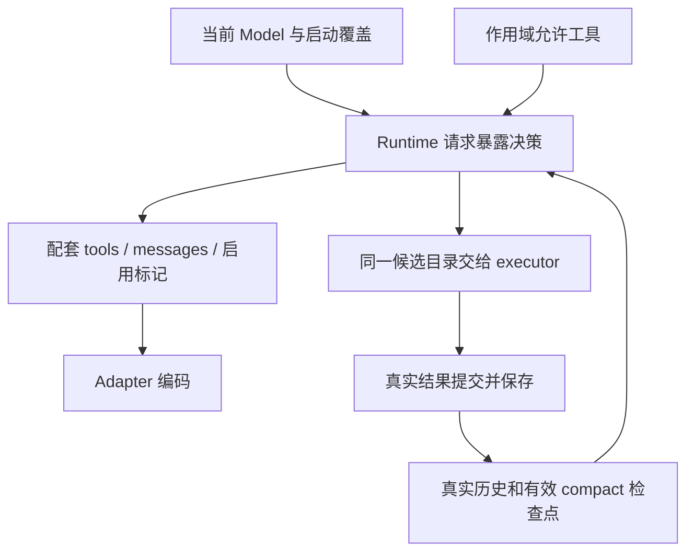

# ToolSearch：启用、持久化与冷恢复

## App Settings 模式

常规设置提供 `toolSearchMode: auto | local | off`，缺省 `off`。`auto` 按每次请求的
实际 Model 决定 Native/Local；`local` 固定走 Local，沿用能力校验；`off` 使用全量工具。
CLI 四值参数及默认 Off 不变，独立 CLI 不读取 App Settings。

工具搜索设置行底部常驻显示实验性说明：模型供应商未完整支持原生 ToolSearch 时，
使用原生模式可能导致缓存失效并增加 Token 用量。中英文文案含义一致，复用设置行的底部
说明区域与主题文字样式。缺省 Off 不覆盖用户已保存的 Auto/Local 选择，不改变现有生效时机。

```text
Settings -> Host SettingService / setting.json
  -> session/requestRuntimePreferences (runtime-materialization)
  -> 创建或冷恢复时固定 runtimeConfig.toolSearch.mode
  -> 现有请求投影、工具执行和子 Agent 继承
```

设置修改只写 App 设置，不广播运行态策略。已有 Runtime（包括预创建草稿、热 resume）
保持原值；新建和冷恢复读取最新值。fork 继承父 Runtime 策略，子 Agent 沿现有链路继承。
本地、desktop-attached remote 和手机 shared-host 使用所属 Host 的同一设置权威源，
不增加 RPC、逐轮读取、session 模式持久化或数据库 migration。旧 Host 响应缺省字段按 Off。
桌面 continuous 与手机 replayable 的交付边界保持不变。

验收：三值读写及非法值拒绝；旧设置/协议缺省 Off；新建/冷恢复读取新值、热恢复不变；
fork/子 Agent 继承；本地/远程 Host 透传。Desktop E2E 通过真实设置 UI 保存并检查最终
provider wire：Off 全量、Auto 的 Coding Plan Native 与普通 provider Local、显式 Local
搜索和包装调用成功，以及修改后当前会话保持原值、冷恢复按新值投影已有引用。

验证（2026-09-23）：macOS Electron TS11 通过，报告
`packages/desktop/.e2e-artifacts/desktop-e2e-20260923134550055-p73032-ec695c13f4b1f2a3/summary.md`。
App 相关单测 229 项、Core 回归 23 项、CLI 参数 13 项通过；Bootstrap 109/111，
两项 Cron denylist / Account Config 失败在 HEAD 原版实现同样复现。根及 Bootstrap
typecheck、根 lint、架构检查通过；CLI 聚合脚本缺 turbo，使用包级检查，既有 max-lines
错误按此前约定排除后 lint 通过。改动格式检查通过，`services/src/node.ts` 仅增加一个字段，
保留该文件既有格式差异。手机真机、Windows/Linux 及真实远程工作区未运行；远程 Host 有单测，
新 E2E 保持 pending，未自动转正。

## Local ToolSearch 与三种请求投影

CLI 唯一入口为 `--toolsearch-mode auto|native|local|off`，移除 `--enable-toolsearch` 和
旧 force 值，不保留别名。未传参数默认为 off，所有 provider 使用完整工具目录。
显式 auto 按当前实际 Model 选择：Coding Plan Anthropic 使用 native，
其余支持普通工具调用的 Model 使用 local。显式 native/local 遇到不支持的能力在发送前报错。
CLI 启动覆盖支持 prompt/target/TUI/resume/continue，子 Agent 继承，不保存到 session 或用户配置。

Native 保持原生引用和已发现 deferred schema；Local 在两次 compact 之间固定发送常驻工具、ToolSearch 和
DeferredToolCall，普通搜索不会向 tools 加入目标 schema；成功 compact 的发现检查点将当前允许的
原 deferred 工具提升为本上下文的普通 tools。Off 发送完整目录并隐藏搜索控制工具。
无 deferred 工具或搜索控制工具不可用时关闭搜索并记录原因。ModelRequest.toolSearchEnabled
仅代表 Native 协议，不因 Local 开启而发送 beta/defer_loading/tool_reference。

Local 从同一份当前允许的 Model 工具目录，在真实结果位置展开连续引用：

```text
引用 A、引用 B -> <functions>
<function>{"description":"…","name":"A","parameters":{…}}</function>
<function>{"description":"…","name":"B","parameters":{…}}</function>
</functions>
```

不跨结果或中间文本合并；保留顺序和 Hook 文本，不输出空容器。失效引用沿用移除/占位规则。
原始历史和 state.metadata.modelContent 仍保存真实引用，不保存 schema 快照或重复展开正文。
最终投影参与 token 估算、缓存和媒体处理；不截断 schema JSON，不新增 schema reminder。
定义未变时搜索新增不改旧前缀；定义/权限/可用性真实变化可以改变投影。

请求准备先扫描有效发现集合，再以一个共用循环完成 Native/Local/Off 的引用投影；
Local 不再在通用过滤后单独扫描历史。未变化的 entry/message/content 复用不可变引用，
仅在删除或展开引用时复制对应结果。Local 的 schema 编码只在请求内按工具定义复用，
不同结果保持各自容器与顺序；下一请求重新读取定义，不引入跨请求缓存或失效状态。
公告收集时序与最终 provider render 的隔离拷贝保持原有合同。

DeferredToolCall 入参严格为 `{name: string, input: object}`，共用外层 callID。只接受当前
请求允许的 client-executed deferred 工具；常驻、alwaysLoad、控制工具和 provider 原生工具
不可转发。常驻目标返回普通工具错误并提示直接调用，不执行目标 Hook/审批/handler。
未搜索不是执行禁令，普通直接调用保持现有规则。包装解包后复用普通调用的调度、校验、
权限、Hook、超时、取消、后台任务、结果格式、媒体和 turn-stop，不递归运行第二套 executor。

```text
原始包装调用 -> 公共准入 -> 同 callID 的目标调用 + modelCallWrapper 标记
                       -> 内部历史 / 普通调度执行 / 目标事件 / SQLite
SQLite -> hydrate 目标调用与结果 -> 请求渲染时恢复原始包装 -> Model
```

内部调用与结果统一使用目标名称，包装标记仅为 `modelCallWrapper: "DeferredToolCall"`。
目标 part 从 pending 起在 metadata 保存该严格字面量，`tool` / `state.input` 保存原始目标
名称与内层参数；重存、历史复制和分支恢复必须保留。执行参数与历史隔离，Hook、审批和
handler 不得修改历史原始输入。不重复存储包装 input；删除开发阶段旧 modelToolCall 格式，
不保留兼容读取或数据迁移。准入失败只保存包装失败记录。
请求渲染在已有遍历中恢复包装调用及结果名，剥离内部标记；不新增历史扫描或 callID 缓存。
Todo 等业务判断直接使用内部目标身份；microcompact 用 sourceEntries 分类，仍用投影后的
消息估算 token。V4 以 scheduled 目标事件定稿工具行，迟到原始流不得覆盖已定稿输入；
桌面 continuous 与手机 replayable 使用同一目标行，不在各个 UI 消费者解包。
完整调用后断流可能没有 scheduled；V4 此时消费已有 tool_call_closed，在同一 callID
的工具行仍为 DeferredToolCall 时，仅用 Core 确认的目标名称和完整输入补齐展示身份。
不新增工具行、不重置状态、不提前更新 Todo/审批或执行状态；普通行、准入失败、缺少输入、
其他 ledger 状态、过期 turn 和父会话中的子 Agent 镜像事件不参与补齐。重复事件不重复更新。
原始模型流、参数预览及 Core 调度时序保持原状，不增加增量 JSON 解析或从展示数据反推权限。
工具名称、input、inputText 通过同一次完整 row upsert 交付，冷恢复仍由持久化目标 part 重建。
无需数据库表列或 migration。Native/Local/Off 切换只修改请求
投影，保留原始结果、公告及包装调用，不伪造直接调用。compact 保存发现名称、
重建名称公告；Local 用有效检查点提升当前允许的工具，保留尾部的引用继续投影，不合成搜索结果。
Explore 的 direct/embedded 两个白名单都包含搜索控制入口，保留原目标工具范围；缺少控制入口的自定义 scope 仍按既有规则关闭搜索。
纯 Continue 不刷新公告。Desktop continuous 与手机 replayable 保持原交付边界。

验收覆盖多引用与混合文本、六向模式切换、作用域/分类变化、直接和包装执行对照、并发/取消、
真实 SQLite 重开与新 Runtime 的 fork/rewind/compact 恢复、最终 wire 和稳定前缀。模拟 provider
测试不等于真实模型能力或缓存命中验证；不增加测试专用生产入口。

### 边界归一化验证（2026-09-23）

- 先复现历史标记丢失、重复 input 落盘和产品工具身份错误，再修改公共边界。定向回归共 43 个文件、678 项通过，包含真实 SQLite 重开、fork/rewind、参数修改隔离、Todo 提醒、microcompact 和 continuous/replayable 投影。
- macOS Local CLI/PTY E2E 5/5，通过真实 Anthropic/OpenAI HTTP 请求验证包装纠错、成功执行、紧凑 metadata、冷恢复和模式切换；报告 `packages/desktop/.e2e-artifacts/desktop-e2e-20260923083224384-p82053-9fe19005d39623fa/summary.md`。
- Desktop 默认 Off 与冷恢复用例通过，报告 `packages/desktop/.e2e-artifacts/desktop-e2e-20260923082900087-p78208-c6f3fa5bd67ce86b/summary.md`。该批次 Local 最初失败：新增 completed 断言发现旧 good fixture 使用不支持的 activeForm；修正为 priority 并补实际成功断言后，以上 Local 批次通过。不能用旧“仅有 result”的断言证明工具执行成功。
- 根及 CLI 各 package typecheck、Desktop E2E typecheck 通过；架构检查 0 违规。CLI 顶层脚本缺 turbo，使用 package 原脚本替代；全量 lint 仅有既有 max-lines 错误，按本任务已确认范围忽略该规则后受影响生产目录无 error。
- 未运行 Windows/Linux、手机真机 relay 或 Desktop Local 包装审批 UI；手机验证止于协议投影。未修改 UI 样式、工具权限、数据库结构或新增测试生产接口，pending 用例未转正。

### Local 初版验证记录（边界归一化之前）

- 定向 Core/Adapter/Bootstrap 40 文件、514/514；覆盖执行/审批/Hook/媒体/turn-stop、流式中断、Continue/compact、Memory/Explore、SQLite 重开/分支及最终 wire。
- CLI 单测 188/190；两个 provider registry 用例在 HEAD 原版 CLI 源码上同样失败。新模式参数、默认 off、旧参数拒绝及各入口传递断言通过。
- macOS 正式 WDIO 合并批次：9 spec、34/34（既有 29 项 + 新增 Local CLI/TUI 5 项）。报告：`packages/desktop/.e2e-artifacts/desktop-e2e-20260922160802850-p98628-e8d69b77464ad70e/summary.md`。新 spec 保持 pending，fixture/manifest 检查通过，未新增 Docker 准入。
- 根及 CLI typecheck 通过；根 lint 无 error；架构检查 0 违规；改动格式及 diff 检查通过。CLI 全量 lint 仍有既有 max-lines 失败，受影响生产目录排除该规则后无 error。
- CLI 全量套件未全绿：CUA 缺相邻 producer checkout，其他 provider/bootstrap/打包等用例也有失败或未结束，未全部完成基线归因。Core 五项非 ToolSearch 失败及上述 CLI 两项已在 HEAD 源码复现；定向复跑不再出现 ToolSearch 持久化超时。
- 真实第三方 Anthropic/OpenAI 尝试因已配置 API 连接拒绝（ECONNREFUSED）未取得响应；没有真实缓存 usage 证据。固定 tools/历史前缀断言不代表服务端缓存命中。
- 本轮未运行 Windows/Linux、手机真实 relay 或 Desktop Local 包装审批 UI；Desktop 无新增模式设置，默认 Off 的工具卡、恢复及切换 E2E 已运行。协议和 continuous/replayable 实现未修改。

## 边界与所有者

Native 模式使用工具引用协议。默认 off；显式 auto/native/local 的选择规则见上文。
Runtime 使用启动时确定的模式，子 Agent 继承，不写入 session；App 设置与 CLI 覆盖的来源见上文。
无 deferred 或必要控制工具
被禁用时恢复全量定义并记录原因。MCP 保持现有初始化；不实现异步就绪、搜索等待、
OpenAI 原生引用、auto:N 或历史调用自动补装。



Registry 保存完整工具，Runtime 唯一负责请求决策。候选经过 Model、可见性、allowlist/denylist、
主子作用域过滤。未提交/取消/丢弃结果不成为发现事实。改变 Model 时重建请求，正在执行请求不改写。

### 独立请求准备环节

`prepareRuntimeProviderRequest` 是主/子 Agent、Goal verifier、Memory Extraction/Dream 和
Compact 组装真实请求的共享入口。内部仅执行一次 ToolSearch 准备，再调用已有消息投影；
media 能力、聚合预算及各入口的执行/重试流程保持独立。

```text
本次 Model / 启动策略 / 作用域完整工具目录 / 原始 entries
  -> ToolSearch：启用判定、发现集合、schema 与历史引用/公告投影（不生成新公告）
  -> 消息投影（保留最新真实用户归属，按需追加验证/摘要 prompt）
  -> 配套 request { messages, tools, toolSearchEnabled }
  -> 既有 media 策略 -> Adapter
```

- 调用方必须提供未经过 deferred 裁剪的完整候选目录；旧位置不再重复准备。
  Registry 只补全候选工具的元数据，不扩张权限或作用域。
- 消息投影不再根据 Model 或启动配置猜测 ToolSearch 状态；纯展示/记录/估算投影不执行搜索准备。
- Goal 使用空工具目录自动降级；Memory 使用调度时的目录（不含 ToolSearch），保留原有
  model/启动覆盖边界，并在后续循环沿用准备后的工具与启用标记。Compact 保留自己的候选策略。
- 显式 native/local 的接口能力校验在发送前执行；不向原本未继承 flag 的辅助调用扩散覆盖。
- 准备结果包含 executor 使用的搜索 context，不生成或返回新公告，不写历史、DB 或全局状态。
  Compact/Memory/Goal 的请求投影不写回 Main。
- 历史引用、有效 compact 检查点和公告必须在内部 metadata 被移除前处理。异步消费者
  固定历史成员和 Model 快照；降级不修改 canonical 历史，不另建发现缓存。
- 同模型的传输重试复用配套请求；切换 Model 或重新选择 compact 历史时从原始输入重建。
- 回归覆盖首次无发现、权限/目录变化、重复准备防回归、公告顺序与原始历史隔离；
  使用真实 SQLite/runtime 验证搜索后 Goal 判定未完成不进入 fail-open complete，
  同时检查 Memory 多轮请求、Compact fallback 及现有冷恢复/provider 切换。
  Desktop continuous 与手机 replayable 的持久化/事件交付边界不变。

## 工具和协议

Model requestCapabilities.toolSearch 保存 protocolSupported/defaultEnabled；请求携带
toolSearchEnabled。ToolMetadata 增加 shouldDefer/alwaysLoad/searchHint；请求工具增加
deferLoading；模型内容增加严格的 `{type:"tool_reference",toolName:string}`。

内置常驻名单：Agent/AskUserQuestion/Bash/Edit/Glob/Grep/Read/ReportFindings/Skill/ToolSearch/Write。
只暴露当前已注册、作用域允许且满足原有可见性规则的工具；当前没有 ReportFindings 实现，
不因名单而新增工具。其余已注册内置工具统一在各自 metadata 声明 shouldDefer: true，
包括 ZCode 工作流（含 FillWorkflowHole）、ReplyToChannel、OffPeak、TodoRead、CronUpdate、js 和子 Agent 协作工具。
Task 兼容入口保持 providerVisible: false，不因 deferred 分类而进入请求或搜索目录。
不开启 ToolSearch 时保留完整工具集；开启时首轮只发送常驻定义，真实搜索发现后才追加
相应 deferred schema（Native）；Local 在真实结果位置展开定义并通过 DeferredToolCall 调用。权限、执行、灰度和 embedded search 筛选保持原状。
MCP 默认延迟，支持
server alwaysLoad 与 `_meta["anthropic/alwaysLoad"]`、`_meta["anthropic/searchHint"]`。
这些元数据不构成授权或官方信任。Provider 原生工具保持现有协议。

验收使用真实内置注册目录（含动态工厂、typed submit_result 和 js 分支）：检查首轮工具名单、
公告包含其余允许工具、执行 ToolSearch 后下一请求携带对应 schema 和 deferLoading，
关闭或禁用 ToolSearch 时恢复完整定义，Task 兼容入口仍不进入模型目录。

插件 `.mcp.json` 与 manifest 的 server `alwaysLoad` 由插件配置转换器统一解析并透传，
覆盖 stdio、普通 HTTP/SSE 和官方鉴权 HTTP 分支；仅接受布尔值，保留 false，
未配置或非布尔值沿用插件可选字段规则作为 undefined，不做字符串真值转换。
该字段只控制模型请求中的 schema 曝光，不改变 MCP 初始化、异步就绪、鉴权或权限。
回归覆盖各配置来源/transport，以及真实插件发现 → MCP 工具列表 → 注册 → 请求准备 →
Anthropic wire：无搜索历史时常驻工具有完整 schema 且不带 defer_loading，默认工具仍延迟。

App 的 `ZCodeAgentMcpServer` 类型与现有配置转换函数必须在 stdio/HTTP/SSE 中透传
布尔 `alwaysLoad`，保留 false；缺失或非布尔值不输出字段，不做真值转换。
回归从 App 转换入口验证 JSON 往返及严格协议 schema；Agent 接收端沿用现有透传。
当前 App 调用方是 MCP 设置页连接/状态查询，不新增普通会话创建的 MCP DTO 注入；
不修改持久化、MCP 初始化、Desktop continuous 或手机 replayable 边界。

输入 query:string、max_results?:number（默认 5，无额外整数范围）；支持 select:A,B、canonical/
alias、MCP 前缀、关键词和 +required。直接选择不截断；关键词只搜 deferred，精确名称可选常驻。
对模型的 JSON Schema 将 query 和 max_results 同时标为 required；
runtime schema 仍接受省略 max_results，沿既有执行链先补默认值 5，再校验 JSON Schema。
仅在 ToolSearch 导出 schema 上补齐声明，不改通用转换器或其他工具；wire 与 executor 分别验证。
搜索按分词、权重、稳定排序与去重生成结果。输出 matches/query/total_deferred_tools；成功模型结果为
有序引用，空匹配为文本。只读、并发安全、无外部副作用，复用权限/Hook/trace/预算/取消链。
未搜索不是执行禁令；未发现工具的参数校验失败提示先搜索加载定义。

内置 deferred 工具的 metadata.searchHint 采用以下检索材料，不改 provider description、
参数、排序权重或常驻工具；MCP 继续使用自身的 searchHint。

| 工具          | searchHint                                                  |
| ------------- | ----------------------------------------------------------- |
| WebFetch      | fetch and extract content from a URL                        |
| WebSearch     | search the web for current information                      |
| TodoWrite     | manage the session task checklist                           |
| EnterPlanMode | switch to plan mode to design an approach before coding     |
| ExitPlanMode  | present plan for approval and start coding (plan mode only) |
| TaskOutput    | read output/logs from a background task                     |
| TaskStop      | kill a running background task                              |
| SendMessage   | send messages to agent teammates                            |
| CronCreate    | schedule a recurring or one-shot prompt                     |
| CronList      | list active cron jobs                                       |
| CronDelete    | cancel a scheduled cron job                                 |

Native 发送常驻及已发现 deferred 的完整 schema，仅后者 deferLoading；其他工具只公告名称。
目录变化才追加增删公告。关闭去掉 ToolSearch/DeferredToolCall/公告/字段，删除引用块，空结果替换为
`[Tool references removed - tool search not enabled]`，保留 call/result 配对。开启时删除
不可用引用，空结果使用 tools no longer available 占位。所有删除仅作用于请求投影。
Adapter 原生输出 tool_reference/tool_name 和 defer_loading，禁止 JSON 字符串化，开启附加
advanced-tool-use-2025-11-20 beta，不用服务端搜索。媒体/缓存/token 估算消费同一最终投影。

结果预算对齐引用块语义：包含真实 `tool_reference` 的文本/引用数组，100 KB 预算只约束
文本，引用完整保留且顺序不变。初次序列化和 Hook 追加后使用同一投影；文本超限时给出
截断提示，不能把引用数组降级成工具名字符串。展示文本从最终块派生，字节统计仍按现有
文本序列化口径计入工具名，不因引用免于截断而漏记；`truncated` 仅反映实际文本裁剪。
普通文本、媒体和官方 CUA 的预算合同不变。不收紧 `max_results` 或 `select:`：大目录结果
仍可包含大量引用，对应 schema 进入后续请求。验收覆盖超过 100 KB 的真实 executor 输出、
超长 Hook 文本、最终 Anthropic wire，以及 completed part 原子保存与真实 SQLite 冷恢复。

### 模型可见文案

Native ToolSearch description、query/max_results 参数说明与名称增删/恢复公告使用固定文案。
不增加模型判断、实验配置或 runtime 状态。

- Native 描述保留 `<functions>` / `<function>` 的模型侧 schema 展开说明；客户端仍发送真实
  `tool_reference`，不合成 XML 或 tool call/result。
- 新增公告完整列名；恢复公告按 MCP server 汇总名称及数量，其他工具保留原名。
- 删除名称不超过 30 个时逐行列出，超过时按同样方式汇总；删除段后追加 ambient-context 提示。
- 各公告段用空行分隔，沿用 `<system-reminder>` 包装和现有增量 metadata。
- 恢复/删除公告只描述当前作用域内的可用性，不推断 MCP 断连、重连或其他变化原因。
  工具因本轮限制暂时隐藏时仍按现有增量逻辑公告；相同目录不重复追加。
  不增加 pending/failed/鉴权诊断、异步初始化或搜索等待。
- 只改变文案渲染：`增量事实 -> 文案 -> 既有提交/快照/请求投影`；纯 Continue 不生成公告。
  不改持久化、App 协议、Desktop continuous 或手机 replayable 交付边界。

Local 描述首句明确 deferred 工具通过 `DeferredToolCall` 调用；搜索与返回格式说明保持
原有 `<functions>` / `<function>` 结构，明确 `parameters` 描述的是包装调用的 `input`。
不再声称与 prompt 顶部工具列表具有相同编码，也不使用抽象的 classification 说明。
常驻工具仍直接调用。只保留一个简短的 TodoWrite `<example>`，展示顶层 `name` 和完整
`input`，不增加场景对白或 `<commentary>`；不要求已经加载的工具重搜。
示例按当前包装及目标工具 schema 校验，CLI/PTY E2E 检查 Local/auto 与冷恢复请求中的
实际 description，Native 完整文案由既有 wire 测试保护。本次只改 Local 描述，不改变结果
投影、调用参数、执行逻辑或重复搜索反馈；bench 行为收益需另行验证。

搜索语料使用经过 model contract 投影、包含 modelInstructions 的最终 description。
不因接口名称不同构造第二份搜索语料。已有工具说明不在此处重写；例如 TaskOutput 已采用
对应说明，Cron 则保留持久化 automation 等 ZCode 特有行为的描述。

验证固定完整 description/参数说明，以及新增、单个/多个恢复、MCP 分组、30/31 个删除名称
与混合增删正文；真实 Runtime -> Anthropic wire 检查文案和续写去重，继续复用 compact/SQLite 回归。

2026-09-17 文案验证：先复现 6 项旧文案失败；修改后 Node 24.14.0 下 10 文件 / 55 项通过。
提取 CC 原始函数独立比较，默认 description 及 120 组公告正文完全相同；仓库测试不依赖
本机 CC 文件。CLI/根目录 typecheck、根 lint（43 条既有 warning）、改动生产文件 lint、
格式和架构检查通过。本轮未重跑 Desktop/手机 E2E 或真实远端 provider。

Compact 开启采用 Read/ToolSearch/MCP 候选再过滤，关闭保留现有摘要策略，不新增摘要执行循环。
该分支必须同时满足当前 Model/flag、候选内 ToolSearch 可用及存在 deferred 工具；
ToolSearch 被禁用或候选全部 alwaysLoad 时，按普通工具目录（不计 ToolSearch）应用原阈值：
不超过 100 个保留完整定义，超过 100 个发送空工具目录。回归检查实际 Runtime compact 请求。

### 公告收集与续写时序

公告沿用 attachment 收集边界，由 Runtime 历史 owner 提交，
请求投影仅消费已有公告，不能在准备每次请求时追加提醒。

```text
正常输入 / 完整工具批次 -> 收集并提交公告 -> 复制原始请求快照 -> 请求投影
纯 max-token Continue -> 沿用快照，追加 Partial / Continue -> 请求投影
Compact 成功 -> 按保留历史重建公告 -> 替换上下文 -> 后续请求
```

- 正常提醒阶段与 Todo 一样跳过 output-token recovery；公告先进入 canonical 与 turn-local
  历史，再复制 requestEntries。纯 Continue 不调用公告生成器，已有公告随快照保留。
- 目录在纯 Continue 期间变化时，增删公告等待下一次正常收集；每次请求的 schema、
  引用、权限与启用判断仍执行。不扩展 MCP pending/failed/鉴权状态。
- Compact 在摘要成功后调用同一纯公告生成器：full 使用空保留历史，保留尾部的 compact
  使用 preservedEntries 比较。公告加入 postCompactReminderEntries；失败、取消或跳过不提交。
  Auto/Reactive 在 Continue 期间触发时同样重建，不依赖下一次正常提醒收集。
- Compact 公告读取继续执行的工具目录，不能使用摘要请求裁剪后的候选工具。
  内部 getContinuationTools 回调复用本轮工具作用域筛选；手动 compact 使用当前 Runtime/Model。
  不改变摘要工具策略，不为 scope 建立第二份状态。
- 公告仍是内存历史中的派生提醒，不新增持久化字段；冷启动首次正常收集时重建。
  已发现工具仍仅由真实引用和 compact 检查点恢复，P/C、App 协议及多端交付边界不变。
- 回归捕获真实 Runtime 的 Model 请求与 canonical 历史：连续三次续写及下一输入均只有一份
  首次公告；目录变化、正常工具批次、full/保留尾部/续写期间 compact、失败取消、scope、
  provider 切换及 SQLite 冷恢复均保持该边界，覆盖 streaming on/off 与最终 adapter 请求体。

### 公告增量记录

RuntimeMessageMetadata.toolSearchAnnouncement 仅记录本条公告的事实：

```ts
toolSearchAnnouncement?: {
  addedNames: readonly string[];
  removedNames: readonly string[];
  readdedNames: readonly string[];
};
```

三个数组始终存在、去重、排序；readdedNames 是 addedNames 的子集。
不保存完整目录 snapshot 或 addedLines；完整列名为 addedNames − readdedNames。
历史复制分别复制三个数组，不能共享可变引用。

```text
当前保留的增量公告
  -> 顺序 added / removed -> 当前已公告可用 A
  -> 合并 added - readded -> 曾完整列名 L
当前作用域：全部工具 T，deferred 工具 D
  -> added = (D - A) ∪ (D - L)
  -> readded = (D - A) ∩ L
  -> removed = A - T
  -> 同一计算结果生成正文与 metadata
```

正常收集和 compact 使用同一生成器，只扫描当前有效历史。正文按上面的模型可见文案渲染，
恢复可用单独提示；名称事实仍来自增量集合，不从公告文案推导状态。
没有变化不提交公告。
Bug 根因：旧 metadata 为全量目录但正文只列增量，compact 保留后一条时误以为旧名称仍在
上下文中；旧删除判断只看 deferred 集合，又会把仍常驻的工具公告为不可用。
增量事实支持尾部补列，删除改看完整工具池；deferred → alwaysLoad → deferred 不误报。

公告正文及增量 metadata 随隐藏 synthetic message/text part 持久化，使用既有 JSON
metadata，不新增 DB 表列、migration、session 缓存或公告检查点。正常收集先保存公告，
再提交 Runtime 历史和请求快照；纯 Continue 不新增公告。Compact 重建的公告随成功历史
替换保存，失败时与 summary 一起回滚。Fork/resume/rewind 沿用有效分支和 compact 边界，
原位恢复公告正文与严格校验的增量字段，目录未变时不再次宣告工具尚未加载。
公告接入 tool_search_announcement attachment/MCS，不支持时使用 user reminder，UI/transcript 隐藏；关闭 ToolSearch 仅在请求
投影中隐藏公告，不删除存储事实。真实 modelContent 与 preCompactDiscoveredTools 不变。
旧会话未存储的公告不回填、不从搜索结果推测，仍沿用原有首次收集重建；本次不扩展兼容策略。

```text
正常收集 / compact 成功 → 公告正文 + 增量 metadata → 现有 Session Store
                                                     ↓ 有效分支 / fork 边界
下一请求 ← 从公告推导增量 ← hydrate 原位恢复正文 + metadata
```

回归使用真实 SQLite：关闭并重开数据库、创建新 Runtime，覆盖搜索后 fork/冷恢复、
compact 后恢复、边界后的公告不继承、关闭 provider 投影及三次 Continue 不重复公告。
验收覆盖增删/恢复/仅保留恢复公告、增量尾部与连续 compact 的实际 Model 请求、历史副本隔离，
并用真实内置目录验证 checklist/cancel/active 与 +required 命中。临时 CC 纯函数差分验证
不成为仓库运行依赖；Desktop continuous 与手机 replayable 的现有边界保持不变。

本轮验证（2026-09-17）：

- 新契约先验证旧实现失败，再通过 5 文件 / 48 项测试。扩大 ToolSearch、continuation、compact、
  主子作用域和 wire 回归后，23 文件 / 233 项中 232 项通过；Explore 后台完成通知测试
  `can launch Explore in the background and inject completion on a later turn` 在
  `subagent-explore.test.ts:4424` 仍失败（期待没有 system-reminder 包装），通过隔离加载
  本轮修改前源码复现同一失败，未扩张本次修改范围。
- 生产公告生成器与提取的 CC FDs 在 729 条三步状态序列、各保留历史后缀及后继目录上做
  52,488 次比较全部一致。固定一个 deferred 工具维持启用；该验证不覆盖启用开关或 MCP 诊断。
- CLI 全包及根目录 typecheck、Desktop E2E typecheck、17 个修改文件格式检查、架构检查通过。
  根 lint 无错误、43 条既有 warning；core lint 仍有基线超行等问题。本轮 10 个生产文件
  前后同规则比较只命中 message-history 的既有 max-lines（445 → 455），无新增诊断类别。
- 现有 Desktop TS01/TS04 搜索、执行与冷恢复冒烟首次通过：
  `packages/desktop/.e2e-artifacts/desktop-e2e-20260917092805624-p37188-32ac7469c9f8c8f7/summary.md`。
  本轮未重跑真实 provider 或手机 UI；App/远控协议未改动。

## 持久化与恢复

不改 SQLite 表列/migration。终态 part 的 state.metadata.modelContent 可选保存有序 text/引用
数组，与 completed 同次 upsert；schemaVersion 保持 1。output 是展示文本，媒体沿用 attachments/
layout。不另存 loadedTools 或 schema。保存经过现有结果处理后的最终模型内容。
公共 metadata 解析也用于 error part，必须保留既有字符串 modelContent 的兼容性，避免 V4
transcript 冷恢复丢弃同一 metadata 中的 display。ToolSearch 写入与 hydrate 仍只接受严格校验的
文本/引用数组；字符串和失败结果不产生发现记录。
Cold hydrate 先选 active branch/有效 compact，按 callID/声明序恢复；合法 modelContent 优先，
缺失/损坏走媒体/output，损坏记录诊断。中断/失败不产生发现；不按当前 provider 提前清洗引用。

Compact 从原始有效历史与上一检查点合并真实发现名，写已有 preCompactDiscoveredTools，关闭期间
也保存。仅成功生效 boundary 参与恢复。live/cold 使用同一函数把 boundaryId/发现名挂到 summary
entry 内部 metadata，不进入正文、不伪造调用。复制/rewind/fork 保留 metadata，不扫描废弃分支。
请求取发现名与当前允许 deferred 的交集，使用当前 schema；发现记录不保证定义仍展开在上下文。

## 搜索结果提示与公告投影（2026-09-24）

本轮只补成功提示、参数错误指引、公告提醒投影和 MCP 短名称选择。定义快照、不可用工具
历史 schema 保留及其缓存稳定性延期单独实现；不增加 metadata 字段或 migration，不改变
当前 schema/引用过滤、启用条件、执行目录和权限。

```text
真实 ToolSearch 结果 → Native 引用过滤 → 有效结果 callID → 结果批次外 Tool loaded.
                   → Local 展开 → 结果内 Loaded 指引 / 已加载提醒
正常公告收集 → 原始 attachment + 增量 metadata → 持久化/恢复 → MCS 或 user reminder
```

Native 成功且投影后仍有有效引用的每条搜索结果，派生一条 `Tool loaded.`，位于 tool_result 外、
整批结果之后。Local 仅使用结果内的加载和调用指引，不追加外部提示（见下文逐项反馈合同）。
提示不写 canonical 历史或数据库，Off、错误、无匹配
及引用全部失效不生成。复用现有引用和消息遍历，保留媒体真实用户索引、sourceEntries 与缓存标记。
Continue 与 compact 过滤 query-local Continue 后重建请求记录时，复用本次引用投影已计算的
有效结果 callID 集合；成功提示的位置和数量与实际请求一致，不重新扫描引用或持久化提示。
回归同时检查实际 Model 请求、ModelRequest 事件及主轮状态快照，保留 Continue 不进入记录的规则。

参数校验失败且目标为当前未发现 deferred 工具时，在原有错误后以空行追加完整纠错段落：
说明定义尚未进入已发现集合，以及数组、数字、布尔值被当作字符串输出时会导致参数校验失败；
随后给出精确 `select:<canonicalName>`、重试指引和当前完整 input schema。
Native 使用公共段落；Local 在段落末尾另起一行保留 DeferredToolCall 调用说明。
回归断言完整段落及其与原始校验错误的拼接，不仅检查关键词。
未搜索不成为执行禁令；已发现/Off/不存在工具维持原有错误。

公告使用 `tool_search_announcement` attachment 来源参与既有 MCS 投影；不支持时输出
普通 system-reminder。正文只存一次，增量 metadata 冷恢复保留；仅有合法公告 metadata
的旧 synthetic 公告才适配，不推断用户正文。公告只列名称，不加载 schema，不引入 tool_addition、
nameOnlyAnnouncements 或 strippedReferences。Continue 不收集，成功 compact 才重建的时序不变。

select 优先 canonical/alias，未命中再匹配 MCP 原始短名和既有命名规则规范化后的短名；
多个 server 全部匹配且按目录顺序去重，不复制规范化规则，不改变排序、数量或作用域。

验收覆盖最终 wire 提示、混合/并行/失效引用、模式切换、MCS/非 MCS、真实 SQLite 冷恢复及
Continue/compact、不存在工具错误、MCP 同名/alias 冲突。Desktop continuous 和手机 replayable
交付边界不变，不修改 UI、auto-compact 估算或 MCP 连接生命周期。

## 影响面与验收

### E2E 正式准入（2026-09-18）

用户已确认本次及此前 8 个 ToolSearch spec 转正（29 项：7 Desktop、14 CLI/TUI、
8 Runtime/HTTP 集成）。保留原断言和执行入口，不改变生产实现，不增加测试专用生产接口。

模型响应移到各 spec 的 case-local provider fixture，manifest 的请求清单逐项镜像 fixture
的 id 和 metadata。Desktop 数据面代理与 CLI 的隔离 HTTP server 必须实际读取这些响应；
仅保存一份未被消费的 fixture 不算回放。动态目录、错误/取消及 streaming on/off 的阶段
选择继续由原测试 harness 编排，fixture 只拥有响应内容；未知响应 id 直接失败，不兜底。

```text
真实 UI / CLI / PTY / Runtime 输入 → 原测试 harness 识别请求阶段
    → case-local fixture 原样响应 → 产品工具执行 / SQLite / 请求投影
    → 既有 HTTP、UI 与原始历史断言
```

通过 fixture check、转正 dry run 与 apply 的事务审计后进入正式 direct-root 目录，
运行默认 E2E 验收并更新引用。修正准入所需的既有文档索引及生成统计，不放宽审计规则。
Docker preset 仍需额外的容器隔离验证，不将本次本地转正自动等同于 Docker 准入。

### 单测补齐合同（2026-09-18）

本轮只增加测试与文档。所有 E2E/单测均不得为测试修改生产实现、增加测试专用开关、
导出或注入入口；复用既有 executor、Hook、ModelFactory 与 SessionStore 契约。
发现产品缺陷时记录失败，不修改生产代码或放宽断言来使测试通过。

| 场景               | 必须断言                                                                                                                                                                                |
| ------------------ | --------------------------------------------------------------------------------------------------------------------------------------------------------------------------------------- |
| 执行边界           | 未发现的 deferred 工具合法调用仍执行且不生成发现；已发现工具参数错误不再提示搜索；关闭或缺失搜索 context 时 ToolSearch 失败且无引用                                                     |
| Hook 结果冷恢复    | 真实搜索经 PostToolUse 追加文本后，最终有序引用/文本与 completed 同次保存；关闭 SQLite、新 Runtime hydrate 后保持 callID/块顺序，首请求带原生引用与已发现 schema；覆盖 streaming on/off |
| 搜索细分输入       | 显式 MCP metadata 的分词、多项 required 的交集、正则特殊字符按字面匹配、名称/hint/description 竞争的完整排序与截断                                                                      |
| 开启时引用全部失效 | 保持 ToolSearch 开启且移除结果中所有目标时，空结果使用 tools no longer available 占位；保留 call/result 配对，原始历史与发现事实不变                                                    |

```text
真实 ToolSearch → PostToolUse 文本 → 既有结果处理 → completed part / SQLite
    → 关闭数据库 → 新 Runtime hydrate → 首个 Model 请求的引用 / schema
```

测试只编排 Model 响应和既有依赖，不替换结果处理、持久化或 hydrate 实现；不改变
App 协议、Desktop continuous、手机 replayable 或之前的 E2E 验收边界。

本轮新增 16 项单测（4 个测试文件），连同 ToolSearch、adapter wire、通用 executor、
hydrate、消息历史和 Memory 作用域回归共 19 文件 / 275 项通过。搜索相关采集文件行覆盖率
100%、分支覆盖率 97.09%；该数字不代表全仓覆盖率或所有功能分支均已覆盖。
根目录 typecheck、lint（0 error，43 条既有 warning）、新增测试 lint、格式与架构检查通过。
CLI 聚合 typecheck 因当前环境缺少 `turbo` 无法启动，改用工作区递归执行各 CLI 包的
`typecheck`，全部通过。本轮未重跑 E2E；此前 E2E 证据与平台边界保持不变。

未执行 codegraph 扫描（工具不可用）；源码核对 CLI/bootstrap/runtime/executor/adapter/storage/
hydrate/compact/subagent。App/TUI 复用展示，无新设置/队列；Desktop continuous 与手机 replayable
使用原链路，workspace 身份隔离不变。

| ID   | 已接受场景                    | 断言                                        |
| ---- | ----------------------------- | ------------------------------------------- |
| TS01 | 首次搜索并调用                | 首轮无未发现 schema，原生引用与后续定义配套 |
| TS02 | 自动/强制/provider 切换       | on/off/on 保留原历史，force 不支持接口报错  |
| TS03 | 搜索后重开 SQLite/runtime     | callID/块顺序/下一请求定义一致              |
| TS04 | 开启或关闭期间 compact 后冷启 | 有效 boundary 恢复发现                      |
| TS05 | rewind/fork/权限/目录变化     | 废弃分支和不可用工具不暴露                  |
| TS06 | 取消/并发/旧记录/坏字段       | 无幽灵发现，兼容旧恢复                      |
| TS07 | CLI 各入口及重启              | flag 本次生效，重启不带恢复 auto            |
| TS08 | Desktop/手机                  | 既有展示与交付边界不变                      |

先测试后代码。真实 SQLite 重开、新 runtime 和最终请求体是恢复验收面。真实 Coding Plan、force
非 Coding Plan Anthropic、Desktop E2E 分别记录证据，不以 mock 冒充 live。运行受影响单测、
typecheck、lint、格式、架构与相关 E2E；正式用例沿用 pending/review/promotion 流程。

Memory Extraction / Dream 沿用已有受限执行策略，ToolSearch 不在其可执行作用域内；请求保留完整普通工具 schema，并对继承历史中的引用做请求级降级，不修改 Main 历史。

## 实施验证（2026-09-15）

### 插件 MCP alwaysLoad 透传修复

修复前新增回归复现：布尔配置在插件转换中丢失，实际 Anthropic 请求缺少常驻工具。
修复后插件来源/transport 矩阵及本地真实 HTTP MCP → Anthropic wire 两条链路通过；
连同既有插件、鉴权、来源与 ToolSearch 测试，共 8 文件 / 113 项通过。
Adapters 与根目录 typecheck、根目录 lint、架构和改动文件格式检查通过。
修复前 Adapters 全量基线已有 58 项失败及 1 个加载失败的 suite；独立 lint 亦有既有问题，
本次修改文件仅保留原 max-lines 诊断，计数由 402 降至 401，未扩展修复无关问题。
未改 UI/协议、数据库或 MCP 初始化方式；本轮未重跑 Desktop/手机 UI 或真实 provider。

### 请求准备环节重构验证

- 先用真实 SQLite/runtime 和 Adapter 消息转换复现：搜索后无工具 Goal verifier 报错，目标被
  fail-open 保存为 complete；迁移共享准备入口后同一用例保持 active，真实引用及 callID 不变。
- 本轮 Core 相关回归 20 个文件、426 项通过，包含 Memory 多轮、主子作用域、Compact fallback、
  SQLite 冷恢复、provider 切换和输出 token continuation；Adapter wire/capability/MCP 9 项通过。
- Core 与根仓 typecheck、Desktop E2E typecheck、根仓 lint、架构检查、改动文件格式检查通过。
  Core 独立 lint 仍为修改前已有的 30 项 max-lines 错误和 10 项 warning；本轮改动文件仅命中
  Compact 原有的超行数和未使用变量诊断，无新增诊断。
- 现有 Desktop pending ToolSearch E2E 首次通过，搜索执行与重启恢复均成功。报告：
  `packages/desktop/.e2e-artifacts/desktop-e2e-20260915144451763-p6294-0cc136517acd90ac/summary.md`。
  未提升用例状态；本轮未重跑真实远端 Coding Plan/强制 provider 或手机实机 UI。

### 公告时序修复验证（2026-09-17）

- 修复前 Runtime 回归捕获首次请求、三次 Continue、下一输入的公告数为 `[1,1,1,1,4]`；
  修复后为 `[1,1,1,1,1]`，canonical 历史仅一份公告。streaming on/off 与原生 Anthropic
  wire body 均验证；SQLite 重开后首次请求及其三次续写同样不累积公告。
- 20 个相关测试文件、163 项通过；补跑既有权限/automation 相关 7 项通过。
  覆盖正常工具批次、目录变化、full/保留尾部/Auto/Reactive compact、失败取消及本轮 scope。
- 根仓与 CLI 各 package typecheck、架构和改动文件格式检查通过。CLI turbo 包装命令因
  本地缺少 turbo 无法启动，改为 pnpm 逐 package 执行 typecheck，全部成功。
- 根仓 lint 0 error、43 条原有 warning；CLI 改动文件单独 lint 与修改前快照对照均为
  4 项既有 max-lines error、2 条既有未使用变量 warning，无新增诊断类别或文件。
- Desktop pending ToolSearch 搜索/执行/重启恢复冒烟通过，未提升用例状态。报告：
  `packages/desktop/.e2e-artifacts/desktop-e2e-20260917034554193-p29480-01ab7933dc1352e5/summary.md`。
  本轮未单独运行手机实机 UI 或真实远端 provider；未改多端交付协议、数据库或 P/C 规则。

### 初版能力验证

- 新增搜索语义、暴露决策、并发/取消、子 Agent、SQLite 冷恢复、MCP metadata、原生 wire body 和 CLI 入口测试。
  SQLite 用例覆盖 stream on/off、force 启动后不带 flag 重启、关闭期间 compact、真实 atomic fork 后重开数据库。
- Core 相关回归：276 项中 275 通过；唯一失败为原有 Explore 后台通知 wrapper 断言。导出 HEAD 源码复测同例也失败（42 项中 41 通过）。
- Adapter 相关回归：42 项全部通过，包括媒体降级仍保留原生引用。CLI：184 项中 182 通过；两个 provider registry 精确参数断言在 HEAD 同样失败（177 项中 175 通过），本次新增 7 项均通过。
- 根仓按改动源文件运行 Vitest related：965 个测试文件、10,376 项通过，6 项跳过。额外验证 continuous/shared-host/replayable 相关 91 项全部通过；手机实机 UI 未运行。
- Desktop pending E2E 已通过。用例检查首请求、原生引用、延迟 schema、TodoWrite 成功结果、重启后的 ToolSearch 卡片及下一请求；mock 使用现有 HTTPS capture proxy，不修改签名要求。
  最终 artifact：`packages/desktop/.e2e-artifacts/desktop-e2e-20260915120842415-p20103-a333174b85e72492/summary.md`。
  用例仍处于 pending，未经人工评审不提升为正式用例。
- 真实网络闭环：BigModel Coding Plan API（GLM-5.3，自动开启）和 ZAPI Anthropic（GLM-5.3，CLI --enable-toolsearch）均返回成功。
  两者 SQLite 中均有 completed ToolSearch、原生 TodoWrite 引用及 completed TodoWrite；使用隔离配置和既有凭据，未修改用户设置。
  可核对 `.cache/toolsearch-verification/20260915/live-results.json` 与同目录两份 SQLite。
- 根仓 typecheck、Agent contracts/core/adapters/bootstrap/cli typecheck、根仓 lint 和架构检查通过（0 架构违规）。
  根 lint 原本排除 CLI；额外移除排除后当前和 HEAD 均为 13 项已有 max-lines 错误、6 项已有 warning，无新增违规类别/文件。
  `pnpm --dir apps/zcode-cli` 的 turbo 包装脚本因本地无 turbo 不可用，改为逐包执行以上检查。
- 全仓 fmt:check 因已有未格式化内容及 docs/electron 示例 HTML 语法错误未通过；本次全部改动文件格式检查通过，git diff --check 通过。
  affected runner 只比较提交，HEAD..HEAD 会跳过未提交内容，因此使用显式 changed source 的 Vitest related，未将跳过算作测试通过。

复跑 Desktop：

```bash
ZCODE_E2E_MANUAL_REVIEW=1 pnpm --filter @zcode/desktop test:e2e -- --spec test/e2e/conversation-session/manual-review/pending/conversation-session-toolsearch.test.ts
```

### 提交前复核（2026-09-17）

- 当前源码复跑 ToolSearch / MCP / transcript hydration：15 文件、138 项通过；shared MCP 配置
  18 项通过。此前同版源码的 continuation、compact、SQLite、主子作用域等回归保持有效。
- Desktop TS01/TS04 冒烟一次通过，覆盖实际搜索、延迟 schema、TodoWrite 执行和重启恢复；
  provider 使用 mock，不将其计作真实网络验证。报告：
  `packages/desktop/.e2e-artifacts/desktop-e2e-20260917124733222-p7632-d2b8d8eb7bd890d7/summary.md`。
- 独立复跑真实 BigModel Coding Plan 自动开启和 ZAPI Anthropic 强制开启，两条路径均成功。
  SQLite 均确认 completed ToolSearch、TodoWrite 原生引用和 completed TodoWrite；结果及数据库：
  `.cache/toolsearch-verification/20260917-ship/`。使用隔离配置，未修改用户设置。
- 根目录、受影响 CLI 包及 Desktop E2E typecheck 通过；CLI 聚合命令缺少本地 turbo，使用逐包
  typecheck。根 lint 为 0 error / 43 条既有 warning；架构检查 0 违规；全部 106 个改动文件
  格式检查及 git diff --check 通过。此前记录的全仓格式和 CLI lint 基线问题未纳入本次修改。
- 本次未运行手机实机及 Windows/Linux 验证；没有修改 continuous/replayable 状态机。
  E2E 保留 pending 状态，不进行未经人工评审的用例提升。

### E2E 补齐边界（2026-09-18）

补充真实 CLI process 与 Desktop 请求级验收，场景以根目录 `docs/testing/conversation-session-e2e-coverage-matrix.md` 的 TS 子场景为准。冷恢复检查第一条请求；provider 降级请求也必须被捕获，不能用“包含 ToolSearch schema”筛选而漏掉关闭分支。测试 provider 只编排响应，不注入 Runtime 历史或已发现集合。新增候选保持 pending，运行结果不与既有单测混计。

本轮最终完整批次 6 个 spec、20/20 通过（新增 19 个场景），报告 `packages/desktop/.e2e-artifacts/desktop-e2e-20260917170825511-p87277-d34516349bddc10a/summary.md`。受控 provider，不代表所有平台/入口已覆盖；当前缺口以根目录 coverage matrix 为准。

后续新增 TUI PTY 1 项与目录/连续 compact/分类变化 Runtime/HTTP 集成 8 项（streaming on/off）。
macOS 正式 WDIO 合并回归 29/29，最终 TUI helper 单独复验 1/1；Windows 原生进程批次
22/22（14 CLI/TUI E2E + 8 集成），不代表 Windows Electron GUI。报告及剩余边界见根目录
coverage matrix 的“后续补测结果”。仅测试目录使用 registry 注入构造动态目录，未新增 MCP
热更新产品能力；手机 shared-host/replayable UI 仍待登录配对环境。

### E2E 转正验证（2026-09-18）

本次及此前 8 个 ToolSearch spec 全部转入正式目录，fixture/check/promote 事务审计通过。
正式默认 E2E 入口 29/29 通过，无失败或跳过；报告为
`packages/desktop/.e2e-artifacts/desktop-e2e-20260918072918357-p60083-5a0baf60295a16ca/summary.md`。
模型响应实际读取 8 份 case-local JSON；阶段选择与取消时序仍由原 harness 驱动。
仅测试和文档改动，未修改生产代码。没有新增 Docker 准入；Windows/手机边界见根目录 matrix。

## Local 逐项反馈与 compact 后提升

Local 按当前有效历史顺序判断定义是否已经可见；比较 canonical 名称，不要求连续搜索。
真实用户输入与其他工具调用不清空已加载集合。同一 assistant 批次的所有搜索使用批次前集合，
不把并行兄弟结果视为已经交付给模型。未来结果不能反向改变此前反馈。

| 搜索结果                      | tool_result 投影                        | 结果批次后 |
| ----------------------------- | --------------------------------------- | ---------- |
| A、B 均为未加载 deferred      | A、B schema + 合并 Loaded 调用指引      | 无提示     |
| A 为已加载 deferred，B 未加载 | B schema + B Loaded 指引 + A 已加载提醒 | 无提示     |
| A、B 均为已加载 deferred      | 合并提醒，无重复 schema                 | 无提示     |
| A 常驻（含 compact 提升）     | A schema，仍直接调用                    | 无提示     |
| A 常驻、B 为已加载 deferred   | A schema + B 已加载提醒                 | 无提示     |
| 错误、无匹配、全部引用失效    | 原有文本/错误/占位                      | 无提示     |

Local 反馈全部位于 tool_result 内，不再派生结果外的 `Tool loaded.`；Native 仍按有效成功
结果在整批 tool_result 后追加该提示。现有引用投影只为 Native 收集外部成功提示 callID，
实际请求、Continue 和 compact 记录重建共用同一集合；不改变发现集合、成功状态或持久化。
提醒在该结果内按名称去重一次，说明定义已经可见，使用 `DeferredToolCall {name,input}` 执行，
搜索本身不会执行工具。提醒文本使用公共 `<system-reminder>` 包装，仍属于当前 tool_result，
不生成 attachment 或独立 system 消息；MCS 开关不改变其位置、角色或 `Tool loaded.` 规则。
首次实际展开 deferred 定义时，也在同一 tool_result 的 functions 内容之后追加一条调用指引：

```text
<system-reminder>
Loaded: TodoWrite. Call it now with DeferredToolCall {"name":"<tool name>","input":{...}}, using the exact tool name and filling input according to its schema above. No additional ToolSearch is needed before calling these tools.
</system-reminder>
```

多个新增工具仅调整开头为 `Call them now`，其余模板保持相同：

```text
<system-reminder>
Loaded: TodoWrite, WebFetch. Call them now with DeferredToolCall {"name":"<tool name>","input":{...}}, using the exact tool name and filling input according to its schema above. No additional ToolSearch is needed before calling these tools.
</system-reminder>
```

名称仅包含本次实际展开的 deferred 工具，按引用顺序去重并合并一条；`input` 占位需要按
对应 schema 填写。常驻、compact 提升、失效引用和失败结果不生成此指引。混合新旧结果先给出
新增定义的指引，再保留原来的已加载提醒；纯重复结果只有已加载提醒，不追加 `Tool loaded.`。
只在现有引用投影中派生，不新增历史遍历或持久化字段；后续请求、Continue 和冷恢复重新投影
时不累积。文案直接引导下一步执行，但不自动发起调用，也不承诺定义永不失效。Native/Off 保持原状。
连续的新定义共用 functions 容器，不跨文本或结果合并；Hook 原序保留，
不能通过匹配 Hook 中的 functions 文本判断是否加载成功。常驻精确名称、alias、select 选择
仍正常返回 schema；关键词只搜索当前 deferred 分类。

```text
有效历史 -> 发现扫描（发现集合 + compact 检查点）
         -> 当前作用域分类（Local 提升检查点内原 deferred）
         -> 引用投影（批次前可见集合 -> schema + Loaded 指引 / 已加载提醒）
         -> 请求渲染 / Continue / compact 记录重建
成功 compact -> 新检查点 + 保留尾部 -> 重建公告 -> 提交历史 -> 下次请求普通 tools
```

提升只作用于 Local 当前上下文：检查点名称与当前允许、可用的原 deferred 目录求交集，
普通 schema 不带 defer_loading。曝光、关键词搜索、公告和包装准入共用分类；已提升工具
包装调用沿用“直接调用”错误且不执行目标。所有 deferred 已提升时仍保留 Local 两个控制入口。
提升依据成功生效的检查点，full/tail compact 一致，失败/取消不提交。新搜索直到下次 compact
才提升。不修改 registry、alwaysLoad、权限或历史包装调用。

原始结果仍存完整真实引用；请求投影决定去重和提醒，不增加 DB 字段、schema 快照、session
状态、跨请求缓存或全历史遍历。Native/Off 不变。冷恢复、fork、rewind 使用有效分支检查点；
Local/Native/Off 切换仍不承诺缓存连续。保留定义变化/工具消失的既有过滤行为，不实现
unavailable schema 保留，不调整 UI、auto-compact 估算或多端交付边界。

验收：组合表、并行/非连续/alias/短名、Hook 保序、失效引用、前缀稳定、提升后的普通调用与
包装拒绝（零执行）、全量提升、作用域、Continue/compact 成败取消、SQLite 冷恢复和分支。
真实进程 E2E 输出 model-io，再用 prompt trajectory 检查数量、位置和配对；模拟前缀断言
不能代替真实 bench 的任务成功率、重复搜索率或服务端 cache usage。

### 本轮验证（2026-09-28）

- 2026-09-29 Local 移除结果外提示：调整断言先复现 18 项失败；实现后 Core ToolSearch
  186 项、adapter wire 5 项通过。WDIO 31 项中 30 项通过，覆盖 Native/Local、两种接口、
  streaming、MCS、模式切换、SQLite 冷恢复及 Continue/Auto/Reactive compact 请求记录。
  TS10-TUI 独立复验仍超时：终端确认 `/model` 和 `/effort disabled` 均成功，随后普通 prompt
  被既有登录检查拦截，提示 `Model not set, send /login to login.`，Mock 收到 0 次请求。
  未进入搜索阶段，未改动该路径，不能将本轮 E2E 报为全绿。主报告：
  `packages/desktop/.e2e-artifacts/desktop-e2e-20260929-150638-717/summary.md`；复验：
  `packages/desktop/.e2e-artifacts/desktop-e2e-20260929-151813-512/summary.md`。
  主报告同目录的 `prompt-trajectory/` 与 `trajectory-audit.json`：34 次真实主请求严格转换，
  Local 外部提示为零，内部指引保留；仅 compact 分段，call/result 完整配对。
  根/CLI/E2E typecheck、根 lint、改动代码格式及架构检查通过；CLI lint 被既有 max-lines
  阻塞。未跑其他操作系统、手机实机或远端 bench，不声称真实模型重复搜索率改善。

- 2026-09-29 首搜调用指引：新增断言先出现 7 项失败，实现后 Core ToolSearch 186 项、
  adapter wire 5 项通过，TS13 真实进程 E2E 4/4。严格转换实际 model-io 的 34 次主请求，
  普通/冷恢复保持连续，仅 compact 处分段；提醒内容、位置及 call/result 配对均通过。
  报告与轨迹：`packages/desktop/.e2e-artifacts/desktop-e2e-20260929-144809-083/`。
  根/CLI/E2E 类型检查、根 lint、改动代码格式及架构检查通过；CLI lint 仍有既有 max-lines。
  未运行 Windows/Linux/手机真机或远端 bench，不据此推断重复搜索率或真实缓存命中。

- 内联提醒包装补充验证：MCS 开/关两条新增断言先失败；修复后相关 6 个测试文件、107 项通过，
  TS13 真实进程 E2E 4/4。新 model-io 经严格转换后 34 次主请求仅在 compact 处分段，
  提醒标签位于原 tool_result 内，call/result 完整配对。报告与轨迹：
  `packages/desktop/.e2e-artifacts/desktop-e2e-20260928080047472-p86891-f421a8f3bd4c6de0/`。
- 先运行新增失败断言，旧实现 9 项失败；最终 Node 24.14.0 下 Core 33 个文件、391 项通过，
  覆盖 ToolSearch、Continue/记录、compact 成败取消、SQLite 冷恢复/提升后 fork/rewind 和媒体回归。
- macOS 正式 WDIO：4 个 spec、31/31。新增 TS13 四项保留 pending；既有 TS10/TS12 共 27 项回归通过。
  CLI on 覆盖真实进程退出/重开 SQLite；streaming off 与显式 compact 使用真实 Runtime 子进程/HTTP。
  报告：`packages/desktop/.e2e-artifacts/desktop-e2e-20260928-062536-147/summary.md`。
- 四组新 model-io 经 prompt-trajectory 严格转换（未开启 ignore-tool-search-changes），34 次主请求，
  仅 compact 场景各两次 `post-compaction` 分段，无非预期 non-incremental-change，调用/结果全部配对。
  复核脚本和结果：同报告目录的 `audit-local-feedback.mjs`、`trajectory-audit.json`、`prompt-trajectories/`。
- CLI（从根目录 turbo 入口，30 项任务）和根目录 typecheck 通过；根 lint、架构、E2E fixture 校验、
  conversation 覆盖索引审计、改动代码/fixture 格式及 diff whitespace 检查通过。
- CLI 全量 lint 仍被已有 max-lines 等诊断阻塞；本轮涉及 compact-active 的既有超行数和
  executionMaxOutputTokens 未使用诊断未顺带处理。根 fmt:check 扫描到既有文档/隐藏工作树中的
  HTML 语法及二进制问题；两个目录索引的已有排版问题保留，只格式化新增段落以免扩大 diff。
  完整检查输出保存在报告目录 `validation/`，不宣称全仓门禁全部通过。
- 未运行 Windows/Linux、手机真机或真实 provider。用户确认 bench 位于本机不可访问的局域网机器；
  重复搜索率、任务成功率、token 开销及服务端 cache usage 待该环境验证。受控响应不证明模型会减少搜索。
- 生产变更仅 4 个文件，不新增测试生产接口、数据库字段或 UI/多端链路。未提交、未推送。
