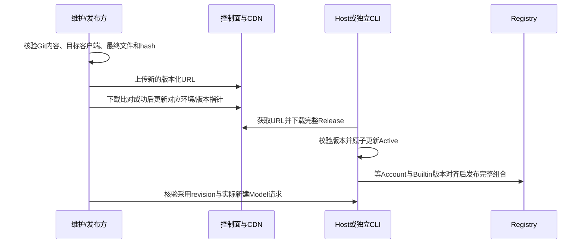

# MR、版本与动态配置交付

本页解释模板/模型配置怎样交付，不授权维护者自动发布。创建 MR、合并、版本发布、修改在线配置指针是不同动作，各自保留结果和责任。

## Git 与 MR

正式配置是唯一编辑源，测试配置和必要文档/测试同一 MR 提交。内容变更使用新的 revision；两份环境文件保持相同 revision，但内容按各自环境派生。合并冲突后重新检查上游最新 revision，不能只解决文本冲突而复用已经被不同内容占用的版本号。

MR 说明至少列出模板与型号增删、默认启停、能力/Map/URL 的具体差异、正式/测试派生结果、官方证据、真实验证及缺口、旧实例/选择影响、交付方式与回退方案。内容按以下五章组织：

| 章节       | 本领域应说明的内容                                                                                     |
| ---------- | ------------------------------------------------------------------------------------------------------ |
| TL;DR      | 具体问题与改变后的行为；真实文件数及增删行数                                                           |
| 目标       | 背景、原有行为、接入或修正的入口/型号、设计意图和验收条件；bugfix 附根因证据、反馈关联与本目录工作记录 |
| 改动范围   | 正式/测试配置、代码、测试、本目录规范与库存的实际变化，以及非目标                                      |
| 验证       | 实际命令及结果，Key/地区/套餐/协议矩阵，未验证项；bugfix 对应回归用例，有交互变化时附证据              |
| 风险与回滚 | 旧实例、个人覆盖、目标客户端版本、上线方式和恢复方案                                                   |

提交标题采用 `<type>(<scope>): <subject>`，例如文档整理使用 `docs(provider)`；内容变更与纯文档区分。文件规模来自 `git diff --shortstat origin/staging...HEAD`，描述契约以仓库 `zcode-mr` skill 为准，不能编造根因、反馈关联或验证结果。

创建/更新 MR 使用仓库 `zcode-mr` 工具：在干净的特性分支先运行 `python3 .agents/skills/zcode-mr/scripts/zcode_git_workflow.py setup` 检查认证，将五章描述写入临时 UTF-8 文件，再运行 `python3 .agents/skills/zcode-mr/scripts/zcode_git_workflow.py mr --description-file <描述文件> staging`。工具会保留 push hook、查找同源/目标 MR 并只在缺少时创建。检查返回的真实 MR URL；仅生成预填链接不算创建成功。已有 MR 的正文变化还需通过 glab 更新并核对。认证失败保留本地成果，不把凭据写入描述或命令。

普通目录改动走配置 MR；新协议、Access、Adapter、Logo 资源或 UI 行为需要对应代码和测试，不能以“只是模型更新”省略检查。缺 Key 的变更在 MR 中清楚保留待验证，是否接受例外由负责角色明确决定。

## 选择交付方式

| 情况                                                              | 交付方式与条件                                                                |
| ----------------------------------------------------------------- | ----------------------------------------------------------------------------- |
| 常规模板/模型维护                                                 | 随产品版本携带完整配置，验证最终包资源                                        |
| 仅使用目标客户端已经支持的字段、协议和能力，确需提前更新目录/规则 | 可评估动态配置；仍来自已审查 Git 内容和最终文件验证                           |
| 新 Schema/Access/协议、Adapter 行为、图片资源或 UI 能力           | 先交付客户端能力；不能仅推 JSON 给旧客户端                                    |
| 已上线内容错误                                                    | 纠正后的内容以更高 revision 发布；同时修复 Git/包内基线，避免两条链路长期分叉 |

`schemaVersion=1` 相同不证明所有旧客户端都理解新字段、值或 Map。动态更新前对目标产品版本/平台确认实际 decoder、Adapter 和已知行为；不得只在开发分支验证。灰度、版本分流、执行人和权限以实际控制面为准，本仓库未提供可假定存在的一键配置发布/自动回滚工具。

## 随版本交付

1. 合并后的正式源和派生测试源分别通过检查。
2. 按真实 `ZCODE_ENV` 构建，检查实际包内/嵌入内容的 revision、hash 和目标模板，不只看源码。环境选源、Desktop/CLI/SEA/Server 资源位置及缓存要求见本目录[配置规范](./configuration.md#构建选源与最终资源)。
3. 记录包含该提交的产品版本与测试/生产产物，确认安装后目标 Host 采用的配置；已有更高 revision 的有效缓存可能继续优先，不能仅因包升级就推断生效。
4. 按本次变更检查新增实例与已有继承实例、个人覆盖和模型实际请求。记录未覆盖的平台/远程模式。

## 必要时动态上线

现有客户端使用两阶段下载：控制面 `/api/v1/client/configs` 按 app_version/platform 返回 `data.configs.builtin_provider_config_json`，该字段是 HTTPS 下载 URL；URL 内容是完整 Release。没有该字段表示本次无发布，不清空已有配置。

操作顺序：

1. 确认必要性、目标客户端/平台、正式或测试环境、发布责任与授权，记录前一内容和恢复方案。
2. 从待交付 Git 内容准备最终文件，对该文件执行 Decoder、完整性及本次规则/请求验证，记录 hash。正式与测试分别验证和投递；同 revision 的两份文件不可混用。
3. 上传**新的 URL**，下载后核对 hash/完整内容，再切换对应控制面指针。不覆盖长期缓存的旧 URL，不临时在线手改 JSON 绕开 Git。
4. 验证实际客户端的下载结果、Active revision、完整 Registry 和后续创建 Model 的请求。成功下载不是成功采用，页面列表变化也不代表所有调用方已更新。
5. 观察受影响入口的鉴权、参数拒绝、工具流和用户反馈；按下述边界恢复。记录采用证据，更新工作项交付状态。

下载器限制 HTTPS、无 URL userinfo、无重定向，不携带账号 Token/Key；两次请求总预算 20 秒，正文按实际字节限制为 10,000,000。以[下载实现](../../packages/provider-node/src/zcode-builtin-download.ts)为准，不复制一套发布客户端。

## 生效与恢复边界

- 启动在兼容有效的包内/Active 候选中选较高 revision；在线低版本忽略，同版本同内容不变，同版本不同内容拒绝。启动遇到同号缓存内容冲突会回包内可信候选。
- Provider 与 Model 规则整体替换；结构合法不保证业务正确。下载失败保留基线，不承诺错误业务配置会自动回滚。
- Host/独立 CLI 持有刷新；每分钟检查、成功默认一小时后再下载，失败按分钟指数退避至一小时。手动 force 绕到期限制，不绕有效 lease。
- 缓存按平台、App 版本、控制面 Endpoint 隔离；换 CDN URL 不重置来源版本。测试/正式不能只凭相同 revision 判断内容一致。
- Managed Worker 不独立下载；手机使用目标 Host。Builtin 与 Account 未对齐时保留上一份完整 Registry，不能把状态混合发布。
- Personal 意图不被覆盖，已有执行 Model 不原地变更；不要承诺当前请求或所有存量运行立即切换。
- 回退发布**更高 revision 的已验证旧行为/纠正内容**。仅把 URL 指回低 revision 不能让已经升级的客户端回退；客户端代码不兼容则需要修正版客户端或经过验证的投放限制。

实现核验：[Release Source](../../packages/provider-node/src/zcode-builtin-provider-config-source.ts)、[刷新协调](../../packages/provider-node/src/zcode-builtin-remote-synchronizer.ts)、[Registry 版本配对](../../packages/provider/src/registry-service.ts)。本轮没有查询当前线上指针；任何历史线上 revision 都不能代替今天的生产状态。
