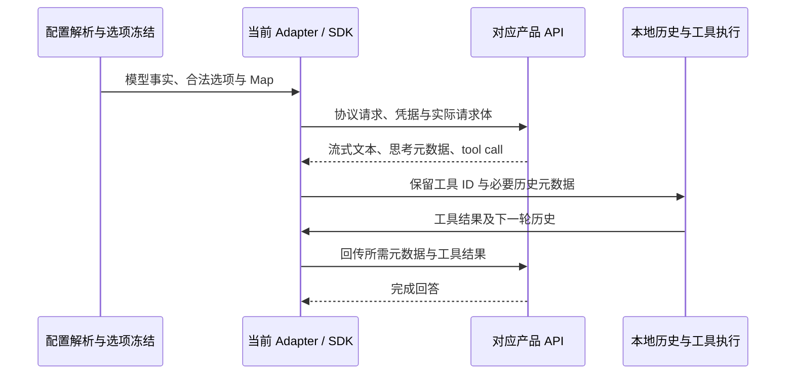

# 主流供应商与模型扩展计划（2026-10-14）

## 结论与证据边界

实施先补齐已维护供应商的新模型，再补聚合入口交集，随后按协议证据扩展腾讯 TokenHub、火山方舟等入口。已有入口的生命周期和目录偏差同步核验，涉及修改/删除时单列讨论，不作为独立新增的前置条件。Google 原生协议、Mistral 需要响应转换的路径暂缓；其他无需额外适配的入口均可推进。StepFun、SiliconFlow 随后推进；Azure、Bedrock 的兼容 API 单独验证，不再笼统归类为“必须开发新协议”。新增普通入口之外，还要补查已有品牌的编程套餐。

本页上半部分保留 2026-10-14 调研证据。随后确认的执行原则是：符合现有能力的新增直接推进，已有调整/删除先讨论。2026-10-15 进一步确认：需要额外适配的路径本轮全部暂缓，其他入口均可接入；批次只表示先后顺序。资料、Key 验证、配置实现、交付分别记录，分批实施见下文；早先的候选顺序不能覆盖后续明确决定。

- 检查日期：2026-10-14；仓库基线：staging `68fac8de4fcc`，Builtin revision 33，21 个模板、246 个模板成员条目，正式/测试配置同源。完整库存见[当前状态](./current-state.md)。
- 已做：阅读官方目录、发布及退役说明；匿名 GET 公开 Models API；运行仓库 Release 解码、规则解析及 Option Map 编译，查看真实生成的请求补丁。
- 未做：登录后目录查询、计费推理、套餐权益核验、桌面/远程真实工具循环。下文的“目录存在”不能写成“已支持”。
- 日期标注：明确的发布、生效和退役日期写在对应条目；未标注的页面仅记本次检查日，不推测发布日期。公开目录的 `created` 也不自动当发布日期。
- 取舍：已有用户使用量和新增供应商需求排名未取得；顺序依据 Agent 相关性、官方可接入性、当前缺口、失效风险和维护成本，属于工程建议。

## 第一优先：处理已有入口的风险

### MiniMax 需要在 10 月 19 日前完成迁移判断

[官方模型概览](https://platform.minimax.cn/docs/guides/models-intro)宣布 M2.5/M2.7 系列在 **2026-10-19 停止向新用户开放，2026-11-18 按量 API 正式下线**；套餐用户的旧名称从 10 月 19 日路由到 M3.1 Flash Preview。当前 `minimax` 模板仍默认启用 M2.7 及 highspeed，应优先核对普通 API 与套餐分别怎样处理。

`MiniMax-M3.1-Flash-Preview` 当前只通过 M Plan / MiniMax Code 提供，不能直接加入普通按量模板并声明可用。建议：

1. 由账号协作者核对 Key 产品、实际端点、套餐成员及旧名称路由。端点或凭据要求不同则拆模板；相同也要记录权益差异。
2. 普通 API 优先验证已列出的 M3 作为迁移候选；确认后调整旧系列的维护等级，保留历史选择处理，不静默改成另一模型。
3. 套餐若沿用旧 ID，必须按路由后的实际能力复核规则。`modelId` 没变，不代表思考参数和能力没变。
4. 截止日前未拿到 Key：保留明确的待验证状态和负责人，不把迁移完成写进当前状态。

[官方 Messages 参数说明](https://platform.minimax.cn/docs/api-reference/text-anthropic-api)明确：M3.1 Flash Preview 不允许关闭思考，支持 `low/medium/high/xhigh/max`；M3 的思考可关闭；M2.x 接受关闭参数但不真正关闭。当前规则对 M3.1 的离线解析仍给出 `disabled/enabled`，因此型号补齐必须伴随规则修正。文档使用新域名，仓库仍用旧域名；域名变更也要验证兼容性，不能仅因文档更新就替换用户入口。

### 聚合目录存在 10 个待核验的旧成员

本次不带 Key、不调用推理的 GET 结果：

| 公开目录                                                                                                         | HTTP / 条目数 | 对照结果                                                   |
| ---------------------------------------------------------------------------------------------------------------- | ------------- | ---------------------------------------------------------- |
| [OpenRouter Models](https://openrouter.ai/api/v1/models)                                                         | 200 / 462     | 当前 59 个成员中 4 个未出现在本次目录                      |
| [OpenCode Zen 旧目录](https://opencode.ai/zen/v1/models)、[新目录](https://opencode.ai/inference/v1/models)      | 均 200 / 85   | 两份 JSON 相同；现有 Zen 三协议模板的成员并集中有 6 个缺项 |
| [OpenCode Go 旧目录](https://opencode.ai/zen/go/v1/models)、[新目录](https://opencode.ai/inference/go/v1/models) | 均 200 / 40   | 两份 JSON 相同；现有 Go 三协议模板成员无缺项               |

| 入口         | 本次目录未列出的配置 ID                                                          | 当前默认状态       |
| ------------ | -------------------------------------------------------------------------------- | ------------------ |
| OpenRouter   | `qwen/qwen3.8-max`                                                               | 启用               |
| OpenRouter   | `openai/gpt-5.6`、`qwen/qwen3-vl-plus`、`qwen/qwen3-vl-flash`                    | 关闭               |
| Zen Messages | `qwen3.7-max` / `qwen3.7-plus`                                                   | 前者启用，后者关闭 |
| Zen Chat     | `hy3-free`、`ling-3.0-flash-fin-free`、`mimo-v2.5-free`、`nemotron-3-ultra-free` | 均启用             |

优先验证其中 **6 个默认启用成员**。一次公开目录缺项不足以证明推理入口失效：先用获授权账号确认目录、别名及请求结果，再决定关闭默认、保留兼容或移出模板。也不能把某入口下线扩散成所有供应商下线。

新旧 OpenCode **Models** 端点仍可读，不能据此强制迁移模板 URL，也不能据此断言新旧推理端点等价。[Go 接入说明](https://opencode.ai/v2/docs/console/go/)还要求每个会话提供稳定的 `x-opencode-session`。实施前检查当前请求是否满足；静态模板 Header 不能代替动态会话身份。若需运行时接线，单独说明并测试，不混入纯型号列表更新。

## 已维护供应商：增补和保留建议

下表覆盖当前官方品牌；聚合入口随后单列。除明确标注外，来源页未给统一发布日期。重点候选通过真实验证后才考虑默认启用；原重点模型是否降为一般维护另作显式决定。

| 对象        | 当前差异与建议                                                                                                                                                                                                                                  | 来源 / 时间                                                                                                                                                                                                                    |
| ----------- | ----------------------------------------------------------------------------------------------------------------------------------------------------------------------------------------------------------------------------------------------- | ------------------------------------------------------------------------------------------------------------------------------------------------------------------------------------------------------------------------------ |
| OpenAI      | 优先新增 `gpt-6.1-sol`、`gpt-6-luna`，分别补齐通用编程与低成本档；保留 Astra。`gpt-6-sol` 先按仍可用的上一代候选评估，不为版本齐全而全开。6.1 Sol 不支持 `none`；6 Luna 的 Chat 工具调用仅在无思考模式支持，现有官方 Responses 模板更适合先验证 | [6.1 Sol](https://developers.openai.com/api/docs/models/gpt-6.1-sol)、[6 Luna](https://developers.openai.com/api/docs/models/gpt-6-luna)；[变更记录](https://developers.openai.com/api/docs/changelog)记 6.1 Sol 于 09-29 发布 |
| Anthropic   | 新增 `claude-opus-5-5`、`claude-sonnet-5-5`、`claude-haiku-5-5`；保留 Fable 系列。Opus/Sonnet 的现有宽规则已覆盖 adaptive 五档，不必凭版本号重写；Haiku 5.5 需要独立规则。不要把 Sonnet 的 `between_tools` 伪装成完全关闭思考                   | [模型目录](https://platform.claude.com/docs/en/models/overview)、[思考强度](https://platform.claude.com/docs/en/build-with-claude/effort)                                                                                      |
| Z.AI        | 普通 API 候选 `glm-5.3-flashx`；补查普通模板缺少的 `glm-5.2`，后者可一般维护。FlashX 官方 ID 为小写，不能据展示名擅自换大小写；已保存旧 ID 不批量重命名。Coding Plan 单独证明权益                                                               | [目录](https://docs.z.ai/guides/overview/overview)、[Flash / FlashX](https://docs.z.ai/guides/vlm/glm-5.3-flash)                                                                                                               |
| BigModel    | 单独核对 FlashX、5.2 及套餐目录。已能读取中文官方模型正文，但本轮未取得与 Z.AI 对等的 FlashX 产品证据，不直接镜像新增                                                                                                                           | [官方模型说明](https://docs.bigmodel.cn/cn/guide/models/text/glm-5)                                                                                                                                                            |
| xAI         | 新增 `grok-4.7`：500,000 context、图像输入、`low/medium/high/xhigh`；验证 Responses 的推理历史与工具循环后，再决定 4.6 的默认状态                                                                                                               | [模型卡](https://docs.x.ai/developers/models/grok-4.7)、[推理协议](https://docs.x.ai/developers/model-capabilities/text/reasoning)                                                                                             |
| MiniMax     | 先完成上面的生命周期处理；M3.1 Flash Preview 作为套餐候选，普通 API 不盲加；M2.1/M2 不能因 M2.5/M2.7 的通知而一并宣布退役                                                                                                                       | [模型概览](https://platform.minimax.cn/docs/guides/models-intro)                                                                                                                                                               |
| Kimi        | 官方当前主线 K3、K2.7 Code、highspeed、K2.6 已在模板，无需补重复 ID。K2.8 Preview 在部分平台出现，须以该平台目录验证；不推导为原厂 API 可用。Kimi Coding 产品单独调查                                                                           | [官方目录](https://platform.kimi.com/docs/models)；K2.5 / moonshot-v1 原厂退役日期为 08-31，不能据此删除聚合入口同名成员                                                                                                       |
| DeepSeek    | 继续用 `deepseek-flash` 与 `deepseek-v4-pro`。前者已指向 V4.1 Flash，重点复核多模态、思考与旧别名；不新增一个猜测的原厂 `deepseek-v4.1-flash`                                                                                                   | [官方变更](https://api-docs.deepseek.com/updates/)：09-10 发布及别名路由；明确 V4 Pro 在 09-14 后继续提供服务                                                                                                                  |
| Qwen / 百炼 | 当前 3.8 Max/Flash 已覆盖主线；国内 Messages、国际 Chat 分开验证。3.8 Omni Flash 是额外多模态候选，先确认本产品输入/工具需求，音频输出和实时接口不自动进入对话模板。补查 Coding Plan 独立入口                                                   | [模型目录](https://help.aliyun.com/zh/model-studio/models)、[套餐 FAQ](https://help.aliyun.com/en/model-studio/coding-plan-faq)                                                                                                |
| MiMo        | revision 33 已补普通 API / Token Plan 双模板及 V2.6 Pro/Flash，本轮不重复新增。重点补真实验证、聚合入口的 V2.6，以及后续套餐成员变化                                                                                                            | [套餐接入](https://mimo.mi.com/docs/zh-CN/tokenplan/Token%20Plan/quick-access)、[Messages 接口](https://mimo.mi.com/docs/en-US/api/chat/anthropic-api)；本轮仓库已有实现                                                       |

OpenAI 的退役表还提供精确停用日期及 Models API 的 `shutdown_date`。本次读到 10-14 新公告涉及 GPT-4 系列；不能将其推导为当前 GPT-5/6 成员已停用。旧型号目录标签、停止新增用户、正式停用、聚合入口继续服务要分别记录。[官方退役说明](https://developers.openai.com/api/docs/deprecations)

### 聚合入口的增补清单

以下 ID 已出现在本次公开目录中，但未做 Messages / Chat / Responses 的逐项推理验证。保留各平台原始 ID；不要由原厂 ID 拼接推测。

| 入口         | 优先补充                                                                                                                                                                                                                      | 附加约束                                                                                                   |
| ------------ | ----------------------------------------------------------------------------------------------------------------------------------------------------------------------------------------------------------------------------- | ---------------------------------------------------------------------------------------------------------- |
| OpenRouter   | `openai/gpt-6.1-sol`、`openai/gpt-6-luna`；`anthropic/claude-opus-5.5`、`anthropic/claude-sonnet-5.5`、`anthropic/claude-haiku-5.5`；`x-ai/grok-4.7`；`z-ai/glm-5.3-flashx`；`xiaomi/mimo-v2.6-pro`、`xiaomi/mimo-v2.6-flash` | 当前模板是 Messages。逐个验证映射、输出与路由能力；`-pro`、`-ultraspeed` 另审，`:batch` 不进入普通对话模板 |
| OpenCode Zen | `gpt-6.1-sol`、`gpt-6-luna`、Claude 5.5 三项、`grok-4.7`、`mimo-v2.6-flash-free`                                                                                                                                              | 按官方协议表分配到现有三个模板；`-backup` 不是免费复制一条普通模型                                         |
| OpenCode Go  | `gpt-6-luna`、`claude-haiku-5-5`、`grok-4.7`、`mimo-v2.6-pro`、`mimo-v2.6-flash`                                                                                                                                              | Go 目录及套餐额度独立于 Zen；先确认当前 Key 可访问                                                         |

Google、Mistral、腾讯、StepFun 的聚合成员按既定范围原则及该入口的协议证据评估，满足新增条件即可推进，不再等待逐品牌批准；原厂直连暂缓不自动禁止兼容的聚合入口。本次目录已见 `google/gemini-4-argon`、`mistralai/mistral-large-4-0`、`tencent/hy4-preview`、`stepfun/step-5-preview`；这不代表所有对应原厂型号、协议和地区均已覆盖。Go 的 `gemini-4-argon-contributor` 带产品后缀，必须单独查清使用条件，不当普通 Argon。

## 新供应商与产品入口规划

### 新供应商候选及协议边界

| 供应商 / 产品                 | 起步模型与理由                                                                                                 | 接入路径及尚缺证据                                                                                                                                                                                                                                               |
| ----------------------------- | -------------------------------------------------------------------------------------------------------------- | ---------------------------------------------------------------------------------------------------------------------------------------------------------------------------------------------------------------------------------------------------------------- |
| Google Gemini API（原生暂缓） | `gemini-4-argon`、`gemini-3.8-flash` 为重点候选；3.5 Flash-Lite 作为成本档后续核验。补齐当前缺失的主流模型家族 | 原生协议不在现有三种 API type 内，短期暂缓；Chat 兼容入口若验证无需额外适配即可推进。聚合服务是否可用按入口独立判断。Argon 的 1,048,576 是输入输出合并窗口，普通同步输出上限 65,536；百万长输出是另一种执行能力，不能写进普通上限。3.8 Flash 的 `minimal` 不支持 |
| Mistral API                   | `mistral-large-4`、`mistral-small-2603`，`mistral-medium-3-5` 可一般维护；覆盖旗舰与轻量 Agent 模型            | 核对 Chat 请求、推理控制、流式工具调用和模型别名。Small / Medium 的 256k context 必须显式覆盖；不能套 1M 基线。当前目录将 Devstral 2 / Small 2 列入退役区，不优先新增旧代码型号                                                                                  |
| 腾讯 TokenHub                 | `hy3` 为稳定候选，`hy4-preview` 默认关闭观察；补原厂混元入口                                                   | 官方支持 Messages、Chat，Responses 能力按模型区分。优先验证 Messages。当前文档给广州 `https://tokenhub.tencentmaas.com/v1`、新加坡 `https://tokenhub-intl.tencentmaas.com/v1`；新旧文档域名有差异，实测后再确定地区模板，不使用旧 Hunyuan SDK 资料直接搭建       |
| 火山方舟                      | Coding Plan 文档已列 `doubao-seed-2.1-pro`、`doubao-seed-2.1-lite`；`doubao-seed-evolving` 作为滚动别名候选    | 普通 API、Coding Plan、Agent Plan 分开核验。这里的型号证据来自套餐目录，不直接填入普通 API；需要取得对应原始 Model / Endpoint ID、端点、协议与 Key。Evolving 要记录别名升级及推理历史兼容                                                                        |

来源：[Argon 模型卡](https://ai.google.dev/gemini-api/docs/models/gemini-4-argon)（10-13 更新）、[3.8 Flash 模型卡](https://ai.google.dev/gemini-api/docs/models/gemini-3.8-flash)（09-02 更新）、[兼容入口](https://ai.google.dev/gemini-api/docs/openai)、[Mistral 目录](https://docs.mistral.ai/models)、[Large 4](https://docs.mistral.ai/models/mistral-large-4-0)、[Small 4](https://docs.mistral.ai/models/mistral-small-4-0-26-03)、[Medium 3.5](https://docs.mistral.ai/models/mistral-medium-3-5-26-04)、[TokenHub 调用概览](https://cloud.tencent.com/document/product/1823/130079)（10-13 更新）、[方舟套餐变更](https://docs.volcengine.com/docs/ark/coding-plan-personal-model-release?lang=zh)（Seed 2.1 Pro/Lite：09-23）。

已确认的新增授权适用于现有执行链可表达的候选，不要求所有供应商同时完成。Mistral 官方说明 high 模式的流式 `delta.content` 会返回 thinking chunk 列表，并要求回传历史；本次检查当前安装的 `@ai-sdk/openai-compatible`，响应 Schema 的 `message.content` / `delta.content` 仍只接受字符串或 null，assistant 历史也使用字符串。当前执行适配器直接使用该 SDK，未装配此类块的转换。因此该思考模式至少需要响应和历史适配，本轮暂缓，不能只追加模板。该判断来自代码及协议对照，尚未进行真实请求复现。[官方思考响应合同](https://docs.mistral.ai/studio/conversations/reasoning)

### 后续批次及证据缺口

| 对象                                                           | 建议与边界                                                                                                                                            | 证据程度                                                                                                                                                                        |
| -------------------------------------------------------------- | ----------------------------------------------------------------------------------------------------------------------------------------------------- | ------------------------------------------------------------------------------------------------------------------------------------------------------------------------------- |
| StepFun                                                        | 重点调查 Step 3.7 Flash，Step 5 Preview 默认关闭候选；普通 API 与 Step Plan 分开。不要把 OpenRouter 的 `stepfun/step-5-preview` 当作原厂 ID           | [官方平台](https://platform.stepfun.com/)搜索正文与[3.7 发布](https://www.stepfun.com/news/step-3-7-flash)可读；主站直接抓取超时，精确原厂目录/参数仍需补证；3.7 发布时间 05-29 |
| SiliconFlow                                                    | 国内聚合候选，维护与已批准上游的交集；核对 `Pro/` 等计费/路由前缀，不能剥掉                                                                           | [快速接入](https://docs.siliconflow.cn/docs/userguide/quickstart)及[Messages API](https://docs.siliconflow.cn/docs/api/messages-post)可读；需账号目录与逐型号参数证据           |
| Azure / Microsoft Foundry                                      | 先验证资源 URL + Deployment + 静态 API Key 的 v1 兼容入口；不要求先开发原生协议。部署名可任意，不一定能靠模型名正则推出能力，精确覆盖或身份映射需明确 | [v1 文档](https://learn.microsoft.com/en-us/azure/foundry/openai/api-version-lifecycle?tabs=key)确认 `/openai/v1/` 不需日期式 `api-version`；Entra 自动刷新是另一条能力路径     |
| AWS Bedrock                                                    | 先调查 API Key + Responses 路径；不能再断言全部必须 SigV4。Region、runtime / mantle、Profile ID、模型授权分别验证，IAM 刷新另作设计                   | [Responses 文档](https://docs.aws.amazon.com/bedrock/latest/userguide/inference-responses-api.html)可读；runtime 与 mantle 的服务端工具、状态存储及模型 ID 不等价               |
| Groq                                                           | 有明确低延迟需求再引入，优先查 GPT-OSS 120B / 20B；不把平台内置 Agent 系统当普通模型，也不无差别追加全部 Llama                                        | [模型目录](https://console.groq.com/docs/models)、[工具支持](https://console.groq.com/docs/tool-use/overview)可读；流式、结构化输出和并行工具的组合要另测                       |
| Together                                                       | 按已维护上游交集评估；Serverless 与 Dedicated 不混用同一模型清单                                                                                      | [公开目录](https://docs.together.ai/docs/serverless/models)可读；尚无本项目需求/Key 证据支持排在第一批                                                                          |
| Cerebras、Fireworks、NVIDIA 托管 API、Cohere、百度千帆、Vertex | 保留范围扫描，按用户需求、独有模型价值和可维护性进入下一轮；不能因为“主流”就一次性创建空模板                                                          | 本轮未完成逐产品目录与协议核验；Cerebras 目录抓取失败。没有给出可实施的具体 ID，不宣称已完成接入研究                                                                            |

开放权重模型也在范围内：GPT-OSS、Llama、Qwen、DeepSeek、StepFun 等应按“可获得的推理入口 × 精确 ID × Agent 能力”审查。模型发布者没有公共 API 时，优先通过已维护聚合入口覆盖，不创建一个无法填写凭据的发布者模板。本轮不覆盖模型训练、下载部署、Embedding、图像/语音生成和实时音频产品。

### 已有品牌的套餐缺口也要补查

增加新品牌不能掩盖已有产品入口缺失。建议并行收集百炼 Coding Plan、Kimi Coding、MiniMax M Plan 的凭据/目录；新增品牌时同时检查方舟 Coding/Agent Plan 与 Step Plan。优先级依用户实际持有的套餐调整，不凭品牌相同复用普通 Key。

百炼官方 FAQ 明确区分套餐 Key 与普通 Key，以及带 `coding` 的专用入口；错误组合可能走按量计费。因此，当前百炼普通 API 模板不能描述成已支持套餐。套餐的自动化用途限制、用量窗口、模型额度、额外付费回退也需由协作者确认，真实验证按产品允许的交互方式执行。[套餐说明](https://help.aliyun.com/en/model-studio/coding-plan-faq)

## 规则需要怎样调整

### 实际解析结果，而非只看 JSON 是否有型号

本轮使用仓库[Release 解码器](../../packages/provider-node/src/zcode-builtin-release.ts)、[规则解析器](../../packages/provider/src/config/model-config.ts)和[Map 编译器](../../packages/model-option-map/src/option-maps.ts)，对正式配置做只读探测。输入包含真实模板、API type、Base URL；候选模型不写入成员表。对每个解析出的思考档位编译并应用 Map，输出预算取 1024，仅检查生成请求，不发网络请求。

| 探测对象                        | revision 33 的实际结果                                                  | 对实施的影响                                                                                  |
| ------------------------------- | ----------------------------------------------------------------------- | --------------------------------------------------------------------------------------------- |
| 官方 `gpt-6.1-sol`              | 1M、文本输入、`disabled/enabled`；disabled 生成 `reasoning.effort=none` | 新增明确模型规则；官方不支持 none，不能只加模板成员                                           |
| 官方 `gpt-6-luna`               | 同样落入通用两档及文本输入                                              | 补完整档位、能力；Chat / Responses 的工具约束分别表达                                         |
| 官方 `grok-4.7`                 | 1M、文本输入、两档；disabled 生成 none                                  | 修为证据支持的 500k、图像与四档；输出上限需补证，不能从 context 反推                          |
| Claude Opus / Sonnet 5.5        | 已继承图像/PDF、adaptive 五档，输出补丁含 `output_config.effort`        | 现有基础映射可复用；补精确断言与实测，避免无效重构                                            |
| Claude Haiku 5.5                | 通用两档、文本输入                                                      | 新增专属能力及档位，不继承 Haiku 4.5 或通用规则                                               |
| MiniMax M3.1 Flash Preview      | M3 宽规则给出图像/视频、32k 输出、两档，并允许 disabled                 | 需要更具体规则压住 M3 宽规则；补输出上限证据；旧套餐别名迁移也可能受影响                      |
| Z.AI `glm-5.3-flashx`           | 已命中 5.3 家族能力和三档；Chat 请求同时带多个思考字段                  | 不是“完全没规则”；验证当前网关实际支持哪些字段，再决定是否精简，不能全品牌删除兼容字段        |
| OpenRouter `moonshotai/kimi-k3` | 解析为三档，生成 `output_config.effort`，没有 `thinking` 字段           | Site 的 K2 匹配范围没覆盖 K3，但 Model+API 已提供映射；仅凭正则缺项不能判 bug，需实际请求证据 |
| OpenRouter `openai/gpt-6.1-sol` | 通用 Messages 两档，可生成 `thinking.type=disabled`                     | 原厂与聚合的模型规则及 Map 必须一起检查，不能只修 Responses                                   |

新增模型能够通过结构校验，不代表推荐档位和请求有效。未知型号继续保留既定 1,000,000 context / 128,000 output 基线；**本计划不撤销这项既定决定**。已知真实差异必须覆盖，新增成员不能以未知基线通过校验作为完成依据。

### 建议保持分层，收紧验证

1. **Model 层写型号事实，API 层写协议映射，Site 层写产品差异。** 更具体规则放在需要覆盖的宽规则之后；大小写不敏感只用于匹配，原始请求 ID 保持不变。新旧代际语义不同就显式拆规则，不不断扩大同一正则。
2. **思考控制按型号列出合法组合。** Opus 5.5 强制 adaptive；Sonnet 5.5 的 `between_tools` 是特殊模式，不等于 disabled；Haiku 5.5 的 disabled 与高档位有组合限制。第一批优先使用现有可清楚表达的 adaptive 档位；新增特殊模式须先确认产品语义。[官方控制说明](https://platform.claude.com/docs/en/build-with-claude/effort)
3. **容量区分 context、input、output 和执行模式。** Gemini 普通输出 65,536、Mistral Small/Medium 256k context 等都要覆盖。动态长输出、服务端后台任务不靠一个大数字获得支持。输出预算包含思考消耗的型号要纳入低预算验收。
4. **原生能力与入口可用能力分别核对。** 有 function calling 不等于并行工具、严格 JSON、流式和多模态可同时组合；有厂商搜索产品不等于当前 Adapter 已接入原生搜索。
5. **规则只负责声明及请求映射，不能补响应协议。** 新字段的编码、opaque 推理内容、流式块、工具调用 ID、历史回放要由当前 Adapter/SDK 实测。发现丢失先定位这一层，不通过扩大正则或忽略错误掩盖。
6. **默认启用与型号存在分开。** 新旗舰和低成本档验证后各选合适主线；Preview、免费临时路由、backup、ultraspeed、pro 变体单独评价，不能跟着普通型号自动全开。
7. **保留旧选择边界。** 不借这轮工作自动改用户实例 URL、Model ID 或思考值；模型退役后的提示、失效处理与自动迁移若需改变，另提明确行为方案。

工具循环的验证链路如下；任一环节缺失都不能写成“支持 Agent”：

当前[执行适配器](../../apps/zcode-cli/packages/adapters/src/model/model-execution.ts)装配 Responses、Messages、Chat 三条路径；[请求补丁](../../apps/zcode-cli/packages/adapters/src/model/model-option-map-fetch.ts)在 SDK 生成请求后应用。应使用这条真实链路验证，不能以独立 HTTP 示例通过代替产品兼容性。

## 拆分实施与人工协作

| 批次                       | 范围                                                                                  | 开始条件 / 验收重点                                                                                      |
| -------------------------- | ------------------------------------------------------------------------------------- | -------------------------------------------------------------------------------------------------------- |
| 第一批：已有品牌新型号     | OpenAI 两项、Claude 5.5 三项、Grok 4.7、Z.AI FlashX，共 7 个型号；BigModel 待独立取证 | 按供应商拆分配置 MR；补精确能力和请求映射，保持已有成员、规则及启停不变。缺 Key 可先准备默认关闭的新增项 |
| 第二批：聚合交集           | 上表 OpenRouter 9 项、Zen 7 项、Go 5 项，共 21 个候选成员条目                         | 逐入口、协议及产品目录验证；这不是 21 个不同模型，原厂验证不能代替聚合验证。旧成员处理不混入新增         |
| 第三批：新供应商           | TokenHub、方舟逐家核验并单独提交；Google 原生及 Mistral 需响应转换的路径暂缓          | 确认产品入口、精确 ID、协议、能力和验证协作者；方舟套餐证据不能直接填入普通 API 模板                     |
| 后续：补套餐与第二批供应商 | 百炼/Kimi/MiniMax 套餐；StepFun、SiliconFlow；Azure/Bedrock 等无需额外适配的云入口    | 全部按无需额外适配即可推进；依证据成熟度排序，新认证或 Adapter 行为本轮暂缓                              |
| 并行：已有变更核验与讨论   | MiniMax 截止日期、6 个默认启用目录缺项；OpenCode 会话 Header 与旧端点兼容性           | 优先核验临近日期，每项给出具体前后差异；确认前不改已有配置，不阻塞前三批独立新增                         |

建议先申请 **首批 7 个型号、现有聚合入口和 MiniMax 生命周期核验**的验证资源；新供应商各准备一个受限测试账号/Key。人工协作者负责开通、实名/地区要求、模型授权和账单额度；维护者负责测试及脱敏记录。每份凭据记录产品、地区、可用型号、预算上限、失效日期和协作者角色。Key 经安全渠道或本地受限环境提供，不进入 Git、文档、截图和 MR。

### 各批次预计触及的 Git 范围

首批按 OpenAI、Anthropic、xAI、Z.AI 分为四个可独立验证的配置 MR。每个 MR 先在本目录明确型号、能力、合法档位和验收，再补测试、修改配置。聚合交集按 OpenRouter、Zen、Go 分别推进；新供应商按产品入口单独推进，不等待整批完成才提交。

| 范围           | 预计改动                                                                                                      | 必须保留的边界                                                                   |
| -------------- | ------------------------------------------------------------------------------------------------------------- | -------------------------------------------------------------------------------- |
| 正式配置       | 在 `config/provider/zcode-builtin.json` 增加成员或模板、精确启停及必要的 Model/API/Site 规则，递增 revision   | 只作用于新增身份；不修改旧成员的能力、默认档位、启停、排序、URL 或 Access        |
| 测试配置       | 用现有生成器派生 `config/provider/zcode-builtin.test.json`                                                    | 两环境同 revision、同模型事实；普通供应商仍使用原产品端点，不另造测试模型目录    |
| 受影响测试     | `packages/provider-node/test/` 的配置完整性、型号/Map 场景；新模板按需补 `packages/provider/test/` 的继承场景 | 先写场景断言；比较新增前后全部既有成员及相邻 ID 的解析结果，覆盖用户显式覆盖保留 |
| 维护文档       | 本目录的计划、当前状态及相关规范                                                                              | 官方证据、缺 Key、实际验证和交付状态分别记录；候选不写成已支持                   |
| 新品牌展示资源 | 需要品牌 Logo 时新增素材并扩展 `packages/ui/src/settings/model-provider-section/ProviderLogo.tsx` 的资源映射  | 按需验证主题、显示和本地化；不顺带改设置交互或排序策略                           |

新增型号规则也可能命中用户已经手动添加的同名模型，或经聚合前缀命中其他入口。除了静态模板成员，还要检查这些身份及已存在的精确规则；发现旧解析结果变化时，将该部分按已有变更提出讨论，不能仅以“型号尚未列入模板”判定无影响。

所有批次都限定在现有执行链内；模板、成员、能力规则及现有 Option Map 的配置维护可继续。若某个候选需要扩展 API type、Access 或运行时请求/响应处理，暂缓该路径并记录缺口，其他无需额外适配的新增继续。OpenCode 动态会话 Header、Mistral 响应/历史块适配、云凭据自动刷新均不纳入本轮实施，不能以升级 SDK 或新增兼容代码绕过这条边界。

每个配置 MR 至少包含：

- 本目录内明确的范围、官方证据日期、候选/已验证状态及默认启停理由。
- 正式配置单源修改、递增 revision、生成测试配置，并检查允许的环境差异。普通供应商的“测试配置”仍可能调用真实计费 API，不是供应商沙箱。
- 行为断言：正/负匹配、默认档位、每个合法思考值的真实请求补丁、输出字段、Site 覆盖、个人覆盖不被破坏。新增能力时先写测试再改实现。
- 获授权的最小真实验证：文本流式、至少两轮工具调用与工具结果回传、每档思考、代表性图片、结构化输出组合及失败信息；记录具体 model/base URL/protocol/账号产品，不记录秘密。
- 使用当前客户端进行一次完整 Agent 任务；若改协议、历史或 UI，补相应 CLI / 桌面 / 远程回归。没有修改的平台也需说明适用边界，不能把直连 HTTP 验证算作桌面 E2E。
- 未取得 Key 的项明确标注“待验证”，不要和已通过项一起宣称完成。已通过的独立项可以先交付，不等待全部供应商。

执行细节与证据格式见本目录[验证规范](./validation.md)，正式/测试生成与规则合同见[配置规范](./configuration.md)。本计划只安排 Git 变更及验证，不执行合并、发布或动态上线；这些动作需要另按[交付规范](./delivery.md)记录。

## 持续维护的补强建议

现有“每周查发布/退役、每月复核范围”的节奏继续保留。增加三个固定检查，不建立另一个运行时目录源：

- **生命周期检查**：将停止新用户、停用、套餐旧名重定向分别列入带日期的待办；临近事件立即复核，尤其是本次 MiniMax 的两个日期。
- **目录差异检查**：按入口保存小型脱敏快照或摘要及时间，输出新增/缺失/默认启用缺失。公开 GET 可以自动收集候选；不自动改模板、不从目录缺项直接删除。
- **行为差异检查**：候选进入 MR 时运行 Resolver + Map 的场景断言；同时记录官方合同与实测请求/响应，不能只比较模型字符串。

每月用用户需求、Key 可获得性、近两次验证状态和维护成本调整队列。第一轮不引入新的远端模型数据库、自动批准机制或额外生命周期 Schema；先用本目录的维护记录与现有测试证明需求，再决定是否需要工具化。

符合上述范围的新增已获准直接推进，不再逐个请求批准。已有默认启停/规则/端点/成员的修改删除先给出方案讨论。特殊思考模式、新 Adapter/云身份能力等需要额外适配的路径本轮暂缓，后续单独确认。真实 API 可用性仍需人的凭据与额度配合。

## 已有变更的待讨论清单

下列项目前只记录证据和候选动作，**未获得具体变更确认，未修改配置**。临近停用日也不自动删除或迁移：

| 对象                          | 当前状态                                                                                        | 讨论时需明确的候选动作与影响                                                              |
| ----------------------------- | ----------------------------------------------------------------------------------------------- | ----------------------------------------------------------------------------------------- |
| MiniMax M2.7 / highspeed      | 普通模板默认启用；已收到停用日期公告                                                            | 是否先改为默认关闭、何时移出模板、已有选择如何处理；套餐旧 ID 路由后的规则另列            |
| OpenRouter `qwen/qwen3.8-max` | 默认启用，本次公开目录未列出                                                                    | Key 核验后选择保留、关闭或改用另一个明确 ID；替换 ID 必须说明历史选择影响                 |
| Zen 的 5 个默认启用缺项       | `qwen3.7-max`、`hy3-free`、`ling-3.0-flash-fin-free`、`mimo-v2.5-free`、`nemotron-3-ultra-free` | 分别核验，不批量推定退役；提出每项启停/移除方案                                           |
| OpenCode 端点与会话 Header    | 现有 `/zen/` 端点；新旧公开目录相同                                                             | 若要迁移 `/inference/` 或新增动态会话 Header，先列 URL、Site 规则、实例覆盖及请求行为差异 |
| 现有家族规则、默认档位及容量  | revision 33 的实际解析结果                                                                      | 任何精简、改档位、改上限、调整默认或扩大 matcher，先对比所有受影响旧身份，不混入新增 MR   |

上述讨论不阻塞独立新增模型的 spec、测试和配置准备。正式/测试配置始终同源；当前运行时仍为 revision 33。本轮落实的是新增授权、既有变更讨论和协议暂缓原则，不将尚未实施的候选写成已加入库存。
