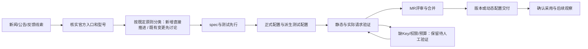

# 持续维护工作流

## 责任和状态

每项工作明确角色，不在文档中固定个人姓名：维护者负责资料、配置和 MR；产品负责人讨论确认既有配置调整、删除及超出现有能力的方案；验证协作者提供账号/Key 和预算；代码评审者检查规则与兼容；发布负责人记录版本或动态配置交付。一个人可以承担多种角色，但实际结果需要分别记录。

这些是维护阶段，不替换工作项的 `Status:`。本目录没有创建自动新闻监控或自动上线任务。

维护项使用本地 Markdown，不创建远端 Issue。已有完整 spec 可直接作为工作项，不复制正文；本领域新增维护 spec 和研究记录放在本目录，保留明确日期、目标、验收和下表状态。若需独立 Issue，仓库位置为 `docs/issues/<feature-slug>/<NN>-<slug>.md`，这里只记录状态和本目录 spec 的引用，维护背景与要求仍完整留在本目录。

| `Status:`         | 适用条件                                                   |
| ----------------- | ---------------------------------------------------------- |
| `needs-triage`    | 线索尚未分类，范围待判断                                   |
| `needs-info`      | 缺官方事实、复现或其他必要信息                             |
| `ready-for-human` | 等人工账号、Key、预算或产品裁决                            |
| `ready-for-agent` | 目标与验收明确，可以实施                                   |
| `in-progress`     | 已开始工作                                                 |
| `done`            | 本项声明的验收完成；只完成配置 MR 的任务仍要单列未交付状态 |
| `wontfix`         | 已决定不接入或不处理，记录理由                             |

文件标题下写 `Status:`，依赖用本地链接，必要讨论追加 `## Comments`。Issue 状态与 MR、版本、动态配置的交付状态分别记录；不能用 `done` 代替线上采用证据。

## 一次配置改动

1. 从最新 staging 开分支，记录基线 commit，执行 `node scripts/check-workspace-freshness.mjs`。先查本目录当前状态、研究记录和维护项，避免同一供应商重复立项。
2. 收集精确入口、协议、原始 ID、能力、档位、参数映射、地区/套餐与退役证据。按[新增与既有变更边界](./scope.md#新增与既有变更的授权边界)分类：符合范围且无需额外适配的新增直接推进；需要新增协议、认证、动态 Header、请求/响应或历史处理及 SDK 兼容改动的候选暂缓，记录缺口，不顺带开发适配。任何已有配置调整、降级或移除先给出具体前后差异并讨论确认。
3. 在本目录更新相应规范或维护 spec，写明目标行为、理由、非目标和验收；先写能表达目标和保留边界的测试。新模板覆盖继承与实例身份；规则变更覆盖顺序、相邻型号不误命中和最终请求。
4. 修改正式 JSON，使用新的内容 revision；新品牌按需补 Logo/本地化。执行 `pnpm provider:config:sync-test`，把测试 JSON 同时纳入 Git。只有地址转换合同变化才改生成器。
5. 做[验证](./validation.md)，区分正式/测试配置、普通/套餐 Key、三协议及不同入口。用户界面变化按仓库要求补 E2E，不能只测 JSON 字符串。
6. 更新[当前状态](./current-state.md)及本项证据；对账成员、默认启停、已解析能力、精确规则和已知例外。审查是否无意写入个人覆盖、修改请求预算或改变其他模板。
7. 完成适用检查和 diff 自检后提交 Conventional Commit，按[MR 内容与操作](./delivery.md)创建面向 staging 的 MR。缺实测证据的 MR 明确标记待验证，不宣称上线就绪。
8. 合并后由授权发布者沿[交付规范](./delivery.md)执行，记录实际包或动态配置采用结果；MR 合并不是维护工作的线上完成证据。

## 每项工作的最小记录

维护背景、决定和验收记录放到本目录的相应规范、维护 spec 或日期研究中；独立 Issue 只链接任务，不另存一份规范正文：

| 字段       | 必填内容                                                                      |
| ---------- | ----------------------------------------------------------------------------- |
| 标识与状态 | templateId / 原始 modelId / 协议；维护阶段与 Issue Status                     |
| 范围决定   | 新增/调整/下线；重点/一般维护；新增适用的已确认原则，或既有变更的人工确认记录 |
| 来源       | 官方链接、发布日期、生效日、检查日期；冲突或未知项                            |
| 配置差异   | 成员、enabled、能力、Map、URL、Access、正式/测试转换                          |
| 人工协作   | 缺哪类账号/Key、地区/套餐、所需权限、预算与安全交付方式；不记录 Secret        |
| 验证       | 基线 commit/revision、配置 hash、用例、实际请求协议、结果和未覆盖项           |
| Git        | commit、MR、目标分支、评审结论与后续任务                                      |
| 交付       | 计划方式、兼容客户端、最终文件 hash、实际版本/动态 revision 与采用结果        |
| 后续       | owner 角色、下一次复核触发、退役日期或解除阻塞的条件                          |

## 范围扩大和清理

每月复核重点/一般模型是否仍符合需求、待人工项是否长期无人处理、聚合目录是否遗漏已维护上游、官方退役与别名是否变化。范围扩大按已确认原则审查证据和维护资源，无须逐个重问新增授权；超出现有协议能力的候选暂缓。不把“支持更多”当作默认启用全部型号的理由。

无效模板成员先按真实入口证据处理；能力规则和精确规则另查用途。删除模板要检查现有实例的模板引用、用户自定义 URL、保存的模型选择和必要迁移。恢复默认、关闭模型、移除成员、移除模板是不同动作，不能用一次大批删除代替。

## 文档同步

本目录完整承接模板维护所需的领域概念、合同、理由、验收和当前库存。新增规则必须在本目录解释清楚，不能用“参见其他设计/待办”替代正文；代码用于核验实现，官方资料用于追溯外部事实。历史调查保留原时点证据。目录外入口和 AUF 可以引用这里，不维护第二份现行规范或可执行型号目录。

新原则或例外一经确认，立即更新本目录对应正文及受影响流程，不等到下一次配置 MR。每次配置 MR 都要检查正式/测试同源、当前库存、研究状态和旧入口导航。仅整理文档时不顺带修配置、不抬 revision，也不把发现的问题写成已经解决。
