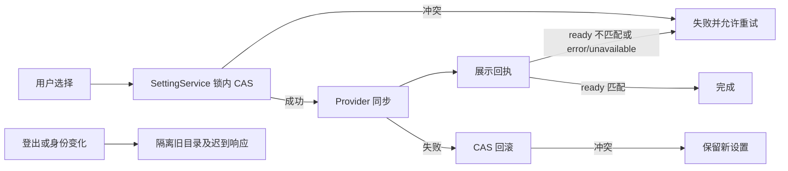

# Composer 模型与思考档位合并入口

## 交互

普通输入框的模型与 Think 使用一个入口。入口不显示 Provider 前缀：

```text
[ GLM-5.3-Flash High ▾ ]  → [ GLM-5.3-Flash ▮ ] → [ 模型图标 ▮ ]
```

菜单显示 Models（中文「模型」）分区标题，使用 text-ui-sm 和次要文字色；模型名称保持基础字号，能力标签保持原样。

High 使用次要文字色。绿条始终是同一按钮内的展示，不单独响应点击；按模型声明的档位显示强度，关闭或无效选择为空槽。

模型菜单相对入口居中对齐（`align="center"`），保留视口边缘避让。

入口保留原有 `rounded-lg` 圆角按钮样式，不使用胶囊造型。菜单展开期间保持主题 hover 灰色底，即使指针已移入菜单也不消失；关闭后恢复 ghost 底色。展开前测量按钮宽度，展开期间取原宽度与 `8rem` 最小宽度的较大值并锁定，避免短模型名或图标态导致「选择模型」被截断；展开时隐藏模型和档位，改为居中的 Select model（中文：选择模型），不显示下箭头；关闭后释放固定宽度并恢复模型和档位及原压缩优先级。宽度只在一次展开前捕获，不随调档或模型变化重新测量。

未选模型时，入口无论展开或关闭均显示次要文字色的「选择模型」，不显示思考档位占位横线或绿条。未选模型时无障碍名称只显示选择模型文案，不拼接 `· —`；选中模型后按钮和无障碍名称显示模型与有效档位。普通 Tooltip 始终显示操作文案「选择模型」（Select model）及快捷键，不重复模型和档位；菜单展开时隐藏 Tooltip，引导提示保持原有专用文案。

Think 滑杆采用胶囊轨道、离散档位圆点和白色圆形滑块。低于最高档时，已选轨道保持 success 纯绿色；只有有效选择达到最高档时才显示从右至左的蓝到绿渐变（右蓝、左绿），蓝色使用滑杆专属变量 --composer-thought-max-accent（blue-500），两套主题均保持高饱和度，绿色使用 success 主题色；渐变使用 OKLCH shorter hue 插值，从左至右经过绿、青、蓝，保持过渡色度，不包含紫色。离开最高档以 200ms 淡出渐变恢复纯绿色，工具栏竖条继续使用 success 绿色，未选轨道及圆点使用主题中性颜色；关闭或无效档位不填充。轨道描边仅显示在未选中的灰色区域：描边置于底层，渐变填充覆盖选中区域的描边，不缩进到描边内部。轨道 24px 高，滑块 28px，操作区域 32px 高；每个档位对应一个圆点，位置与原生 range 的离散索引一致。保留原生 range 的键盘、指针与触屏行为及现有焦点保护，仅自定义视觉。

点击或键盘调档时，滑块位置和渐变填充同步使用 120ms ease-out 过渡。拖拽逐档移动时也保持同样的短过渡，让滑块与渐变填充同步平滑移动。切换模型、Provider 或档位目录时仅重置视觉层，不跨模型补间，也不重建原生 input 或移动焦点。系统 prefers-reduced-motion 时取消过渡。

弹层结构：供应商图标、名称、接入标签（箭头靠右）→ 分割线 → Models 标题与模型列表 → 分割线 → Effort 标题（text-ui-sm）与当前档位（基础字号，同排靠左，下间距 mb-1）→ 离散滑杆。不显示最低／最高档位标签，也不保留该行空间；桌面与手机 Web 共用此布局，滑杆的键盘、指针、触屏操作及无障碍档位文字保持不变。管理模型入口与已有 provider family 连接方式仍然可达。主菜单与供应商子菜单的分割线统一使用 border/50。

Provider 行左侧依次为当前供应商图标、名称、接入方式标识，子菜单箭头靠右，不再显示 Provider 标题。图标复用供应商配置中的 logo 和已有深浅主题资源，无 logo 时使用通用模型图标。供应商子菜单中的接入方式标识紧跟名称（间距 8px），不推到行尾；当前选中标记保留在右侧，末尾分割线下放置 Manage models；合并弹层底部不重复显示此入口。空目录时仍可打开子菜单进入模型管理。其他使用 ModelConfigSelect 的界面保持原布局。

接入标识复用目录的 `labelBadge`：账号套餐显示个人／团队／免费，API Key 接入显示 API；由配置 access 生成，不从名称推断，不暴露凭据。

子菜单使用 Portal 避免父菜单裁切。窄屏侧向空间不足时，子菜单允许覆盖父菜单并避开 Provider 触发器行，保持高于父菜单的层级；不改变 Provider 选择和模型切换逻辑。

切换 Provider 立即选择该分组按目录顺序的第一个未锁定模型，沿用已有 onSelectModel 更新 Composer，Think 由既有模型切换逻辑同步为有效档位，弹层保持打开。重复选择当前 Provider 保留其当前可用模型。没有可用模型的 Provider 仍可浏览和配置，但不覆盖当前模型，Think 禁用。滑杆按 Option Spec 的原始顺序逐格选择，不排序、不转换成 Token Budget。仅 Off 单档隐藏整个 Effort 区域及分割线；其他单档禁用滑杆但显示档位；无模型／无有效档位不制造默认选择。选择档位保持弹层打开，点击外部或 Escape 收起。桌面关闭后恢复输入焦点；手机不主动弹出软键盘。

### 模型菜单关闭

- 点击或键盘确认可用模型后保持菜单打开，包括重复选择当前模型，便于继续调整思考档位；锁定模型不提交、不关闭。切换 Provider 和调档仍保持菜单打开。
- 普通输入框、全屏插件中的浮动输入框共用同一个菜单打开状态。点击菜单外侧一次即关闭，包括插件 webview 所占区域；该次点击只关闭菜单，不触发底下插件操作。Escape 保持关闭行为。
- 菜单关闭后沿用现有焦点规则：桌面恢复输入框，手机不主动弹出软键盘。不改变模型选择 owner、提交和协议。

```text
确认可用模型 → 既有模型选择回调 → 菜单保持打开
菜单外侧指针 → 宿主菜单外部交互 → 菜单 open=false
Provider / Effort 操作 → 原有选择链路 → 菜单保持打开
```

外侧点击回归原因：Radix 打开 modal 菜单后将 body 的 pointer-events 设为 none，但插件 webview 显式设置 auto，继续接收点击；guest 内事件不冒泡到宿主 document，因此菜单没有收到外部 pointerdown。Electron 事件采样确认该次点击执行了插件按钮，菜单仍为打开态。合并菜单打开期间提供透明指针层，放在插件页面之上、Composer 和浮窗之下，复用 Radix 的外部关闭逻辑，保留工具栏菜单互切。该层与菜单共用 open，不保存额外状态。

回归验证：菜单组件单测 47 条、Electron webview / 手机宽度 iframe 深浅主题交互 4 条、完整桌面工具栏 11 条通过，覆盖选模型后保持打开及随后一次外侧点击关闭。浏览器候选通过 `node --test packages/ui/test/browser/manual-review/pending/composer-menu-dismiss.test.mjs` 运行，产物在 `packages/desktop/.e2e-artifacts/composer-menu-dismiss/`。未覆盖 Windows/Linux 原生窗口、手机真机和远控连接；插件资源采用测试页，不验证插件安装或 Agent 握手。

## 整体压缩优先级

统一由 useComposerToolbarFit 测量全部左右控件及间距，每一级仍溢出才进入下一级：

1. Computer 文字收起。
2. Mode 文字与箭头收起。
3. Plan 文字收起。
4. 合并入口 High 与箭头替换为绿条，模型名完整保留。
5. 模型名替换为模型图标，绿条保留。

不存在隐藏绿条、仅模型名、截断模型名的中间阶段。未渲染的控件跳过，宽度恢复时逆序展开；按钮不因压缩重新挂载，打开的菜单、焦点和选择不丢失。Highspeed 锁定模型的既有专用指示器与独立思考控制保持现有行为。

## 状态与边界

```text
ModelSelectionView（支持的模型与档位）
                 ↓
选择 Provider → 当前可用模型或首个可用模型 → 现有 onSelectModel → Composer 草稿
合并弹层 → 现有 onSelectModel / onSelectThought → Composer 草稿（唯一选择 owner）
                                                     ↓ 发送
                                               冻结 Submission
```

弹层只拥有打开状态和浏览的 Provider，不复制模型、档位状态。不改变请求映射、服务协议、accepted queue 或实时流：桌面 desktop-continuous 和手机 web-remote-replayable 继续使用各自原有链路。Ctrl+M 打开合并入口，Ctrl+T 保留循环档位。

## 验证

- 组件交互：Provider 自动选择可用模型、跳过锁定模型、重复选择当前 Provider、无可用模型、模型选中后菜单保持打开、视觉标签、离散滑杆、单档／无效档、继承的连接方式和管理入口。
- 布局：各级收缩与逆向恢复、缺失 Computer/Plan、最终图标＋绿条；真实浏览器桌面与手机宽度、深浅主题。
- Desktop E2E：模型与档位修改仍更新 Composer；普通模式不再渲染独立 Think 入口；合并菜单与 Mode 互斥。

本次验证：相关单测 7 个文件共 155 条通过，Desktop 工具栏 E2E 覆盖 Provider 自动选模型和子菜单模型管理跳转；typecheck、lint（0 errors）及 architecture:check --changed 通过。实际桌面窗口确认三档收缩；浏览器组件验证 320、390、1200 像素及深浅主题，未执行手机 `/remote` 真机链路验证。

## 调档期间的焦点

真实 Desktop E2E 观察到调档或切模型后 Host View 会短暂进入 loading，旧实现将目录一起清空，导致菜单高度闪烁。原生 `disabled` 会将焦点从 range 移回菜单，后续方向键不再调整档位。合并菜单使用 `aria-disabled` 和事件门禁暂停交互，保留同一 range 节点与焦点；Hook 在同一 Host 的输入重读期间只保留 revision/providers 目录展示，不保留 effectiveSelection、preferredSelection 等旧解析结果；Toolbar 读取该目录，当前选择仍来自 Composer 草稿，提交仍要求 ready。快速切换继续沿用 generation/requestId 防迟到覆盖。Host 切换、禁用或不可用时立即丢弃旧目录，不改变桌面 continuous 或手机 replayable 边界；不用超时恢复焦点。新目录返回后原位更新。未选档位时，首格位置不代表用户已选，只有明确的 change／键盘释放／指针释放才提交。

该规则同时覆盖 Provider 切换。有保留目录的重读不禁用菜单入口，避免按钮透明度闪动；首次加载、错误、不可用与运行锁定仍沿用原门禁。回归测试监测真实 DOM，要求调档、模型和 Provider 切换期间模型列表无空帧，入口无瞬间禁用，并覆盖跨 Host 清理和快速切换的迟到回包。

档位圆点：已填充区域的圆点使用 30% 白色，两套主题一致，不使用黑色圆点；未填充区域保留原灰色。鼠标接近圆点横向 10px 范围时，以 120ms ease-out 放大到 1.75 倍并变为完全不透明，离开后恢复。触屏和禁用态不触发悬停；减少动态效果设置下取消过渡。圆点仅负责展示，原生 range 继续接收点击和拖拽。

最高档气泡：保留现有渐变和颜色，在填充内部叠加 12 个低透明度白色小圆点，大小 2–4px、周期 2.6–3.6s，错开相位从右向左漂移并淡入淡出。气泡裁切在轨道内，位于档位点和滑块下方，不接收指针事件。仅可调且有效的最高档渲染气泡；降档、切到单档／无效模型或关闭菜单即移除。prefers-reduced-motion 下隐藏气泡并关闭动画；不新增 Canvas、定时器或独立状态。

滑杆交互后的收起：原生 range 的 pointerdown 必须冒泡到 document，让 Radix DismissableLayer 清理内部点击标记；只阻止 click 触发菜单项选择。点击或拖拽调档后，第一次点击菜单外部就关闭，不需要第二次点击。禁用态仍用 preventDefault 阻止调档。

菜单打开态响应式：打开时锁定的宽度（至少 128px）仅用于空间充足的文案态。工具栏继续按 Computer → mode → Plan → think → 模型图标的既有优先级收缩；到模型图标态时解除宽度和最小宽度限制，显示模型图标与思考条，隐藏居中的选择模型文案和下箭头。拉宽后恢复原打开态宽度与文案，保持同一个触发按钮与菜单实例，不重置选项、焦点或开关状态。桌面面板 resize 与手机 Web 共用此规则。

## E2E 覆盖复核（2026-09-28）

本次为 presentation 层的既有 CT 用例增强，不新增产品语义、provider 请求或独立候选 spec。已确认边界来自上述交互规格和用户对合并入口、一次关闭、图标＋思考条的要求。

- accepted：滑杆点击和拖拽分别从最低档开始，明确改变目标档位；断言 range 和 Composer config 都到达目标，随后一次外部点击关闭且选择不回退。
- accepted：鼠标置于菜单外、通过键盘聚焦滑杆后，打开态缩窄再恢复，保留同一按钮、菜单、range 节点和滑杆焦点；模型/Provider/档位不被 resize 改写；窄态继续按 End 调档，思考条与 config 同步；关闭再打开仍是图标＋思考条。
- pruned：主题/语言/全部宽度不与 desktop E2E 全量叉乘；共享 CSS 的浏览器视觉证据单列，不能算作手机 `/remote` 真机或原生侧栏拖拽覆盖。当前 E2E 设置工具栏容器宽度以确定性触发真实 ResizeObserver，不伪造 compact 属性。
- 已有覆盖保留：Provider 自动选模型、模型/Provider 切换不清空目录、Tooltip 操作文案、最高档渐变与气泡、模式菜单互斥、管理模型、scope reset。

影响面：must-inspect 为 V4ComposerToolbar → ModelConfigSelect/ComposerModelMenu 与 useComposerToolbarFit；选择权威仍为 Composer 草稿，布局测量只投影 DOM。AutomationEditView、OffPeakEditView、SubagentsSection 与 workflow settings 虽复用 ModelConfigSelect，但各自持久化边界不同且不启用 composerOptions，属隔离边界；本次不修改产品代码。Desktop continuous 与手机 replayable 不涉及改动。当前环境无可调用 codegraph，未执行图索引的 depth-2 扫描，以当前源码调用点和现有用例核对，不宣称完成 codegraph 影响扫描；无新增语义图节点或 owner 关系。沿用 CT 已有 case-local fixture，不新增发送或 fixture 请求。

复核结果：增强后的工具栏 Electron E2E 11 项通过，case-local fixture 校验、typecheck:e2e、全仓 typecheck、lint（62 条既有 warning、0 error）和 architecture check 通过。全仓 conversation coverage audit 被未修改的 Highspeed card fixture 两条 syntheticReason 与 manifest 不一致阻断（REQUEST_LEDGER_METADATA_MISMATCH），不计为本次工具栏测试失败；未执行 Docker admission 或手机远控真机验证。

## Effort 控件按档位数量展示

两个及以上档位使用离散滑杆，包括 Off/On、Low/High、Off/High；单一档位显示标题与状态文字，空档位隐藏。保留原始值和目录顺序，不按翻译文字判断控件。滑杆沿用既有 onValueChange、键盘、指针与触屏操作，不维护第二份选择状态。不可选 Provider 禁止调档；菜单 Escape 和首次外部点击关闭规则不变。

以下为此前二态开关方案的历史验证记录，当前展示规则以“按档位数量统一展示”为准。

验证：组件覆盖 Off 别名、On 别名与反向顺序、Low/High 和 Off/High 仍为 slider、单 Off 隐藏与模型切换恢复；扩展既有 Turbo I37 E2E 断言双态开关和 config 同步，并更新合并选档 helper 兼容开关及不可调的 Off。浏览器组件验证两主题与手机/桌面宽度；不新增 provider 请求、fixture 或运行态协议。

本轮验证结果：42 项相关组件单测、11 项工具栏 Electron E2E、3 项 Turbo Electron E2E 通过；两主题 × 390px 触屏／1200px 桌面浏览器验证开关点击、空格、一次外部关闭、单 Off 隐藏及切回恢复通过。typecheck、typecheck:e2e、lint（0 error）、architecture check 与 Turbo fixture check 通过。Turbo 用例显式加入当前默认目录已移除的模型候选，并使用当前目录的 disabled/enabled 原始值，避免依赖历史默认模型和 off 原始值。

Effort 当前档位文字复用 `RollingToolbarLabel`：变化时 200ms 向上翻滚并淡入淡出，仅动画 `{level}`，标题与滑杆位置保持原样。首次打开不播放入场，快速连续调档以当前草稿为准，减少动态效果时直接替换文字。复用 CT 工具栏调档回归验证文字更新与菜单/滑杆稳定性，不新增状态或提交路径。

翻滚验证：28 项组件单测、最新一轮 11 项工具栏 Electron E2E 通过；390px / 1200px 真实浏览器帧采样确认正常模式有 transform 动画、减少动态效果无动画，最终文字与 slider 一致且焦点保持。typecheck、typecheck:e2e、lint（62 条既有 warning、0 error）及架构检查通过。早期回归运行曾出现测试初始档位干扰和菜单定位失败，最终将文字断言并入原有点击/拖拽步骤，最新完整工具栏回归通过。

滑杆背景过渡：success 纯绿底保持不变，最高档渐变使用常驻伪元素层，以 opacity 200ms ease-out 在 0 与 1 之间切换；进入最高档淡入、离开最高档淡出，快速反向调档从当前透明度继续。填充宽度和滑块位置仍为 120ms；气泡保持最高档规则。减少动态效果时取消背景过渡。沿用现有滑杆 E2E 验证两端透明度及过渡属性，真实浏览器采样中间帧确认渐变不再瞬切。

背景过渡验证：工具栏 Electron E2E 11 项通过；两主题真实浏览器帧采样确认进入／离开最高档均有 0–1 中间透明度，减少动态效果无中间帧。typecheck、typecheck:e2e、lint（62 条既有 warning、0 error）及架构检查通过。

Effort 滑杆标题行：左侧 Effort 与当前档位，右侧用工具栏共享 ControlShortcutBadge 显示当前生效的 cycleThoughtLevel 快捷键。使用 Toolbar 已有 thoughtShortcutLabel 传入，不硬编码 Ctrl+T；未绑定时不显示空键帽。两个及以上档位均显示滑杆与快捷键，单一档位仅显示文字，不新增快捷键处理或状态。

快捷键标题行验证：29 项组件单测与最终 11 项工具栏 Electron E2E 通过，包含自定义/空绑定、右对齐和同排几何断言。typecheck、typecheck:e2e、lint（62 条既有 warning、0 error）及架构检查通过；未新增手机远控真机验证。

模式入口动效回归：V4 权限模式按钮恢复共享 RollingToolbarLabel，沿用 200ms 向上翻滚与淡入淡出、首次渲染无动画和减少动态效果规则。Plan 独立勾选、模式草稿归属、图标、颜色与响应式压缩不变。原因为 Plan 菜单重写时用普通 span 替代旧 ConfigSelect，遗漏文字动效。

模式动效恢复验证：5 项模式组件单测、11 项工具栏 Electron E2E 通过；真实模式切换采样捕获 transform/opacity 中间帧，验证按钮节点保留、文字更新及 Plan 独立开关。typecheck、typecheck:e2e、lint（62 条既有 warning、0 error）和架构检查通过。

合并入口开关动效：已选模型时，打开/关闭菜单在“模型名＋思考档位”和居中 Select model 之间执行 200ms 向上翻滚及淡入淡出；首次渲染不播放，减少动态效果时直接切换。动画只呈现既有 open 状态，不维护第二份选择或延迟开关；保持原按钮、打开态锁宽、窄屏图标＋思考条、焦点与一次外部关闭规则。

打开态文案不显示箭头：Select model 保持居中，关闭态继续沿用原箭头与压缩规则；窄屏打开态仍为图标＋思考条。

合并入口开关动画验证：45 项组件单测、最终 11 项工具栏 Electron E2E 通过，覆盖无打开态箭头、文案容纳、按钮身份及锁宽/缩窄恢复。真实浏览器采样确认打开与关闭均有透明度中间帧，减少动态效果无中间帧；打开宽度至少 128px，关闭恢复内容宽度。typecheck、typecheck:e2e、lint（62 条既有 warning、0 error）和架构检查通过。宽度断言改为测量实际 Select model 文案，避免将离场文字的溢出计作当前文案截断。

Effort 快捷键外观复用 ControlHintTooltip 的键帽：h-4、rounded-md、tooltip-tag 背景和文字色、text-ui-xs，以及平台专用符号字体。通用 Kbd 引用未定义 muted token 导致裸文字，避免在 Effort 中继续使用；不修改其他 Kbd 入口。

快捷键样式修复验证：35 项单测与 11 项工具栏 E2E 通过；390px 两主题截图确认非透明键帽背景、16px 高与 6px 圆角，Tooltip 与 Effort 共用同一外观。typecheck、typecheck:e2e、lint（0 error）和架构检查通过。

供应商子菜单使用 max-content 内容宽度，取消固定 224px；按最长名称＋接入标签＋勾选预留空间决定宽度，继续受 Radix 可用视口宽度约束。常规桌面长名称不因固定宽度折行，窄屏必要时允许名称换行，标签紧跟名称、勾选靠右；保留 Portal 与窄屏避让。

供应商内容宽度验证：11 项工具栏 E2E 通过；真实浏览器长名称 ZAPI（Chat Completions）在 1200px 视口单行展示，子菜单自然宽度约 257px；320/390px 视口按可用空间折行且无溢出。typecheck、typecheck:e2e、lint（0 error）及架构检查通过。

多模型与窗口拖拽边界：合并主菜单外层不滚动；供应商、Models 标题、分隔线和 Effort 不收缩，只有 Models 列表随可用高度收缩并纵向滚动（保留 max-h-60）。主菜单和供应商子菜单显式 app-region:no-drag，覆盖 Electron 顶部拖拽区域时继续接收鼠标事件。根因为共享 DropdownMenuContent 的 overflow-y-auto 和默认 flex shrink 使整个菜单滚动，且 Portal 菜单缺少 no-drag 命中声明。

滚动/拖拽验证：11 项 Electron 工具栏 E2E 通过，实际 computed style 验证外层 overflow-y:hidden、Models overflow-y:auto、主/子菜单 app-region:no-drag。真实浏览器 42 模型分别在 1200×720、390×360 视口滚动 500px，外层 scrollTop 保持 0、供应商/Effort 坐标不变且供应商可点击。typecheck、typecheck:e2e、lint（0 error）及架构检查通过；自动化验证的是 Electron CSS 与 DOM 鼠标交互，未执行操作系统原生窗口拖拽命中测试。

## 菜单安全边距与供应商导航（2026-09-29）

主菜单与供应商子菜单保留 12px 视口安全边距及 no-drag。宽屏供应商子菜单外框与主菜单顶部对齐，外框相隔 4px；碰撞时优先保证可见。Provider 高亮使用 menu-hover/50。供应商列表独立收缩/滚动，Manage models 固定。

小于 640px 时在原菜单内显示供应商页，顶部为本地化返回入口，不叠加左右两层。菜单页状态由 ComposerProviderMenu 唯一持有；关闭后自然重置，返回不修改模型，选择供应商复用现有自动选模型链路并返回模型页。视口变宽后恢复子菜单导航。模型页仍仅 Models 滚动，不改变桌面/远控数据链路。

验证计划：扩展既有管理模型 E2E 检查安全边距、对齐和供应商滚动样式；组件验证窄屏返回与选择；真实浏览器验证两主题、桌面/手机宽度及长列表滚动。原生窗口拖拽命中和手机远控真机另行验证。

本轮验证：46 项组件测试通过；真实 Chrome 在两套主题、320/390/1200px × 480px 下验证 32 个供应商滚动 500px、12px 边距、宽屏顶部对齐/约 4px 间距，管理入口坐标不变，窄屏返回和选择成功。鼠标连续移动进入子菜单可正常滚动；瞬移式自动化 hover 会触发 Radix 离开/焦点规则，未据此添加超时兜底。typecheck、lint（62 条既有 warning/0 error）、architecture check 和 typecheck:e2e 通过。
最终 Electron 工具栏 E2E 11/11 通过；几何断言等待菜单入场动画完成再采样，避免缩放中间帧误判对齐。

## GLM Highspeed 最高档视觉

仅当前已选模型显示名称包含 glm，且包含 highspeed 或 flashx（忽略大小写）时启用特殊最高档样式，不按 provider 名称或模型 value 猜测。最高档从左到右蓝 → 紫，仅保留 0% 蓝色和 100% 紫色两个色标，采用 OKLab 插值平滑过渡。普通模型保留绿 → 青 → 蓝，低档绿色；命中 GLM Highspeed / FlashX 的低档蓝色。

GLM Highspeed 最高档气泡固定 32 个（普通 12 个），周期约 0.8–1.2s，从右到左，保持 2–4px 和最高 40% 透明度；降档移除气泡，减少动态效果隐藏气泡。现有 200ms 渐变透明度过渡、模型切换视觉层重置保持不变。模型名称 → 派生视觉变体 → 最高档填充/气泡，不新增状态、定时器或协议。

验证：组件覆盖大小写、仅 GLM、仅 Highspeed、名称与 value 区分、降档及切换；既有工具栏 E2E 验证普通模型不启用特殊效果，浏览器补充 Highspeed 两主题/窄屏和 reduced-motion。

验证结果：50 项组件测试、11 项 Electron 工具栏 E2E 通过；Chrome 两主题 × 390/1200px × 默认/减少动态效果验证绿紫渐变、32 气泡/0.8–1.2s、降档消失及普通模型恢复 12 气泡。typecheck、typecheck:e2e、lint（62 条既有 warning，0 error）、architecture check 通过。未执行手机远控真机或 Docker 回放。首次 Electron 回放在既有 slider 键盘降档断言超时并影响下一用例，最终版本完整重跑 11/11 通过。

## Models 滚动边缘遮罩

复用 ScrollFadeViewport 的 24px 上下渐隐 mask，仅作用于 Models 列表。无溢出不遮罩；顶部只淡出底边，中间双边渐隐，到底只淡出顶边。沿用共享组件的滚动/ResizeObserver 更新，不新增模型状态或定时器。保留 max-h-60、flex 收缩及 Provider/Effort 固定布局；两主题、桌面与手机 Web 共用。

验收：既有工具栏 E2E 临时缩短真实列表视口，验证顶部/中间/底部 mask 和清除约束后的恢复；共享组件测试覆盖边界，浏览器验证长列表及两主题。

验证结果：52 项组件测试、11 项 Electron 工具栏 E2E 通过；真实 Chrome 两主题 × 390/1200px 验证长列表顶部 bottom、中间 both、底部 top 的 computed mask，外层 scrollTop 始终为 0。typecheck、typecheck:e2e、lint（62 条既有 warning、0 error）与架构检查通过。未执行手机远控真机或 Docker 回放。

颜色调整：GLM Highspeed 最高档最终使用 blue-500 → purple-500 的 OKLab 渐变，移除绿色起点；普通模型渐变及所有气泡参数不变。浏览器检查 computed gradient 的色彩空间与端点，验证两主题和窄屏。
蓝紫调整验证：Chrome 两主题 × 390/1200px × 默认/减少动态效果通过；蓝紫端点、32 气泡、降档和普通模型切换正常。typecheck、lint（0 error）、architecture check 通过；本次仅 CSS 色值/插值调整，未重跑 Electron 全套。

GLM Highspeed 普通档与入口竖条：普通思考档填充使用 blue-500；最高档仍为蓝紫渐变及 32 个快速气泡。入口竖条在开/关菜单与图标压缩态统一使用 blue-500，Off 仍为空槽。其他模型沿用 success 绿色。菜单与入口复用同一名称判定（GLM + Highspeed 或 GLM + FlashX），不按 provider 或 value 判定，不增加状态。
蓝色基础填充验证：50 项组件测试通过；Chrome 两主题 × 390/1200px × 默认/减少动态效果验证普通档填充与竖条同为 blue-500，最高档和切回普通模型正常。typecheck、typecheck:e2e、lint（0 error）与架构检查通过。
Electron 工具栏 E2E 11/11 通过；未执行手机远控真机或 Docker 回放。

MR !2820 CR-01：模型能力目录为空（levels=[]）时与 sole Off 一样隐藏整个 Effort 区域及其分隔线。此前只排除 sole Off，导致无思考能力模型显示禁用的空滑杆。修复边界：review source 71f5ed4731；仅 ComposerModelMenu 与对应测试/规格；旧 graph 为 66 affected files / 470 impacted nodes，编辑后不视为当前图快照。

CR-01 刷新边界：已有模型选择但 groups=[] 的目录未就绪状态保留禁用滑杆以维持焦点；目录已包含模型且 levels=[] 才表示确定无思考能力并隐藏。继续使用输入目录派生，无新增缓存或计时器。
CR-01 验证：新增测试先复现空 Effort；修复后 51 项组件测试、11 项 Electron 工具栏 E2E、typecheck、lint（62 条既有 warning，0 error）、architecture check 通过。真实 Chrome 390/1200px 验证无能力隐藏及模型选择正常。远端 fetch 两次因自动审批超时未执行，尚未提交/推送或调用 Ready；当前旧图快照不作为修复后影响面证据。

## Composer 供应商列表中的团队入口（2026-10-08）

沿用主菜单的「供应商 → Models → Effort」布局，不增加连接方式行。供应商子菜单按同一品牌依次展示个人 Coding Plan 和具体团队：`BigModel [Individual]`、`BigModel [团队名称 1]`、`BigModel [团队名称 2]`；团队块之后用弱分割线区分原有 API 供应商列表。Start Plan 和 API 行保持各自现有行为，不合并品牌或 API。主菜单顶部显示当前品牌和当前个人/团队标签。

团队入口来自已有企业 pricing 的 subscribed 产品，使用真实组织名，身份包含 family/productId/organizationId/projectId；身份不完整或无组织名不制造入口，同名不同身份不得去重。未选团队额度 unknown 不等于未购买；入口以已购目录为准，执行模型在选择后校验。

```text
点击个人/团队行 → 根设置保存完整身份 → 现有 Provider 刷新 → 目标 Host 可用模型
                                                        ↓
             保留可用同名模型，否则第一个可用模型 → Composer 模型 owner → 勾选/标题
失败 → 恢复原设置并同步 → 保留原模型并显示可重试错误
```

共享设置为套餐身份唯一来源，Composer 仍持有模型选择。团队多行是目录投影，不创建 Provider 或额外 runtime。同步时禁用供应商、模型和 Effort 重复操作，保持主菜单打开；完整同步后才采用新菜单身份。异步结果绑定 Host 与 workspaceIdentity.trim() || workspacePath；远端须比对根/目标 Provider connectionKey，避免旧团队同名模型误判成功。API 选择不写套餐设置。关闭菜单及窄屏返回不修改模型；使用现有窄屏返回导航、主题 token 和国际化。桌面 continuous 与手机 replayable 消息链路不变。

验收覆盖个人/多个团队行及标签、团队身份去重、API 顺序不变、切换同名模型、失败回滚、重复选择、过期 Host 结果和窄屏导航；桌面 E2E 验证个人→团队→个人、持久化身份、勾选与标题。真实账号鉴权及其他平台实机验证单独报告。

验证记录：8 个相关单测文件共 93 条通过，覆盖多团队同模型勾选、未选团队 unknown、Agent 格式过滤、窄屏返回、失败恢复及旧 Host 结果。macOS Electron CTP-02 与 CTP-20 通过；最终 CTP-20 再次通过，完整核对 product/org/project 和主行标签。typecheck、lint（63 个既有 warning，0 error）、architecture:check 与 diff check 通过。E2E 使用隔离 mock 账号；真实账号请求、Windows/Linux 及手机真机远控尚未验证。

连接切换回归修复（2026-10-08）：同账号族个人/团队的同名模型由既有 Effective Selection resolver 映射并保留有效 reasoning options，不再调用普通选模重建意图。原实现的重复选模清空 reasoning，并因输入变化重读目录，导致 Effort 短暂消失再显示“—”。目标不存在同名模型时仍走原选模流程；不引入默认最高档、额外档位记忆或延迟逻辑。桌面回放从 high→空复现，修复后个人→团队→个人保持 high，切换全过程 DOM 采样检查档位、候选档位和控件存在性；相关 87 条单测通过。

连接切换 loading：供应商主行沿用 connectionSwitch.pending，在原右箭头的固定 size-4 槽位显示加载图标，不新增行或遮罩、不设置最短显示时间。保留现有选中名称、模型与思考档位；主行标记 aria-busy，并继续禁用重复切换、模型与档位操作。成功/失败均由实际同步结果结束 loading，失败沿用可重试错误。桌面与窄屏共用状态；加载标签使用现有 common.loading 国际化，图标遵循 motion-reduce。

团队可用性：pricing 项目明确 apiKeyStatus=unavailable 时隐藏对应行（项目未提供状态时继承产品状态），不渲染禁用项；unknown 仍按已购完整身份发现。已加载目录中的团队全部不可用时，也不得回退为泛化 Team 行；目录尚未到达时才保留当前可执行团队的原入口。

本次验证：52 条相关单测通过，macOS Electron CTP-20 同场景验证 loading 生命周期、不可用团队隐藏及双向切换档位保持；运行日志确认被隐藏项目返回「暂无有效的团队套餐授权记录」。typecheck、lint（既有 63 warning，0 error）、architecture:check 与 diff check 通过。手机窄屏加载及失败恢复有组件覆盖，手机真机和 Windows/Linux 未实测。

### 2026-10-08：解析期间主动选模丢失思考

调档改变 Selection 输入后，读取状态暂时变为 loading；菜单保留同 Host 的目录，但草稿选模处理只读取 ready view，导致在该窗口主动选模写入缺少 reasoningLevel 的 Selection，并永久显示“—”。主动选模 completion 必须复用 loading.catalog；该目录只用于构造新意图，不作为 effectiveSelection 或提交就绪证明。跨 Host 不保留目录。回归覆盖调档后挂起解析、再选模型，以及桌面实际菜单连续操作。

个人 → 普通 API → 团队：团队未激活时不在旧 Renderer 候选目录中。连接同步返回的目标目录已包含团队模型，但普通选模回调仍闭包捕获旧 API 目录，因此补齐失败。连接切换应从已同步的目标目录构造完整模型选择，将 reasoningLevel 随模型身份原子传给草稿 owner；不能拆成先选模型再调思考，也不能等待任意延时。直接个人/团队同名映射继续保留现有档位。

供应商列表横向边界回归（2026-10-12）：个人、团队与 API 列表只允许纵向滚动。列表内套餐/API 分隔线不使用菜单根容器的负横向边距；否则分隔线越过右边界 4px，`overflow-y-auto` 使横向 overflow 计算为 auto，显示横向滚动条。只在该分隔线覆盖横向边距，不改变全局分隔线或连接 pending。Electron 在宽/窄屏、两主题中采样个人→团队→个人全过程，所有已挂载列表满足 `scrollWidth <= clientWidth`，并验证纵向滚动仍可用。

### 连接 loading 范围（2026-10-08）

个人→团队、团队→个人、个人→普通 API→团队、团队→普通 API→个人，供应商连接切换均进入同一 connectionSwitch pending 生命周期；普通 API 不再绕过该 owner。API 仍不写套餐设置，只读取目标 Host 模型目录并写入选择。同一连接内选模型、调思考不显示连接 loading，不设置最短显示时间。E2E 分别检查经过 API 的两段 loading，沿用直接个人/团队切换回归。

闪烁原因：连接 RPC 完成与 Renderer Selection 解析返回是两个事件；此前 RPC 返回即结束 loading，暴露了新配置与旧目录混合帧。pending 必须持续到目标选择在 ready View 中显示；期间 ModelConfigSelect 固定上一个完整菜单展示，保留当前 owner 的 pending/error。完成后一次采用新展示；错误/不可用解除等待，不用超时或最短动画时长。该快照只用于显示，不能参与提交。

验证：129 条相关单测、4 条 macOS Electron 用例通过；双向 API 中转各有 2 次 loading，加载期间共 41 次 DOM 采样，模型列表和思考控件展示不变。typecheck、lint（63 个既有 warning，0 error）、architecture 与 diff check 通过。手机 Web 共用组件及状态 owner，手机真机、Windows/Linux 未实测；未修改 continuous/replayable 消息链路。

### 补充套餐项国际化修复（2026-10-08）

团队激活后个人套餐可能不在目标 Host 可执行模型目录中，Composer 从根 ProviderSettings 补充其入口；这条投影路径原先未传分组标签，回退为英文 Individual。普通目录和补充目录必须复用当前 intl 生成的同一份标签：中文显示“个人”、英文显示 Individual，团队实际名称不翻译。桌面及手机 Web 共用投影；不修改套餐、模型、连接与档位状态。

### MR !2820 同名连接等待核验（2026-10-08）

评审基线 `8f7a638cc4` 的 CR-01 假设工具栏始终读取原始草稿 provider。实际链路为原始 `composerDraft.modelSelection` → Host `resolveEffectiveModelSelection` → `useDraftConfigControl.draftConfig` → 工具栏编码值 → connection switch 呈现确认。同名个人/团队切换不改写原始意图；ready View 映射到当前账号 provider 并保留有效 reasoning，因此目标编码值能够结束 pending。不能将持久化意图与有效展示选择混为一层，也不能用原始 provider 作为呈现完成条件。

参数化回归使用真实有效选择解析器，保留两侧同名模型与旧 provider 候选，覆盖个人→团队→个人及团队→个人→团队。开启 `waitForPresentation`，断言每次 pending 结束、high 保留、不调用普通选模、第二次连接命令可达。CTP-20 使用两侧共用的 `GLM-5.3`；usage mock 中 `glm-personal-e2e`/`glm-team-e2e` 是用量报表名称，不是模型候选目录。此核验仅补回归证据，不修改生产状态机；桌面 E2E 账号前置状态未就绪仍为独立待验证项。

修复循环快照边界：review source 为 `8f7a638cc4`；本次仅修改 connection switch 单测与本 spec。旧 graph 为 191 affected files / 489 impacted nodes / 0 related tests / 239 test gaps，范围包含本 MR diff 外的节点，编辑后不将其当作新快照或已验证影响面。

### 按档位数量统一展示

两个及以上档位统一使用离散滑杆，包括 Off/On 二态；单一档位（开启或关闭）仅显示标题与当前值，不显示滑杆、开关或调档快捷键。空能力目录仍隐藏区域，加载中仍保留既有焦点保护。保留模型目录原始值与顺序、现有键盘/指针/触屏行为，桌面与手机 Web 共用布局。此规则取代本文此前的二态开关及仅关闭隐藏规则。

### Composer 不可用 Provider 过滤

Composer 以 ProviderSettingsView 的 accountState.availability 为可用状态来源：个人、API 等非团队 Provider 明确 unavailable 时隐藏，unknown 或尚无状态时保留。团队共用 Provider ID，其 availability 只描述当前连接选择；当前团队明确 unavailable 时仅隐藏与当前完整 product/org/project 身份一致的团队行，其他团队继续按自身 apiKeyStatus 判断，unknown 保留。模型目录缺少团队 Provider 时仍可从设置与已购记录补充其他团队，不得补回已确认不可用的当前团队或泛化 Team 行。设置页详情保持可见。桌面和手机共用该投影，不新增请求、超时或状态缓存。

连接同步失败的回滚必须核对本次写入的品牌、版本和连接身份；另一窗口已改写品牌或版本时，旧请求不得恢复全局品牌或覆盖新连接。

### 未登录与空配置

未登录但已有 API Provider 时，Composer 正常选择 API 和模型；团队目录的 OAuth 错误不得污染 API 菜单。账号状态明确未登录时不请求鉴权团队目录。配置加载完成且没有可选 Provider 时，模型按钮点击直接进入 Provider 设置，不展开空菜单。连接切换错误显示在 Provider 选择区域，模型加载错误保留在模型区域；正常未登录和空配置不显示错误。

### 连接并发、鉴权目录与展示终态（2026-10-12）

- 连接设置唯一 owner 是 SettingService。提交与失败回滚均使用 update(patch, expectedAccountSettings) 在写锁内比较 family、完整连接映射与已有 providerFamilyDomainUpdatedAt 操作版本。缺少持久版本按 0 比较；所有完整连接映射写入必须提供 expected family、完整映射和操作版本，SettingService 拒绝缺少版本的写入，并在成功提交时递增版本。设置页、OAuth 初始化/回包、失效建议和 Host Provisioning 提交/回滚使用同一准入规则。普通设置补丁保留原契约。CAS 冲突明确失败，不自动重试，用户可再次选择。回滚冲突时保留新设置，不发布恢复目录；另一操作再次选择同一连接也必须由版本比较保护。
- 团队目录按 service、family、账号与登录会话隔离。普通菜单关闭可保留同身份快照；登出、账号变化或 family 变化立即隐藏旧快照，迟到请求不得重新发布旧目录。团队用量来源缓存同样绑定 service、family、userId 与 authSessionSeq；登出在 Provider 刷新前即清空来源、隐藏旧额度并禁用团队权益查询。权益请求的迟到响应不写入共享/本地缓存。
- 展示回执沿用目标目录 revision 判断归属，保留的旧 ready 不作为本次回执；loading 或低于目标 revision 的旧快照保持 pending。本次 ready 是终态：匹配则成功，不匹配则失败并解除操作锁；error/unavailable 同样失败。已有 ready 的展示刷新失败仍保留旧目录，但必须同时发布绑定当前 service/input 与事件 revision 的失败回执；目标 revision 的失败解除连接锁，旧 revision 或旧 owner 的失败不得终结新操作。每次连接操作显式请求当前展示 owner 按当前输入重读，复用其请求序号隔离迟到回包；同 revision、无事件的重试仍取得独立终态，成功重读清除失败回执。沿用可重试提示，失败后允许重新选择当前连接，不增加超时。



回归覆盖两个 deferred 请求同读后写、回滚检查后的并发写入、后一个请求同步失败、ready 不匹配后重试、已登录团队目录到登出、登出期间迟到 pricing。桌面与手机共用 hook 和 owner，不改变 continuous/replayable 传输。

FlashX 动画范围（2026-10-12）：GLM + FlashX 复用 GLM + Highspeed 的蓝色普通档/入口竖条、最高档蓝紫 OKLab 渐变及 32 个快速气泡。单独 FlashX、普通 GLM、其他品牌 Highspeed 不启用；匹配不区分大小写，只读取显示名称。降档、切回普通模型、减少动态效果沿用既有规则。

FlashX 验证：新增 GLM FlashX 大小写用例先复现 12 气泡；修复后相关受影响测试 4,625 条通过。macOS Electron 分别回放 GLM FlashX、GLM Highspeed 与普通模型，3/3 通过，验证 32/12 气泡、快速周期、渐变、入口标记及降档退出。命名模型通过正式 Personal Config 测试数据提供，不发送模型请求；首轮仍使用录制 fixture。FlashX 证据目录 `packages/desktop/.e2e-artifacts/desktop-e2e-20261012-094941-814/`。typecheck、typecheck:e2e、lint 与架构检查通过；本次未验证手机真机、Windows/Linux。

展示读取消费者隔离（MR review）：显式 refresh 返回 ready 或 superseded 回执；已被同 owner 新请求或新 input 取代的读取，其成功和失败均不得决定连接终态。当前请求失败仍拒绝并发布失败回执。Composer 仅在重读结束后按当前展示 state 与目标 revision/选择结算。OAuth session 成功后，连接域初始化属于独立辅助步骤；CAS 冲突保留并发新设置、单独记录初始化失败，继续 Provider 刷新及登录成功标记，不自动重试初始化。

OAuth 连接初始化冲突后不再执行自动连接校正：该登录操作失去自动写入资格，只读取最新 App settings 快照并刷新 Provider 事实，随后完成登录成功标记。不得重读新版本为旧登录操作重新取得 CAS 写入资格；正常初始化仍执行已有自动选择流程。
