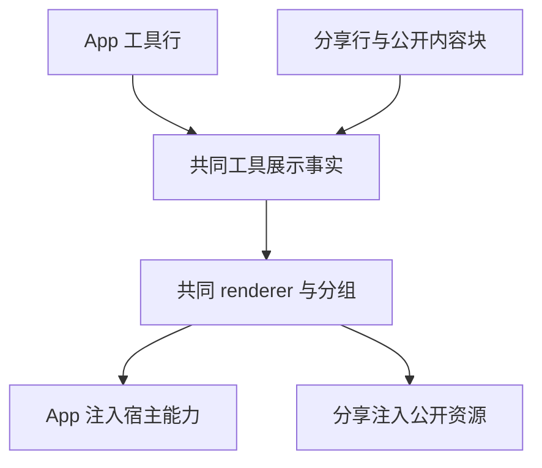

# 会话分享与继续工作 V1

## 状态

- 当前事实 spec，日期：2026-08-31。
- API 基线：会话分享接口 revision 27，加 2026-08-12 联调约定。
- 本文同时约束发布端、Desktop 导入端和同仓库 `packages/web` 的独立 share 落地页契约。

## 产品边界

V1 支持 Desktop 本地、SSH、WSL、Docker workspace 发起分享。手机 `/remote` 和普通 Web
不得发起分享；`packages/web` 的 `/cn/share/:share_code` 只消费 preview API 并通过 deep link 唤起 Desktop。Desktop Server
Remote 首期不支持。

运行中的会话可以分享此前已经完成的 product turn；运行中的 turn 可展示但不可选择。分享选择以
`productTurnId` 为身份，`rowId` 只用于 timeline 定位。标题默认当前任务标题并允许仅为本次分享编辑，
新分享草稿打开设置浮窗时权限默认 `public_importable`（拥有链接的人可导入并继续）；用户显式切换
权限后，调整分享范围或重新打开同一草稿都保留该选择。

```text
Desktop UI
  -> workspace-scoped ConversationShareService
       |- 目标 Environment JWT / Share API
       |- local/remote Conversation Rows + fileChanges
       `- local/remote artifact staging
  -> prepare -> upload -> confirm -> share URL

Web preview
  -> https://zcode.z.ai/cn/share/<share_code>
  -> zcode://share/import?code=<share_code>
  -> Desktop continuation
  -> 当前本地 workspace 新 task/session + shared_context + 全部产物
```

Share 落地页是独立静态构建：`pnpm run build:web-share` 使用 Vite `base=/cn/share/`，由
`Dockerfile.web-share` 和 `nginx.web-share.conf` 发布到 `/cn/share` 与 `/share` 两个语言入口。
两者共用同一份 SPA 和静态资源，路径前缀决定中文或英文 UI locale；它与 `/remote/v4` 使用独立镜像、
Deployment、CI Job 和回滚版本；公开 Preview 匿名访问，private Preview 使用同源 Web OAuth。

裁剪构建只安装 `@zcode/web-share` 的依赖闭包。复用的 Web/UI 源文件不能依赖完整工作区的
`node_modules` 链接；Vite 对 `@zcode/shared` 根入口使用精确匹配的源码别名，避免从 Web
目录解析失败，同时不得把 `@zcode/shared/*` 子路径改写到 `index.ts/*`。Share 闭包用到的每个
`@zcode/shared/*` 子路径（如 `test-ids`、`zcode-protocol-v4`）都要在 `packages/web-share/vite.config.ts`
登记精确的源码别名。隔离构建回归覆盖此约束。

镜像和 nginx 路由的手工验收用 `scripts/test-web-share-build.sh`（需要本机 Docker，不需要 CUA Git
凭据）。它校验构建产物落在 `/cn/share/assets`，
并确认 `/cn/share`、`/share` 两个入口和 callback 都能访问，同时不服务 `/remote/v4`；这些
base 路径和路由隔离在单测里覆盖不到，改动 Dockerfile 或 nginx 配置后应该跑一次。

OAuth callback 按语言入口提供 `/cn/share/callback` 与 `/share/callback`，登录凭据仍写入同源
`BrowserOAuthCredentialRepo`，因此登录后两个 Share 入口、`/remote` 和其他 Web 路径共享同一 Web
session。Web JWT 不进入 Deep Link，也不传给 Desktop。两个入口不互相重定向，避免英文页面被切换为
中文 locale；静态资源和 callback 均由 share 镜像独立托管。

权限映射固定为：`private` 需要 owner Web OAuth 后才能 Preview/import；`public_readonly` 和
`public_importable` 的 Preview 完全匿名开放。匿名请求 private 时，`401/3213` 或隐匿策略下的
`404/3211` 都只能显示通用登录提示；登录后仍为 `404` 时不得泄漏分享存在性或 owner 信息。
Desktop continuation 携带可选登录态，客户端不得因本地缺少 JWT 而跳过请求；最终 import 权限由
服务端根据 share code、访问模式和可选用户身份判定。

### 找不到分享内容页

已登录且 Preview 返回 `not_found` 时，沿用居中状态卡片，显示「找不到分享内容」及
「链接可能无效、分享已被移除，或当前登录账号无法访问。」；独立一段提示
「Z.ai 与 BigModel 的账号数据不互通。请检查是否选错了登录平台或使用了其他账号。」
账号提示是排查建议，不推断分享是否存在、所属平台或 owner。中英文提供同义文案。

操作区从左到右为描边「重试」和主按钮「回到首页」。首页复用既有官网地址
`https://zcode.z.ai`，同标签页导航，不清理登录态。按钮优先并排，窄屏或长文案允许换行；
使用现有主题与 UI 字号 token，兼容桌面、手机 Web 和深浅主题。

```text
Preview not_found → 现有 Loader
  ├─ 无 token → 登录选择页
  └─ 有 token → 找不到分享内容 + 账号排查提示
                   ├─ 重试 → 当前 token 再请求 Preview
                   └─ 回到首页 → 官网导航
```

状态仍由 `ConversationShareLandingLoader` 唯一持有，状态组件只负责展示。
不修改错误映射、OAuth、其他错误页、Desktop continuous 或手机 remote replayable 链路。

验收用例 SHARE-NF01（pending）：启动 `pnpm dev:web-share:mock` 后运行
`node packages/web/test/e2e/manual-review/pending/share-not-found.mjs`。
通过匿名访问 fixture → 登录 → 检查账号提示 → 重试 → 同标签页首页导航，验证上述边界；
另覆盖中英文、320px 手机/桌面视口、深浅主题、无横向溢出及过期页不出现新增内容。
首页请求由浏览器测试拦截，不依赖外网。组件单测补充其他错误状态的隔离断言。

本地 Share 验证入口：`pnpm dev:web-share:test` 启动与生产相同的 `@zcode/web-share` Vite 入口，
固定连接测试环境；启动后手动打开
`http://localhost:5173/cn/share/<share_code>` 或 `http://localhost:5173/share/<share_code>`，分享码只从 URL
路径读取，不需要环境变量；前者显示中文，后者显示英文。`pnpm dev:web-share:mock` 使用开发态
`/cn/share/mock-private`、`/cn/share/mock-readonly`、`/cn/share/mock-importable`、`/cn/share/mock-expired`
和 `/cn/share/mock-not-found` fixture。两者都只启动 Vite，
不启动 Desktop、relay 或独立 Agent。跨版本兼容另有两个 fixture：
`/cn/share/mock-partial-unsupported`（认不出的行被跳过，顶部出软提示）和
`/cn/share/mock-outdated-client`（载荷版本高于本 build，显示「需要更新 ZCode」而不是「格式无效」）。

目标 Environment 的分享运行时始终使用真实 Share API，API 地址由 `ZCODE_ENV` 解析；不再提供运行时
Mock 开关。`ConversationShareMockApiClient` 仅用于服务单测和协议 fixture，不能生成可跨进程访问的分享链接。

公开页正文展示复用 `packages/ui` 的只读 presentation 层：通过
`buildConversationTurnRenderUnits` 保持 Desktop 的轮次和工作段顺序，使用同一套
`ConversationUserInputBody`、`ConversationUserInputContent`、`MessageResponse`、`Reasoning`、
`ToolLayout` 和 `ToolSummaryRow`。Share 只注入 locale、theme 和 code preview defaults，不注入
Host、workspace 或 file service；Desktop action、文件打开、编辑、重试和反馈仍只存在于 Desktop。
Explore/Execute/CUA 等连续工具也先经过 Desktop 的 `buildAssistantWorkRenderItems` 分组，公开页只
展示安全摘要和只读详情，避免把每条工具结果渲染成独立的大卡片。

Share 自己承接页面级纵向滚动，不改变全局 `body/#root { overflow: hidden }` 的 Desktop/remote 约定。
滚动根同时标记 `data-markdown-table-layout-root`，让长 Markdown table 在页面纵向滚动、表格内部横向
滚动之间保持独立。`MessageResponse` 的公开模式由一次性的 `TooltipProvider`、只读外链 handler 和
citation 清理组成：本地 citation 不泄漏路径，无法匹配公开 artifact 时不渲染协议 directive。

公开分享页顶部固定栏始终保持单行 64px 高度。`ZCode` 品牌、分享标题和继续 CTA 使用同一条连续
几何轨道；完整 CTA 无法为标题保留最小可见宽度时，切换为保留可访问名称的图标 CTA，再让标题
通过 CSS ellipsis 收缩。完整标题仍保留在可访问名称/`title` 中。`public_readonly` 始终不显示
CTA；该响应式策略只影响 Web landing page 的展示，不改变 Deep Link、权限或 Desktop/remote 行为。

当分享可继续导入时，正文时间线末尾还显示一个与顶部 CTA 样式和行为一致的“去 ZCode 继续”按钮，
按钮在正文内容栏内水平居中并复用同一个 `zcode://share/import` deep link。点击顶部或底部任一入口
都进入相同的自动打开提示流程；`public_readonly` 仍不显示任何继续入口。底部按钮属于正文流，
不能遮挡最后一条分享内容，也不改变分享内容的只读语义。

公开页元信息中的“结果物数量”只统计公开 `rows` 内的 `kind: "artifact"` 行，也就是时间线实际展示的
Assistant 结果物卡片。`preview.artifacts` 是结果物和 `userInput.attachments` 共用的完整下载 manifest，
不能直接作为结果物计数；用户输入附件继续参与 URL/name 映射和下载，但不计入“结果物”数量。

用户输入的图片附件按 `mime` 显示缩略图，优先通过 `previewRef`、其次通过 `ref` 在既有 artifact URL
映射中取图；点击缩略图通过附件 `ref` 对应的地址打开原图。普通附件、无可用图片地址或图片加载
失败时保留文件名、大小和原文件下载入口。桌面只读分享预览与公开页复用同一呈现，在手机窄屏自动
换行并约束宽度；两种主题和中英文可访问名称都来自现有规则，不新增宿主读取或上传通道。

## 协议优先级

当历史方案、接口示例和本文冲突时采用以下规则：

1. confirm 只提交 `selected_product_turn_ids`、`projection.rows`、两哈希 integrity 和披露确认。
2. title、schema version、access mode、client request ID 和 payload hash 只在 preparation 提交。
3. Preview / Continuation 的 integrity 只有 `projection_sha256` 与 `artifact_set_sha256`。
4. artifact 上传成功响应必须包含非空 `safety_status`；客户端不按其取值分支。
5. HTTP 409 / code `3215` 是安全检查非终态；同一 preparation 与字节语义相同的 confirm DTO
   串行轮询，优先合法 Retry-After，否则 5 秒，总等待不超过 2 分钟。
6. TTL、限额和产物白名单完全以 capabilities 为准；PDF 只有服务端显式声明后才开放。

## 跨版本兼容纪律

分享内容在 **4 个可以各自独立升级/回滚** 的部件之间流动：发布端 Desktop、Share API 后端、
独立部署的落地页镜像（见上文「独立镜像、Deployment、CI Job 和回滚版本」）、导入端 Desktop。
它们不可能同版本，所以公开投影事实上是一份**跨版本数据交换格式**。以下纪律不是建议：

1. **响应宽容、请求严格。** 入站 schema（capabilities / preview / continuation / 错误信封 /
   artifact descriptor 回显）一律非 strict，未知字段放过；出站 schema（preparation /
   confirm / continuation request）保持 `.strict()`，多带字段是本端 bug，必须当场炸掉。
   给入站 schema 加回 `.strict()` 等于让后端下一次加字段打死全部存量客户端。
2. **完整性只对服务端原样发来的值校验**，不对 zod 解析产物（`verifyConversationShareIntegrity`）。
   zod 默认剥掉未知字段，拿解析产物重算哈希会把纯 additive 的 row 演进误报成
   「分享文件校验失败」。摘要与 schema 认知必须永久解耦。
3. **rows 只能 additive。** 新字段必须 `optional`；**永不删字段、永不收窄 enum、永不改字段
   语义**——删字段和收窄枚举同样会让对端丢内容，方向只是反过来。
4. **新增 row kind 或 enum 取值 = 老客户端会跳过该行**（`decodeConversationShareRows` 逐行降级，
   UI 出「部分内容需要更新 ZCode 查看」软提示）。加之前先问：这行被跳过后，分享是否仍然自洽？
   需要「不可跳过」的语义变化，才谈得上第 5 条。
5. **`schema_version` 只在 rows 出现不可跳过的破坏性变化时才 bump**，且 bump 前先确认存量
   客户端与已部署落地页镜像的版本占比——bump 一次就等于让它们同时看不了新分享。版本高于
   本端认知时走 `unsupported_schema_version`（「请升级 ZCode」），不得混进 `invalid_contract`
   （「分享格式无效」）。
6. **`projectRow`（`conversationSharePublicProjection.ts`）的穷尽 switch 是故意的编译期闸门，
   不要给它加 `default`。** 新增 row kind 必须让构建失败，强制开发者按第 4 条做决定，而不是
   悄悄开始往公开投影里发老客户端读不了的东西。

回归覆盖在 `packages/shared/test/conversationShareContract.test.ts` 的
「cross-version forward compatibility」一节，以及 `conversationShareImportService.test.ts`
里「导入更新版本发布的分享」的端到端用例。改动入站契约后必须跑这两处。

## 权威与安全边界

### R3 Source Server 的分享权威（2026-09-16）

R3 远程 workspace 的分享由目标 Source Server 执行，读取目标 Environment 当前 OAuth/JWT、
网络配置、会话和文件。Desktop 只转发请求并提供可信 attachment 上下文；本地账号即使与远端
不同，也不得改变分享所有者。Provisioning 可以先写入远端凭据，但每次分享只读远端正式 Store，
不在线读取 Desktop JWT，也不在未登录/失效时回落本地账号。此规则替代旧 SSH mixed-service
模式中“远端文件 + 本地 JWT/API”的组合；本地 workspace 继续在本机执行。

```text
Desktop attachment（覆盖不可信 caller 上下文）
  → SSH/WSL/Docker → Source Server Share RPC
                    → 远端 OAuth + 远端 HTTP + 远端 Rows/File
                    → 复用同一 V4 trusted carrier / 已握手连接
  server 直连 → 保持一期禁用
  手机 attachment / Source 的普通 Web 入口 → 拒绝发布和导入
```

Source Share RPC 只接受受信 Host transport 下的 desktop-continuous 下游上下文；Rows/File 查询
沿用该 transport 的既有 Agent scope，由它命名空间化下游 connectionId，不能另建连接或握手。
Desktop 的 raw renderer 字段必须被可信 attachment 真值覆盖，Source Web 客户端不得伪造该字段。
Source 的发布状态、预检缓存、临时文件与 HTTP 均由其现有 ShareService 管理；重连重建 RPC
attachment，不新增 stream、队列或恢复语义。Desktop continuous 与手机 replayable 保持原边界。

Share 数据携带 workspaceIdentity 与 remoteSessionId；隔离 key 仍为
`workspaceIdentity?.trim() || workspacePath`。Source 身份转换复用现有 canonical mapper。
JWT、Signed URL、Rows 正文与文件内容不得进入日志。`remote:server:...` 是身份格式，不能据此
把 SSH 当成用户选择的 Server 直连。

回归：真实远程工厂 → Share RPC → trusted Agent 的完整组合；本地账号 A、远端 B 时必须只用 B，
远端退出后拒绝而不回落 A；直接 Web/mobile 与 Server 直连仍拒绝；握手上下文必须与既有会话一致。
SHARE18 单独运行，先通过现有 Provisioning 将显式提供的 Team profile 写入远端，再由远端访问
匹配的生产 Share API。模型使用 case-local replay，必须真实生成文件并验证发布成功及产物字节。

### 公开分享页对第三方内容的防御边界

公开分享页（`/share`、`/cn/share`）渲染的是**发布者可控的正文**，访客是匿名的，因此在这个入口
上正文必须被当作不可信内容处理。两道防线都必须在位，缺一不可：

1. **渲染侧剥离**：`normalizeConversationShareMarkdown`（`packages/ui/src/v4/conversationShareMarkdown.ts`）
   把正文与工具输出里的远程图片语法降级为普通链接（`` → `[alt](https://x)`）。
   只处理 `http:` / `https:` / 协议相对 `//`；`data:` 不走网络、相对路径落在自身 origin，保持原样；
   代码围栏内的写法由 `findMarkdownCodeRanges` 保护不改写。
   原因：只读时间线不传 `workspacePath` / `sessionId` / `readAttachment`，`MarkdownImage` 会 fallback
   成 ``，于是任意访客一打开页面就自动向发布者指定的第三方发起
   请求，泄露 IP / UA / Referer —— 等价于发布者可控的 tracking pixel。放在渲染侧的好处是对**已经
   发布出去的旧分享立即生效**。

2. **传输侧 CSP**：`nginx.web-share.security-headers.conf` 的 `img-src 'self' data: blob:` 兜住第一道
   防线漏掉的任何形态。该文件同时提供 `X-Frame-Options` / `X-Content-Type-Options` /
   `Referrer-Policy`，并且**必须被每个 `location` 显式 include**：nginx 的 `add_header` 不继承，
   子级一旦出现任何 `add_header`（例如 `Cache-Control`）就会丢弃 server 级整组声明。

CSP 的两个硬约束（改动前先读，否则会静默打断线上页面）：

- `script-src` 必须带 `'wasm-unsafe-eval'`：shiki 代码高亮默认走 oniguruma wasm
  （`packages/ui/src/lib/shikiHighlighter.ts` 的 `createHighlighter`），只给 `'self'` 会让分享页
  所有代码高亮失效。它只放开 wasm 编译，`eval` / `new Function` 仍然被挡住（已实测）。
- `connect-src` 保持 `https:`：API origin 是 vite 构建期按 `ZCODE_ENV` 注入的
  （`packages/web-share/vite.config.ts`），写死具体 origin 会让 test/production 各自需要一份 conf。

artifact 只经 `window.open` 打开、不做 ``，因此不受 `img-src` 收紧影响。

## 发布投影

公开投影从正式 `ConversationRow[]` 构建，不从 DOM、legacy MessageWithParts 或 Web DTO 反推。

- 允许：`turnHeader`、`userInput`、`assistantText`、`reasoning`、`toolCall`、`timelineMarker`、`artifact`。
- `subagent` 详情过滤，但对应 Agent toolCall 与同轮其它公开 Rows 保留。
- 每类 Row 使用 allow-list 新建对象，删除 actions、source/root command ID、client ID、approval ID、
  active progress 和本地 artifact 引用。
- 确定性重建 public product-turn、turn、row、entity、tool-call、artifact ID；保持 Row 稳定顺序和引用闭包。
- descriptor 不发送 `original_path`。artifact ref 固定为 `zcode-artifact://share/<artifact_id>`。

选择至少包含一个 terminal product turn。每个被选 ID 必须只有一个 `turnHeader`，且状态不是
`running`。任一分页 revision/log epoch 不一致时必须在 preparation 前失败。

### Workflow 工具展示

`toolCall.display` 支持 `create_workflow`、`get_workflow_run`、`list_workflow_runs`、
`eval_workflow_snippet`、`saved_workflow_list`、`list_models`、`resume_workflow_run`。
客户端使用正式 `toolCallDisplaySchema` 校验并复制完整展示，服务端逐字段镜像其嵌套对象、
枚举、可选字段、数组上界和 UTF-16 字符串长度；未知类型、未知字段与非法值仍拒绝。
图片继续走既有 artifact 转换，不开放内联 Base64 或本地 URI。

这里分享的是工具执行时的展示快照：工具行必须终态，快照中的 workflow status 可以仍为
`running`，不要求后台工作流结束。runId、图内站点与阶段 ID 是快照数据，不作为分享端的
执行授权；不发布实时 workflowRuns 状态，不增加运行、恢复或订阅动作。
分享页复用现有 workflow 展示组件：Create/Amend 的静态阶段图与编译诊断、Get 的运行摘要/
阶段/子代理/日志、List 的运行清单、Eval 的诊断/结果、Saved 的工作流清单、Resume 的结果说明。
展示仅代表工具调用时的快照；不注入本地文件、session、编辑、运行或恢复回调。缺少 display 的
历史行沿用通用工具卡；ListModels 使用共享的模型目录 renderer。导入端保留 display，schema_version 维持 1。
桌面/手机、深浅主题与中英文下可阅读并展开详情，窄屏卡片表头允许换行，工作流名称不得被状态挤至不可见；页面不请求桌面宿主服务。

验收：7 种展示完整投影、服务端 confirm 校验和导入解码通过；嵌套未知字段、类型/枚举错误、
越界数组/字符串/整数、显式 null 失败，错误包含 row 和嵌套字段路径；普通工具、图片转换与
分享完整性校验不回退。两端测试使用相同的 workflow display JSON 样本。
浏览器验收 SHARE-WF01（pending）：启动 `pnpm dev:web-share:test`，运行
`node packages/web/test/e2e/manual-review/pending/share-workflow.mjs`；测试拦截 preview API，
覆盖桌面/手机、中英文、Zai Light/Dark 的基本展示、展开诊断、历史兜底、只读与无横向溢出。

### 可扩展只读内容块

公开投影在 `rows` 之外允许可选 `content_blocks`，每块带 `type`、独立 `version`、公开
product-turn 锚点、`fallback_row_id`、`captured_at` 和 `resource_ids`。首个类型为
`workflow` v1：运行图与状态、完成通知、六类用户产物。不是透传实时 workflowRuns；
发布后为不可变快照。发布器生成一个已有 assistantText 类型的摘要 Row，旧读端可以阅读；
新读端仅在块可识别且成功渲染时用卡片替换摘要。未知或损坏块保留摘要，不影响同轮正文。

服务端通过可选 `content_block_versions: { workflow: 2 }` 声明当前能力；仍兼容版本 1，版本 2
增加冻结文本预览。能力缺席时只发布摘要与
允许的普通资源。`schema_version` 保持 1。新增块字段以严格白名单校验，资源必须闭包于
本次 manifest；块使用独立 `content_blocks_sha256`，既有 rows/artifact 哈希不变。
preview、continuation、导入归档均保留块，完整性在逐块解码前按 wire 原值校验。

```text
所选终态轮次 → Share Service → 原 Agent 的 journal 事件冻结读取
                              → 同一 reducer 生成 run 状态与产物版本
                              → 指定版本字节 / 截止 sequence 的看板条目
                              → 公开字段投影 + 摘要 + 上传 → Server 不可变快照
                                                           → Web / 导入只读展示
```

workflow 事件按 `afterSequence` 分页读取，跨页 sequence 必须严格递增；空的未完成页、重复游标、
读取失败或累计超过 20000 条时将该 run 标记为不可用。读至 `hasMore=false` 形成 append-only
前缀，末条 sequence 是本次截止点（不是首个请求的时刻）；持续追加也受总条数限制。看板分页
过滤该水位之后的条目，文件按 reducer 记录的 artifact version 读取。禁止用 conversation
revision 冒充 journal 水位。运行中的后台 workflow 不阻止已完成产品轮次分享；其卡片明确
标注分享时快照。历史关联或源数据不可读取时保留带原因的摘要，不伪造成功、零计数或空看板。
不会分享未选择的其它对话/子代理 transcript，不启用停止、恢复、审批或本地目录操作。
卡片和看板复用纯展示组件与算法，公开 bundle 不引入 Desktop service/store。

预检与发布使用同一采集器，发布重新冻结，不复用上一次预检的运行态。文件沿现有上传审核；
结构化看板随块计入 payload 限额并参与内容审核。每个新增内容类型必须声明公开 schema、
采集器、摘要、资源策略和只读 renderer；未知类型只读摘要，不自动执行插件代码。

产物下载文件名使用来源类型对应的扩展名，标题中的点号和版本号不改变文件类型。文本解码及
公开 schema 校验全部通过后，才同时登记内容块、artifact 行、字节和资源预算；失败产物仅
保留未包含说明，不进入上传集合。合成的 workflow 摘要仅用于展示，预检与发布均不得把其
标题、错误文本再次当作工作区文件引用。真实 assistantText 的文件发现保持原有行为。

公开 API 返回的产物 URL 只接受 HTTP(S)。工具图片缺少宿主读取能力及对应公开资源时显示
静态“预览不可用”，不显示无异步任务的 Loading。未知 HTTP 错误不归为响应契约损坏；无业务码
的 403 沿用隐藏分享的 not_found 语义，已知业务码优先。真正的成功响应结构错误仍为 invalid_contract。

验收 SHARE-WF02：完整运行卡、完成卡、board/table/chart/metrics、Markdown 与文件的实际
打开；选择完成轮、运行中快照、跨版本摘要、资源闭包/篡改、无 Desktop 依赖，以及手机/
桌面、Zai Light/Dark、中英文布局。旧分享未包含的数据只能重新发布补齐。

## 产物发现与上传

分享候选包括当前轮次的 `userInput.attachments`、当前轮次最终显示的 Assistant 预览卡片，
以及已完成工具输出的内嵌图片。正式 `artifact` row 不再作为独立发现源；只有它同时形成了预览卡片，
才通过预览卡片候选进入分享。

预览卡片候选必须由 shared candidate builder 统一生成，UI 和 Share Service 使用同一套顺序、
去重和可见数量限制。普通正文中的 `~/...` 路径、Bash input/output、workspace 扫描、孤立
`fileChanges` 和没有形成预览卡片的文件都不是候选。`fileChanges` 只用于 Markdown/HTML
卡片的 active/reverted 关联，不独立发现文件。

候选文件先经过所属执行端 stat，再取最终可见卡片集合；不存在的 Assistant 卡片文件被视为
“卡片不显示”，不进入分享且不生成 warning。用户输入附件仍保留附件不存在 warning。
PDF、Office、Markdown/HTML、视频和音频都可以成为预览候选，但 video/audio 当前只允许进入
“存在但类型不支持”的 warning，不进入可上传 artifact manifest。相同 canonical path 只上传一次。

```text
正式 attachment / assistant 文件引用
                 |
                 v
    PreviewableArtifactCandidate（文件预览候选集合）
                 |
       +---------+---------+
       |                   |
       v                   v
  UI preview card     Share Artifact Row
```

文件在所属执行端完成 realpath containment、普通文件、类型、size 与 mtime 校验。远端文件通过
`readFileRange` 分块进入 Desktop 临时 staging，边写边计算 SHA-256；前后 size/mtime 变化、空 chunk、
断连或越界均 fail closed。prepare 之后只上传 staging 的不可变字节。上传按稳定 manifest 顺序串行，
任一失败不 confirm，finally 清理 staging。

`userInput.attachments` 通过当前 Agent connection scope 按 `rowId + entityId + attachmentIndex`
授权读取，不允许 Renderer 直接把附件路径作为读取目标。长文本粘贴保持现有
`~/.zcode/tmp/paste-attachments/<date>/<uuid>.txt` 路径处理，不在发送时重新内联正文；分享时
复用同一读取链路。文件已被清理、读取失败或字节发生变化时，只跳过该附件并在发布成功态展示
`input_attachment_unavailable` warning，不把失效路径写入公开 projection。可用附件统一改写为
`zcode-artifact://share/<artifact_id>`，不额外插入 `artifact` Row，直接通过 manifest 闭合。

分享 artifact 类型增加 `text`，对应 `txt` / `text/plain`；服务端按 UTF-8 文本走与 Markdown/HTML
一致的同步安全审核。`text` 类型与客户端、服务端和独立分享落地页同步升级后开启。

## UI 状态机

顶部分享按钮打开锚定按钮的非模态浮窗（建议宽 360px，边缘自动避让），不加全屏遮罩，
不替换 Composer。浮窗展示标题、整行分享范围按钮、权限、敏感信息确认和「生成分享链接」。
分享范围按钮将摘要、对话图标与向右箭头合并，点击整行打开现有选择面板；不再单独显示「调整」。
预检进行中（含 stale）在该按钮内显示 loading 与「正在检查分享内容…」，不另占一行；检查完成恢复范围摘要，按钮高度保持一致。
预检问题入口使用紧凑提示（如「有内容无法分享，查看问题」），详细说明保留在点击后的浮层中。提示采用 sm 字号、左对齐，图标固定 16px 且对齐首行；窄窗口换行时文本保持左对齐。
范围箭头与权限下拉箭头统一为 14px、右侧 8px 内边距；诊断详情与修复操作保留现有入口。
浮窗主标题使用 text-ui-lg，字段 label 使用 text-ui-base，辅助说明保持次级字号。
浮窗使用 12px 紧凑内边距与字段间距，输入框、范围按钮和权限选择统一共享 lg 控件规格；
底部生成分享链接主按钮单独使用 40px 高度，文字保持 text-ui-base，上方表单控件保持 32px。
敏感信息确认不使用卡片背景、边框或橙色侧线，以普通复选框与次级说明呈现。
确认文案、发布阶段名称、诊断正文、成功页字段与链接使用 text-ui-base；
说明、预检提示及辅助操作使用 text-ui-sm，不将辅助说明降为 text-ui-xs；主浮窗标题沿用已确认的 text-ui-lg。
检查范围浮层复用共享 Popover 默认 offset、边框与阴影，
使用 12px 内边距、base 正文和 sm 分组/说明，不叠加尖角、分隔线、橙色圆点或独立底色页脚。打开时聚焦浮窗而不自动选中标题。
默认选择全部已完成轮次，权限默认 public_importable。运行轮次不可选，分享标题不修改任务标题。

```text
顶部分享 → 分享设置浮窗 → 生成 → collecting → uploading → checking → published / failed
                    │
                    └ 调整 → 现有左侧选择面板（临时勾选）
                                  ├ 确认 → 写回范围、关闭选择面板
                                  └ 取消 → 丢弃临时勾选、关闭选择面板
```

ConversationShareSelectionStore 按 sessionId 唯一持有已确认范围、临时勾选、浮窗可见性与发布状态。
浮窗可见性由 `open` 表达，范围编辑由 `pendingExcludedRowIds != null` 表达；不再维护旧 scope/stage/view 或全局 dropdown 状态。正文只承担定位展示，勾选和全选统一由范围面板的事务命令处理；`ConversationSharePreflightStatus` 仅显示问题与重试/整轮移除操作，不保留旧下一步与批量选择控件。
「调整」复制已确认范围到临时选择；逐轮勾选以 productTurnId 为身份，同轮多条 query 一起改变。
选择面板复用现有提问/回复摘要，点击列表项（文字、摘要或空白）和复选框都切换临时选择；右侧独立定位按钮只跳转正文，不改变勾选。键盘 Enter/Space 可切换文字按钮，定位按钮可独立聚焦；运行中条目不可勾选，但仍可定位。
选择面板各行统一 8px 纵向内边距、4px 标题摘要间距，取消首项特殊缩进；标题 base 常规字重，摘要 sm。Checkbox 与首行 prompt 垂直居中，message 与 prompt 左对齐。选择器宽 320px，窄窗口不超过视口减 16px；prompt 保持一行，message 最多两行并截断。滚动视口上下各使用 32px 透明度 mask 渐隐：仅在对应方向还有内容时显示，到顶/到底时取消对应渐隐；无溢出时不渐隐。mask 不作用于滚动条和底部操作区。顶部固定全选 Checkbox 与列表 Checkbox 左对齐：全选、未选、半选三态；半选时点击补齐全选，全选时点击清空，仅操作已完成的可选行。批量修改仅写入当前选择草稿，确认后生效，取消撤销；无可选行时禁用。

面板采用顶部全选、中间滚动列表、底部状态与操作三层结构。底部默认显示已选轮数，超限时替换为 warning 色「超出上限 N 行」并禁用确认。预检进行中显示检查状态并禁用确认，空选亦禁用确认。行数与上限来自现有服务预检，不写死 500，不把轮数当行数。

数据链路：勾选 → selection store 的 pendingExcludedRowIds 草稿 → 复用按轮缓存/预检 → 聚合行数 → 面板状态。确认保存草稿，取消丢弃草稿并恢复原选择的预检；草稿不存在时使用已确认选择。沿用 workspace/session 隔离与过期响应处理。验收覆盖全选/半选/空选、超限后减选恢复、取消回滚、检查中禁用确认，以及桌面/窄窗口与深浅主题。
勾选由共享 Checkbox 表达，未勾选仍保持正文可读，仅运行中禁用项弱化；hover 使用统一浅色背景。
底部固定显示「已选 N 轮」「取消」「确认」，计数为 sm，按钮统一 32px，列表内部滚动；未选任何轮次时确认禁用。
确认后才更新浮窗数量；取消保留原范围和敏感信息勾选，范围改变后确认重置敏感信息勾选。
调整期间浮窗保持可见，生成禁用；不新增二级页面、折叠列表或选择器。

点击两个面板外部或 Esc 时优先取消临时选择，只关闭选择面板；再点击外部或 Esc 收起浮窗。
点击正文定位、浮窗以及其权限/诊断浮层不误关闭选择面板。收起浮窗保留当前会话草稿，再打开恢复。
切换 session 不得串用选择、标题、权限、发布进度或成功结果。

发布前标题为空、未选内容、范围调整中或预检未通过时禁止生成。敏感信息未确认时点击生成只定位、
聚焦复选框，将确认文案显示为 warning 颜色，并让复选框与文案整行左右轻微抖动一次（280ms、最大 4px）。
不改变底色或复选框边框，不自动发布；重复点击重启动画而不叠加，勾选或卸载立即取消。开启减少动态效果时仅保留 warning 色。
勾选后文案立即恢复正常颜色，仍需再点击生成。
确认项已可见时不滚动；需要定位时仅滚动浮窗正文，外层页面与固定底部按钮保持稳定。
发布期间锁定修改和关闭；失败原位显示原因、诊断与重试，保留草稿。
生成中的浮窗沿用 12px 间距，显示最多两行任务标题、细进度条和三步阶段列表；只在当前阶段显示辅助进度说明，
当前阶段进度（如上传数量）是主要信息，使用 text-ui-base；底部轮次/权限摘要使用 text-ui-sm。
字号随界面设置缩放，图标尺寸保持不变。进行中图标旋转，完成态勾选，待执行态弱化。移除重复的顶部进度文案和不可操作的底部生成按钮，保留轮次/权限摘要；失败后恢复重试入口。
成功原位显示只读标题、真实链接、复制链接和浏览器查看；复制后短暂显示已复制，浮窗继续保持。
成功浮窗去掉重复说明与「分享标题」标签，任务标题最多两行；链接框为 32px，保留选中复制。
统一 12px 内边距，移除底部分隔线；两个操作等宽、高 40px，浏览器查看为次按钮，复制链接为主按钮，成功图标与标题居中对齐。
成功后关闭并再次点击顶部分享，开始新一轮分享设置：保留标题与权限，范围恢复为当前全部已完成轮次，
清除上次成功链接、诊断、进度与发布 attempt，敏感信息确认重置为未勾选；可重新调整内容再生成。
未发布成功的草稿关闭后仍恢复原设置，失败重试仍复用原 attempt。新一轮仅重置本地状态，不撤销旧链接。
状态归属仍为 ConversationShareSelectionStore：published → closeShare（收起）→ openShare（新配置）→ publish（新 attempt）。
被跳过的文件保留非阻断 warning。无真实 confirm 成功结果时不得显示链接。

浮窗正文独立滚动，生成按钮保持可见；选择面板底部按钮同样不可被列表挤出。窄窗口无法并排容纳时，
调整期间限制设置浮窗高度，选择面板避让到其下方，两个面板均保留原操作。兼容窄窗口、
Zai Light/Dark 和中英文。手机 remote 与普通 Web 继续不提供分享入口，Desktop continuous 与
手机 replayable 权限/恢复边界不变；发布 API、Host authority 和幂等重试机制不变。

验收 SHARE34：打开/收起保留草稿；调整临时选择不改变已确认范围；取消回滚、确认生效与空选择禁用；
文字定位不关面板；Esc/外部点击逐层关闭；运行轮次禁选；发布锁定、失败重试、成功复制；跨 session 隔离。
浏览器组件集成用例保留在 manual-review/pending，不视为真实 Desktop 发布或手机远控实测。

选择阶段的 `SharePreflight` 是独立的只读检查，不上传文件、不读取完整附件内容，也不改变选择草稿。
它绑定当前 `sessionId`、`workspaceIdentity/workspacePath`、`remoteSessionId`、selection、rows
`revision/logEpoch`、capabilities fingerprint 和候选 fingerprint；选择、候选集合、文件变更
状态或会话水位变化后旧结果必须标记为 stale。

预检结果分为四类：

- **阻断**：选择已失效、缺少 product turn、轮次/正文/工具/子 Agent/compact/goal verification 仍在运行、
  本地或内联 URL、未闭合 artifact 引用、陈旧水位、已知容量超限或没有任何可分享内容。阻断项展示在分享设置中，
  不允许生成链接。
- **可跳过**：存在但不支持的预览卡片文件、明确不存在或已变化的用户输入附件。允许继续，发布时跳过对应文件并在成功态展示 warning。
- **卡片消失**：Assistant 预览候选在 stat 时不存在，视为 UI 不显示的卡片，不进入分享、不生成 warning。
- **延后确认**：权限不足、远端断开或 stat 超时等无法证明文件不存在的情况。选择阶段只提示“发布时会再次确认”，
  发布阶段以实际读取结果为准。

  分类依据必须是协议侧的稳定 fault 码（`ZCODE_ATTACHMENT_FAULT_CODES`），不能匹配错误文本。
  `conversationAttachmentStat` 是 metadata-only 探测，其 `totalBytes` 上界（`attachmentStatMaxBytes`）
  与搬运字节的读取通道上界（`attachmentPreviewMaxBytes`）是两个独立边界：stat 必须能表达超出传输能力的
  真实文件大小，否则“已知容量超限”这一确定阻断会退化成“延后确认”，发布时静默丢掉附件。
  类型判定排在体积判定之前——不支持的类型根本不会上传，其体积与分享无关，不应升级成阻断。

- **静默移除**：`forkNotice`、`forkCreated`、`checkpointRestored` 以及其它已完成但
  无法在线性公开时间线表达的内部 marker，直接从公开 projection 删除，不生成 warning、不计入跳过数量，也不要求
  用户取消轮次。若静默移除后整次选择没有其它可分享内容，才按“没有可分享内容”阻断。

分享浮窗 在预检期间显示 `checking` 状态；阻断项显示具体轮次和“取消选择该轮”操作（按 issue 携带的
`productTurnId` 整轮移除，`turnOrdinal` 只用于展示文案——两者编号口径不同，用序号反查目录会取消错轮次）；存在可跳过文件时，操作行显示
跳过数量。确认和发布阶段仍必须复用同一套校验并重新检查 revision/log epoch、文件 stat、大小和 SHA-256，防止预检后
的文件或会话发生竞态变化。

预检结果由当前分享流程的 renderer-local owner 按 `productTurnId` 缓存，而不是按整个 selection 反复检查。首次打开分享浮窗时，
仅批量检查当前尚未命中的轮次；之后新增选择只检查新增且未命中的轮次。取消已检查轮次、重新选择已检查轮次以及
确认范围都只读取缓存，不重新发起 preflight RPC。缓存绑定 `workspaceKey`、`remoteSessionId`、`sessionId`、
`productTurnId`、rows revision/log epoch、turn/candidate fingerprint、fileChanges 状态和 capabilities fingerprint；
当前轮次内容、候选集合、文件变更状态或能力发生变化时，只失效受影响轮次。
缓存不进入数据库或 conversation snapshot，取消/完成分享或切换 session/workspace 时清理。

分享浮窗交互归入 `packages/ui/src/conversation-share-interaction/` 受管模块。模块提供浮窗、
预检提示、范围事务动作以及预检请求与响应处理器；调用方通过登记的入口访问。selection store 仍独占范围草稿，
SessionPane 仍独占预检缓存和发布状态，模块不增加持久化或独立业务状态。手机远控不新增分享入口。

预检响应处理异常也必须结束检查：当前请求未命中的轮次写入可重试的 transport 阻断项，保留选择，
禁止生成，并通过问题详情提供「重新检查」。异常日志与服务端失败日志分开记录。响应条目全部构建成功后，
才能提交元信息与缓存，避免失败响应的 capabilities fingerprint 使恢复结果立即失效；过期请求不写入任何状态。
状态顺序：`checking → ready（阻断）→ 重新检查 → checking → ready（成功或阻断）`。

## 发布错误详情契约

发布失败不得只显示首个错误或一条无上下文的 Toast。Host 在 prepare 前必须执行一次
SharePreflight，并在失败时返回最多 5 条脱敏后的 `issues`；超过部分只返回计数。每条 issue
可包含轮次序号、文件名（仅 basename）、artifact type、扩展名、MIME、实际值与能力上限，
禁止包含绝对路径、URL、文件内容、哈希、Token 或内部持久化 ID。

结构问题至少细分为运行中的 turn、streaming row、活动工具调用、活动子任务、运行中的 compact/goal
verification、用户输入附件、本地/内联 URL、未闭合 artifact 引用和陈旧 revision。已完成的 fork/checkpoint
内部 marker 不属于用户可操作错误，必须静默移除；内嵌工具图片按下述产物转换规则处理。阻断项按同一轮合并展示，并提供取消该轮的操作。
产物白名单问题必须显示文件名、
实际的 type/extension/MIME 和当前 capabilities 允许的格式；Markdown 的 `html + text/markdown`
组合与 HTML 的 `html + text/html` 组合必须区分。

行数、产物数量、单文件大小、总产物大小和 JSON payload 大小必须同时报告实际值与上限，
不能统一退化为“超过分享限制”。网络、上传和安全检查错误必须标记失败阶段；若服务端没有
返回可定位信息，只显示稳定错误类型、阶段和安全的重试建议，不展示原始服务端文本。

HTTP 错误分类以故障源为先：网关/负载均衡返回的 5xx 非 JSON 错误页（502/504 HTML）是
基础设施故障，必须归类为 `service_unavailable`，与未收到响应的 network 类区分，不得因 body 无法解析而归类为 `invalid_contract`
（后者语义是服务端违反 API 契约，会误导排障与用户提示）。artifact 上传是用户主动等待的
大传输，单请求超时按 artifact 字节数动态放宽（保底带宽估算），不能沿用普通 JSON 请求的
默认超时；confirm 之外的超时放宽规则同源。

分享 dock 保留打开状态，发布失败继续停留在发布态 dock 中，并在进度信息下方内联显示可滚动的
错误详情；发布失败不再显示顶部错误 Toast。错误态保留「调整」、关闭浮窗和「重试生成链接」，
用户修改选择、标题或权限后清除旧详情。所有详情文案必须同时支持中英文、浅色/深色主题和窄屏布局。

发布、导入、网页预览共用业务码和 HTTP 状态分类：3216 提示内容未通过安全检查、需调整内容；
3217 提示安全检查服务暂不可用、稍后重试；通用 5xx 提示分享服务暂不可用。原始数字 code 必须保留，
包括未知业务码。401/429 空响应分别提示登录和稍后重试，HTML 错误页也按 HTTP 状态判断。
3211/3212 在发布阶段提示重新生成链接，并清除旧 attempt 以生成新请求 ID；导入的 3211/3212/3214 和不支持的版本不提供原样重试，
分别提示检查链接或账号、让分享者重新生成、只读分享无法导入、更新 ZCode。3210 不断言文件丢失，
统一提示上传未完成或分享状态已变化。3215 保持现有有界串行轮询，优先使用合法 Retry-After-Ms。

服务端校验失败的 data 只接收有界的 rule/path/field/row_index/row_kind 结构字段，忽略原始内容与
其他字段；无效诊断字段不影响错误分类。主提示保持一句原因和下一步，技术位置放入错误详情。
服务端请求 ID 优先取 x-request-id，缺失时可取合法的响应 logid；不得使用客户端请求 ID 代替。
网页错误页同样提供 HTTP/code/服务端请求 ID 详情，导入失败日志保留这些字段供定位。

```text
HTTP 响应 → shared 分类/诊断校验 → Host 或 Web 客户端错误
                                 ├─ 3215 → 原有 confirm owner 有界串行轮询
                                 └─ 终态 → 原有 UI 错误态 → 原因/行动 + 按需诊断详情
                                      └─ 3211/3212 → UI 清除已失效 attempt → 手动重试生成新请求 ID
```

错误详情中的服务端 `x-request-id` 默认不在错误 dock 内联展示；错误引导文案末尾提供一个
click-only 的错误详情按钮，点击后通过向上的 Popover 展示并复制合法的服务端 request-id。
没有 HTTP 响应 request-id 时仍保留该入口，在 Popover 中显示稳定缺失提示且不提供复制操作；
不得使用客户端生成的请求头 ID 冒充服务端 ID。多条 issue 共用一个详情入口，不在每条 issue 后重复
request-id。错误按钮与错误文案保持同一内容列，使用 24px 点击区域和语义 destructive 色，需支持
键盘触发、Esc/点击外部关闭、窄屏碰撞调整以及浅色/深色主题。范围面板取消时丢弃 pending 草稿，
保留已确认范围、标题、权限与错误草稿；再次点击浮窗范围按钮开启新的编辑事务。正文定位不关闭面板。

错误详情卡只有一条可行动文案时采用紧凑单行布局：文案、错误详情按钮和“关闭”操作垂直居中，
上下内边距保持一致，使用较小的 `p-2`，并将卡片与操作栏的间距收窄为 `mb-2`；包含多条 issue 时才恢复列表所需的
额外间距，避免单行错误
提示在底部留下不必要的空白。

用户必须显式确认系统不会自动识别敏感信息。发布期间面板不可关闭。真实 `share_url` 只在 confirm
成功后显示；不得使用 demo URL 或模拟 loading。相同标题、权限、选择和内容重试复用 clientRequestId，
输入变化后生成新 ID。

发布失败必须按稳定错误 kind 显示可操作提示，不得统一退化为“请重试”。执行分享的目标 Host 记录
`operationId`、阶段、kind、HTTP status/code 和安全计数；Server Remote 等主动拒绝记录明确 reason。日志
不得包含 JWT、Signed URL、Rows 正文、文件名或绝对路径。公开投影和产物 staging 失败还记录稳定
`reasonCode`（如 `input_attachment`、`running_turn`、`artifact_changed`、`unsafe_url`）及安全的
`rowKind/rowId/artifactType/phase` 诊断字段；UI 按 reasonCode 提示下一步操作，不展示底层原始错误文本。

成功 HTTP 响应解析失败时，HTTP 客户端记录 `responseFormat`（`invalid_json` 或 `schema_mismatch`）、
响应字节数、接口路径、请求 ID，以及最多 10 条校验问题的安全字段路径和类型；不记录原始响应、
字段值或校验器原始错误消息。未知动态字段名以占位符隐藏。界面说明 ZCode 无法读取分享服务的返回结果，
引导稍后重试，并在持续失败时通过错误详情复制请求 ID 联系支持；不把 HTTP 200 描述为发布成功。

## 导入与继续工作

Web CTA 使用 `zcode://share/import?code=<share_code>`，deep link 只能携带 share code。main process
只解析、缓存和投递 intent；Renderer 不按本地登录态前置拦截，统一调用 Host import service，
由 continuation API 返回最终访问判定。share deep link 的目标窗口解析与其他 deep link 一致，
必须走调用方注入的 `resolveApplicationWindow`（排除 CUA indicator 等辅助窗口）；窗口未就绪时
缓存的 pending import 必须绑定目标窗口的 webContents id，只投递给目标窗口，目标窗口关闭时
清理，不得投递给先 ready 的任意 renderer——导入会写入目标窗口激活 workspace 的
`.zcode-share`，投递错窗口等于在错误 workspace 创建会话。

导入在当前本地 workspace 下创建新的 conversation task/session；远程 workspace 回退到默认本地
conversation workspace。产物固定写入 `<workspace>/.zcode-share/<share-id>/shared-artifacts/`，
同一 `workspaceKey = workspaceIdentity?.trim() || workspacePath` 与分享码幂等复用，不同 workspace 各自创建 session。
创建 import-owned pending marker 后：

1. 调 continuation 并校验 schema 与两哈希；
2. 全部 artifact 下载到同文件系统 staging，复验 size/MIME/SHA-256。下载必须带单请求
   超时（挂住的连接按 network 失败，不得无限停在 downloading 阶段），并在读取 body 前
   预检 `Content-Length`：超过 manifest 声明的 `size_bytes` 时立即中断，不把已知的
   超大响应读进内存——完整性校验放在无界下载之后只保证正确性，不保护客户端资源；
3. 原子 rename 为 `shared-artifacts/`；
4. `SharedContextFormatterV1` 按 Rows 原序生成确定性 Markdown，并把 artifact ref 改成相对路径；
5. SQLite 单事务创建 session、唯一 model-only `shared_context` message 和
   `v4/shared_context_import` provenance，初始状态为 `pending`；
6. 删除 marker、激活 workspace/session，并显示 Share URL handover。

整合约束（Todo103）：导入不执行模型，不依赖当前 Provider 可用性。分享上下文消息沿用当前
结构化 `modelSelection` 存储合同；有明确选择时保留，未绑定时不伪造模型来源，不重新写入旧
`model.providerID/modelID` 字段。原子导入与后续正常执行的模型校验是两个边界。

### 首次导入的选择初始化（Todo139）

导入服务返回 `reused=false` 后、激活 Session 前，Renderer 按结果中的实际 workspacePath／workspaceIdentity
准备该 Session 的独立 Composer 草稿。已初始化的 Root 草稿只复制 mode/modelSelection（包括明确空选择），
不复制正文、附件或提及，不清除 Root。目标草稿已存在时不覆盖；`reused=true` 不初始化。
无已初始化 Root 时，在同一草稿保存 `initializeFromNewTask` 待初始化标记，普通新任务与该标记共用
初始化函数：Recent 完整选择及模式优先，否则公共默认选择／build。Registry 尚未就绪先打开内容，
标记阻止空 Session snapshot 抢先初始化；公共读取就绪后一次完成。用户提前修改模型／模式即结束
默认初始化意图，迟到结果不得覆盖；正文编辑不清除待初始化标记。已有历史不按空模型推断首次导入。

```text
import result (reused=false) → seed independent draft → activate returned workspace/session
                                  ├─ initialized Root → copy selection only
                                  └─ pending marker → shared new-task initialization when View ready
reused=true → existing session/draft unchanged
user submission → existing context_refs + full modelSelection/mode → accepted updates Recent
```

不新增 Host／CLI 字段或同步机制；Renderer 草稿仍与 desktop continuous／mobile replayable 权威消息链路
分离。标记只属于现有草稿存储，不写会话数据库，不回填历史导入记录。

V4 projection 会通过 additive 的 `sharedContextImport` snapshot 元数据携带 `contextId`、标题、
canonical Share URL 和 `pending/reserved/attached/discarded` 状态。删除会话不删除普通
workspace 文件；导入完成后分享过期不影响本地副本。

导入时把公开 rows 与结果物元数据一并落到 `<workspace>/.zcode-share/<share-id>/shared-conversation.json`；
会话顶部据此渲染**只读块 + 分割线**（复用分享页的 `ConversationShareReadonlyTimeline`），
分割线的可点击与静态形态统一使用 Lucide `SquareArrowRightEnter` 图标，避免与 Fork 的分支图标混淆；保持现有尺寸、主题色和多端布局。
分割线之下是用户自己的实时对话。只读块不回源，因此分享过期或未上线也能离线打开；它不是
`timelineMarker` row，不进 transcript 导出，也不参与重新分享。

Desktop 导入块中的 artifact 卡片只在本地副本存在合法 `workspaceRelativePath` 时提供打开动作：
主按钮复用正常预览卡片的 `OpenSplitButton` 打开 PreviewPane，下拉菜单复用同一套编辑器选择与
复制绝对/相对路径能力。该路径必须仍位于 `.zcode-share/<share-id>/shared-artifacts/` 内；
渲染侧校验为形状白名单（`.zcode-share/<dir>/shared-artifacts/<file>` 恰四段、无 `..`/`.`/绝对
路径），不与 shareId 交叉比对——元数据由导入服务自写自洽，复制 sanitize 规则到 UI 反而有漂移风险，
取舍详见 `ConversationShareReadonlyTimeline.tsx` 的 `resolveImportedArtifactPath` 注释；
缺失、绝对路径或包含 `..` 的元数据一律退回纯只读展示。公开 Share 落地页仍只使用服务端
`artifactUrls` 下载文件，资源卡片按钮统一显示「下载文件」/「Download file」（桌面和手机浏览器一致），不注入 Host、workspace、file service 或本地打开菜单。

`ConversationShareReadonlyTimeline` 是公开落地页与 Desktop 共用的安全边界文件，因此
`OpenSplitButton` 及其 open-with 子树（platform hooks、tab store、文件树模型、编辑器偏好）
**不由该文件静态引入**，而是由 Desktop 消费方（`ConversationShareImportNotice`）通过
`artifactOpenAction` 组件注入；时间线文件对 `@/OpenSplitButton.js` 只保留 `import type`
（构建期擦除）。这保证匿名公开页 bundle 物理上不含该子树，未来往共用时间线里追加依赖时
必须先考虑公开页包体与无 Desktop 宿主（`window.zcode`、PlatformProvider）的运行环境。
该约束由 `packages/ui/test/conversationShareBundleBoundary.test.ts` 机械守卫：守卫把边界
文件里的 import specifier 统一归一化（相对路径按边界文件目录 resolve 后折算回 `@/` 别名
形态）再比对 denylist，覆盖四种引入形态——带 from 子句的 `import`/`export ... from`（仅
放行 `type` 子句）、副作用 `import "..."`、动态 `import("...")`（后两者不存在类型擦除
变体，命中即失败）。守卫提取器自带 fixture 自测，防止正则或归一化逻辑在未来被改出盲区。

模型侧仍只通过隐藏的 `shared_context` 消息拿到内容：可见即会随第一条消息 attach，
因此不再提供 Composer Share URL Chip、居中 handover 空状态与导入后自动打开侧栏分享页；
分享页改由用户点分割线主动打开。`discardSharedContext` 命令与 `discarded` 状态保留但暂无 UI 入口。
会话标题在导入时定型为带前缀的形式（`来自分享：…` / `From Share: …`，`titleSource: "custom"`）。

启动清理器只扫描 `.zcode-share/<share-id>/` 下具有匹配 import ID 的 marker。无 provenance 的
导入目录删除；已有事务记录但尚未激活的 session 补建索引并激活。失败清理只能删除本次
importRoot/staging，禁止递归删除用户 workspace。

## 验收不变量

### 导入状态提示

一次 Share Deep Link 导入操作只允许占用一个全局 Toast。下载进度、安装、创建会话等阶段在同一
Toast 内原位更新，不能按阶段追加多个 Toast。导入成功时，进度 Toast 原位替换为包含会话标题的
最终结果；不得再额外显示独立的“分享导入完成”提示。导入失败时，进度 Toast 原位替换为错误和
重试入口，不能留下已经过期的进度提示。快速完成的导入可以跳过中间进度展示，但必须保留最终
结果提示。

Toast 的按 id 进度更新与既有 dedupeKey 去重共同生效；挂载前暂存的更新也先合入最终 item 再去重，不得因分享接入而让设置页重复堆叠提示。

进度提示使用顶部居中的现有 Toast 容器、现有 `--color-toast` 和 `text-ui-*` 字体层级；进行中和
工作区回退使用中性信息语义，不使用黄色 warning。该展示约束只影响 Desktop renderer 的通知编排，
不改变 `ConversationShareImportProgress` 阶段、Share API、导入事务、`workspaceIdentity` 隔离或
Desktop `desktop-continuous` / 手机 `web-remote-replayable` 边界。

- private 仅 owner preview/import；public_readonly 可匿名 preview 但不能 import；
  public_importable 可匿名 preview。Desktop 对 continuation 使用可选 JWT，并以服务端响应作为 import
  权限依据；服务端返回 `authentication_required` 时按不可重试的登录限制展示。
- 手机发布入口不存在，且 mobile attachment 直接调用 RPC 仍被拒绝。
- local/SSH/WSL/Docker 使用同一公开投影与 API DTO；远端只替换 Rows/File authority。
- `pending/reserved/discarded` shared_context 不注入 provider；`attached` 在 hydration/compact
  后恰好注入一次，不生成可见历史气泡。
- 首条 Share URL 输入保留 queue/guide 语义：queue/guide accepted 后进入 `reserved`，实际消费时
  与 user message 原子 attach；删除 queued input 后恢复 `pending`。
- 合并接线约束：分享 `context_refs` 与当前完整 Submission 同时提交；已有 Session、预热首发、无预热先建 Session 再发送三条路径均不得丢失 modelSelection/mode。分享上下文不负责另选 Provider，不恢复发送前 Registry 等待。
- 同一 session/context 只打开一个 Browser Tab；Web renderer 和内置 Browser 使用不同 OAuth session。
- 发布或导入失败不留下半个 share、本地可见半个 workspace、残缺 artifact 目录或半个 session。
- “能预览，就能分享”仅对 file-backed 且 capabilities 允许的预览候选成立；localhost URL-only 预览不自动
  转为分享产物。
- 不实现 workspace 全量文件监听；模型未明确引用且工具未显式登记的 Python/Bash 中间文件不展示、不分享。

### 发布失败归因与诊断

- 本地内容问题、HTTP 接口契约异常、网络请求或响应体读取失败必须分别呈现；`invalid_contract` 不得映射为取消运行轮次或图片的建议。
- `checking` 表示发布确认，不能仅根据所在阶段断言安全审核拒绝。失败后保留选择和现有幂等重试身份。
- 响应体读取失败归类 `network`；在读取前保存 HTTP 状态和服务端请求 ID。客户端请求 ID 与服务端请求 ID 分开保留，并通过既有 RPC details 传到错误详情；operationId 用于关联整次发布。
- 诊断只记录请求方法、接口路径、HTTP 状态、请求 ID、响应媒体类型、响应字节数与是否重定向，不记录响应正文、鉴权信息或带查询参数的 URL。

### 内嵌工具图片与选择阶段一致性

- 已完成工具的 `node_repl_images` 按原顺序转换为既有 image artifact，插入对应工具之后；公开 payload 不携带 base64，上传复用现有 manifest、SHA-256、prepare/upload/confirm 和导入下载链路。
- 预检与发布共用同一个转换入口；预检仅处理已经随 rows 读入的内嵌数据，不额外读取附件文件。图片类型由服务端 capabilities 决定，不支持或图片数据损坏时保留工具文字并明确提示跳过该图片，不再静默丢失。
- 公开行数按轮缓存并随当前选择重算，取消轮次后不保留旧的整组超限错误；fingerprint 包含工具 display，图片变化必须使旧预检失效。
- 可支持图片的已知单文件、总大小、数量限制在预检阶段检查；发布仍重新生成快照并复核。正在运行的工具仍阻断，不把中间图片冒充定稿产物。
- 接口异常及网络失败不要求取消轮次；发布失败保留选择与幂等身份。音视频与任意文件格式仅在现有协议和服务端能力支持时携带，不伪造 MIME 或扩展名绕过限制。

验收：含内嵌图片的已完成轮次能通过预检、上传原始图片并产生可下载/导入的 artifact；不支持或损坏图片产生精确 warning；图片容量超限在选择阶段发现；HTTP 405 HTML 和响应体中断显示为接口/网络错误，详情保留关联 ID。

### Workflow 分享展示一致性（SHARE-WF03）

分享选择列表按 product turn 构建，包含没有 realUser 气泡的后台完成轮；普通提问导航保持不变。
编译失败且未创建 run 的 CreateWorkflow 只保留工具诊断，不生成 unavailable 运行卡。
运行卡复用客户端卡头、阶段图和产物条；完成轮只展示完成交付卡和四项统计，不重复阶段图。
被内容块认领的 artifact Row 不再额外显示下载大卡，未知块仍保留原摘要和资源。
workflow 内容版本 2 为 file/markdown 增加可选 preview_text（仅 text/plain、text/markdown，
UTF-8 字节及字符均不超过 64 KiB）。发布端只在服务端 capabilities.workflow>=2 时发送；
正文来自同一已冻结版本字节，并进入块哈希和既有安全审核。下载资源仍保留。
读端优先使用快照正文，不依赖 OSS CORS；v1 分享继续兼容，原来遗漏的完成轮需要重新发布。

分享只读视图不展示没有运行状态、没有产物且标记为 unavailable 的 workflow 占位块，
同时移除该块的降级摘要和快照提示；正常或含部分数据的工作流继续展示。
不额外生成 localhost/127.0.0.1 网站卡片；消息正文中的原始文本保持原样。此规则也适用于旧分享。

分享预检必须保留认证、网络、服务不可用、限流、功能未开放、工作区连接、响应契约和
授权声明错误的稳定分类，并复用明确的操作提示。纯传输/认证阻断使用“暂时无法检查分享”
标题，不误判成内容问题；只有真实内容问题才显示内容阻断标题。未知原因不展示空的阶段占位。

## 工具展示统一（tool-presentation v1）

公开时间线复用 App 的全部工具 renderer、分组摘要和可公开详情。采用产品默认设置：探索/终端/CUA 分组开启、变更分组关闭、思考显示、Todo 隐藏；不上传个人设置。分享的只读边界保持不变，不新增 child session、工作区操作或插件交互应用。

新增 content_blocks type=tool-presentation version=1，通过 content_block_versions 协商，顶层 schema_version 仍为 1。绑定 toolCall fallback_row_id，包含经过严格白名单过滤的 display、图片资源引用和 agent 类型；不包含格式化摘要、主题、运行授权或原始 raw。工作流继续使用原有内容块。媒体复用 artifact 上传与资源闭包，按工具归属和原顺序展示。

旧分享以原工具行还原共同展示，不猜测丢失事实；旧服务端保持 V1 发布并提示结构化展示未完整保留。未知/损坏内容块退回原行，不能导致整份分享打不开。新块上线顺序：服务端、分享站、App。



### 工具展示失败与宿主能力回归

- 内嵌图片有资源 URL 时直接显示；否则由读取能力加载。缺少能力或空结果显示不可用，读取异常显示加载失败并记录日志。切换路径或能力后立即失效旧图片，迟到请求不能覆盖当前结果。
- 审批弹窗直接复用工具 renderer 时也必须注入 App 展示能力。审批只预览待批准内容，不启动插件交互页面。App 工具行有合法插件 UI 声明和 session 绑定时，保留插件入口；无声明时仍使用专用 renderer。公开时间线不获得插件权限。
- 预检不读取产物文件字节，仅使用已有元数据和 stat；工作流文件按 `version.bytes` 检查单文件、总字节和数量预算。声明大小缺失时不为预检额外读文件，发布时再读取并校验。已移除的独立产物行不重新物化。
- 导入契约/完整性损坏不可原样重试；网络请求失败、响应体读取中断、服务不可用和 unknown 可重试，保留导入请求 ID。HTTP 错误不得仅因非 JSON 响应被归为契约损坏。

```text
图片输入变化 → 当前读取 → 成功 / 不可用 / 失败
             └→ cleanup 失效旧读取 → 迟到结果丢弃
App 宿主 → 展示能力 Provider → 工具行 / 审批预览
导入请求 → HTTP 分类 → 传输故障可重试 / 契约损坏不可重试
```
