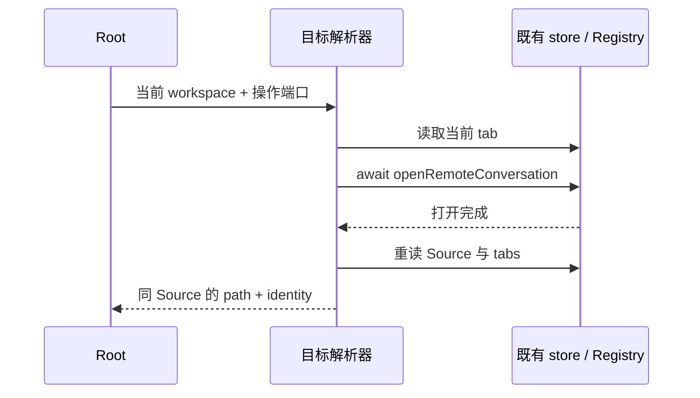

# Conversation workspace 目标解析模块

## 问题与修复范围

`resolveConversationWorkspaceTarget.ts` 在 2026-09-13 新增到未受管的 `ui` 根模块，触发 `unmanaged-new-file`，导致 `verify:pre-push` 在业务单测前退出。

将解析器移入 `packages/ui/src/conversation-workspace-target/`，以 `conversation-workspace-target` 登记为 managed 模块，补齐契约、示例与契约测试。原 Root 调用改用公开入口。保留架构规则、日期阈值与 baseline。

## 实现前决策

- 层级：契约定义最小 tab 只读视图和操作端口；app 层组合端口，不直接导入 Zustand store、Host 或平台实现。
- 唯一 owner：窗口 tab store 拥有 tab，Registry / SourceManager 拥有远程连接及 Source 归属。模块不持有可变状态或持久化数据。
- 唯一路径：Root 注入既有 `openRemoteConversation`、Source 查询及本地目录解析，不引入新的打开命令或连接。
- 时序与失败：沿用当前实现，先等待远程打开完成，再读取 Source 与最新 tabs；按 Source 匹配 conversation tab，返回其 path 与 identity。Source 未知、tab 缺失或端口失败时向上传播错误，不回落本地。
- 重试与并发：复用原打开端口的 admission；不增加 lease、超时、去重缓存或队列。



## 不变量与兼容边界

已有 conversation tab 直接返回自身；本地项目沿用本地目录解析。相同路径的本地与远程、不同 Source 之间仍按 identity 隔离。设置 tab 不参与 workspace 选择。迁移仅改变模块归属与 import，不修改数据库、协议、UI、主题或文案；桌面 continuous 与手机 web-remote-replayable/shared-host 链路均沿用原路径。

## 验证要求

先将现有六项真实 tab store 回归用例切换到公开入口，确认新入口不存在时失败，再迁移实现。契约测试补充非 workspace tab、端口异常和打开后的 Source 回读。执行相关单测、typecheck、lint、默认分支范围的架构检查与完整 `verify:pre-push`。此次无交互行为变更，检查现有 E2E 覆盖，未运行的环境验证单独列明。

## 后续门禁：迁移测试预期

解除架构门禁后，全量单测发现 `taskIndexRepoWorkspaceIdentity.test.ts` 的启动屏障断言只期待 `0005_projects`，未包含已登记的 `0006_default_workspace_tasks`。修正测试为按 ID 排序验证两项迁移，并在重新打开后验证 ledger 不变；保留“不重新导入 settings”的断言。此修正不修改迁移实现、SQL 或 checksum。

## 后续门禁：项目行默认引用

`reactStableReferences.test.ts` 发现 `ProjectNodeContent` 的 `availability` 和 `additionalActions` 默认值每次渲染都创建新引用。将两个只读消费的默认值提升为模块常量；仍使用原项目行渲染、菜单和操作路径，状态 owner、UI、默认在线语义与操作集合不变。先记录原检查失败，再运行引用检查和既有项目行组件测试。

## 后续门禁：设置顺序与归档测试时序

- 项目仓库已按“新建排在同 Host 最前面”返回项目，设置兼容投影沿用该顺序。`workspace-settings/contract.test.ts` 的重复 root 去重预期更新为 `/shared`、`/local`，保留删除后不复活的所有断言。
- `projectAutoArchiveSelection.test.ts` 原本等待第二次 refresh 后才释放第一次；当前 `docs/task-first-submit-visibility.md` 规定重叠刷新共享 flight，因此测试自锁。将迟到响应场景改为切换 service：新 service 的树先被接受，再释放旧 service 归档结果，验证旧响应不会清理任务或覆盖新树；不改变刷新或归档实现。

```text
旧测试：read A 在途 → await refresh（复用 A）→ 释放 A（永远到不了）
修正：旧 service 的 A 在途 → 切换 service → 接受新树 → 释放 A → 旧结果被拒绝
```

## 验证记录（2026-09-16）

- 解析模块、真实 tab store、现有本地目录 hook：3 文件 / 10 项通过；去除类型后，解析函数与原实现内联既有 workspace kind guard 的结果一致。
- 迁移启动屏障与 project-storage 契约通过；React 引用检查、项目行在线/离线组件交互及下载测试：3 文件 / 11 项通过。
- 最终 typecheck、修改文件格式检查通过；lint 保留 47 个既有 warnings、0 errors；默认 origin/staging 范围架构检查为 0 violations，未调整 baseline。
- 初轮全量检查在修复前暴露迁移断言和默认引用问题，并出现设置写入/下载计时失败；两个计时用例分别复跑通过，未修改其生产实现或测试超时。旧轮次已停止，最终完整结果单独记录。
- 第二轮完整运行耗时 504 秒：1,785 文件 / 15,522 项通过，2 文件 / 14 项跳过，仅设置顺序与旧归档时序两项失败。修正这两份测试后，与首发回归一起运行 3 文件 / 10 项通过。此处区分完整运行与修正后定向验证，实际 push 仍执行完整 hook。
- 已检查 `conversation-session-ssh-remote-project-conversation-scope.test.ts` 的 CWP13/CWP15，用例仍为 manual-review/pending。本次未重跑真实 SSH、手机 shared-host、Windows/Linux GUI，不将历史 E2E 作为当前提交证据。
