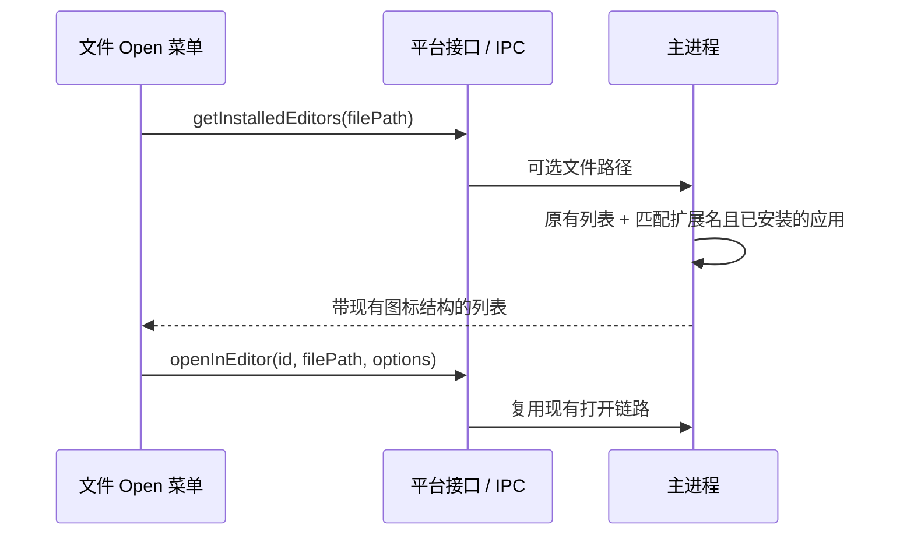

# 文件预览的外部打开应用

## 范围

在现有 Open 上拉菜单中追加已安装且匹配当前文件扩展名的应用。原有编辑器、终端、Finder/QSpace/Explorer 的展示与顺序保持不变；不增加入口、分组、默认应用项或“选择其他应用”，复制路径和 Open 主按钮不变。

| 类型 | macOS                                                 | Windows                                                  | Linux                                 |
| ---- | ----------------------------------------------------- | -------------------------------------------------------- | ------------------------------------- |
| PDF  | Preview、Adobe Acrobat/Reader、PDF Expert、WPS Office | Adobe Acrobat/Reader、Foxit PDF Reader、WPS Office、Edge | Evince、Okular、Firefox               |
| DOCX | Word、Pages、WPS Office、LibreOffice Writer           | Word、WPS Office、LibreOffice Writer                     | WPS Office、LibreOffice Writer        |
| PPTX | PowerPoint、Keynote、WPS Office、LibreOffice Impress  | PowerPoint、WPS Office、LibreOffice Impress              | WPS Presentation、LibreOffice Impress |
| XLSX | Excel、Numbers、WPS Office、LibreOffice Calc          | Excel、WPS Office、LibreOffice Calc                      | WPS Spreadsheets、LibreOffice Calc    |
| MP3  | Music、QuickTime Player、IINA、VLC                    | Windows Media Player、VLC                                | VLC、mpv                              |
| MP4  | QuickTime Player、IINA、VLC                           | Windows Media Player、VLC、PotPlayer                     | VLC、mpv                              |

## 数据与平台边界

`IPlatformService.getInstalledEditors(filePath?)` 保持无参数兼容：不传文件路径时仅返回原有清单，避免改变工作区菜单。传路径时主进程按大小写无关的扩展名匹配新增清单并异步检测安装位置（macOS 系统/全局/用户 Applications，Windows 常见安装位置与 App Paths 注册，Linux PATH）。主进程是安装检测与缓存的唯一 owner；UI 不维护另一份格式映射。



文件卡片和 Preview Pane 使用当前文件路径查询。未知扩展名、目录及无路径查询不追加应用。切换预览文件时，旧查询结果不得覆盖新文件的列表。新增应用通过参数数组打开文件，不经 shell 拼接。

SSH/WSL/Docker 继续通过现有 `resolveWorkspaceEditorSelection` 限制可用应用，不把远端文件路径传给新增本机阅读器。手机 Web 继续返回空清单，桌面 continuous / 手机 replayable 消息流、workspaceIdentity 和 owner 路由不变。

## 验证

单测覆盖六种扩展名、大小写与含空格路径、缺失应用、无参数兼容、多平台安装位置以及参数化打开。现有文件卡片 E2E 覆盖按路径传递和菜单内容/打开目标；系统应用安装与真实启动另需平台运行时验证。

主进程在启动文件应用前校验本机绝对路径与真实文件类型，不信任 renderer 的 `pathKind`。
macOS 使用系统 `open`；Windows/Linux 使用独立子进程并忽略 stdio，收到 `spawn` 后返回成功，
不等待阅读器退出，也不让应用日志触发缓冲上限终止进程。启动失败返回原有失败结果。

```text
renderer 打开请求 → main 校验本机文件 → 启动应用 → spawn / error → 返回结果
                                                └─ 应用独立运行，关闭时无需回写状态
```

## 打开失败与安装变化

打开应用返回失败或请求抛异常时，都记录日志并显示同一条本地化失败 Toast。远端菜单继续复用工作区能力过滤：SSH 仅 VS Code 系；WSL 额外允许 Explorer；未解析目标和不支持的目标不展示本机应用。

文件应用探测只缓存成功结果和在途请求；未安装、图标缺失和异常都释放缓存。下次菜单查询重新探测，不用 TTL 或要求重启。清理只针对原请求，不能删除更新的请求。
