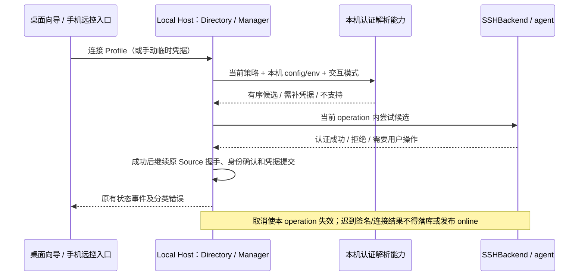

# 07 — ssh-agent 与默认密钥评估

Status: ready-for-human

**父规格：** [远程连接交互与视觉体验优化](./01-remote-connection-ux-optimization.md)

**被阻塞于：** 评估已交付，等待用户决定是否排期；尚未创建实施票。

**要交付的行为：**

评估要让 `~/.ssh/config` 里配置了密钥的 Host 能一键连接，需要改动哪些地方，把评估结论交给用户决定是否排期。

- **现状（评估后修正）**：SSH 底层在未提供密码时已使用 `SSH_AUTH_SOCK`，但界面、Profile 和静默重连没有完整的 agent/default-key 认证契约。config 别名未写 IdentityFile 时，界面仍切换到密码输入。代码证据见 Comments。
- **本票边界**：只做评估，不改产品代码。

评估范围：

- config 中的 IdentityFile 和 IdentityAgent。
- 默认密钥 `~/.ssh/id_*`。
- ssh-agent 在各平台的接入方式：
  - macOS 和 Linux：`SSH_AUTH_SOCK`。
  - Windows：OpenSSH agent 管道和 Pageant。
- 带口令的私钥如何与现有凭据存储配合。

验收标准：

- [x] 梳理当前 SSH 连接层的认证方式和 config 解析现状，并附上代码证据。
- [x] 给出三个平台各自的可行性、差异和已知风险。
- [x] 列出改动范围、需要新增的契约，以及测试方式，包括能否在现有 SSH 测试容器里验证。
- [x] 给出建议和工作量估算，追加到本票末尾的 `## Comments`。
- [ ] 用户做出决定后更新本票状态。如果决定排期，另开实施票。
- [x] 不修改产品代码。

## Comments

### 2026-09-27 — 评估结论，待用户决定

**建议分期排期，保留现有 ssh2 Transport。** 首期贯通 macOS/Linux Unix agent、Windows OpenSSH agent、普通默认私钥与显式 `IdentityFile`，预计 **7～10 人日**；Pageant 作为可选第二期再加 **1～2 人日**。这不是只加 `agent` 参数的改动：主要工作在认证选择、config 语义、Profile 持久化和恢复门禁。以下均为建议，尚未批准实施。

“一键连接”限定为：目标可达、普通公钥已获服务端授权，且 agent 已可签名，或文件私钥无需口令/口令已保存。需要首次输入口令、agent 确认、安装或身份确认时，继续进入现有向导；不承诺与系统 `ssh alias` 的全部能力等价。

### 当前实现与代码证据

核对基线：`8794bfcbbe5c724dcba0d6760c62c08bc995c9cd`。下表描述当前代码，不代表已完成三平台实测。

| 链路          | 当前事实与缺口                                                                                                                                                                                                                                                                                        | 证据                                                                                                                                                                                                                                                                                  |
| ------------- | ----------------------------------------------------------------------------------------------------------------------------------------------------------------------------------------------------------------------------------------------------------------------------------------------------- | ------------------------------------------------------------------------------------------------------------------------------------------------------------------------------------------------------------------------------------------------------------------------------------- |
| 底层认证      | 支持密码、单个私钥及其口令；有非空密码时禁用隐式 agent，无密码时取 `SSH_AUTH_SOCK`；底层 options 也能显式传 agent。密码同时用于 keyboard-interactive，当前不是独立 OTP/MFA 流程。                                                                                                                     | [sshAuth.ts](../../../packages/server/src/remote/sshAuth.ts#L27)、[SSHBackend](../../../packages/server/src/remote/ssh-backend.ts#L127)、[现有认证测试](../../../packages/server/test/sshAuth.test.ts)                                                                                |
| 主链适配      | `createRemoteBackend` 只读取 `target.privateKeyPath`，再传私钥内容给 backend；不枚举默认文件，也不解析 alias 或传显式 agent。文件不存在会在 agent 尝试前读取失败。`sshConfigAlias` 当前只是元数据。                                                                                                   | [create-backend.ts](../../../packages/server/src/remote/create-backend.ts#L6)、[Transport factory](../../../packages/server/src/source-server/transportAdapter.ts#L479)                                                                                                               |
| config 枚举   | 从本机 home 的 `.ssh/config` 读取，支持 Include、可枚举的单一 Host alias、匹配的 Host pattern；只取第一个 `IdentityFile`，路径仅做有限的 home 展开。`IdentityAgent`、`IdentitiesOnly` 不进入结果；`IdentityFile none` 也没有禁用语义。fallback 没有独立处理 Match 条件，不能视为完整 OpenSSH 解析器。 | [解析与 Include](../../../packages/services/src/system/sshConfigAlias.ts#L193)、[fallback 字段提取](../../../packages/services/src/system/sshConfigAlias.ts#L410)、[SSHConfigAliasOption](../../../packages/shared/src/platform.ts#L334)                                              |
| `ssh -G`      | 查询有效 host/port/user，有 1.5 秒超时、3 并发、200 alias 上限及 30 秒缓存；刻意不用返回的默认 identityfile，避免把密码用户误判为指定私钥。不能直接撤销这条保护来实现默认密钥。                                                                                                                       | [查询和结果合并](../../../packages/services/src/system/sshConfigAlias.ts#L665)、[默认 identityfile 回归](../../../packages/services/test/sshConfigAlias.test.ts#L224)                                                                                                                 |
| 连接和编辑 UI | 只有 password/privateKey 两种模式；选 alias 时，有路径则私钥，无路径则密码；提交密码模式强制要求密码。编辑 Profile 同样推导二选一。配置了可用无口令私钥的 alias 已能减少输入，缺的是自动候选与 agent 完整入口。                                                                                       | [applySshConfigAlias](../../../packages/ui/src/hooks/useRemoteConnectionForm.ts#L325)、[buildRemoteTarget](../../../packages/ui/src/lib/remoteConnectionWizard.ts#L134)、[编辑 Profile](../../../packages/ui/src/remote-connection/EditConnectionProfileDialog.tsx#L78)               |
| 保存与恢复    | Profile 只有单路径及 password/passphrase credential key；`resolveSilentTarget` 只认可有效密码，或有私钥路径且未设置口令引用/引用能加载。agent-only Profile 不能通过门禁；该门禁不检查文件是否可读或能解密。此判断同时影响手动 Profile 连接和启动重连。                                                | [Profile schema](../../../packages/shared/src/source-server/contracts.ts#L15)、[resolveProfileTarget](../../../packages/desktop/src/host/sourceServerDirectory.ts#L858)、[resolveSilentTarget](../../../packages/desktop/src/host/sourceServerDirectory.ts#L1547)                     |
| 凭据存储      | `connection-profile:<profileId>:private-key-passphrase` 与密码分开保存；当前 store 是本机 `credentials.json` 加密值。默认 cipher 使用 AES-256-GCM，密钥来自显式 secret 或平台/home/用户名派生；不是 macOS Keychain、Windows Credential Manager 或 ssh-agent 的存储。                                  | [Profile 凭据写入](../../../packages/desktop/src/host/sourceServerDirectory.ts#L1471)、[credentialService](../../../packages/services/src/credential/credentialService.ts#L31)、[cipher provider](../../../packages/services/src/credential/providers/credentialCipherProvider.ts#L1) |
| 身份及复用    | SSH 共享 key 已有 agent/password/private-key 分类，但没有具体 agent 来源及多 key 策略；Profile 去重只含 host/port/user/单路径。未来两条同目标、不同认证策略的连接不能被错误合并；alias 仍不能充当 Source/workspace 身份。                                                                             | [buildSshRemoteHostKey](../../../packages/shared/src/remoteSshHostKey.ts#L108)、[Profile 去重](../../../packages/desktop/src/host/sourceServerDirectory.ts#L128)、[现有 alias 契约](../../ui/ssh-config-alias.md)                                                                     |

### 外部能力依据与平台差异

以下结论来自官方文档与源码；本轮确认锁文件和本地加载版本均为 `ssh2 1.17.0`，未执行三平台真实 agent / 打包应用验证。

- **config 语义不能只增一个 socket 字段。** `IdentityAgent` 覆盖 `SSH_AUTH_SOCK`；`none` 禁用 agent，字面量 `SSH_AUTH_SOCK` 与 `$变量名` 引用环境变量，路径还允许 `~`、token 与 `${变量名}` 展开。`IdentityFile` 可多次出现并累积，也允许 `none`；没有本地私钥时可用公钥文件选择 agent 中的同一身份。`IdentitiesOnly yes` 要按配置身份过滤 agent 公钥，不能遍历 agent 所有密钥；不支持这些语义时应明确报兼容性问题。依据：[OpenSSH ssh_config](https://man.openbsd.org/ssh_config#IdentityAgent)、[IdentityFile / IdentitiesOnly](https://man.openbsd.org/ssh_config#IdentityFile)。
- **默认文件应使用明确候选集合。** OpenBSD 7.7 的默认值为 `id_rsa`、`id_ecdsa`、`id_ecdsa_sk`、`id_ed25519`、`id_ed25519_sk`；当前上游手册又列入 `id_mldsa44_ed25519`，平台随附版本并不一致。首期建议明确仅自动探测 `~/.ssh/id_ed25519`、`id_ecdsa`、`id_rsa`，顺序作为产品契约，不能把任意 `id_*` 通配成可用私钥；`*_sk`、新算法、证书须单列不支持边界。依据：[固定版本手册](https://man.openbsd.org/OpenBSD-7.7/ssh_config.5#IdentityFile)、[当前上游手册](https://man.openbsd.org/ssh_config#IdentityFile)。
- **现有库具备认证编排能力。** `ssh2 1.17.0` 的 `authHandler` 支持按次返回 `publickey`（含各自的 `key/passphrase`）、`agent` 或 `password`；默认顺序为 none → password → private key → agent，不能依赖默认值表达“先无交互认证、最后提示密码”。顶层 `privateKey` 会在连接前立即解析，密文缺口令会抛错；设计 agent 优先候选时需避免提前解析该私钥阻断 agent。依据：[固定版本 API](https://github.com/mscdex/ssh2/blob/v1.17.0/README.md#client-methods)、[client.js](https://github.com/mscdex/ssh2/blob/v1.17.0/lib/client.js)。
- **agent 并不补齐所有算法。** 该版本 agent 身份列表经过 `parseKey`，不支持的类型会跳过；二进制公钥解析只接受 RSA、DSA、ECDSA 与 Ed25519，未接受 `sk-*` 或 OpenSSH `*-cert-v01@openssh.com` 类型。因此 FIDO 安全密钥和 agent 证书不能列为首期支持，文件证书的正则匹配也不代表完整证书认证能力。依据：[agent 解析和跳过逻辑](https://github.com/mscdex/ssh2/blob/v1.17.0/lib/agent.js#L539-L585)、[keyParser 支持范围](https://github.com/mscdex/ssh2/blob/v1.17.0/lib/protocol/keyParser.js#L1249-L1406)。

| 客户端平台      | 可行性与差异                                                                                                                                                                                                                                                                                                                                                                                                                                                                                                                                                  | 必须在对应平台验证的风险                                                                                                                                                                                                                                       |
| --------------- | ------------------------------------------------------------------------------------------------------------------------------------------------------------------------------------------------------------------------------------------------------------------------------------------------------------------------------------------------------------------------------------------------------------------------------------------------------------------------------------------------------------------------------------------------------------- | -------------------------------------------------------------------------------------------------------------------------------------------------------------------------------------------------------------------------------------------------------------- |
| Linux           | 可以通过进程可见的 `SSH_AUTH_SOCK` 或显式 socket 使用 `ssh2.OpenSSHAgent`；默认私钥从当前客户端用户的 home 解析。agent 负责签名，应用无需取得 agent 内私钥或其口令。[OpenSSH agent](https://man.openbsd.org/ssh-agent.1)、[ssh2 agent](https://github.com/mscdex/ssh2/blob/v1.17.0/lib/agent.js#L49-L149)                                                                                                                                                                                                                                                     | 不同桌面登录会话与终端启动的环境可能不同；socket 缺失、过期、权限拒绝、agent 锁定/确认弹窗/拒绝签名都要可恢复。该列是待测风险，不是本轮已复现问题。                                                                                                            |
| macOS           | 同样走 Unix socket。Apple 的 launchd 配置用 `SecureSocketWithKey=SSH_AUTH_SOCK` 发布 agent；`UseKeychain` 保存私钥口令，`AddKeysToAgent` 决定系统 ssh 是否加入密钥，两者不等同于 agent 已加载该 key。[Apple agent 配置](https://github.com/apple-oss-distributions/OpenSSH/blob/main/com.openssh.ssh-agent.plist)、[Apple TN2449](https://developer.apple.com/library/archive/technotes/tn2449/_index.html)                                                                                                                                                   | Dock/Finder 启动与终端启动分别检查实际主进程环境；不能假定 shell 中配置的 socket 必然传给 GUI。接入 ssh2 agent 不会自动执行 Apple ssh 的 Keychain 读取/加 key 逻辑；若仅 Keychain 有口令但 agent 无 key，仍需应用口令流程或用户先加载。                        |
| Windows OpenSSH | `ssh2.createAgent` 已将 `\\.\pipe\...` 识别为 OpenSSH 管道；系统 agent 常用 `\\.\pipe\openssh-ssh-agent`。微软 OpenSSH 可在自己的程序入口注入该环境值，但 Electron 不会因此自动获得它，需平台默认端点解析。[ssh2 管道判断](https://github.com/mscdex/ssh2/blob/v1.17.0/lib/agent.js#L359-L368)、[Microsoft 程序入口](https://github.com/PowerShell/openssh-portable/blob/latestw_all/contrib/win32/win32compat/wmain_common.c)、[agent 管道定义](https://github.com/PowerShell/openssh-portable/blob/latestw_all/contrib/win32/win32compat/ssh-agent/agent.c) | 官方文档说明 agent 服务默认禁用；服务未启动、账号权限、密钥未加载均需区分。不可把连接失败静默归类为密码错误，也不应自动提权启用服务。[Microsoft key management](https://learn.microsoft.com/en-us/windows-server/administration/openssh/openssh_keymanagement) |
| Windows Pageant | 库支持显式 `agent: 'pageant'`，内部启动其附带的 `util/pagent.exe` 与 Pageant 通信；已有底层适配，不需重写协议。[ssh2 Pageant 实现](https://github.com/mscdex/ssh2/blob/v1.17.0/lib/agent.js#L150-L235)                                                                                                                                                                                                                                                                                                                                                        | Pageant 正在运行且已加载 key 是前提；Electron 打包/解包路径必须携带并能运行该 exe，覆盖实际 Windows 分发物和支持架构；还需验证签名权限与安全软件拦截。建议独立于 OpenSSH 管道验收，不能用 Linux 容器代替。                                                     |

### 建议新增的契约与改动范围

下面的字段名仅用于表达边界，实施票先更新现有 [alias 规格](../../ui/ssh-config-alias.md)、[R3 主规格 §3/§7.1](../../architecture/r3-source-server-remote-architecture.md)、[远程连接 UX 合同](../../architecture/remote-device-connection-ux-spec.md)，再落地严格类型与运行时 schema。本票不改变这些事实规格。

| 层次 / 改动点                                                                                      | 建议契约                                                                                                                                                                                                                                                                                                                                                                                                                                                                                                    |
| -------------------------------------------------------------------------------------------------- | ----------------------------------------------------------------------------------------------------------------------------------------------------------------------------------------------------------------------------------------------------------------------------------------------------------------------------------------------------------------------------------------------------------------------------------------------------------------------------------------------------------- |
| services 的 config 解析与本机认证解析能力；shared 的 alias 结果                                    | 区分显式配置、默认候选、禁用和不支持；保留有序的多个 identity，输出 `identitiesOnly` 和 agent 选择（继承/禁用/显式端点/Pageant）。处理 `none`、引用环境变量与支持的路径 token；不能把未知语法当普通路径。复用现有有界 `ssh -G` 查询，但补齐认证字段及来源，失败时只承诺明确支持的 fallback 子集。包含 Match 或不支持的代理配置时返回兼容性提示，避免静默套错身份。                                                                                                                                          |
| shared 的 `SSHConnectOptions`、snapshot、`SSHProfileTarget`、Profile 编辑请求及相关 schemas        | 新增显式认证策略（建议 auto/password/privateKey，Pageant 是 agent 选择）；持久化配置选择和 credential 引用，不持久化 agent 私钥、口令、运行时 socket 缓存或“agent 已就绪”布尔值。旧密码/私钥记录保持原策略，不能迁移成 auto。相关入口见 [RemoteTarget](../../../packages/shared/src/remoteTarget.ts)、[连接校验](../../../packages/shared/src/validation.ts#L395)、[snapshot](../../../packages/shared/src/protocol.ts#L126)、[settings 校验](../../../packages/shared/src/validationAppSettings.ts#L107)。 |
| server 的 create-backend / sshAuth / SSHBackend                                                    | 消费一次连接的候选计划，按需读取文件/加载口令，使用 ssh2 `authHandler` 明确顺序，并用可过滤的 agent 适配器落实 `IdentitiesOnly`。注入平台、env、文件和 agent 访问便于测试；不同候选去重、失败有界、支持取消。不要在顶层传未解密私钥，导致 agent 可用时仍提前失败。agent 认证不等于 agent forwarding，不启用 forwarding。                                                                                                                                                                                    |
| Desktop Local Host 的 SourceServerDirectory、ConnectionManager / StartupReconnect / RecoveryPolicy | Directory 继续唯一持有 Profile 和 credential 引用，认证解析只返回候选及诊断；Manager 继续持有连接生命周期。放开有可用无交互候选的恢复资格，但禁止从“socket 存在”推导静默可用。候选、取消、重试都沿用当前 operation 与失效回调边界；不新增独立重连 owner。                                                                                                                                                                                                                                                   |
| Host/Main 共享 key、Profile 去重、UI 的连接复用与历史                                              | 审计认证策略是否参与连接复用和 Profile 去重；同目标不同显式 agent/identity 策略必须可区分，secret 不入 key。配置变化在新连接时重新解析；已经在线的复用继续明确提示，不把“配置已修改”误报为“新认证已生效”。保持 Source ID、workspaceIdentity 和 workspacePath 原合同。                                                                                                                                                                                                                                       |
| UI hooks / 向导 / Profile 编辑 / 错误展示                                                          | 增加自动认证入口；agent 可用时不先要求密码。耗尽可用候选后展示需要补充的凭据类型，保留手动密码/私钥入口。密码、私钥口令、agent 不可用/拒签、无可用 key、认证被服务端拒绝需要可判别结果；扩展现有 [error codes](../../../packages/shared/src/source-server/errorCodes.ts) 与 [归一化](../../../packages/shared/src/source-server/connectionErrors.ts)，所有日志继续脱敏。覆盖中英文、深浅主题与编辑已有连接。                                                                                                |

认证策略建议在实施票固定为以下规则：

1. **兼容现有显式选择。** 密码模式仍禁止隐式 agent/default key；显式单私钥保留其路径和口令语义。auto 才进入配置/agent/default 候选流程；`IdentityAgent none` 必须压过环境 fallback，不能通过 `undefined` 意外重新启用 agent。
2. **候选有来源和顺序。** auto 下优先尝试配置 identity 对应的 agent 身份或可静默使用的文件；`IdentitiesOnly yes` 严格过滤其他 agent key。未配置 identity 且未显式禁用时，才使用前述普通默认文件白名单；配置顺序优先，匹配同一公钥的 file/agent 只算一个身份。非受限 agent 的其他身份按确定顺序、有上限地尝试，避免低 `MaxAuthTries` 主机在有效 key 前耗尽认证次数。
3. **加密私钥分两路。** agent 已加载同一身份时只委托签名，不需要 ZCode 保存它的口令。直接文件认证时先读已保存口令；缺少/错误口令进入明确的补充凭据流程，不误当 SSH 登录密码。自动候选不应反复弹出每个文件的口令框，应先耗尽其他可静默候选，再由用户选择待解锁 identity。
4. **口令按候选隔离。** 当前一个 Profile 一个口令引用不足以覆盖多个加密 key。建议沿用 `ICredentialService`，为所选 identity 保存独立引用，并以规范路径加可取得的公钥指纹校验归属；不将同一口令广播给所有 key。旧单路径引用继续可读。保存时机沿用现有“实际使用的凭据”语义；改 key、取消、切认证模式及失败回滚要处理旧引用。现有 store 可复用，但本票不把它升级为系统钥匙串，也不承诺读取 Apple `UseKeychain` 项。
5. **静默与手动分开。** 手动连接可以提示口令或等待 agent 授权；自动恢复必须保持 [R3 §7.1](../../architecture/r3-source-server-remote-architecture.md) 的无交互要求。普通 agent 协议没有通用的“签名绝不弹窗”预检：锁定、`ssh-add -c` 等确认约束必须列为不保证静默的场景，不能用超时模拟确认成功。首期若不能保证某 agent 无交互，应停在需用户操作的结果，不自动触发该签名路径。
6. **兼容范围明确。** 首期支持普通 RSA/ECDSA/Ed25519 身份；FIDO/security-key、证书、PKCS#11、ProxyJump/ProxyCommand、完整系统 ssh 配置兼容、Keychain 自动解锁、自动启动/提权配置 agent 不纳入估算。当前读取 alias 的入口可以复用，但要报告这些不支持条件；不能宣传所有终端可连的 Host 都能一键连接。

建议时序与归属如下（待实施，不是新增运行时）：



config、home、socket/pipe 和文件读取均在**控制端本机**解析，不去远端 Source 或手机文件系统寻找密钥。手机沿用 shared-host attachment；认证结束后的任务恢复仍是桌面 `continuous`、手机 `replayable`，不改变 session、队列、snapshot/gap 或 provider 下发协议，也不把 SSH 凭据加入 Provider Provisioning。

### 测试接缝、现有容器能力与本轮证据

| 层次                     | 实施时应验证的场景                                                                                                                                                                                      | 环境与边界                                                                                                                                                                                                                                                                            |
| ------------------------ | ------------------------------------------------------------------------------------------------------------------------------------------------------------------------------------------------------- | ------------------------------------------------------------------------------------------------------------------------------------------------------------------------------------------------------------------------------------------------------------------------------------- |
| config / policy 单测     | 多 IdentityFile 的顺序；Host/Include/Match 与受控 fallback；IdentityAgent 路径/env/none；IdentitiesOnly 过滤；默认文件不存在、无权限、坏格式、算法不支持；显式密码绝不隐式探测；缓存刷新及 alias 变更。 | 扩展 [sshConfigAlias.test.ts](../../../packages/services/test/sshConfigAlias.test.ts)、[sshAuth.test.ts](../../../packages/server/test/sshAuth.test.ts)。依赖注入/临时 home；禁止读取开发者真实 `.ssh`。                                                                              |
| Host / schema / 凭据单测 | 旧 Profile 迁移不改认证策略；每 key 的口令隔离/轮换/删除/回滚；agent-only 首连和恢复；agent 失效后转需操作；相同目标不同认证策略不误合并；取消后迟到回调无效；日志/回包不含 secret。                    | 扩展 [SourceServerDirectory 测试](../../../packages/desktop/test/sourceServerDirectory.test.ts)、[SSH 复用 key 测试](../../../packages/shared/test/remoteSshHostKey.test.ts)、Manager/StartupReconnect 测试和严格 schema 契约测试。                                                   |
| UI / E2E                 | auto 选 alias 不先索要密码；普通文件/agent 成功；缺口令、错误口令及重试；编辑 Profile；已在线复用不保存未使用凭据；重启/断线恢复；深浅主题、中英文和手机现有恢复回归。                                  | 扩展 [remoteConnectionWizard.test.ts](../../../packages/ui/test/remoteConnectionWizard.test.ts) 及 [SSH P0 计划](../../testing/ssh-remote-p0-e2e-plan.md)，按 [E2E 生命周期](../../../.agents/skills/e2e-case-lifecycle/SKILL.md) 新建/维护 case，不能把 mock 通过标为真实 E2E 通过。 |
| 真实认证集成             | 临时默认 key；多个候选首个无效；加密文件/保存口令；仅 agent 无私钥文件；空/死 socket；拒签；低 MaxAuthTries；IdentitiesOnly；密码回退；取消及冷启动恢复。                                               | Linux 控制端可连现有 Ubuntu SSH 容器；macOS/Windows 控制端另跑本机 agent，服务端仍可复用可达的该镜像。各平台发布包需验证，特别是 Pageant helper。                                                                                                                                     |

**现有 SSH 测试容器可以复用，但当前 runner 不是 key/agent 测试。** [Dockerfile](../../../harness/remote/Dockerfile) 已安装 OpenSSH server；[new-target-server.sh](../../../harness/remote/new-target-server.sh) 支持独立容器、sshd 选项及初始化；[run-wdio-server.mjs](../../../harness/remote/run-wdio-server.mjs) 当前生成密码并注入 `ZCODE_E2E_SSH_PASSWORD`，[SSH helper](../../../packages/desktop/test/e2e/helpers/ssh-remote-p0.ts#L164) 也要求密码。实施时应增加显式 auth fixture 类型，在一次性容器中安装**临时测试公钥**到 `authorized_keys`（校验属主和权限），给控制端临时 home 启独立 agent，仅注入该进程树的 socket；结束时清理 key/socket/agent/container。低 MaxAuthTries 或禁用密码仅施加于该测试容器，验证有效 sshd 配置，不能修改共享测试机的 sshd。

Linux 同机 harness 可以证明 Unix agent、公钥认证、错误路径及取消时序；**不能证明** Finder/Dock 启动环境、Apple Keychain 行为、Windows 服务管道/Pageant IPC 或发布包携带 helper。三平台控制端实测资源未确认，作为后续实施的环境依赖；本轮没有连接用户 SSH 主机或修改 agent、私钥及系统服务。

本轮执行了用于核对现状的已有测试，两次合计 **5 个文件、77 个用例通过**：

```bash
pnpm exec vitest run packages/server/test/sshAuth.test.ts packages/services/test/sshConfigAlias.test.ts packages/desktop/test/sourceServerDirectory.test.ts --reporter=dot
pnpm exec vitest run packages/ui/test/remoteConnectionWizard.test.ts packages/shared/test/remoteSshHostKey.test.ts --reporter=dot
```

本次是纯文档评估，按根 AGENTS.md 的文档检查范围验证链接、引用与 diff；不以这些单测代表新增能力已通过。未运行产品全量 typecheck/单测/E2E，也未做三平台真实 agent 或打包验证。实施票需按代码、APP 交互、状态与远控的验证矩阵执行 typecheck、lint、architecture、相关单测及真实 E2E。

### 工作量与待决事项

估算假设：一名熟悉现有远程主链的开发者，三平台测试资源可用，复用 ssh2 1.17.0 与当前 SSH harness；含测试、评审和文档，不含平台申请、等待人工验收或上述排除能力。

| 工作包                                                     | 估算人日      |
| ---------------------------------------------------------- | ------------- |
| 明确 config/auto/持久化合同，补 config 解析与 schema 测试  | 1.5～2        |
| 候选调度、agent 过滤、平台端点、逐 key 口令处理            | 2～3          |
| 向导/编辑 Profile、历史兼容、去重及静默恢复接入            | 1.5～2        |
| Linux 容器认证矩阵、macOS/Windows OpenSSH 发布包验证与回归 | 2～3          |
| **首期合计**                                               | **7～10**     |
| 可选第二期：Pageant 选择、helper 打包及 Windows 验收       | **另加 1～2** |

**待用户决定：** 是否按首期范围排期，以及 Pageant 是否后置。通过后另开实施票并更新本票状态；若暂缓，也记录决定。当前 `ready-for-human` 只表示评估已交付，不表示支持已实现或排期已批准。
