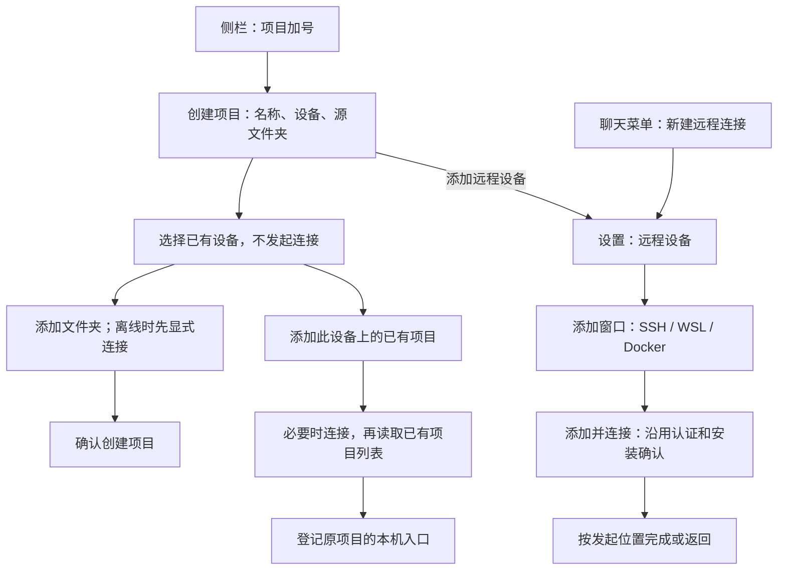

# 15 — 项目创建与远程连接管理分离

Status: ready-for-agent

2026-10-12：产品决策 Q1–Q12 与测试切入点已确认；各子票实施与验证以其完成记录为准。2026-10-14：聊天入口合同按新确认更新，详见 [#21：连接后必选远程文件夹并进入项目](21-chat-settings-round-trip.md)。#21 已重新标记 ready-for-agent；旧聊天往返证据不代表新行为已实现。

## Problem Statement

以下保留 2026-10-12 的立项背景；2026-10-14 聊天连接后执行目标不清晰的问题与修订范围见 #21。

用户希望在某台设备上创建或添加项目，目前却需要先选择本地或远程、进入已有连接列表，再进入另一个包含已保存设备和发现候选的连接向导。设备选择与项目创建分散在多个页面，难以判断当前是在添加设备、建立连接，还是创建项目。

侧栏、聊天框项目菜单和设置页的连接入口还具有不同的完成路径：侧栏连接后选择远端已有项目或新建项目；聊天框和设置的新建入口连接后继续选择目录。仅想添加设备的用户也会进入项目流程。已有连接列表与发现候选来源不同，前一个列表为空、后一个列表有许多目标时，界面没有清楚表达两者的区别。

从创建项目或聊天过程中进入设备管理，还需要保留原草稿和返回位置。否则用户完成连接后必须重新填写项目，或丢失聊天输入；后台完成若自动跳页，也会打断后续工作。

## Solution

将项目操作与设备管理分开，SSH、WSL、Docker 共用同一套入口和完成规则。

- 「项目 +」直接打开包含项目名称、设备和源文件夹的创建表单，不再经过本地／远程选择和「下一步」。
- 设备默认取打开表单时当前任务所在设备；没有当前任务时选「此电脑」。离线设备仍保留默认选择，不能静默切回本地。
- 设备下拉菜单只展示「此电脑」、所有已添加设备及其状态，以及「添加远程设备…」。尚未成功识别的连接配置和发现候选不进入这个列表。
- SSH config Host、WSL 发行版和 Docker 容器的发现结果放在设置的添加窗口中。窗口按 SSH／WSL／Docker 分类，默认 SSH，各类型保留发现和手动填写能力及现有平台限制。
- 所有新增连接入口进入「设置 → 远程设备」并打开添加窗口，主操作为「添加并连接」。设置来源完成设备管理即可；聊天新任务草稿来源每次连接成功后都继续选择远程文件夹，并按 #21 确定项目后进入，不允许跳过项目发送。
- 选择已有设备不发起连接。在线设备的「添加文件夹」直接打开目录选择；离线设备通过「连接并选择文件夹」显式连接，进度、补凭据和必要安装确认留在当前项目流程中。
- 远程项目表单保留「添加此设备上的已有项目…」次要入口，避免把新建同目录项目误当作恢复原项目和任务。

前台完成和取消规则：

| 发起位置       | 添加并连接成功                                                                                                         | 取消尚未完成的添加                                                       |
| -------------- | ---------------------------------------------------------------------------------------------------------------------- | ------------------------------------------------------------------------ |
| 创建项目       | 返回原项目草稿并选择新设备；已有文件夹时先按 Q7 确认切换，拒绝则保留原设备和目录，新设备仍已添加                       | 返回原项目草稿，保持名称、设备和目录                                     |
| 聊天框项目菜单 | 每次弹目标设备文件夹选择；确认目录后唯一匹配复用、多个匹配显式选择、零匹配按默认文件夹名创建；准备完成后进入项目新草稿 | 取消本次远程切换，恢复并明确显示原聊天目标，保留原草稿；已连接设备不断开 |
| 设置页         | 留在远程设备页并定位对应设备                                                                                           | 留在远程设备页，不继续项目流程                                           |

「在后台继续」收起当前连接交互，由设置的设备卡或未完成连接项承接进度。后台成功只提示完成并提供继续入口，不强制跳页。失败保留配置和原因，可修改重试；关闭、取消或连接交互层的 Esc 取消本次尚未完成的流程。设备已经连接后关闭界面，不断开设备。

## User Stories

1. As a desktop user, I want the project add button to open the project form directly, so that I can start with the project I intend to create.
2. As a desktop user, I want the project name, device, and source folder in one form, so that I can review the complete target before creating a project.
3. As a user working on a remote task, I want its device selected by default, so that I do not repeatedly choose the same environment.
4. As a user working locally, I want this computer selected by default, so that local project creation remains direct.
5. As a user without a current task, I want a local default, so that the form has a predictable starting point.
6. As a user whose task device is offline, I want that device to remain selected with a visible status, so that I do not accidentally create a local project.
7. As a user with saved devices, I want both online and offline devices in the selector, so that disconnection does not hide my targets.
8. As a user choosing a device, I want its name and connection status to be readable, so that I can distinguish devices without relying on color.
9. As a user choosing a project device, I want discovery candidates kept out of the saved-device list, so that I know which devices I have already added.
10. As a user adding a device, I want every add-connection entry to open the same settings section and dialog, so that the process is consistent.
11. As an SSH user, I want SSH selected initially in the add dialog, so that I can enter its settings immediately.
12. As an SSH user, I want to select a host from my existing configuration or enter it manually, so that I can use either setup method.
13. As an SSH user, I want existing authentication and advanced settings retained, so that the simplified entry still supports my connection.
14. As a Windows user, I want supported WSL distributions and a manual entry in the WSL section, so that I can add my development environment.
15. As a Docker user, I want discovered containers and manual configuration in the Docker section, so that I can select a suitable target.
16. As a user on an unsupported platform, I want controls to respect available capabilities, so that I do not enter a workflow the platform cannot complete.
17. As a user encountering discovery failure, I want a clear explanation and the available manual entry, so that discovery does not block other supported ways to connect.
18. As a user browsing discovery candidates, I want selection to prepare the configuration before I submit it, so that connection starts only after an explicit action.
19. As a user adding a device, I want an Add and connect action, so that I can tell whether the device is usable before selecting a project on it.
20. As a user managing devices, I want connection completion to finish the device operation, so that I am not forced to choose a folder or create a project.
21. As a user choosing an existing device, I want selection alone to avoid connecting, so that browsing the selector has no connection side effect.
22. As a user choosing an online device, I want Add folder to open its directory browser, so that I can proceed directly to the project location.
23. As a user choosing an offline device, I want Connect and choose folder to start the connection, so that the required network operation is explicit.
24. As a user connecting an existing device for a project, I want progress and required confirmations in that project flow, so that I retain the project context.
25. As a user whose connection needs credentials or installation, I want the existing prompts and details, so that the new navigation does not bypass required decisions.
26. As a user switching devices before selecting folders, I want the switch to be immediate, so that an empty form stays easy to change.
27. As a user switching devices after selecting folders, I want confirmation before clearing them, so that I do not lose my selection by mistake.
28. As a user confirming a device switch, I want my project name retained, so that only the device-specific folder selection changes.
29. As a user cancelling a device switch, I want the original device and folders retained, so that cancellation has no partial effect.
30. As a local project user, I want existing empty-project and multiple-folder support retained, so that the remote UI change does not reduce local capabilities.
31. As a remote project user, I want one required fixed root directory, so that project creation follows the existing remote project contract.
32. As a user with an existing remote project, I want to add that project to this computer, so that I can continue accessing its original tasks.
33. As a user with multiple remote projects using the same directory, I want to select the actual project, so that directory similarity does not merge their identities.
34. As a user returning from the existing-project list, I want my new-project draft retained, so that inspecting existing projects does not discard my work.
35. As a user with an older remote environment that only supports reading projects, I want to retain the existing-project entry, so that I can use its supported capability.
36. As a user adding a device from a project draft, I want to return to that draft after success, so that I can continue creating the project.
37. As a user whose project draft already has folders, I want returning with a new device to use the same switch confirmation, so that a settings round trip cannot bypass it.
38. As a user cancelling device addition from a project, I want the original draft restored unchanged, so that the cancelled prerequisite does not discard the project.
39. As a user adding a connection from a chat draft, I want to choose a remote folder after every successful connection, so that my next task runs on the device I chose.
40. As a user confirming a remote folder, I want to enter its selected or newly created project before sending, so that the message cannot run in a local projectless chat.
41. As a user adding a device directly in settings, I want its card located after success, so that I can inspect and manage the result.
42. As a user encountering a connection error, I want the configuration and reason retained with a retry action, so that I can correct the problem without starting over.
43. As a user cancelling an unfinished connection, I want the original project or chat draft preserved, so that cancellation affects only that connection attempt.
44. As a user with saved connection records, I want cancellation to keep those records, so that cancelling an attempt is not mistaken for deleting a device.
45. As a user with other projects on the same device, I want cancellation to leave their connections intact, so that one abandoned flow does not disrupt ongoing work.
46. As a user waiting for a connection, I want to continue in the background and inspect progress in settings, so that I can keep working elsewhere.
47. As a user whose background connection finishes, I want a completion notice and a continuation action, so that success does not unexpectedly change my page.
48. As a user closing an interface after connection success, I want the device to remain connected, so that dismissing a dialog does not undo completed work.
49. As a keyboard user, I want accessible device selection, confirmations, and focus restoration, so that I can complete the same workflow without a pointer.
50. As a user of either theme or supported language, I want readable and complete controls in narrow windows, so that state and actions remain understandable.
51. As a Web or mobile user, I want shared project UI to respect existing Host capabilities, so that the desktop redesign does not imply access to my browser device's filesystem or create a separate remote session.
52. As a user who has moved to another workflow, I want late results from a cancelled or superseded flow ignored, so that old requests do not reopen dialogs or overwrite new drafts.

## Implementation Decisions

### 已确认的产品决策

| 决策 | 实施合同                                                                                                   |
| ---- | ---------------------------------------------------------------------------------------------------------- |
| Q1   | 项目入口负责设备、目录和项目选择；所有新增连接入口转设置；设备添加有独立完成点                             |
| Q2   | SSH、WSL、Docker 一起实施，保留各自的能力与平台限制                                                        |
| Q3   | 新建项目默认当前任务设备；无当前任务时用本地；离线不自动替换默认设备                                       |
| Q4   | 设备选择只列已添加设备，含离线设备；发现候选留在添加窗口                                                   |
| Q5   | 添加窗口按类型组织，默认 SSH，每类保留发现和手动填写                                                       |
| Q6   | 选择已有设备不连接；离线设备由「连接并选择文件夹」发起连接，在项目流程中处理等待和错误                     |
| Q7   | 有目录时切换设备须确认；确认后清目录、保留名称；取消保持全部原值                                           |
| Q8   | 主操作为「添加并连接」；不增加「仅保存」模式；未识别配置保留在设置的未完成连接中                           |
| Q9   | 远程项目表单提供添加已有项目入口，同一弹窗内显示列表，返回保留新建草稿                                     |
| Q10  | 从项目添加设备，前台成功返回草稿并选新设备；已有目录仍须确认；取消恢复原草稿                               |
| Q11  | 聊天新任务草稿每次连接后必选远程文件夹，按 #21 确定项目并进入；顶层取消恢复原目标；设置来源仍留在设置      |
| Q12  | 失败保留并可重试；关闭／取消／Esc 取消未完成流程；后台继续不取消，后台完成不抢导航；已连接后关闭不等于断开 |

### 模块与接线

1. 修改项目创建和项目编辑模块，将原类型选择、Host 列表与项目表单整合为直接创建表单；复用现有目录选择器和远端已有项目选择器。
2. 修改侧栏项目入口、聊天项目菜单、设置导航和远程设备管理模块。聊天入口文案使用「新建远程连接…」；设置新建进入同一个分类添加界面。
3. 复用现有连接表单、连接流程、设备展示模型、认证与安装确认能力。统一侧栏和应用级连接交互的接线，避免分别持有两套会竞争的连接向导。
4. 在现有 UI 导航和连接完成接缝表达发起位置与完成意图：仅完成设备管理、继续选择目录、继续选择已有项目、恢复明确的原项目。连接成功时按该意图分派，不能再统一落入目录选择。
5. 现有流程已支持连接成功后由调用方接管。优先复用该接缝；不为跳过目录屏新造一条认证、安装或连接主链，不新增仅保存 Profile 的管理 API。
6. 设置中的连接操作完成在设备管理范围；设备卡上的明确项目操作仍沿用项目意图。已有项目重连继续原项目，不能被本轮新建表单接管。

### 数据与状态归属

7. Source 表示已识别的远端环境和账号；Connection Profile 表示到达该 Source 的连接方式。一台 Source 可有多条 Profile，设备列表不能按连接地址或显示名称另造设备身份。
8. 已添加设备候选来自既有设备管理事实，与本机是否已打开该设备上的项目无关。发现候选、尚未识别的 Profile 与已识别设备分开；复用同一 Source 的连接不能产生重复设备。
9. 项目名称、所选设备和源文件夹由项目草稿的单一 owner 持有；打开时初始化默认设备，后续状态刷新不覆盖用户选择。设置往返保留同一草稿，不在侧栏、设置和聊天分别复制草稿再相互同步。
10. 连接流程持有请求归属、发起位置和完成意图。后台卡和弹窗投影同一操作；真实连接状态、日志、凭据仍归既有 Host 服务，UI 不另建连接事实缓存。
11. 连接配置与凭据沿用现有提交边界。失败、取消或复用在线连接，不得无条件保存本次密码或覆盖已有凭据；添加失败保留可修正的表单，不等于宣称本次认证信息已经持久保存。
12. 项目草稿恢复只覆盖本次交互内的页面往返；不新增跨重启草稿恢复。返回意图不保存密码或私钥口令，不改变已有凭据服务的存储规则。
13. 不新增数据库迁移或改写 Source、Profile、项目及 workspace 身份格式。界面层的返回意图不进入任务协议，不成为新的任务、连接或消息 owner。

### 异步、取消与目录边界

14. 切换设备确认必须先于目录清空与目标切换；拒绝确认不产生部分修改。异步目录选择或读取返回时，核对其草稿、设备和请求仍有效，旧设备的结果不能写入新设备草稿。
15. 设备选择、连接完成和目录浏览不新增项目或聊天。聊天来源按 #21 在用户确认目录后解析现存项目，零匹配时使用默认名称并沿用共享创建确认；其他入口仍须显式创建或添加。无效目录、无权限、读取或保存失败不新增幽灵入口，失败不能当作零匹配。
16. 本地项目继续允许零个或多个 roots；远程项目必须恰好一个固定 root。已有远程项目的固定目录、项目身份和历史任务归属不随新表单变化。
17. 添加已有远程项目使用原项目身份；通用新建同目录项目仍可产生另一项目。聊天来源的确认目录动作按 #21 做同设备精确目录解析：唯一匹配复用、多个匹配再选择，不合并项目，也不把全局保存改为按目录去重。旧远端的只读项目能力继续可用。
18. 取消只撤销本次尚未完成的交互请求和它持有的临时资源，不删除已保存连接记录，不断开其他项目共享的设备连接，不撤销已经成功完成的添加。连接窗口关闭与原项目表单的显式放弃是不同操作，不能连带清空发起方草稿。
19. 关闭或取消后的迟到连接、凭据、安装确认及目录结果不得重新打开界面、创建项目或覆盖新草稿。复用既有请求身份与失效机制，不用延迟跳转、定时器或轮询补偿状态同步。
20. 前台成功返回只消费仍有效的原流程意图；原任务、草稿或目标已经失效时，不复活旧页面。后台完成只通知并提供显式继续入口，即使用户已经离开设置也不能抢焦点；后台失败和需要处理同样保留可访问的详情。
21. 下拉菜单或确认层打开时，Esc 先遵循共享组件的顶层关闭规则；到连接交互层才表示取消本次连接，避免一次按键同时关闭多个层级。

### 平台与视觉

22. 复用设计系统的字号、颜色、层级、圆角、尺寸、组件和状态模型；连接类型与连接状态各表达自身含义，不仅用颜色表示离线、失败或需要处理。
23. 验证当前浅色和深色主题、中英文、窄窗口、键盘操作与焦点返回。长设备名、路径、错误和翻译不得挡住主操作。
24. 远程设备管理仍受既有 Desktop 平台能力约束；WSL 仅在支持的平台提供，Docker 的不可用与无候选状态保持可区分。发现失败不阻塞其他来源或现有可用的手动入口。
25. 共用表单在 Web／手机上遵循已有能力，不能提供通向不存在设置页的新增入口。「此电脑」沿用已有控制宿主语义，不表示浏览器所在设备的本地文件系统。手机继续附着桌面已有 Host，不创建独立 SSH、WSL 或 Docker session。
26. 桌面 continuous 与手机 replayable、原项目重连和启动恢复、任务 owner、Provider 下发及 workspace 隔离沿用现有合同；本轮只重组用户入口和交互完成去向。

## Testing Decisions

2026-10-12 用户已确认测试切入点：以现有桌面应用 E2E 为主，从侧栏、聊天框和设置三个真实入口验证完整流程；仅对难稳定控制的迟到结果、取消、草稿恢复时序补 UI 集成测试；认证、安装使用现有真实远程测试链，不新增测试专用业务接口。

### 测试原则与既有切入点

- **主要切入点是应用外部行为。** 通过真实入口操作，断言可见页面、按钮、焦点、原草稿、项目身份、任务归属及实际连接状态。不能只验证内部方法调用或让用例手工跳过待测设置导航。
- **以现有接缝控制时序。** UI 集成测试挂载真实项目／连接组件，在已有平台和服务端口延迟返回、注入失败或释放结果；断言可见结果与项目写入等外部副作用，不锁定 hook 名称、私有状态字段或 DOM 层数。
- **被测模块。** 项目创建／编辑、设备候选、已有项目选择、侧栏和聊天入口、设置导航与设备管理、连接流程完成分派及草稿生命周期。Host 连接和项目服务保留既有合同测试，仅在受影响边界补充断言。
- **现有先例。** 三屏连接测试已有 SSH config、离线目标、收起、失败和关闭场景；项目输入框测试已有侧栏同源、项目选择与跨布局证据；原项目交接测试已有真实 SSH、Host 绑定屏障和入口移除后的迟到结果；连接流程 UI 测试已有延迟凭据、安装确认和取消恢复。复用这些组织方式与环境，不照搬已被本规格替代的三屏导航断言。
- **真实环境证据独立记录。** SSH、WSL、Docker 的真实链路分别验证，Windows 的 WSL 用例不能以 SSH 或 mock PASS 代替。窄桌面窗口截图不等于真实手机 shared-host 验证；原生目录框可沿用系统返回值替身，但要标明替身边界。
- **先测试后实现。** 先把下表接受场景映射进现有 case 目录和覆盖矩阵，补充能证明旧行为不满足新合同的交互测试，再修改代码。既有 E2E 中依赖类型选择、通用目录收尾和侧栏收起卡的 helper 与断言同步更新。

### 接受场景与证据要求

下列 ID 是本轮验收清单，不表示测试已经存在或通过。每条均需保留 setup、操作、断言及运行证据；覆盖主题、语言和平台时采用代表性与高风险组合，不无差别展开全量笛卡尔积。

| ID        | 初始条件与操作                                                         | 可观察断言                                                                                                     | 主要证据                        |
| --------- | ---------------------------------------------------------------------- | -------------------------------------------------------------------------------------------------------------- | ------------------------------- |
| RDUX15-01 | 分别从本地任务、远程任务、无当前任务点击项目加号                       | 直接显示完整表单，默认设备分别为本地、对应远端、本地；没有类型前置屏                                           | Desktop E2E                     |
| RDUX15-02 | 当前任务设备离线；打开表单并等待状态刷新                               | 默认设备保留，状态可读；不自动切本地、不建立连接                                                               | Desktop E2E + UI 时序           |
| RDUX15-03 | 设备有在线、离线、未打开项目的记录，另有发现候选和未识别 Profile       | 下拉包含所有已识别设备，不混入发现候选和未完成连接；不按项目 open set 丢设备                                   | UI 集成 + Desktop E2E           |
| RDUX15-04 | 从项目、聊天菜单、设置分别点击新增连接                                 | 进入同一设置分区与分类添加窗口，不再次选择跨类型的已有设备                                                     | 三入口 Desktop E2E              |
| RDUX15-05 | 添加窗口切换 SSH／WSL／Docker，选择发现候选或手动输入；模拟发现失败    | 默认 SSH；类型字段和能力正确；候选选择不拨号，显式提交才连接；发现失败不阻塞其他可用入口                       | UI 集成 + 支持平台 E2E          |
| RDUX15-06 | 项目表单选择在线设备并添加文件夹                                       | 选择设备无连接副作用，目录浏览复用该设备；选择文件夹尚不创建项目                                               | Desktop E2E                     |
| RDUX15-07 | 项目表单选择离线设备，点击连接并选择文件夹                             | 点击前不连接；进度和必要确认在项目流程内，成功进入目录浏览，不跳设备设置                                       | 真实远程 Desktop E2E            |
| RDUX15-08 | 表单已有名称和文件夹，切换设备；分别确认和取消                         | 确认只清目录并切设备，名称保留；取消保持全部原值；空目录草稿无需确认                                           | Desktop E2E                     |
| RDUX15-09 | 设备 A 的目录选择／读取尚未完成，取消或切到设备 B，再释放 A 的响应     | A 的结果不写入 B 草稿，不重新打开旧目录页，不保存项目                                                          | UI 集成                         |
| RDUX15-10 | 直接从设置添加并成功连接设备；另检查已有设备的普通连接操作             | 设备管理操作独立完成并定位设备，不弹目录页、不新增项目或聊天                                                   | 真实远程 Desktop E2E            |
| RDUX15-11 | 从有名称的项目草稿新增设备并前台成功                                   | 返回同一草稿，保留名称并选新设备；未显式创建前项目数量不变                                                     | Desktop E2E                     |
| RDUX15-12 | 原草稿已有文件夹，新增设备成功后返回；分别接受和拒绝换设备             | 返回仍须经过 Q7 确认；拒绝保留原设备和目录，新设备仍在已添加列表                                               | Desktop E2E                     |
| RDUX15-13 | 从项目草稿新增设备，分别在表单、连接、等待确认时取消                   | 回到原项目草稿；未新增项目；已保存连接记录和其他共享项目不被删除或断开                                         | Desktop E2E + UI 时序           |
| RDUX15-14 | 聊天新草稿新增设备；成功必选目录并进入项目，取消恢复原目标             | 新合同详见 RDUX21-01–24；发送限制、项目身份、取消和异步保护须重验；草稿跨设备迁移延期，旧 PASS 不覆盖          | Desktop E2E + 必要 UI／服务时序 |
| RDUX15-15 | 远程设备有原项目和任务，从次要入口选该项目；也测试返回列表前的创建草稿 | 添加原项目入口并保留原任务身份；不创建同目录新项目；返回保留草稿；重复添加不造重复入口                         | Desktop E2E + 项目服务合同      |
| RDUX15-16 | 同设备同目录存在不同项目；另以只读旧远端执行添加                       | 原项目可分别选择；不按路径合并；只读远端可添加已有项目且不能非法新建                                           | 既有服务／UI 合同 + E2E         |
| RDUX15-17 | 本地创建空项目和多目录项目，远端创建单目录项目，再选择不可用目录       | 本地能力保留；远端目录合同有效；读取或保存失败不新增幽灵项目                                                   | Desktop E2E + 项目服务合同      |
| RDUX15-18 | 分别遇到补凭据、认证失败、安装／升级确认，修正后重试                   | 原完成意图不丢失，配置及可理解错误保留；所需确认不被跳过；未使用的新凭据不覆盖已有值                           | 真实远程 E2E + 既有凭据合同     |
| RDUX15-19 | 连接中点击后台继续，再手动离开设置；让连接成功、失败或等待处理         | 设置项承接同一进度；前台不被抢占；成功有继续入口，失败／待处理有可访问详情；无重复操作                         | Desktop E2E + UI 时序           |
| RDUX15-20 | 连接已关闭、取消或发起方失效后释放旧凭据、安装或连接结果               | 旧结果不复活弹窗、不跳页、不新增项目、不覆盖新草稿；只清理本次独占临时资源                                     | UI 集成 + 原项目交接 E2E        |
| RDUX15-21 | 同设备已有项目正在使用连接，再新增复用连接或取消另一请求               | 仍为同一设备；原项目可继续使用；新增未参与认证的凭据不覆盖旧值；关闭成功界面不断开                             | 真实远程 E2E + Host 合同        |
| RDUX15-22 | 已有远程项目离线，点击原项目并经历补凭据／安装；另跑启动恢复           | 成功仍进入原项目和目录，不误入新建表单；恢复不要求重新选目录                                                   | 原项目重连 E2E                  |
| RDUX15-23 | 仅用键盘操作设备下拉、添加、切换确认和关闭；覆盖长名称与错误           | Esc 按顶层交互语义生效，焦点可见且返回合理；状态有文字；无操作被裁切                                           | Desktop E2E + 可访问性断言      |
| RDUX15-24 | 浅色／深色、中英文、正常／窄窗口；macOS／Windows／Linux 对应能力       | 使用现有设计系统；布局、系统目录选择及类型能力正确；WSL 仅在支持平台出现                                       | 视觉证据 + 对应平台 E2E         |
| RDUX15-25 | Web／手机使用现有 Host 的项目界面，并恢复已有远程工作区                | 能力门禁有效，无不存在的设置入口，无浏览器本机目录误用，无独立远程 session；共享 Host 与 replayable 恢复不回退 | Web／手机回归 + 既有 Host 合同  |

### 实施完成门槛

- 代码实施需通过类型检查、lint、架构门禁、任务范围内受影响单测及对应 Desktop E2E；共享 UI 与远程边界做适用的 Web／手机回归。
- 记录真实 SSH、WSL、Docker、操作系统和手机证据范围。环境阻塞必须列出未验证场景，不能用组件测试或旧版本通过记录代替。
- 新 E2E 按既有工作流进入人工审核候选；运行成功不等于 formal／CI 准入，正式晋升另走原流程。
- 本次交付仅为文档，检查文档结构、引用、规则一致性、格式和开源约束；不把未执行的功能测试写成已通过。

## Out of Scope

- 改写 SSH、WSL、Docker 的传输、认证、安装、升级或重连状态机；新增 ssh-agent、默认密钥等未确认能力。
- 引入「仅保存但不连接」模式，或把尚未识别的连接配置作为已添加设备供项目选择。
- 远程多目录、远程无项目任务、修改已建远程项目的固定目录、按路径合并项目或迁移历史任务。
- 重做设备卡的全部视觉、侧栏排序和分组，或新增大型设备清单的筛选系统。
- 新增跨重启的项目／连接草稿恢复，或把密码纳入页面返回意图。
- 扩大手机或普通 Web 的远程设备管理能力，创建独立的手机远程连接 owner，或改变 continuous／replayable 边界。
- 重做开发专用 Server 直连入口、Provider 下发、任务协议、workspace 身份和存储迁移。

## Further Notes

- 本次发布只交付规格，未修改功能代码或执行功能测试；后续实施以本文为目标，不将 ready-for-agent 当作已实现或已验证。
- 本轮 Q1–Q12 与测试切入点已确认；2026-10-14 的聊天入口修订及取消、目录匹配规则也已确认。实现前从本 Issue 及 #21 的接受场景开始，不重新讨论已确认决策；草稿／附件跨设备迁移不在 #21 范围。
- [本地 Issue 约定](../../agents/issue-tracker.md)中的 ready-for-agent 由本文 Status 表达；本文件同时作为完整 spec，不复制另一份正文，也不发布远端 Issue。
- [远程连接 UX 索引](01-remote-connection-ux-optimization.md)记录本票与已完成批次的关系。2026-10-14 仅重开 #21 以实施聊天入口新合同，其他子票状态及历史证据保留，不推进未决的 ssh-agent 评估。
- 实施本票时，[连接 UX 规格](../../architecture/remote-device-connection-ux-spec.md)中的通用三屏入口、混合发现列表、成功必进目录、侧栏收起进度位置及关闭清空所有草稿的相关表述，由本文对应合同替代。五态、错误分类、日志、安装确认、凭据保存和设备身份继续沿用原合同。
- 实施本票时，[项目导航规格](../../remote/project-first-remote-navigation-spec.md)中的项目加号入口和无目录手动连接统一选目录规则，按本文的项目／设备管理意图区分；既有项目重连、启动恢复、身份隔离和历史数据规则继续有效。旧文档的已实现标记和旧测试证据不代表本票完成。
- 领域边界继续依据 [R3 主规格](../../architecture/r3-source-server-remote-architecture.md)及[运行时边界](../../agents/runtime-boundaries.md)；UI 依据[设计规范](../../../DESIGN.md)，本地目录选择沿用[现有合同](../../ui/project-local-directory-picker.md)。
- 实施时把接受场景关联到[case 目录](../../conversation-session-case-catalog.md)和[覆盖矩阵](../../testing/conversation-session-e2e-coverage-matrix.md)，按照[E2E 工作流](../../testing/conversation-session-e2e-development-workflow.md)维护证据。这里只给验收目标，不伪造用例文件或 PASS。
