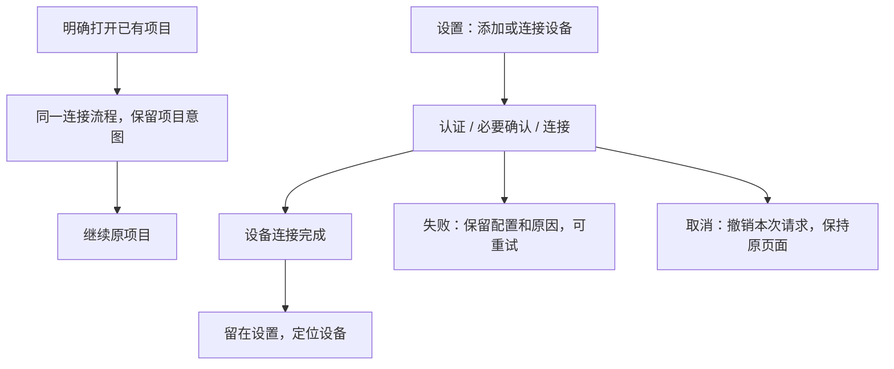

# 16: 设置内连接独立完成

Status: done

**Parent:** [#15 — 项目创建与远程连接管理分离](15-project-device-selection-and-connection-management.md)

**What to build:** 用户从设置添加或连接设备时，认证、必要的安装确认和连接成功之后，留在远程设备页并定位该设备，不再被要求选择目录或创建项目。明确打开已有项目的操作仍回到原项目。先完成这条可运行、可验收的路径，为后续分类添加和项目入口复用同一连接流程。

**Blocked by:** None (can start immediately).

**Spec coverage:** Q1、Q8、Q12；RDUX15-10、RDUX15-18、RDUX15-21、RDUX15-22，以及 RDUX15-20 的连接流程失效保护。RDUX15-23／24／25 覆盖本票涉及的设置交互、视觉和能力边界。

## Acceptance criteria

- [x] 先整理现有连接完成接缝，区分设备管理、继续目录选择、继续已有项目选择和恢复原项目等完成意图。保留现有认证、安装、升级和连接能力，不另建物理连接链或任务 owner；旧调用方在迁移前仍能按原意图完成。
- [x] 从设置的新增和已有设备普通连接入口操作，成功后留在远程设备页并定位设备；目录选择器、项目编辑器均不被自动打开，项目和聊天数量不增加。
- [x] 设置设备卡的明确项目操作、侧栏原项目重连和启动恢复仍使用原项目与目录；补凭据、安装、升级和重试不会把它们改成设备管理完成或新建项目。
- [x] 失败保留当前配置及可理解的错误，允许修改重试；关闭、取消或连接交互层的 Esc 只取消本次尚未完成的流程。下拉和确认层仍先消费自身的 Esc，不一次关闭多层。
- [x] 取消不删除已保存连接记录、不关闭其他项目共享的设备连接；连接成功后关闭界面保持设备在线。本次独占的临时 attachment 按既有生命周期释放。
- [x] 取消或发起意图失效后，迟到的凭据、安装确认和连接结果不能重新打开界面、切换项目或提交旧导航；通过请求归属判定，不用超时补偿。
- [x] 失败、取消或复用在线连接不无条件保存本次密码或覆盖已有凭据；同一 Source 的复用不产生重复设备。
- [x] 设置的成功、失败、需要处理状态与设备事实一致；键盘焦点、状态文字、中英文和当前深浅主题可用。Web／手机的设备管理能力门禁不被放开。
- [x] 先补测试再改代码，完成下述验证并记录实际证据；相关规格和测试断言随本票完成行为更新，不将仍由后续票负责的目标写成已实现。

## Verification

- 从真实设置入口执行新增、已有 Profile 连接和明确打开原项目，断言最终页面、设备状态及项目／任务数量。用现有真实远程测试链证明连接成功、补凭据、安装确认和原项目恢复。
- 在现有 UI／服务接缝控制取消及迟到结果，断言可观察导航和项目副作用；复用凭据与共享连接合同，验证未使用的凭据不覆盖已有值。
- 覆盖当前浅色／深色、中英文和窄窗口，记录实际执行的 SSH、WSL、Docker 及操作系统范围。组件替身或旧运行结果不能替代真实链路证据。
- 实施需通过类型检查、lint、架构门禁、任务范围内受影响单测和对应 Desktop E2E。共享模块触及 Web／手机时完成适用回归；环境阻塞时列出未验证项，不标记 done。

## Scope and handoff

- 必要的完成意图整理在本票先做，并由设置连接的完整路径验收；不单独交付一套没有实际调用者的新抽象，不新增「仅保存 Profile」API、数据库迁移或工作区身份格式。
- 分类添加界面由 [#17](17-typed-remote-device-addition.md) 交付，直接创建项目由 [#18](18-direct-project-creation-and-device-selection.md) 交付。迁移期间保留既有入口可用，不一次删除后续票仍依赖的流程。
- 后台进度位置和显式继续交互由 [#22](22-background-connection-and-explicit-resume.md) 交付；本票的前台取消、凭据保护及迟到结果隔离必须独立完成，不能推迟到该票。

## 实施边界与待办

- 设置设备卡当前的目录历史只含 Source 与路径，不是带原项目 ID 的已有项目列表。本票保持其兼容目录路径；明确原项目重连继续使用已有 `preferredProjectEntryId` / `preferredWorkspaceTabId`。不按相同目录推断项目；正式已有项目选择由 #19 交付。
- TODO：按用户本轮授权，WSL 与手机真实链路暂不验证。保留能力门禁回归；不将其报告为真实链路通过。

## 验证记录（2026-10-12）

- macOS 原生 Desktop E2E：`conversation-session-settings-connection-completion.test.ts` 2/2 通过。SSH 新增、普通 Profile 重连、在线复用错误新密码、Docker 独立用户环境、Esc 取消、设备定位与原项目 identity 恢复均通过真实连接。Host 公共读取接口确认各设备操作前后仍为 1 个本地项目、0 个任务。
- 设备与取消证据：`packages/desktop/.e2e-artifacts/desktop-e2e-20261012101254815-p39412-0d279d20ad5c072b/`。含中英文 × 深浅主题 × 1440/480px 的 8 张截图，已检查代表截图。最终运行使用已逐文件与源码映射核对一致的构建产物；没有替换连接、安装或 Host。
- 既有凭据回归：`conversation-session-ssh-remote-wizard-credentials.test.ts` 1/1 通过，覆盖冷重载后的缺凭据回填和已在线连接复用。证据：`packages/desktop/.e2e-artifacts/desktop-e2e-20261012101356498-p39966-214ee0d1c7e9b02c/`。
- 单测：按基线 `e98b230336` 选择的 659 个测试文件、6358 项通过，附带 34 项 Node 脚本检查通过；随后新增的无账号启动配置按文件执行受影响验证通过。连接流程 32 项、启动凭据 24 项定向回归通过。
- `pnpm typecheck`、Desktop E2E 类型检查、`pnpm lint`、架构门禁、fixture check、改动代码格式和 diff 检查通过。lint 保留 208 项基线 warning，没有新增 error。
- 本轮真实执行范围为 macOS Desktop + Linux 容器中的 SSH/Docker。WSL 与手机按用户授权暂缓；Windows/Linux 桌面未执行真实 E2E，不计入通过范围。
