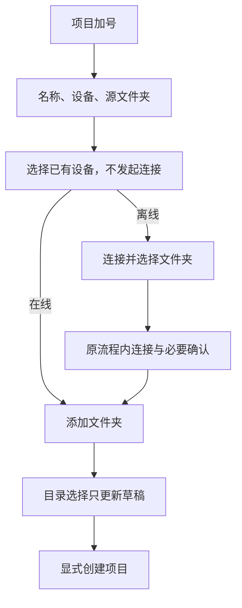

# 18: 直接创建项目与选择已有设备

Status: done

**Parent:** [#15 — 项目创建与远程连接管理分离](15-project-device-selection-and-connection-management.md)

**What to build:** 用户点击「项目 +」后，直接填写名称、选择设备与源文件夹，并完成项目创建。已有远程设备在线时直接浏览目录，离线时由用户显式发起连接，在项目流程内完成必要确认后继续选择目录。

**Blocked by:** [#16 — 设置内连接独立完成](16-settings-connection-completion.md)。本票复用其按意图继续项目操作的连接流程，不再维护另一套竞争的连接完成路径。

**Spec coverage:** Q1、Q3、Q4、Q6、Q7；RDUX15-01、RDUX15-02、RDUX15-03、RDUX15-06、RDUX15-07、RDUX15-08、RDUX15-09、RDUX15-17；RDUX15-18／20／21 覆盖本票的连接等待与取消，RDUX15-23／24／25 覆盖共享项目表单。

## Acceptance criteria

- [x] 移除新建项目的本地／远程类型前置屏及「下一步」。首屏包含项目名称、设备、源文件夹和创建操作；本地和已有远端项目均能从此入口完成保存。
- [x] 打开时默认当前任务所在设备；没有当前任务时用本地。当前任务设备离线仍保持选择并显示状态；后续设备快照刷新不覆盖用户已经作出的选择。
- [x] 设备下拉展示「此电脑」、所有已添加设备及状态；包含离线和从未在本机打开项目的已识别设备，不依赖项目 open set，不混入发现候选及未识别 Profile。设备身份不按显示名或地址猜测。
- [x] 选择设备本身不连接、不创建项目或任务。在线设备「添加文件夹」复用该设备的目录能力；离线设备显示「连接并选择文件夹」，点击才建立连接。
- [x] 已有设备的连接进度、补凭据、必要安装／升级确认和错误在项目流程中处理，不跳设置新增窗口；成功打开所选设备的目录浏览，失败保留项目草稿并允许重试。
- [x] 空目录草稿可直接换设备；已有目录时先确认，接受后清目录并换设备，名称保留；拒绝后设备与目录全部不变。确认和异步目录返回不得造成部分修改。
- [x] 旧设备的目录读取或系统目录选择响应，在设备切换、取消或草稿失效后不得写入新草稿、重新打开旧界面或触发保存。
- [x] 本地继续支持零个或多个目录；远程必须且仅能选择一个固定 root，编辑已有远程项目不能更换其 root。目录不可用或保存失败留在表单，不新增幽灵项目。
- [x] 选择目录只修改草稿，只有显式创建才保存项目。关闭本次连接不等于放弃原项目草稿，不删除已保存设备，也不影响其他项目共享的连接。
- [x] 共用表单保留平台注入的目录能力；Web／手机不把浏览器所在设备当作可访问的本机文件系统，不开放不存在的设备管理入口或新建独立远程 session。
- [x] 表单、设备下拉、切换确认和目录选择符合设计系统，覆盖键盘、焦点、长设备名／路径、中英文、当前深浅主题和窄窗口。
- [x] 先更新并执行本票交互测试再实现，保留未迁移入口可用；完成验收时不把后续票的新增设备往返和已有项目次要入口算作本票已经交付。

## Verification

- 从侧栏真实加号入口验证默认值、候选范围、在线／离线设备选择、切换确认及本地／远程项目保存；对「已识别但从未打开项目」设备验证实际可创建项目，不只检查列表可见。
- 用真实远程链路验证离线显式连接、补凭据／安装后继续选目录；用既有 UI 端口延迟目录响应，验证草稿隔离和取消。
- 将本票场景关联到现有项目输入框、本地目录选择和远程项目合同测试，覆盖本地零／多目录、远端单目录及无效路径。只断言外部行为，不固定组件内部状态结构。
- 实施需完成类型检查、lint、架构门禁、受影响单测、对应 Desktop E2E 和共享 UI 的适用 Web／手机回归；实际操作系统、主题及远程类型证据分开记录。

## Scope and handoff

- 本票只消费已添加设备，可以与 [#17](17-typed-remote-device-addition.md) 并行推进。
- [#19](19-add-existing-remote-project.md) 将已有远程项目能力接入新表单；在其完成前，不移除用户当前可用的已有项目入口。
- 新增设备进入设置并往返草稿由 [#20](20-project-draft-settings-round-trip.md) 完成；迁移期间保留既有新增连接能力可用，不留下空操作按钮。
- 复用单一项目草稿和现有连接流程，不新建跨重启草稿存储、项目数据库或连接 owner。

## Implementation notes

- Web／手机没有 Source 管理能力时，设备候选只投影既有 `remoteProjectService` 目录中的 Host；不能把管理能力缺席解释为没有设备，也不因此开放设备添加权限。桌面仍使用已识别 Source 全集。
- 项目流程的远端目录页与旧连接目录页共用首次持续运行提示，显示后才写入原 `remoteBoundaryOnboardingVersion`，未显示、读取失败和迟到结果不记已读。
- `ProjectEditor` 是名称、设备和目录的唯一草稿 owner；`ProjectCreation` 只持有连接交接与本机成员登记。默认设备在表单首次打开时采样，Source 快照刷新不改选中值。
- 设备候选取已识别 Source 全集，目录读写沿用所选 Host 的项目服务。只有显式创建才为无项目成员的 Source 登记成员；已有成员复查代际。远端创建成功、入口登记失败后重试复用原项目 ID。
- 目录结果按草稿代际校验。连接补凭据、安装和升级确认复用现有流程；临时 attachment 释放不影响已有项目共享的 attachment。
- #22 接入统一后台继续 owner 前，项目连接使用 `SSHDialog.allowBackground=false`。这是能力门禁，避免旧外层把收起当取消；#22 完成后开放，不能将该门禁视为后台场景已经验收。
- 旧 VP08 Direct URL fixture 不属于 Source 选择器，改用专用项目元数据服务准备入口；后续项目 UI／远端执行回归保留。它不证明新的 Source 下拉行为。
- TODO（用户确认暂缓）：真实 WSL、手机远控验证；不以 macOS SSH 或共享组件单测替代。

## Verification result — 2026-10-12

- `pnpm typecheck`、`pnpm --filter @zcode/desktop typecheck:e2e`、`pnpm architecture:check --changed` 通过。`pnpm lint` 通过（208 条既有 warning，0 error）。
- 基于 `26778bf6b4` 的 `pnpm test:unit:affected --base` 通过：692 个受影响文件；普通 Vitest 688 文件、6516 用例，隔离 Vitest 1 文件、1 用例；Node 测试组通过。随后新增候选排除测试的 `--files packages/ui/test/projectCreation.test.ts` 通过（11 用例）。
- Desktop 原生 E2E `conversation-session-project-device-selection.test.ts` 2/2 通过，runId `desktop-e2e-20261012104747134-p27975-f98ece7e94e167c8`。覆盖真实侧栏、键盘、无任务／本地任务／在线远端任务／离线远端任务默认设备、快照刷新、未知 Profile 排除的组件合同、本地零／多目录、无效目录、已识别但无项目成员的 SSH 设备、显式重连、换设备确认和迟到目录响应。
- 两种语言、深浅主题、1440px／480px 截图通过实际 CSS 过渡结束后取样；创建按钮保持可见。证据保存在集成工作区 `packages/desktop/.e2e-artifacts/<runId>/`。
- 远端运行产物复用 #16 已验证且 Git tree 相同的 CLI／shared／services／server／rpc／provider／client／CUA release；本票 UI 先从当前源码构建，后续仅测试改动的复跑逐项核对 5 个核心 UI 的 source map 内容一致。
- 额外默认设备前置通过公共历史导入创建真实任务，不发送模型请求；远端准备走真实 ScopedServicePort，不能将本地服务端口加 workspaceIdentity 当作远端命令。
- 未验证：用户明确暂缓的真实 WSL 和手机远控；迁移的其他历史 E2E 未逐一执行，不计作通过。#22 继续负责统一后台完成／恢复和最终交叉回归；本票没有提前验收后续票能力。

## Review regression verification — 2026-10-12

- 已有设备的目录和已有项目连接继续复用 Root 唯一 flow；`connect-device` 返回意图保持原项目页签，仅 `add-device` 往返设置。后台继续的延迟快照错误按 `entryEpoch` 丢弃过期结果；有效入口仍展示错误。
- 项目表单和已有项目列表在展示边界翻译设备移除、连接不可用错误；保留内部错误码和其他服务错误。组件回归覆盖中英文可见文本、取消／替换入口后的延迟失败，以及有效入口错误。
- 基于 `08b88d058f` 的 `pnpm test:unit:affected --base` 通过：658 个 Vitest 文件、6410 个用例；4 个 Node 文件、34 个用例。`pnpm typecheck`、Desktop E2E 类型检查、lint（208 条既有 warning，0 error）、格式检查、架构门禁和两条修改 E2E 的 fixture 检查通过。
- `conversation-session-project-device-selection.test.ts` 2/2 通过，runId `desktop-e2e-20261012-115251-590`。真实离线连接期间断言目录和已有项目两种意图的活动页签均保持原值，且不显示设置；包含中英文、深浅主题、宽／窄窗口截图。
- `conversation-session-project-settings-return.test.ts`、`conversation-session-chat-device-return.test.ts`、`conversation-session-background-connection.test.ts` 各 1/1 通过，runId `desktop-e2e-20261012-114912-766`。覆盖新增设备仍往返设置、原草稿保留，以及 SSH／Docker 后台继续和取消。该批次的两条 selection 用例因测试遗留英文语言状态而失败，修正语言断言后已在上述独立 run 全部通过；不将早期批次报告为全绿。
- 证据已复制到集成工作区 `packages/desktop/.e2e-artifacts/<runId>/`。最终 E2E 在类型检查后重新构建 Desktop；5 份关键 UI sourcemap 与当前源码逐字一致，10 个远端包的 Git tree 与复用的已验证运行产物一致。
- 初次受影响测试的两个 Office 用例因独立 worktree 外链 WASM 被 Vite 拒绝而失败；修正本地依赖布置后，定向 15/15 和完整受影响重跑均通过，未修改产品或断言规避问题。真实 WSL、手机远控继续按用户决定保留 TODO，不记为通过。
- 本轮审查修复复验：`conversation-session-r3-boundary-ack.test.ts` 在 macOS 原生 Desktop + 独立 Linux SSH 容器 1/1 PASS；设备完成不提前消费提示，首次项目目录浏览显示提示，关闭、第二项目及应用重启不重复。证据 `packages/desktop/.e2e-artifacts/r3-server-review-20261012-boundary/`，已检查目录提示截图。
- 手机共享 Host 回归在 macOS Desktop + Chrome 手机视口 1/1 PASS，证据 `packages/desktop/.e2e-artifacts/r3-server-review-20261012-mobile-r3/`。已登记离线设备在受限频道下可选，已有项目入口保留、无新增设备入口，原项目创建／任务持久化／草稿重载仍通过。账号与外部 relay 使用现有 loopback fixture，Main／Host／WebSocket／应用 RPC 保持真实；不代表线上 relay 或实机手机。前两次分别定位无账号配对门禁和 fixture 的 client scenes 返回类型错误，均只修测试前置，未修改产品门禁。
