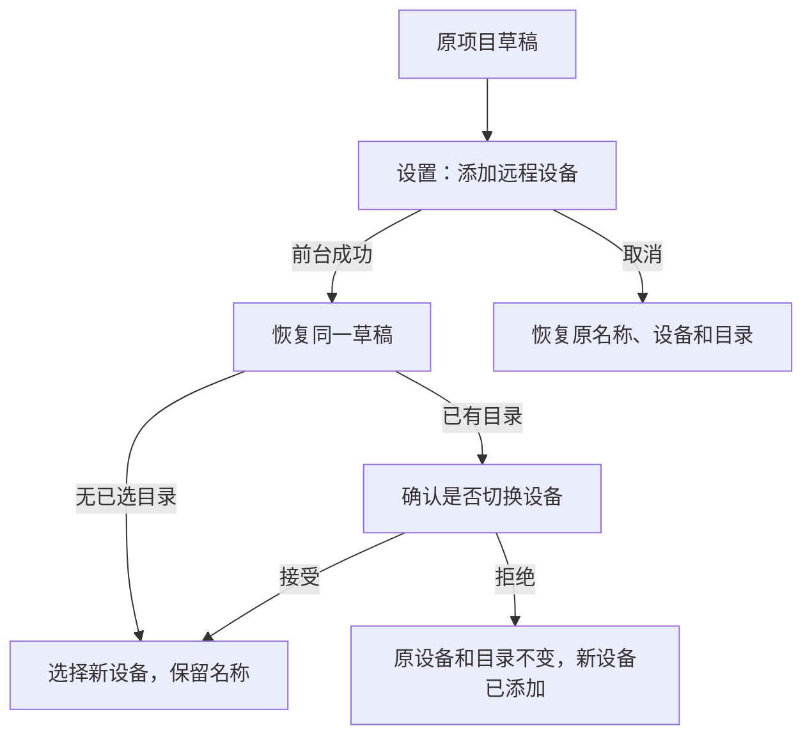

# 20: 创建项目往返设置并恢复草稿

Status: done

**Parent:** [#15 — 项目创建与远程连接管理分离](15-project-device-selection-and-connection-management.md)

**What to build:** 用户在创建项目的设备下拉菜单点击「添加远程设备…」，进入设置的分类添加窗口；前台成功后返回同一项目草稿并选择新设备，取消则恢复原选择。项目名称和目录不会因跨页丢失，已有目录仍需经过换设备确认。

**Blocked by:**

- [#17 — 按类型添加 SSH／WSL／Docker](17-typed-remote-device-addition.md)：提供设置内完整的添加路径。
- [#18 — 直接创建项目与选择已有设备](18-direct-project-creation-and-device-selection.md)：提供待恢复的表单、单一草稿和设备切换确认。

**Spec coverage:** Q1、Q7、Q10、Q12；RDUX15-04 的项目入口、RDUX15-11、RDUX15-12、RDUX15-13，以及 RDUX15-20 的跨页草稿保护；RDUX15-23／24／25 覆盖焦点、布局与能力门禁。

## Acceptance criteria

- [x] 项目设备下拉的新增入口关闭原菜单并进入「设置 → 远程设备」，直接打开 #17 的分类添加窗口；设置已经打开或重新挂载时都只消费本次导航意图一次。
- [x] 跨页期间由原项目草稿的单一 owner 保留名称、设备和源文件夹；导航只携带发起位置及草稿引用，不复制另一份可写草稿，不在返回意图里保存密码。
- [x] 前台连接成功且原意图仍有效时，返回同一创建表单，保留名称；原草稿没有目录时选择新设备，尚未显式创建前项目和任务数量不增加。
- [x] 原草稿已有目录时，返回必须经过与普通设备切换一致的确认。接受后清目录并选择新设备；拒绝后保留原设备与目录，新设备仍已添加且可以稍后选择。
- [x] 在添加表单、连接中或等待凭据／安装确认时取消，均返回原项目草稿并恢复原值；不删除已保存连接记录，不断开其他项目共享连接，不把取消解释为放弃项目草稿。
- [x] 添加失败留在添加流程，配置和可理解的错误保留，可修正重试；最终成功或取消仍回同一个有效发起意图。
- [x] 原草稿被明确放弃、替换或原流程已经失效后，迟到的连接和设置导航结果不得重新打开旧表单或覆盖新草稿；清理仅作用于本次独占资源。
- [x] 一次往返只恢复一次；不靠延迟跳转、超时或轮询修复页面时序，也不额外持久化跨重启草稿。
- [x] 键盘、Esc 顶层语义、返回焦点、中英文、当前深浅主题和窄窗口下，前台往返及切换确认都可完成；无设备管理能力的平台不暴露不可完成的跳转。
- [x] 先补真实入口 E2E 与必要的时序集成测试，再接入导航；删除本入口被替代的独立新增连接接线前确认其其他调用者仍可用。

## Verification

- 从真实项目表单分别以空目录和已有目录草稿新增设备，执行成功、拒绝换设备、接受换设备、失败重试和各等待阶段取消，逐项核对原值、设备状态和项目数量。
- 不使用直接打开添加窗口来绕过待测导航；同时验证设置首次挂载和已经打开的分区切换，防止重复消费及错误返回。
- 在现有服务接缝延迟连接／凭据结果，放弃或替换原草稿后释放，断言不复活旧表单、不影响新草稿或共享项目。
- 实施需通过类型检查、lint、架构门禁、受影响单测、对应 Desktop E2E 和适用的平台／主题回归；记录真实远程证据与未验证项。

## Scope and handoff

- 本票负责前台的项目草稿往返，不依赖 [#19](19-add-existing-remote-project.md) 的已有项目列表或 [#21](21-chat-settings-round-trip.md) 的聊天往返；满足前置条件即可推进。
- 后台成功只提示且需用户显式继续的分支由 [#22](22-background-connection-and-explicit-resume.md) 完成。本票不将连接完成意图迁入任务协议，不修改 Host 的连接状态机。

## Implementation notes

- `ProjectEditor` 保持原实例和唯一草稿；`ProjectCreation` 只保存本次返回引用与收起状态。设置导航不复制名称、目录或凭据。
- Root 通过 `returnTarget` 保存原 owner 引用和精确页签／workspace 身份；成功和明确取消先消费引用，再返回。失效 owner、页签或 workspace 不恢复。连接收起不当作取消，后台延续由 #22 接入。
- 返回的新设备仍调用原 `changeDevice`，复用目录确认。旧草稿卸载后，迟到的设备结果和项目入口登记结果不能影响新草稿。
- 新候选使用无账号的 E2E 启动合同；假 OAuth 会触发真实控制面的登录过期弹窗，遮挡项目入口。项目返回测试仅等待连接窗口完成，不把随后正常出现的换设备确认误判为连接失败。
- TODO（用户确认暂缓）：真实 WSL 与手机远控验证，不以本机 SSH 或共享组件测试替代。

## Verification results

- `pnpm typecheck`、`pnpm lint`（0 errors，208 条既有 warnings）、架构门禁（0 violations）、E2E 类型和 fixture 校验通过。
- 从实施基线运行受影响测试：405 文件、4589 测试通过；测试选择器辅助套件通过。新增无账号启动回归 26 测试、项目草稿与连接时序定向测试通过。
- macOS 原生真实 SSH E2E 通过：`desktop-e2e-20261012110624292-p87138-e361604dfca379e7`。覆盖真实项目入口、表单取消、握手中取消、错误密码修正、成功返回后的拒绝／接受换设备确认、无目录草稿与无隐式项目创建。
- 中英 × 深浅主题 × 1440／480px 的 8 组前台往返、焦点和按钮可达性通过，截图在过渡结束后采集并检查。测试仍为 pending，未转正或纳入 CI。
