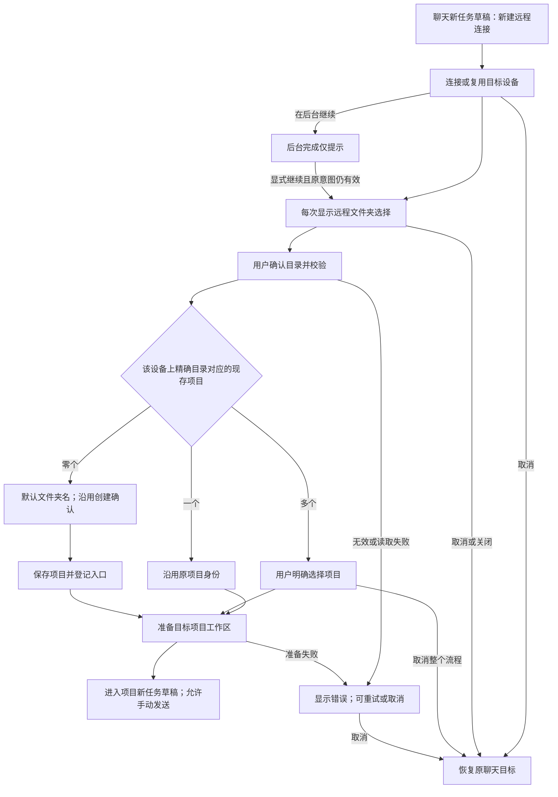

# 21: 聊天连接后必选远程文件夹并进入项目

Status: done

**Parent:** [#15 — 项目创建与远程连接管理分离](15-project-device-selection-and-connection-management.md)

2026-10-14：已按 #23–#26 完成实施和集成验证。此前“连接成功后返回原聊天，仅提供创建项目按钮”的记录保留为历史；本轮结果与实际平台范围见下方最新验证记录，旧 PASS 不覆盖新合同。

## Problem Statement

用户在聊天框项目菜单点击「新建远程连接…」，连接成功后看到「选择项目」和「在此设备创建项目」。输入文字后仍可发送，最终创建的是本地无项目聊天。用户认为刚连接的设备就是接下来的执行目标，界面没有清楚说明聊天仍属于本地。

这条路径符合旧合同：设备添加成功只返回设备身份，原聊天目标没有改变。因此问题是连接完成后的产品流程与用户意图不一致，不能仅描述为远程发送失败后回退本地。远程无项目聊天已停用，本地无项目聊天仍受支持。

文件夹与项目不是一一对应：同一设备、同一目录可属于多个项目。选中文件夹不能只按路径猜测项目身份；只登记项目入口而不进入目标项目，也不能完成用户这次远程工作意图。

## Solution

从聊天框的「新建远程连接…」完成远程连接后，每次都打开目标设备的「选择文件夹」弹窗。使用已有目录浏览能力，包括路径输入、跳转、目录列表和隐藏目录显示。不得在用户确认文件夹前按最近项目、唯一项目或旧草稿项目自动打开。

适用于首页无项目草稿、已选本地项目的新任务草稿、已选远程项目的新任务草稿。既有会话身份不迁移；设置中的设备添加和原项目重连保持各自原有完成规则。

用户确认文件夹后，按所属设备及精确目录确定项目：

| 条件                                 | 完成行为                                                                                     |
| ------------------------------------ | -------------------------------------------------------------------------------------------- |
| 恰好对应一个现存、未删除项目         | 打开原项目的新任务草稿，保留项目 ID 和历史任务归属                                           |
| 对应多个现存、未删除项目             | 显示这些项目，让用户明确选择一个，再进入其新任务草稿                                         |
| 没有对应项目                         | 使用文件夹名作为默认项目名，以该目录创建远程单目录项目，沿用已有创建确认，再进入其新任务草稿 |
| 目录无效、无权限、设备断连或读取失败 | 显示实际原因，允许重试或取消；不创建替代项目，不回退本地                                     |

文件夹选择、项目确定、必要创建与登记、目标工作区准备全部完成后，才允许发送。发送按钮和键盘提交遵循同一约束；准备完成不自动发送任何消息。

取消或关闭顶层选择流程表示放弃本次切到远程的操作，恢复连接前的聊天目标，并明确显示恢复后的设备／项目状态。原草稿由既有 owner 保留。成功建立的设备连接仍保留，其他任务不受影响。不得留下“远程未选项目但可以发送”的状态，也不提供跳过项目后继续远程聊天的出口。



### 目录确认的加载反馈

点击「选择文件夹」后，复用 `ChatRemoteFolderSelection.busy`，在原确认按钮内显示转圈与
「正在打开…」（英文 `Opening…`）。保留目录内容与已选路径；按钮预留两种文案的空间，
切换状态不改变按钮宽度或弹窗高度，不再在目录选择器下方追加「加载中…」。
正在执行的按钮保留主按钮前景色，减少动态效果时停止转圈。失败沿用原错误区，按钮恢复可操作。
父层继续负责 single-flight、目录校验、项目准备与过期结果隔离；目录浏览器只接收展示状态。
多个项目的选择阶段保留既有加载反馈，其他目录选择入口不启用本展示参数。

```text
选择目录 → confirm / busy=true → 校验目录、匹配并准备项目 → 成功导航或显示错误
                      └─ DirectoryBrowser 确认按钮：转圈 + 正在打开…
```

验收：阻塞项目读取期间，目录与路径仍可见，只有按钮内存在加载提示，确认按钮不可重复提交；
失败后按钮文案恢复，错误可见且能够重试。桌面与窄屏、深浅主题以及中英文均检查布局稳定。

2026-10-14 验证：原测试先复现「加载状态不在按钮内」，修复后相关 UI 回归通过；
最终 affected 范围为 503 文件／5,471 项，类型、E2E 类型、Lint（0 错误）、架构及改动代码格式检查通过。
macOS 桌面至独立 Linux arm64 SSH 容器的核心场景通过（`desktop-e2e-20261014-094915-820`）；
创建项目、多项目选择和后台连接相邻场景通过（`desktop-e2e-20261014-095322-224`）。
真实目录组件在 1200px／390px、中英／深浅主题的八组浏览器检查通过，含尺寸稳定及减少动态效果；
手机 shared-host、手机真机和 Windows／Linux 桌面未在本轮实跑。候选不自动转正。

## User Stories

1. As a user starting a projectless draft, I want a remote folder picker after connecting, so that my next task runs in the environment I chose.
2. As a user with a local project draft, I want the same remote folder selection flow, so that the entry has a consistent meaning.
3. As a user with a remote project draft, I want to choose a folder on the newly connected device, so that the old project is not mistaken for my new target.
4. As a user reusing an online device through this chat entry, I want the folder picker, so that connection reuse does not bypass my choice.
5. As a user whose device has one project, I want to confirm a folder first, so that uniqueness does not replace my decision.
6. As a user whose device has several projects, I want no automatic recent-project selection, so that a previous task does not determine the new task's location.
7. As a user browsing remote folders, I want the device and current path to be clear, so that I can distinguish remote directories from local ones.
8. As a user who knows a path, I want the existing path input and jump action, so that I can reach it directly.
9. As a user working in hidden folders, I want the existing hidden-directory control, so that those folders remain selectable.
10. As a user selecting an existing project's folder, I want that project's identity reused, so that its history remains accessible.
11. As a user with multiple projects sharing a folder, I want to choose the actual project, so that their identities and tasks remain separate.
12. As a user selecting an unregistered folder, I want a project named after the folder, so that I can continue without a separate naming step.
13. As a user creating a project, I want the existing folder and recovery confirmations retained, so that this entry follows the same creation contract.
14. As a user repeating the same folder selection, I want the existing project reused, so that routine reconnection does not create duplicates.
15. As a user with identical paths on different devices, I want matching limited to the chosen device, so that the wrong project's history is never selected.
16. As a user whose project is still preparing, I want both button and keyboard submission blocked, so that my message cannot run in the old environment.
17. As a user whose project becomes ready, I want to send explicitly, so that readiness does not submit a message on my behalf.
18. As a user choosing an invalid or inaccessible folder, I want the actual error and a retry option, so that I can correct the choice.
19. As a user whose project list cannot be read, I want a loading error, so that a failed read does not create a duplicate project.
20. As a user whose device disconnects during selection or preparation, I want to remain in the unresolved remote flow, so that sending cannot silently switch to local execution.
21. As a user cancelling remote folder selection, I want the original chat target restored visibly, so that I know where a later message will run.
22. As a keyboard user, I want closing and Escape to respect the active dialog layer, so that one action does not accept a folder or submit chat unexpectedly.
23. As a user with another task on the same device, I want cancellation to preserve its connection, so that abandoning this flow does not interrupt that task.
24. As a user retrying after project registration fails, I want the already-created project reused, so that the retry does not create another project.
25. As a user who changes drafts or starts another connection, I want late results ignored, so that an old operation cannot replace my current target.
26. As a user continuing a connection in the background, I want completion to remain a notice, so that it does not interrupt my current page.
27. As a user explicitly resuming a completed background connection, I want the folder picker for that device, so that resumption follows the same selection requirement.
28. As a user managing devices in settings, I want that operation to remain independent of project selection, so that managing a connection does not start a task.
29. As a user working locally without a project, I want local projectless chat to remain available, so that this remote rule does not remove the local capability.
30. As a user of a supported platform, language, or theme, I want readable folder selection and error controls, so that I can complete the flow with the available device capabilities.

## Implementation Decisions

1. **入口与完成意图。** 聊天项目菜单仍复用统一设备添加、认证和安装链路，但它的完成意图改为“连接后必须选择远程目录并进入项目”。替换此入口“仅设备管理成功，然后显示创建项目按钮”的接线，不另造连接向导。设置添加、项目表单添加设备、原项目重连分别保留既有语义。
2. **词汇与身份。** Source 是已识别的远端环境和账号；Connection Profile 是到达 Source 的连接方式；项目由所属 Host 与项目 ID 确定；目录是项目 root，不是项目身份。连接成功只证明设备可用，不能证明已选中项目。
3. **目录来源。** 浏览、路径校验和目录判等使用目标 Host 的服务与既有路径规则，不使用本机文件系统或本机操作系统的路径归一化判断远端。匹配限定同一设备、同一固定 root 的精确匹配，不用名称、路径前缀、父目录或另一设备的同名路径猜测。
4. **确认后的项目解析。** 只有用户确认目录后才读取／核对权威项目结果并执行一项、多个、零项分派。唯一匹配复用真实项目 ID；多个匹配继续用户选择；列表读取失败不是零项。已删除项目不作为现存匹配自动打开；新建命中已删除项目时沿用现有恢复或继续新建规则，不静默恢复。
5. **新建范围。** 零项时由本流程填充默认文件夹名和单一固定 root，复用共享创建、目录确认、保存及本机入口登记，不要求用户重复填写同一目录。此入口的按目录解析不修改通用项目保存为全局 get-or-create，也不新增“每个目录只能有一个项目”的约束。显式创建同目录另一项目的其他入口保持原合同。
6. **既有创建边界。** 新建／恢复仍经过已有目录信任确认；文件夹选择不代替该确认。旧远端仅支持读取时，已有项目可选择，不能通过本入口绕过新建能力限制。保存失败保持错误；远端已保存、本机登记失败时保留返回的项目 ID，重试登记而非重复创建。已有创建确认的层级取消和权限语义继续有效。
7. **完整交付。** 选中或创建后必须把实际 Host、项目 ID 和目录交给既有项目选择与工作区准备链路，进入该项目的新任务草稿；只刷新列表或登记入口不足以完成。保留既有项目的历史任务，不自动恢复某个旧会话，不迁移其身份。
8. **发送约束。** 当前前台切换意图尚未完成或取消时，发起方草稿不能通过按钮、Enter 或其他既有提交入口向旧目标发送。目标项目、attachment 与运行准备成功后才使用正常发送条件。后台不对无关聊天施加全局禁发；已有任务的消息与队列规则不变。不得靠延迟解除发送限制。
9. **取消与提交边界。** 顶层文件夹／项目选择的取消、关闭及相应层级 Escape 取消本次切换，恢复仍有效的原聊天目标与焦点，并显示其设备／项目归属。不得让“稍后选择”成为可发送的远程无项目出口。嵌套下拉、恢复或目录信任确认层先按原层级语义处理，未完成整个流程仍不能发送。已经成功保存的项目不因关闭而自动删除；尚未保存时取消不新建项目。
10. **资源归属。** 仅释放本次独占的临时 attachment；取消不删除设备记录，不断开已连接 Source，不释放其他项目共享 session。重复确认、重复继续和登记重试不得新增重复项目或入口，沿用既有在途结果与幂等边界，不承诺新增全局分布式目录唯一性。
11. **异步与单一 owner。** 连接流程持有发起方、目标设备、请求身份和完成意图；已有草稿 owner 持有正文和附件。每次异步结果在导航或写入前复验当前请求、Source／Host membership、选定目录和项目。切换草稿、替换请求、成员移除、取消或卸载使旧结果失效；不复制一份草稿、另建连接状态缓存或用超时同步状态。
12. **后台延续。** 沿用已有后台通知和显式继续契约。后台成功不弹目录窗口、不改变当前项目；用户显式继续且原意图仍有效时才进入文件夹选择。过期继续与重复继续不得抢导航或重复提交。旧的连接结果不能复活用户已放弃的流程。
13. **范围与兼容。** SSH／WSL／Docker 使用同一完成规则并尊重现有平台能力。开发专用 Server 直连不扩展。共享 UI 沿用设计系统、国际化、深浅主题及键盘规则；Web／手机保留壳层能力门禁与既有 Host、desktop-continuous／web-remote-replayable 边界。
14. **存储与协议。** 复用项目服务、目录浏览、远程入口和工作区身份契约；本需求不需要新数据库迁移、身份格式、任务协议、草稿持久化模型或第二个消息 owner。草稿和附件跨设备迁移维持现有行为，本轮不实现迁移与冲突合并。

## Testing Decisions

目录匹配兼容旧端保留的历史路径写法：旧端适配器按远端 platform 派生只读 `directoryMatchPath`，使用与 `readDirectory` 相同的 normalize 规则。它只参与单目录匹配，不写数据库或入口缓存，不改变原 roots、合成项目 ID、任务归属或 prepareSession 的 cwd。多个历史身份规范化为同一目录时仍须显式选项目；不增加 realpath 或符号链接等价规则。

后台完成后的显式继续必须在查询 Source 或成员资格前同步恢复前台可见性，由原聊天 owner 立即恢复提交门禁。完成前取消、再次收起或原意图失效继续使用现有清理规则，不增加第二份发送状态。

```text
后台解除禁发 → 显式继续 → 前台可见性通知／原草稿禁发 → Source／成员校验 → 选目录
历史 root → 所属 Host 的规范化匹配值 → 目录匹配；原 ID／root／任务 cwd 保留
```

以已有真实 Desktop 聊天入口 E2E 为主接缝：从可见项目菜单发起连接，完成目录选择、项目进入和首次发送，检查实际任务归属与执行目录。复用聊天设备往返候选、添加已有远程项目候选、后台连接候选以及项目创建目录确认的测试能力。仅用已有 UI／服务端口补充难以稳定控制的迟到结果、失效身份和登记失败；不为测试新增产品 API。

好的测试断言用户可见目标、实际 Host／项目／任务身份、目录、发送结果与持久化数量，不把局部 state、回调次数或“经过了该页面”当作行为正确。草稿预热可能已有运行时，不能用“没有启动任何本地 runtime”替代“没有向本地提交该条消息”。修复前先证明原无项目路径会错误发送到本地，再使对应 E2E 通过。

以下是已确认的验收合同。实现与测试映射见 #23–#26、case 目录和覆盖矩阵；通过结论仅适用于记录的测试接缝与实际环境，不代表所有平台均已实跑：

| ID        | Setup → Action                                       | 必须断言                                                                  |
| --------- | ---------------------------------------------------- | ------------------------------------------------------------------------- |
| RDUX21-01 | 本地无项目草稿，从聊天菜单真实连接远端               | 自动显示目标设备文件夹选择；未确认前按钮与 Enter 均不能提交到本地         |
| RDUX21-02 | 远端仅一个项目，或有最近项目；分别连接               | 每次仍显示文件夹选择，不自动打开任何项目                                  |
| RDUX21-03 | 复用已在线设备，含重复从同一聊天入口连接             | 仍需显式选目录，设备身份与列表正确                                        |
| RDUX21-04 | 本地项目草稿、远程项目草稿分别进入本流程             | 与无项目草稿相同；原项目不是新设备的默认目标，旧任务身份不迁移            |
| RDUX21-05 | 目录唯一匹配一个已有项目，确认并进入                 | 使用原项目 ID、Host、root；历史任务保留；首次消息实际发到目标远端         |
| RDUX21-06 | 同设备同目录对应两个现存项目                         | 再显式选项目；未选择前不能发送；选定后不合并历史、不新增重复项目          |
| RDUX21-07 | 目录无现存项目，完成既有创建确认                     | 默认文件夹名、唯一固定 root；保存／登记后进入新项目草稿；首次发送归属正确 |
| RDUX21-08 | 再次连接并确认已经使用过的同一目录                   | 复用已有项目；重复点击确认不新增重复项目或入口                            |
| RDUX21-09 | 两台设备有相同路径；另有同名前缀或父目录项目         | 只按目标设备与精确目录匹配，不选另一设备或父目录项目                      |
| RDUX21-10 | 无效路径、非目录、无权限；确认期间目录失效           | 显示实际原因，可重试／取消；无替代目录、项目或本地消息                    |
| RDUX21-11 | 项目列表读取失败；随后成功重试                       | 失败不当作零项创建；重试继续原设备／目录                                  |
| RDUX21-12 | 目录选择、项目选择或工作区准备时断连／失败           | 不可发送，不切回本地；恢复后也不自动发送                                  |
| RDUX21-13 | 文件夹选择分别取消、关闭、Escape                     | 恢复原目标、原草稿及合理焦点，目标标识明确；不留下远程无项目聊天          |
| RDUX21-14 | 多项目选择取消；嵌套选择／信任确认按 Escape          | 顶层取消整次切换；嵌套只关闭当前层，不误提交，不同时关闭多层              |
| RDUX21-15 | 连接前或连接中取消；设备另有运行中任务               | 未提交项目不新增；原聊天可恢复；已有连接记录和共享任务不受影响            |
| RDUX21-16 | 取消、换草稿、换设备或成员失效后释放旧结果           | 旧连接／目录／保存／准备结果不导航、不覆盖新目标；不误释放共享资源        |
| RDUX21-17 | 远端保存成功，本机入口登记失败后重试                 | 保留真实项目 ID；只重试登记，不重复创建；完成前不能发送                   |
| RDUX21-18 | 后台完成后用户仍在另一聊天；再显式继续               | 完成不弹窗／抢焦点；有效继续进入目录选择；过期／重复继续无副作用          |
| RDUX21-19 | 原目标分别为本地无项目、本地项目、远程项目，取消切换 | 显示并恢复原目标，保留现有草稿；本地无项目仍能在明确取消后正常发送        |
| RDUX21-20 | 设置设备添加、原项目重连、已有会话续聊               | 保留原完成规则，原项目重连不因本入口要求重复选择目录                      |
| RDUX21-21 | 无现存项目但有已删除项目；旧远端仅有只读能力         | 沿用恢复／新建确认；不静默恢复；只读远端不能绕过新建限制                  |
| RDUX21-22 | 中英文、深浅主题、长路径、窄窗及键盘操作             | 设备／目录／错误可读，确认和取消可达，焦点合理；Enter 不串到聊天发送      |
| RDUX21-23 | SSH／WSL／Docker 及相应操作系统能力                  | 支持的平台走相同目录完成规则；按实际环境分别记录证据                      |
| RDUX21-24 | 普通 Web／手机共享界面与既有远程项目                 | 能力门禁有效；不引入浏览器本机目录、额外 Host／session 或 replayable 回退 |

- 本轮测试范围直接承接已确认的目录选择、项目匹配、取消返回、发送限制及异步保护，不重新访谈或扩大到草稿迁移。跨设备切换成功用空草稿隔离该范围；原草稿内容只用于取消／失败保留回归。
- 实施时先补 E2E 及必要的既有端口测试，再改代码；同步 case 目录、覆盖矩阵和相关旧断言。主题／语言采用代表组合，不与所有失败类型作全量笛卡尔积。
- 完成类型检查、lint、架构门禁、受影响单测、对应 Desktop E2E 与适用共享 UI／手机回归。记录真实连接类型和操作系统范围；窄桌面窗口不能替代手机证据。
- 候选继续走既有 pending、人工审核和转正流程；本规格、实现完成及运行成功均不授权 formal／CI 准入。

## Out of Scope

- 在用户确认文件夹前自动打开唯一项目、最近项目、默认项目或原草稿项目。
- 远程无项目聊天、远程多目录项目、迁移已有会话、按目录合并多个项目身份。
- 草稿文字与附件跨设备迁移、附件重新暂存、目标草稿冲突处理或内容合并；沿用现有行为。
- 改写设置设备管理、项目创建入口和原项目恢复的通用规则；仅本聊天入口采用确认目录后的匹配／创建规则。
- 新连接传输、认证、安装、重连状态机，手机独立连接，身份／数据库／任务协议迁移，全局目录唯一性或新的持久信任机制。
- 自动发送、后台自动跳页、扩大 Web／手机设备管理能力，或把未运行的平台补记为通过。

## Further Notes

- 本轮决策顺序已经收敛：先取消“连接后自动开项目”；每次显式选文件夹；确认目录后执行唯一／多个／零项规则；顶层取消撤销本次远程打开并回到原目标；草稿迁移延期。不再采用讨论中已放弃的“取消后保留远程待选状态”。
- 本文件是本地 Issue 和完整 spec，父规格的聊天分支以本文件为准。#23–#26 已完成，旧成功按钮及旧 E2E 断言已更新；完成范围以本轮证据为准。
- 领域与身份继续依据 [R3 主规格](../../architecture/r3-source-server-remote-architecture.md)、[运行时边界](../../agents/runtime-boundaries.md)和[虚拟项目规格](../../superpowers/specs/2026-09-09-virtual-project-design.md)。同目录多项目是受支持状态，不是待清理的重复数据。
- 复用 [#17 分类添加设备](17-typed-remote-device-addition.md)、[#19 添加已有远程项目](19-add-existing-remote-project.md)及 [#22 后台连接与显式继续](22-background-connection-and-explicit-resume.md)；新建／恢复遵循[项目目录确认](../../specs/project-creation-folder-confirmation.md)，不将选目录视为自动信任。
- 视觉沿用[设计规范](../../../DESIGN.md)。验收 ID 已登记在 [case 目录](../../conversation-session-case-catalog.md)与[覆盖矩阵](../../testing/conversation-session-e2e-coverage-matrix.md)；用例落地遵循 [E2E 工作流](../../testing/conversation-session-e2e-development-workflow.md)。

### 本轮实施与验证：2026-10-14

审查修复补验：

- 后台显式继续在 Source／成员查询前恢复前台通知和禁发。原实现的 Desktop RED 为 `desktop-e2e-20261014080117758-p36079-9dfb8d5ab50a47fa`：扣住 Source 查询后发送按钮仍可用。最终后台候选 `desktop-e2e-20261014081704935-p58111-926b13e33297f1e3` 1/1 通过，覆盖定向输入框 Enter／form 禁发、远程首发、取消恢复及 SSH／Docker；已审阅等待阶段截图。
- 旧端适配器按远端平台派生目录匹配值，保留原 ID、root、任务 cwd 和只读限制。真实适配器／UI 回归覆盖 POSIX、Windows、唯一及多个等价历史身份；旧 UI 副本的两条回归均为 RED。聊天目录候选在 `desktop-e2e-20261014081447158-p54737-f7abcbb92e9dd5c6` 通过，新增旧端投影 RPC 回放并核对两个原项目 ID；已审阅项目选择截图。这不是旧 Server 二进制实跑。
- `pnpm test:unit:affected --base c81f9736d7ccb83dc77203a43d7b2582b9bbecdd` 选择 312/2623 文件。首轮 311 文件通过；旧 Host 测试缺少新增路径投影所需的系统信息端口，补齐后该文件 18/18 通过。合计 4095 测试通过、1 个既有 skip；未跑全量 UT。最终 flow 文件 104/104 通过。
- 根类型检查、E2E 类型检查、lint（209 个既有 warning，0 error）、架构门禁（0 violation）、两候选 fixture 检查、代码格式与 diff 检查通过。fixture 的成员读取故障标记仍为既有非 provider warning。
- 手机 Web 项目目录在 390px × 中英文 × 深浅主题共 4 组通过，证据位于 `.tmp/chat-review-fix-mobile`；已审阅深浅主题截图。实机范围为 macOS Desktop 与独占 Linux arm64 SSH／Docker fixture；未运行 Windows／Linux Desktop、WSL、旧远端二进制或实体手机。候选仍保持 pending。
- E2E 同步纠正了两个观测条件：继续后连接弹窗聚焦“收起”，全局 Enter 会合法解除门禁，因此键盘断言定向原输入框；返回时等待原 Dialog 的退出动画，项目菜单操作前移出身份浮层，均不增加产品超时或同步逻辑。

- [#23](23-chat-remote-folder-existing-project.md)、[#24](24-chat-remote-folder-project-choice.md)、[#25](25-chat-remote-folder-create-project.md)、[#26](26-chat-remote-folder-background-resume.md) 均为 `done`，集成于 `feat/chat-remote-folder-integration`。每次显式选目录，唯一／多个／零匹配共用项目进入、发送限制及取消规则；原草稿仍由既有 owner 保留。
- 双轴评审的问题已修复并复核：模块契约移除旧完成语义；成员资格读取失败沿原连接错误／重试／取消流程处理，前台持续禁发；等待中取消不接受迟到结果，再次收起后的迟到失败不重开弹窗。Standards 与 Spec 轴均无剩余 finding。
- 根／E2E 类型检查、lint、架构、受影响单测及 fixture 检查通过。最终集成树从任务起点运行 `pnpm test:unit:affected --base 833e6dcb4b`：615 文件、6966 测试通过、1 个既有 skip。lint 保留 209 个既有 warnings，架构 0 violations；未运行全量单测。
- 桌面真实 SSH 的唯一项目、多项目和创建首发分别通过；后台候选另含真实 Docker 连接。评审修复后的故障目录与后台候选 2/2 通过：`desktop-e2e-20261014062429307-p3874-62dc81c125bcbc6d`。运行证据核对实际 Host／project／task／cwd／identity，以及失败期间按钮、Enter、form 不向旧本地目标提交。
- 集成后的 Web 项目目录与手机 shared-host 候选 2/2 通过：`desktop-e2e-20261014060018735-p87993-7a832ba2b1b8d036`。使用本仓 Web 页面、独立 Chrome 手机视口／触摸上下文和本地 relay fixture，验证远端项目、设备管理能力门禁、目录／信任确认、返回本地及既有 Host／tab 边界；已检查深浅主题截图。这是浏览器手机仿真，不能记作实体手机验证。
- 实跑范围为 macOS Desktop、Linux arm64 SSH 目标和后台 Docker 分支。Windows／Linux Desktop、WSL、实体手机及旧远端二进制未实跑；旧端只读与 Windows 远端路径规则由服务／UI 合同测试覆盖，Docker 的创建与多匹配分支未单独实跑。所有候选仍为 `manual-review/pending`，未转正或取得 CI 准入。

### 历史实现与验证：2026-10-12，旧合同

以下原完成记录只证明旧“设备添加后返回原聊天、显式继续创建”的实现，不能替代 2026-10-14 必选文件夹合同的独立运行证据。

2026-10-12：已完成。聊天项目菜单复用 Root 的 `returnTarget` 和设置分类添加；正文、附件、项目选择继续由既有 owner 持有。成功只显示显式创建操作，使用返回的实际 Source ID 预选同一个项目表单。聊天切换、新建草稿或 owner 卸载后拒绝旧结果与旧继续操作，不创建或迁移任务。

- `pnpm typecheck` 通过；`pnpm lint` 0 errors（仓库已有 warnings）；架构门禁 0 violations；本票文件清单选择的受影响测试通过（Vitest 6481 tests，Node 34 tests）。焦点修正后再次通过 12 个菜单 UI 测试。
- macOS 原生真实 SSH E2E 1/1 通过：`desktop-e2e-20261012111702883-p10383-3368148f2ba7a92f`。先通过公开历史导入创建并选择真实本地项目任务，再从同项目草稿菜单往返设置；取消、认证失败后修正重试、成功、显式继续均验证原 task 的 Host／project／cwd／identity 和草稿正文、附件、项目不变。显式继续检查实际 Source ID，打开表单前后没有新增项目入口。
- 中英 × 当前深浅主题 × 1440／480px：8 组真实设置取消往返的焦点与草稿检查，以及 8 组成功操作／菜单截图，共 33 张图；已审阅宽窄屏、语言和主题代表图。截图等待实际 CSS 过渡结束，无固定 sleep。
- 运行时 focus 轨迹确认：layout 阶段的返回聚焦会被尚未释放的连接弹窗焦点锁拉回。改为同轮 passive effect 清理后聚焦，完整 E2E 已通过；没有新增同步定时器。原始定位证据保留在 `desktop-e2e-20261012111543445-p8782-332fe6402e28ae3a`。
- 候选保持 `manual-review/pending`，不宣称 formal／CI 准入。WSL 和真实手机按用户要求留 TODO；没有用窄桌面窗口代替手机验证。普通 Web／手机不可用管理入口的能力门禁继续由壳层提供，并有 UI 回归覆盖。
