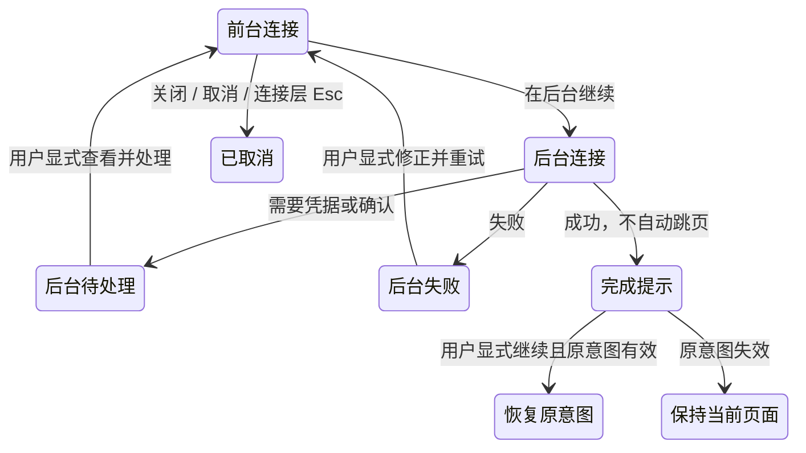

# 22: 后台连接与显式恢复

Status: done

2026-10-14：本票保留已完成的后台生命周期合同。聊天来源显式继续后的目标改按 [#21 的待实施修订](21-chat-settings-round-trip.md)：显示远程文件夹选择，确定项目后再进入；本票旧证据不覆盖该新目标流程。后台完成不抢导航、请求失效和共享连接保护继续有效。

**Parent:** [#15 — 项目创建与远程连接管理分离](15-project-device-selection-and-connection-management.md)

**What to build:** 用户连接设备时可以选择「在后台继续」，在设置的设备卡或未完成连接项查看同一操作的进度、错误与待处理事项。成功只提示完成并提供继续入口，不抢占当前页面；用户显式继续时，按有效的原意图恢复项目、已有项目列表或聊天后续操作。

**Blocked by:**

- [#19 — 添加已有远程项目](19-add-existing-remote-project.md)：后台恢复需要保留继续已有项目列表的意图，不能误回新建项目。
- [#20 — 创建项目往返设置并恢复草稿](20-project-draft-settings-round-trip.md)：提供项目草稿的返回与设备切换确认。
- [#21 — 聊天连接后必选远程文件夹并进入项目](21-chat-settings-round-trip.md)：提供聊天来源的完成目标；本票原完成记录对应其旧版本，新目标须另行验证。

**Spec coverage:** Q12，以及 Q9／Q10／Q11 的后台延续；RDUX15-19、RDUX15-20，并复验 RDUX15-13／14／15／18／21 的相关后台分支。RDUX15-23／24／25 覆盖进度承接、显式恢复和多端边界。

## Acceptance criteria

- [x] 「在后台继续」只收起交互，不取消请求、不清空配置与发起意图；已识别设备由设置设备卡承接，尚未识别的连接由未完成连接项承接，不伪造设备身份。
- [x] 弹窗、设备卡和未完成连接项展示同一操作的真实进度、错误及需要处理状态。设备识别或复用后正确归入对应设备，不重复建立连接或复制日志／状态 owner。
- [x] 用户手动离开设置后，后台成功不打开目录页、项目表单或原聊天，也不改变当前任务设备；只提示完成并提供适合该来源的显式继续入口。
- [x] 原意图仍有效时，用户显式继续可恢复目录选择、已有项目列表、原项目草稿或聊天来源的继续操作；项目已有目录时仍需原切换确认，不绕过 #20 的保护，不自动创建项目或任务。
- [x] 已有后台流程占用连接入口时，从设置「新建连接」或另一设备的普通连接按钮重新打开，恢复同一流程。连接在途时解除后台标记，后续结果按前台完成；连接已完成时一次消费原完成动作，不停在空的连接进度页，不重复拨号。关闭、取消和过期恢复仍按原请求归属处理。
- [x] 直接从设置发起的后台连接可回到对应设备管理状态，不被带入项目创建；后台完成后关闭提示或界面不等于断开设备。
- [x] 后台失败和需要补凭据／确认的状态保持可访问，用户可查看详情、修正、重试或取消；不强行弹出失败窗口，也不把真实失败改写为主动取消。
- [x] 关闭或取消本次尚未完成的连接沿用原请求失效语义；后台继续与取消行为明确区分。取消不删除已保存记录、不影响其他项目共享连接，临时资源只按本次归属清理。
- [x] 原项目／聊天草稿已放弃、原入口已失效、请求已被取消或替换时，迟到结果不复活旧界面，旧继续操作不覆盖新草稿或抢导航。重复查看或点击继续不重复连接、保存项目或提交完成结果。
- [x] 从前台到后台、识别设备、恢复待处理和成功提示的时序均由已有请求与完成事件驱动，不添加定时器、独立轮询或跨重启草稿存储来补状态同步。
- [x] 进度项、错误、待处理和继续操作在键盘、中英文、当前深浅主题与窄窗口下可达；提示不靠颜色表达，恢复后焦点合理，长设备名和错误不遮挡主操作。
- [x] 桌面与手机仍使用原有 Host 及 continuous／replayable 边界；后台连接不会为手机建立独立 session，不因共享 UI 显示而扩大 Web／手机管理能力。
- [x] 先补后台完整路径及失效时序测试再实现，完成各来源的明确恢复验收；替代侧栏旧收起进度入口后，确认不残留双份卡片、重复恢复入口或无人消费的旧接线。

## Verification

- 从设置、创建项目、聊天和已有项目选择路径分别发起连接并转后台；用户离开设置后，让操作成功、失败或需要处理，断言当前页面及输入保持不变，状态有可访问的承接位置。
- 对有效来源显式继续，核对恢复目标、原草稿和设备切换确认；对已失效来源及重复继续操作，断言无旧导航、项目新增或重复连接副作用。
- 在现有 UI／服务端口控制取消后成功、凭据迟到、安装确认迟到和来源失效，复用真实 SSH／WSL／Docker 链路验证实际进度与安装等待；记录各类型与操作系统的真实执行范围。
- 实施需通过类型检查、lint、架构门禁、受影响单测、对应 Desktop E2E、适用 Web／手机回归和视觉／键盘检查。新 E2E 按原候选审核流程保留证据，不把本票完成等同于 formal／CI 准入。

## Scope and handoff

- 本票是后台行为的完整交付，不是前面各票的统一补测票。#16–#21 的前台取消、凭据隔离、迟到结果保护、主题及适用平台回归必须在各自验收时完成。
- 仅整合本轮已接受来源的后台继续与恢复；不重做物理连接状态机、远端任务运行、消息恢复协议或设备卡全部视觉。
- 完成记录只列本票实际实现和执行的证据；不自动关闭或修改父票 #15，不把先前票的旧 PASS 当作新后台路径验证。

## 完成记录（2026-10-12）

### 已实现

- 项目目录、已有项目列表、项目新增设备、聊天新增设备和设置共用 Root 的连接 flow。删除无生产调用的 `ProjectConnection` 与旧侧栏 slot；静态 `dep:refs` 为 0，旧临时 attachment 测试迁入统一 flow。
- 后台只保留原请求与一次性完成动作。设备管理成功立即释放本次独占 attachment；其他来源保留必要 session。显式继续按 entryEpoch 和实时 Source 状态校验；取消、替换、来源失效或重复继续不交付旧结果，复用其他项目的 session 不被释放。
- 设置卡与未完成连接项读取同一份无凭据的 UI 投影。发布与订阅 Context 分离，避免投影回写触发自身 render；不增加连接 owner、日志缓存或定时轮询。成功通知提供继续与关闭，关闭通知不会断开设备。
- 后台取消不激活原 tab；项目 portal 在用户返回原 tab 前保持隐藏，聊天取消不抢焦点。异步继续完成后释放 Root 入口门禁，后续添加不被旧请求阻塞。

### 实际验证与证据

| 实际运行                | 结果与范围                                                                                                                                                                                                             | 证据目录（`packages/desktop/.e2e-artifacts/`）                                 |
| ----------------------- | ---------------------------------------------------------------------------------------------------------------------------------------------------------------------------------------------------------------------- | ------------------------------------------------------------------------------ |
| macOS 原生后台候选      | 1/1 PASS：设置、项目新增、离线目录、已有项目列表、聊天五条入口/后续分支；真实 SSH 成功/认证失败与 Docker 安装待确认/成功；不抢导航、显式继续、项目和任务身份/草稿保持、取消不复活；中英/两主题/480px，宽窗通知与设备卡 | `desktop-e2e-20261012113752972-p61904-ed5d187f22de48de`                        |
| 前台 #20/#21/#19 回归   | 三项各 1/1 PASS：原项目草稿目录切换确认、聊天文字附件/项目与焦点、已有项目身份/旧列表取消。该批原项目 handoff 的第四项被假 OAuth 前置拦截，未记作 PASS                                                                 | `desktop-e2e-20261012113931623-p66484-a0568e0c04891939`                        |
| 原项目 handoff 定向重跑 | 1/1 PASS：Personal-only 启动前置修正后，默认线路、备用失败与 bind 期间移除入口不提交旧导航                                                                                                                             | `desktop-e2e-20261012114148131-p72672-335281107679ef8c`                        |
| UI/flow 时序与组件测试  | 后台失败/缺凭据/安装/更新等待、迟到确认与结果、Source 断开、重复继续、共享 session 释放、发布回环与异步门禁、来源失效；受影响范围 669 文件 / 6488 测试 PASS；启动前置定向测试 30 项 PASS                               | 本票工作区测试日志；核心 #185/门禁定位截图另存 `project-device-22-diagnostics` |

- 最终 `pnpm typecheck`、`pnpm lint`（0 error；208 条仓库原有 warning）、默认 `pnpm architecture:check --changed`、fixture checker、格式与 diff 检查通过。受影响测试基线为 `9c94409bca387d129516500cb9b60ee18c2b948f`。不将 早期试跑 的失败或旧票 PASS 计入本票新路径结果。
- 成功与回归证据已复制到集成 worktree 的上述目录。远端资产复用前核对了 10 个源码 tree；UI 使用本次源码重新构建。候选仍处于 `manual-review/pending`，未转正或加入 CI。
- TODO（用户明确暂缓）：真实 WSL、真实手机/relay。Windows/Linux 原生界面未在本机运行；多端 Host/continuous/replayable 边界由既有协议及受影响单测回归，不能视为这些平台的实机 PASS。
- 未修改父票 #15 状态；仅本地提交，不推送、不创建 MR。

2026-10-12 本轮审查修复复验：后台候选在 macOS 原生 Desktop + 独立 Linux SSH/Docker 容器 1/1 PASS，补验普通设置入口在连接中与完成后恢复同一操作，完成结果只消费一次；证据 `packages/desktop/.e2e-artifacts/r3-server-review-20261012-background/`。旧三屏候选同步迁移设置内进度卡与显式取消后新建，1/1 PASS，证据 `r3-server-review-20261012-threescreen-r4/`；真实运行另外发现通用断开 helper 返回侧栏而旧断言仍等待设置卡，已改为在 Source 卡操作并验证离线状态，没有修改产品超时。

远程全量回归清单补入五份本轮候选，仍为 pending，不表示 formal/CI 准入。清单回归先红后绿，12/12 PASS。最终 Desktop 从当前源码构建，五份关键 UI 的 sourcemap 与源码逐字一致；核对十个远端源码 tree 及 Linux archive 的 descriptor SHA/size。构建凭据在 `packages/desktop/.e2e-artifacts/r3-server/review-final-build-source-verification.json`。早期 runner 参数校验失败、重负载时 Electron session 启动超时及迁移遗漏失败均单独保留，不计入 PASS。

本轮受影响测试首跑仅清单用例在并行构建／类型检查负载下超过原 30 秒限制，其余 408 个文件、4688 项通过；负载结束后原命令定向串行 12/12 通过，未修改代码或超时。根类型检查、lint、架构门禁和最终 Desktop E2E 类型检查通过；四份 E2E fixture、全部改动代码格式通过，新增认证 fixture 2/2 通过。最终代码 lint 为 0 error，保留连接 flow 既有的 max-lines warning。
