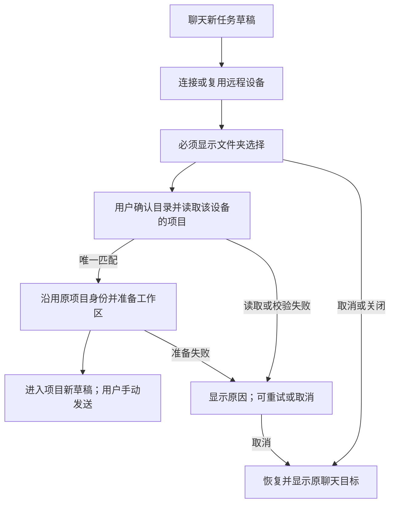

# 23: 选文件夹并进入唯一匹配的已有项目

Status: done

**Parent:** [#21 — 聊天连接后必选远程文件夹并进入项目](21-chat-settings-round-trip.md)

**What to build:** 用户从聊天新任务草稿连接远程设备后，每次都选择目标设备上的文件夹。确认的目录恰好属于一个现存项目时，进入该项目的新任务草稿并在远端发送首条消息。未完成选择与准备时不能发往原目标；取消整次切换则恢复并明确显示原聊天目标。

**Blocked by:** None (can start immediately).

**Spec coverage:** RDUX21-01–05、RDUX21-08–13、RDUX21-15–16、RDUX21-19–20；RDUX21-14 的文件夹与嵌套层级、RDUX21-21 的已有项目只读兼容。RDUX21-22–24 随本票路径验证。



## Acceptance criteria

- [x] 首页无项目草稿、已有本地项目草稿、已有远程项目草稿均从真实聊天项目菜单进入同一流程；原来的“返回原聊天，仅显示在此设备创建项目”不再作为成功终点。
- [x] 每次连接成功或复用在线设备后都显示文件夹选择；设备只有一个项目、有最近项目或原草稿已有项目时也不自动打开。路径输入、跳转、目录浏览和隐藏目录控制沿用现有能力，目标设备与路径明确可见。
- [x] 确认目录后，按实际 Source／Host 与精确固定 root 匹配现存、未删除项目；不使用本机文件系统、显示名称、父目录、路径前缀或另一设备的同名路径替代远端判断。
- [x] 唯一匹配时保留真实项目 ID、root 和历史任务归属，完成必要入口登记及目标工作区准备后进入该项目的新任务草稿；不能只刷新列表，也不自动打开某个历史会话。
- [x] 本次前台切换尚未完成或取消时，发起草稿的发送按钮、Enter 和其他既有提交入口均不能向旧目标提交消息。准备完成只恢复正常发送能力，不自动提交；首次手动发送的实际 Host、项目和执行目录均为选定远端。
- [x] 无效路径、非目录、无权限、项目读取失败、目录在确认后失效及准备期间断连都显示实际原因并允许重试或取消；失败不作为零匹配，不创建替代项目，不切回本地发送。
- [x] 顶层文件夹选择的取消、关闭和 Escape 撤销本次远程切换，恢复仍有效的原目标、原草稿和合理焦点，并明确显示目标。嵌套下拉只先关闭当前层；“稍后选择”不能留下可发送的远程无项目状态。
- [x] 连接前／连接中取消、原目标为本地无项目／本地项目／远程项目时均能正确返回。明确取消后，本地无项目聊天继续可用。
- [x] 仅释放本次独占临时 attachment，保留已建立的设备连接、设备记录及其他项目共享 session。重复确认或重复登记不新增重复入口。
- [x] 切换草稿、替换连接请求、取消、成员移除或卸载后，迟到的连接、目录、项目读取及工作区准备结果不能重开旧界面、覆盖新目标或释放共享资源；沿用请求身份与 owner，不靠超时同步。
- [x] 设置设备添加、原项目重连、已有任务续聊保持原完成规则；只读旧远端可继续使用已有项目。普通 Web／手机不出现超出壳层能力的入口，既有 Host 和 continuous／replayable 边界不变。
- [x] 从真实菜单补 E2E 并先证明原无项目路径会错误提交到本地，再实现修正；测试核对实际首条消息归属、项目数量和历史身份，不能仅断言按钮样式或局部回调。
- [x] 本票完成对应中英文、深浅主题、长路径、窄窗和键盘验证；SSH／WSL／Docker 与操作系统按实际支持及执行范围记录，不以窄桌面代替手机证据。

## Verification

- 主接缝复用已有聊天设备往返 Desktop E2E，使用真实远程连接及项目数据；成功切换使用空草稿，取消／失败使用有内容的原草稿验证保留。
- 复用已有远程项目场景验证重复打开、同路径不同设备、同名前缀及父目录不误匹配。用既有 UI／服务端口控制迟到结果和准备失败，不新增测试专用产品 API。
- 草稿预热可能已创建运行时，断言应是“没有向原本地目标提交该条消息”，不能以“没有启动任何本地 runtime”替代。
- 完成类型检查、lint、架构门禁、受影响单测、本票 Desktop E2E 及适用共享 UI 回归，更新场景与覆盖证据。候选保持既有审核流程；缺失环境如实记录，不沿用父票旧 PASS。

## Scope and handoff

- 若需整理完成结果交接，先在本票内使现有意图能交付实际设备、目录和项目结果，再连接完整用户路径；不新增第二份草稿、连接 owner、数据库迁移或宽泛框架。
- [#24](24-chat-remote-folder-project-choice.md)、[#25](25-chat-remote-folder-create-project.md)、[#26](26-chat-remote-folder-background-resume.md)分别承接多匹配、零匹配和后台继续。交接给它们的是同一目录确认结果、有效请求归属、发送约束、取消及项目进入能力；不复制另一条连接／发送链。
- 多匹配与零匹配不算本票完成的功能，交接期间仍须保持不可发送、可重新选择或取消，不用自动挑选或临时造项目填补后续票。父规格完成需四票均完成。
- 草稿／附件跨设备迁移与冲突处理沿用现有行为，不在本票实现。不修改或关闭父 Issue；本票只登记自身实施及验证状态。

## 实施约定

聊天菜单持有本次切换意图和目录选择；Root 继续持有连接及 workspace 准备。Composer 只接收菜单的提交阻塞投影，不复制草稿。`CreateTaskOptions` 增加 renderer 内有效性与失败回传接缝：Root 在准备和导航前复验发起意图，错误交回目录流程后仍可重试。设备成员以 membership 校验；项目匹配读取目标 Host 权威列表，使用固定 root 的精确路径，不调用本机路径规则。

```text
聊天意图 → 连接 → 目录确认 → 权威项目匹配 → 登记入口 → Root 准备 → 新项目草稿
   │                  │              │               │
   └─取消/换草稿───────┴─旧结果失效────┴─不可导航───────┘
```

### #23 实施与验证（2026-10-14）

- 候选 `manual-review/pending/conversation-session-chat-remote-folder.test.ts`：真实聊天菜单、SSH 连接与在线复用、无项目／远程项目草稿取消、必选目录、按钮／Enter／form 提交禁发、无效长路径错误、唯一项目首发、再次选目录保留项目和历史任务身份、不重复登记入口。
- 更新 `manual-review/pending/conversation-session-chat-device-return.test.ts`：本地项目草稿的连接失败重试、连接前后取消、正文／附件／原任务归属，以及中英 × 深浅主题 × 1440／480px 的目录弹窗与焦点。
- 真实 RED `desktop-e2e-20261014044755117-p28723-fd57f544f073042f`：`old-local-submission.json` 证明旧流程在连接后向本地无项目任务提交了该条消息。GREEN `desktop-e2e-20261014050039448-p42395-acef074fec4b900a`：两候选 2/2 通过，远程首发的 Host／项目／任务／cwd／identity 见 `remote-first-submission.json`；代表截图已审阅。
- UI／服务端口回归覆盖不同 Host、父目录、前缀及已删除项目不误匹配；列表错误与准备失败不解除门禁；取消后迟到结果、Store 提交到 React 渲染前的旧请求失效；attachment 绑定前复验成员与项目，失败仅释放独占资源。旧远端只读目录浏览继续经远端文件服务，Windows 路径规则由远端平台确定。
- 实机范围：macOS 客户端 → Linux arm64 的真实 SSH。Docker 在本轮作为独占 SSH fixture，不算 Docker 传输验收；WSL／Windows／Linux 客户端与物理手机未执行。共享 Web／手机壳层能力门禁保留 UI 回归，集成后的共享手机回归由母任务记录。
- 多项目选择、零项创建／恢复、后台显式继续分别由 #24／#25／#26 承接。候选仍为 pending，不宣称人工审核、formal 或 CI 准入。

- 必要代码检查：`pnpm typecheck`、`pnpm lint`（209 条既有 warning，0 error）、`pnpm architecture:check --changed`（0 violation）、候选 fixture check、diff 与格式自检通过。受影响范围为 607/2615 文件：606 文件先通过；新增的提交／渲染间隙断言在旧组件已加载的在途测试中失败，修正后只复跑该文件 16/16 通过。合并结果为 6841 个测试通过、1 个既有 skip；未扩大全量。
