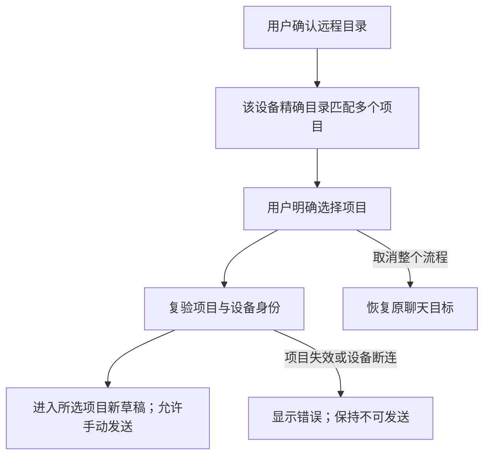

# 24: 同目录多个项目时明确选择

Status: done

**Parent:** [#21 — 聊天连接后必选远程文件夹并进入项目](21-chat-settings-round-trip.md)

**What to build:** 用户从聊天连接远端并确认文件夹后，如果该目录对应多个现存项目，看到这些项目并明确选择一个。完成后进入所选项目的新任务草稿，首条消息使用其原身份和目录；取消整次流程则恢复原聊天目标。

**Blocked by:**

- [#23 — 选文件夹并进入唯一匹配的已有项目](23-chat-remote-folder-existing-project.md)：提供真实聊天入口、远程目录确认、项目进入和发送／取消约束。

**Spec coverage:** RDUX21-06；RDUX21-09、RDUX21-11–12、RDUX21-14、RDUX21-16 的多项目分支。RDUX21-22–24 随本票路径验证。

## Acceptance criteria

- [x] 使用与 #23 相同的聊天连接和目录选择流程；只有用户确认目录后，才按真实目标设备和精确 root 展示匹配的现存、未删除项目。
- [x] 同设备同目录的多个项目保持不同身份，候选显示可区分的信息，并以真实项目 ID 选择；不按名称、最近使用、列表顺序或路径相同自动选定、合并或新建项目。
- [x] 用户选择后，复验请求、Host membership、项目及目录仍有效，再复用公共登记与准备路径进入该项目的新任务草稿。项目 ID、历史任务及其归属保持不变，实际首条消息发送到所选远端项目。
- [x] 项目未选定或工作区尚未准备完成时，按钮与键盘不能向原目标发送；完成后不自动提交。双击选择、重复响应不能重复登记、打开或发送。
- [x] 顶层项目选择取消、关闭或对应层级 Escape 撤销整次远程切换，恢复仍有效的原聊天目标和草稿，并显示目标归属；嵌套层级先按原关闭规则处理，不误提交。
- [x] 项目读取失败、候选被删除／改变、目录失效、成员移除或设备断连时显示错误并允许重新读取／选择或取消；不自动选另一个候选，不把失败当零项创建。
- [x] 用户取消、切草稿、换设备或启动新请求后，旧列表与旧选择完成结果不能导航、覆盖新目标或清理其他任务的连接。
- [x] 两台设备的同路径、同名项目及父／子目录项目不会混入匹配候选；只读旧远端的已有项目仍按现有能力可选，不能触发非法新建。
- [x] 从真实聊天菜单补“同目录两项目”的 E2E，分别选择不同项目并核对原项目与历史任务身份；覆盖取消和失效候选。先写测试，再实现本分支。
- [x] 本票完成列表长名称、键盘、焦点、中英文、深浅主题和窄窗验证；共享 UI 尊重既有 Web／手机门禁，按实际远端类型与平台记录证据。

## Verification

- 复用已有远程项目选择候选的双项目数据和任务历史，接上聊天新入口；以实际项目、任务和运行目录验证结果，不只检查列表行或调用次数。
- 列表迟到、选择后成员换代等难控制时序使用既有 UI／服务端口；取消前后对照入口数量和共享连接可用性。
- 完成类型检查、lint、架构门禁、受影响单测、本票 Desktop E2E 和适用共享 UI 回归；保持 case／覆盖矩阵一致。未执行环境不记为通过，候选不自动转正。

## Scope and handoff

- 仅扩展 #23 的多匹配分支，不修改零匹配创建、全局项目唯一性或同目录多项目的存储规则。
- 不依赖 #25 或 #26；后台恢复若已接入公共目录流程，自然使用同一项目选择结果，不维护第二套后台选择器。
- 草稿／附件跨设备迁移与冲突处理不在范围。不修改或关闭父 Issue；只记录本票完成证据。

## Implementation and evidence — 2026-10-14

- 确认目录后，多项候选只显示该 Host 的精确单 root、未删除项目；名称与真实项目 ID 同时可见，键盘焦点进入候选列表。沿用公共 `enterProject` 的 membership、目录、项目复验与工作区准备，不另建登记或导航路径。
- 项目选择使用同步在途锁。读取或准备失败保持禁发；重读后只剩一项仍要求显式选择，不能用剩余项目替代用户原选择。重新选目录与顶层取消保持已有 owner 和资源归属。
- TDD：`chatRemoteFolderChoice.test.ts` 首个测试在原实现下因无多项目候选失败；实现后 9 个 UI／服务端口测试通过。覆盖同名 ID 区分、双击、候选删除／改 root／离线、取消／过期请求／成员换代、精确 Host 与 root、只读能力、重读不自动改选与焦点。
- Desktop E2E GREEN：`desktop-e2e-20261014053401905-p70011-e4130be481e13bf0`，候选 `conversation-session-chat-remote-project-choice.test.ts` 1/1 通过。真实聊天菜单接入 SSH，选择同目录两项目分别首次发送；核对各自任务、项目、Host、cwd 与 workspace identity，保留既有任务归属且不重复登记。实际项目名遵循服务已有消歧规则；完全同名候选由 UI 端口测试验证。
- 同一 E2E 验证父／子目录及软删项目不混入、原草稿禁发和 Escape 恢复、选择前项目删除显示错误、中英 × 深浅主题 × 480px 与 1440px 桌面。`choice-identities.json` 保存身份结果，代表截图已审阅。首次环境尝试因并发类型检查覆盖构建产物、独占 fixture 的旧 Source 数据不一致未通过；顺序重构建与重置测试数据后重跑。测试已按既有窄窗侧栏规则显式展开侧栏。
- 必要检查：根 `pnpm typecheck`、`typecheck:e2e`、lint（209 条既有 warning、0 error）、架构门禁（0 violation）、fixture check、格式与 diff 自检通过。`pnpm test:unit:affected --base 833e6dcb4b` 官方选择 608/2616 文件，6850 passed、1 个既有 skip；未运行全量单测。
- 实机范围为 macOS Desktop → Linux arm64 SSH；Docker 仅作 SSH fixture，不代表 Docker 传输。Windows／Linux Desktop、WSL、Docker 传输和物理手机未执行；共享 UI 壳层能力门禁由受影响回归覆盖，集成后的手机链路证据由母任务记录。候选保持 pending，未自动转正或加入容器 CI。
