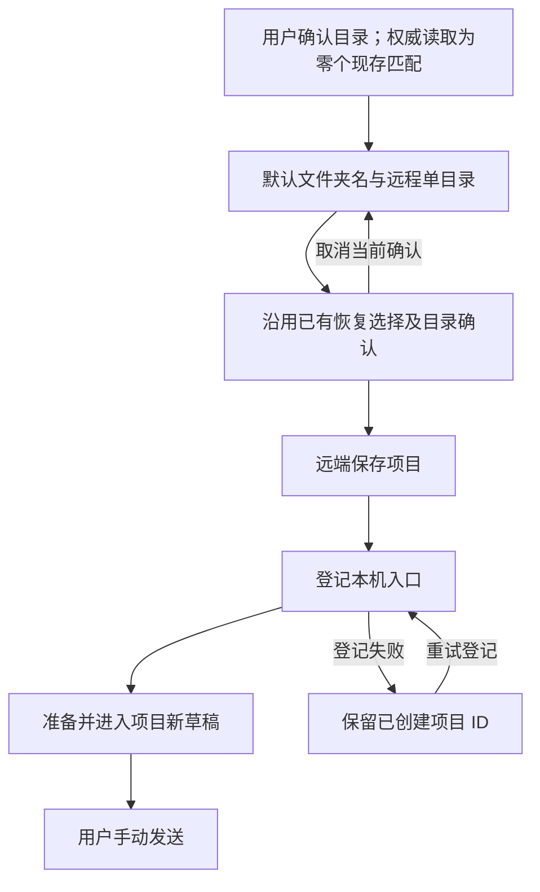

# 25: 无匹配项目时创建并进入

Status: done

**Parent:** [#21 — 聊天连接后必选远程文件夹并进入项目](21-chat-settings-round-trip.md)

**What to build:** 用户从聊天连接远端并确认一个没有现存匹配项目的文件夹后，使用文件夹名作为默认项目名，沿用已有创建／恢复和目录确认流程。保存项目、登记入口并准备工作区后进入该项目的新任务草稿；失败时可重试或取消，不重复创建，也不向本地发送。

**Blocked by:**

- [#23 — 选文件夹并进入唯一匹配的已有项目](23-chat-remote-folder-existing-project.md)：提供目录确认、权威匹配结果、有效操作归属及进入目标项目的完整路径。

**Spec coverage:** RDUX21-07、RDUX21-17、RDUX21-21；RDUX21-08、RDUX21-10–12、RDUX21-14、RDUX21-16 的创建／恢复分支。RDUX21-22–24 随本票路径验证。

## Acceptance criteria

- [x] 只有用户已确认目录且目标设备的权威项目读取成功、现存未删除项目匹配数为零时，才进入创建分支；读取失败、目录失效或身份变化不能被当成零匹配。
- [x] 默认名称取所选文件夹名，目标设备及唯一固定 root 来自本次确认；不要求用户重复填写相同目录，不使用本机目录或新生成的替代目录。
- [x] 复用现有共享项目创建与目录确认；选文件夹不等于信任目录。命中已删除项目时沿用恢复或继续新建的选择，恢复使用原项目 ID，不静默恢复或覆盖其他项目。
- [x] 确认阶段展示和保存的设备、目录、名称及恢复目标一致。嵌套目录确认的取消／关闭／Escape 返回当前流程并保留选择，不提交、不串到聊天发送；顶层取消仍撤销整次远程切换并恢复原目标。
- [x] 保存并登记成功后，交付实际项目 ID、Host 和 root，准备目标工作区并进入项目新任务草稿；只新增侧栏入口不算完成。首次手动发送实际使用该远端项目，旧目标不接收消息。
- [x] 整个创建、登记和准备期间维持按钮与键盘发送约束；完成不自动发消息。重复确认或双击不能重复创建项目、登记入口或发起聊天。
- [x] 再次从聊天连接并选择相同目录时，已有项目由 #23 的匹配路径复用，不因重复连接新建同目录项目；不把通用保存接口改为全局按目录去重。
- [x] 目录无权限、确认期间被删除、设备断连或保存失败时显示原错误并保留可重试的选择，不生成替代目录或幽灵入口；取消时保留原聊天草稿和共享设备连接。
- [x] 远端已返回保存成功而本机登记失败时，保留返回的项目 ID；重试只登记已创建结果，不再次创建或重复索取本次已完成的目录确认。已成功保存的项目不因关闭而自动删除。
- [x] 原请求被取消、替换、隐藏或卸载，或 Host membership 失效后，迟到的查询、确认、保存和登记结果不导航、不覆盖新目标、不继续发起过期写入；只处理本次归属资源。
- [x] 旧远端仅有项目读取能力时，显示现有新建限制；不能通过该入口绕过能力检查。其他显式新建同目录项目入口、项目身份及历史任务合同不变。
- [x] 从真实聊天入口补零匹配创建并远程首发的 E2E，先测试再实现；同时覆盖共享恢复／目录确认、保存失败与登记重试。验证真实项目数量、ID、单一 root 和首条消息归属。
- [x] 本票完成创建确认的语言、主题、长路径、窄窗、焦点及键盘验证；按实际平台和 SSH／WSL／Docker 环境记录结果，维持 Web／手机能力门禁。

## Verification

- 主路径复用聊天入口 E2E 和共享项目目录确认能力；软删恢复与只读兼容沿用项目服务合同测试。
- 保存成功、登记失败以既有服务端口构造，证明重试后仍为同一个项目；不通过新增测试专用 API 或无限网络重试绕过问题。
- 成功切换使用空草稿；原文字／附件只验证取消和失败时保留，不在本票增加跨设备迁移。
- 完成类型检查、lint、架构门禁、受影响单测、本票 Desktop E2E 和适用共享 UI 回归，同步 case 与运行证据。缺失平台明确记录，旧 PASS 不继承，候选不自动获得 CI 准入。

## Scope and handoff

- 不依赖 #24 或 #26；复用 #23 的公共完成、发送和取消约束。与多匹配分支共用真实项目结果，不按目录重写全局项目身份。
- 不新增永久目录信任、Hook 授权、数据库迁移、分布式目录唯一性、草稿迁移或全局网络重试机制。
- 不修改或关闭父 Issue；本票只记录零匹配创建／恢复路径的实施和验证。

## Implementation decisions

- `ChatRemoteFolderSelection` 持有确认的 Host/目录与有效请求；零匹配交给共享 `ProjectEditor`。表单固定本次目录并显示默认文件夹名；信任确认显示本次名称，恢复时显示已确认恢复项目名，不新增创建 owner。
- `ProjectEditor` 保持恢复选择、信任确认、在途互斥与已创建结果缓存。保存前复验请求、Host membership、目录和远端能力；保存后经既有 `enterProject` 登记、准备和进入草稿。登记失败重试同一 ID。
- 端口测试使用既有项目服务与远程入口服务；真实 Desktop 候选从聊天连接入口验证创建和首发，仍保留 pending。

## Verification evidence

- 先补零匹配 UI／服务端口红灯，再实现共享创建；迟到查询失效和恢复名称展示分别保留红绿回归。`chatRemoteFolderCreation.test.ts` 的 11 条涵盖固定 Host/root、显式信任、恢复或继续新建、保存失败、权限失败、重复确认、只读能力、登记重试和过期结果。
- 根 `typecheck`、Desktop `typecheck:e2e`、lint（0 errors，209 条已有 warnings）、架构门禁（0 violations）通过。基于本任务起点的 affected：608 文件、6852 通过、1 条既有跳过。合入 #24 后目录分派及共享确认 4 文件 47 条通过。
- 新增候选 manifest 与 provider fixture 检查通过；候选维持 `manual-review/pending`，不自动转正或纳入 CI。
- 首轮真实 SSH 运行 `desktop-e2e-20261014051020488-p50885-83b993467e37b894` 在安装更新阶段被既有等待辅助函数判为失败，未抵达创建分支；该运行不计创建红灯或通过证据。

- macOS Desktop → Linux arm64 SSH 创建候选 1/1 通过：`desktop-e2e-20261014055401059-p80988-2f9ef70df764ec75`。检查零匹配默认文件夹名、单一固定 root、信任 Escape 不保存、真实远端首发的 Host/project/task/cwd、原本地无该消息、再次连接复用同一项目且入口仅一份，以及取消保留远程草稿。
- 合入 #24、#26 后目录分派、后台归属及共享确认 4 文件 52 条通过，根类型检查再次通过。已审阅英文浅色 1440px 与中文深色 480px 信任确认截图：名称、设备、长路径和按钮可读，无裁切；窄桌面窗口不计手机证据。
- 本票未执行 Windows/WSL、Docker 传输创建分支或实体手机；普通 Web／手机远程连接能力门禁沿用壳层，并有受影响 UI 回归。本次不改变 shared-host 或 continuous/replayable 合同，不将未运行平台记为 PASS。
