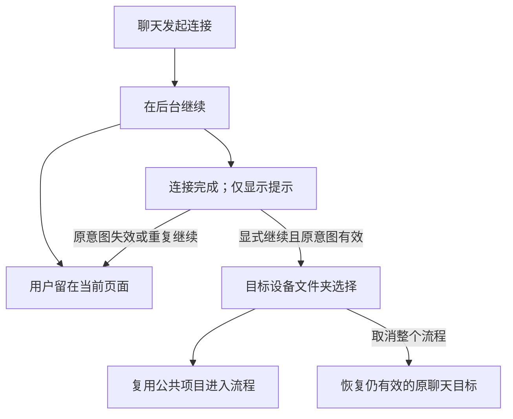

# 26: 后台连接完成后显式继续选目录

Status: done

**Parent:** [#21 — 聊天连接后必选远程文件夹并进入项目](21-chat-settings-round-trip.md)

**What to build:** 用户从聊天发起远程连接并选择在后台继续后，可以留在其他页面工作。连接完成只提示；用户显式继续且原意图仍有效时，显示同一目标设备的文件夹选择，随后进入项目并手动发送。过期或重复继续不能抢导航、重复操作或影响其他任务。

**Blocked by:**

- [#23 — 选文件夹并进入唯一匹配的已有项目](23-chat-remote-folder-existing-project.md)：提供可复用的聊天目录流程、原意图校验、发送约束和项目进入能力。

**Spec coverage:** RDUX21-18；RDUX21-03、RDUX21-12–13、RDUX21-15–16、RDUX21-19–20 的后台延续分支。RDUX21-22–24 随本票路径验证。



## Acceptance criteria

- [x] 沿用已完成的后台连接生命周期和唯一操作 owner。后台继续只收起交互，设置设备卡／未完成项仍展示同一请求的进度与状态，不另建连接或独立恢复流程。
- [x] 用户离开设置或切到其他聊天后，后台成功不弹目录选择、不切换设备或项目、不改变当前草稿，也不对无关聊天施加全局发送限制。
- [x] 显式继续前复验原聊天意图、请求身份、实际 Source 和当前连接状态；有效时进入 #23 的目录选择流程，每次仍须用户确认目录，不因最近／唯一项目或在线复用跳过。
- [x] 目录确认后复用公共项目结果交接、工作区准备和发送规则；以唯一已有项目完整证明“后台连接 → 显式继续 → 选目录 → 进入项目 → 远程首发”，不以仅打开弹窗作为完成。
- [x] 原草稿已放弃、请求已取消或替换、成员已失效时，迟到成功和旧继续操作不复活旧页面、不覆盖新目标。重复继续只消费同一有效完成动作一次，不重复连接、登记或提交消息。
- [x] 后台失败、需要凭据／安装确认或 Source 在继续前断开时，沿用原错误与显式处理入口；不伪装成功、不自动切本地、不强制弹窗打断用户。
- [x] 继续后取消目录／项目选择按公共规则撤销本次远程切换，恢复仍有效的原目标并显示归属。用户仍在其他页面时取消后台操作不抢回原聊天。
- [x] 取消只清理本次独占临时资源；已连接设备和其他项目共享 session 保持可用。失效或重复继续也不能误清理共享资源。
- [x] 设置来源的设备添加仍留在设备管理；项目表单往返和明确原项目重连保留各自完成意图，不被聊天的必选目录规则接管。
- [x] 以真实聊天入口补后台完整 E2E，并先写测试再实现；用既有 UI／服务端口补迟到失败、过期结果、重复继续及共享资源边界，不添加定时轮询或补偿跳转。
- [x] 通知、继续操作及目录选择的焦点、键盘、中英文、深浅主题与窄窗可用；各连接类型和平台按实际执行记录。Web／手机继续使用既有 Host 与 replayable 边界，不新增手机连接 owner。

## Verification

- 复用后台连接候选及聊天设备往返的真实入口，以当前页面、原草稿、真实项目／任务身份和首条消息目标验证结果。
- 分别覆盖后台完成后仍在原草稿、已经切到其他聊天、原意图已失效和重复继续；正常后台完成只通知，显式恢复才进入可见目录流程。
- 复验设置普通入口恢复同一后台操作的现有行为，避免只验证新通知按钮而遗漏原继续入口。
- 完成类型检查、lint、架构门禁、受影响单测、本票 Desktop E2E 和适用共享 UI 回归；同步 case 与覆盖证据。环境不足明确列出，候选审核状态不自动改变。

## Scope and handoff

- 不依赖 #24 或 #25：本票交付后台到共同目录入口的延续，并以 #23 的已有项目路径验证到底。其他票完成后使用同一公共分派，不复制多项目选择器或创建表单。
- [#22 — 后台连接与显式恢复](22-background-connection-and-explicit-resume.md)是已完成的行为依据，不是新增阻塞项；本票只更新聊天来源继续后的目标及对应证据。
- 不改后台连接状态机、认证、安装、任务消息队列或草稿跨设备迁移；不修改或关闭父 Issue。

## Implementation notes

- 连接生命周期仍由 `remote-connection-flow` 唯一持有。Root 将连接可见性通知原返回 owner；聊天收起时解除原草稿提交限制，显式继续交付实际 Source 后进入共同目录流程并重新限制提交。完成回调同步标记返回意图正在校验，成功交付后才标记已消费，原先已有成员通过 readDirectory 复验 membership；await 后重读原草稿和 tab 身份，替换入口使旧返回失效。已校验 membership 传给目录流程，不能在挂载间隙把移除当作首次登记。
- 测试接缝：既有 Composer UI 返回端口、真实连接 flow hook，以及后台候选的真实聊天→SSH→目录→项目→首发链。

```mermaid
sequenceDiagram
    participant Chat as 原聊天 owner
    participant Root as 返回意图 owner
    participant Flow as 连接 owner
    participant Host as 原 Host 成员
    Flow->>Root: 收起连接层
    Root->>Chat: onVisibilityChange(false)
    Note over Chat: 解除原草稿提交门禁
    Flow->>Flow: 后台完成；只通知
    Flow->>Flow: 用户继续；校验 Source 在线与请求代际
    Flow->>Root: 实际 Source 完成结果
    Root->>Root: 同步 checking，防止重复继续；交付后 delivered
    Root->>Chat: canFinish(result)
    Chat->>Host: readDirectory，核对原 membership
    Host-->>Chat: 当前权威成员
    Chat-->>Root: 当前意图且成员有效
    Root->>Root: 重读 tab 和原聊天身份
    Root->>Chat: 返回原 owner，打开共同目录选择
    Note over Chat: 继承原成员资格；完成目录/项目准备前禁发
```



## Evidence (2026-10-14)

- UI 红绿：后台收起后仍禁发的断言先失败；成员移除／换代／迟到草稿的资格断言先失败。完成后 Composer 21 项通过；合并 #24 后 Composer、项目选择、连接 flow 共 128 项通过。既有 flow 端口回归覆盖重复继续、取消／替换后的迟到失败、继续前 Source 离线、共享 attachment 不被取消。
- 真实 Desktop E2E：`desktop-e2e-20261014054619416-p77568-1b2f973228b64db0`，后台候选 1/1 PASS（61 秒）。覆盖 SSH 后台收起解除原草稿门禁、完成仅通知、设置卡与通知的显式继续、必选目录、取消保持原正文附件与在线 Source、原草稿已放弃的继续失效、唯一项目首发；同时保留设置／项目表单／已有项目目录入口、后台认证失败与 Docker 传输回归。
- `background-remote-first-submission.json` 核对实际 Host、项目 ID、task、cwd、workspaceIdentity；首发后本地任务列表未增加，远端项目数量未增加，本机入口仅一项。7 张截图已检查，包括完成提示、目录、中英文深浅 480px 设置状态及 Docker 完成。
- 前三轮分别定位为本任务 fixture 的开发归档 hash 不一致、旧候选未处理新增远程介绍、测试重复添加已保留附件。均修正测试前置／断言，不修改连接产品语义，不删除 Source 或业务数据库；保留各轮失败证据。第三轮已通过远程首发，最终整轮以上述 PASS 为准。
- `pnpm typecheck`、Desktop `typecheck:e2e`、lint（209 个原有 warnings，无 error）、架构门禁、fixture 校验通过。`test:unit:affected --base 833e6dcb4b` 官方选择 607/2615 文件：首轮 597 文件通过，10 文件因独立 worktree 的 Electron 路径缺失失败；补齐本地依赖路径后仅复跑这 10 文件，160 测试全部通过。未跑全量 UT。
- 实机范围为 macOS Desktop 与本任务独占 Linux arm64 的 SSH、Docker 传输；未运行 Windows／Linux Desktop、WSL 或实体手机。Web／手机未新增 owner，保留既有能力门禁和 shared-host／replayable 接缝，整合共享手机回归由母任务记录。候选保持 pending，不自动转正或纳入 CI。

## 评审修正：完成资格读取失败

成员资格读取失败与明确失效分开：Root 保留同一返回意图、恢复其重试资格，并由连接 flow 等待完成回调。IO 失败沿用连接错误界面的实际原因、显式重试和取消；前台请求仍禁发，未选目录且未取消时不能向原目标提交。取消撤销在途资格结果，后台仍由已有可见性通知解除原聊天门禁。

```text
连接 flow 完成 → Root checking → canFinish
                     │ 成功且前台 → delivered → 文件夹选择
                     │ IO 失败 → 保留 owner → 原 flow 错误／重试／取消
                     │ 等待时收起 → flow 保留后台完成 → 显式继续
                     └ 明确取消 → 撤销返回引用 → 迟到结果无权导航
```

- 评审 TDD：完成资格 IO 拒绝原先提前关闭且无错误；后台显式继续后再次收起时的拒绝原先会请求重开弹窗。两项均保留 RED；最终连接 flow 103/103 测试通过，另覆盖等待中取消后的迟到成功／失败、等待中收起后的显式继续及重复继续。
- 真实故障回归与后台回归 2/2 PASS：`desktop-e2e-20261014062429307-p3874-62dc81c125bcbc6d`。通过既有 RPC 端口让已有 Host 的资格读取失败，检查原始原因可展开、按钮／Enter／form 不向原本地提交、等待中明确取消后迟到结果不弹目录、重试进入目录、取消恢复原草稿；随后核对真实远端首发。原后台候选继续覆盖 SSH／Docker 与设置／项目等完成意图。`membership-read-failure.png` 已审阅。
- 首轮故障与远程首发已通过，但后续菜单点击被既有项目身份 hover 浮层遮挡；测试按既有 Escape 交互先关闭浮层，最终整轮以上述 PASS 为准，未更改产品 hover 行为。
- 最终根类型检查、lint（209 条既有 warning，0 error）、架构（0 violation）、fixture、格式和 diff 检查通过。全任务起点 `--base 833e6dcb4b` 的受影响测试选择 615 文件，6965 passed／1 既有 skip；之后仅新增后台再次收起拒绝回归并修复该条件，受影响 flow 文件最终 103/103 通过，未重复已过的其他 614 文件。
