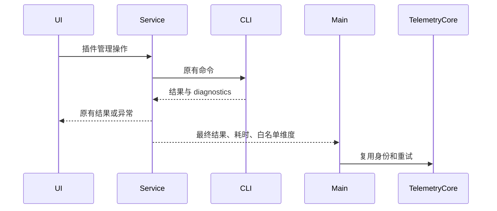

# 插件生命周期业务埋点

## 事件总览

| 事件                   | 触发点                                                                 | 主要维度                                                                  |
| ---------------------- | ---------------------------------------------------------------------- | ------------------------------------------------------------------------- |
| `plugin_lifecycle`     | 安装、卸载、更新、恢复、配置、启停、来源变更和逐插件远端同步的最终结果 | action、result、plugin_id/marketplace、entry、trigger、scope、duration_ms |
| `plugin_discovery`     | 商店或详情变为可见、提交搜索                                           | action、entry、plugin_id（详情）、client_kind；不含搜索词                 |
| `plugin_usage`         | 插件界面请求打开、初始化完成、释放实例、界面发起工具调用               | action、plugin_id、plugin_component；工具调用含 result/duration_ms        |
| `plugin_runtime_error` | 插件界面初始化进入错误状态                                             | plugin_id、plugin_component、error_category；不含原始错误                 |
| `agent_step`（已有）   | 模型真实调用 Skill/MCP 的终态                                          | 新增 plugin_id、plugin_component；保留旧 Skill 字段和原有去重             |

## 实施口径

插件管理操作在取得 CLI 最终结果后上报 `plugin_lifecycle`；不报开始事件，不新增业务 `operation_id`。网络重试沿用 TelemetryCore 生成的 `event_id`。操作协议已有的 operationId 仍用于取消/进度，不作为业务埋点关联字段。移除 `plugin_intent`。

每次调用独立计时。入口上下文用代理封装传递，保留 RPC 动态方法，不展开复制服务对象。Telemetry 失败不得延迟、拒绝或重试业务操作。CLI 为安装、配置、启停事实的唯一来源；列表刷新和 UI 提示不决定成功。dryRun 不上报。取消请求的接纳不算操作取消；仅原调用的明确取消错误记 cancelled。

## 范围

- `plugin_lifecycle`：install、uninstall、update、restore、configure、reset_config、enable、disable、source_add、source_remove、source_refresh。远端同步使用目标导入完成结果，不能以导出代替成功。
- `plugin_discovery`：商店与详情实际可见；搜索在提交时上报，不能上传搜索原文。卡片曝光阈值尚未定稿，不实施。
- `plugin_usage`：插件自身界面的打开、就绪、关闭、工具调用，与商店详情和模型工具执行分开。
- 已有 `agent_step`：Skill 保留旧字段并补通用 plugin_id/plugin_component；MCP 从执行时 ToolEntry 的真实归属传递，禁止从工具名猜测。
- 授权、Hook/LSP 聚合、Agent/Command 使用归属和存量快照仍为后续规划；未定义完成点前不造事件。

结果为 success/failure/cancelled/noop/partial。diagnostics 中 error 优先于 RPC resolve；卸载目标不存在为 noop；批量返回有成功目标且存在错误时为 partial。逐插件结果缺失时不虚构失败插件。版本只使用实际返回记录，缺失时省略，不用 latestVersion 代替。

## 白名单与数据边界

公共字段、设备与用户身份由现有 TelemetryCore 注入。event_extra_detail 只允许 schema_version、action、result、plugin_id、marketplace、source_type、publisher_type、entry、trigger、scope、client_kind、workspace_kind、remote_kind、version_before、version_after、duration_ms、error_category、batch_id、target_count、plugin_component、remove_cache，按事件需要填写。source_type、batch_id、target_count 当前保留在白名单中，没有权威数据时不填；publisher_type 仅在返回记录携带时填写。固定枚举校验、文本标识限制长度；不上传配置、凭据、URL、路径、提示词、原始错误或工具内容。

Desktop 本地 Host 负责管理操作结果上报，手机管理请求复用该 Host，不在手机重复报告结果。手机发现事件通过严格白名单转发。桌面 continuous 与手机 replayable 的既有 Agent 执行上报 owner 不变；重放不新增 agent_step。

## 影响与验证

must-inspect：PluginStorePage → pluginManagementStore → IPluginManagementService → CLI；Host → Main → TelemetryCore；CLI tool terminal → V4 fact → conversationTelemetrySupervisor → agent_step；插件 UI provider/bridge。

must-preserve：真实业务结果、scope/远端身份透传、取消/进度 operationId、列表刷新、不重复 Agent 执行计数、原始内容隔离。没有 codegraph 索引，按现有源码追踪调用；图谱命中 capability.plugin-market-ui 与 capability.data-observability，新增观测边保留为 graph-drift-candidate。

测试覆盖：RPC 成功但 diagnostics 失败、部分成功、dryRun、noop、明确取消、并发耗时隔离、上报同步/异步失败、白名单、真实 Skill/MCP 归属、桌面与手机请求转发。E2E 为插件管理真实入口到业务上报的定向验证，不自动晋升正式 CI。

时序图和 SQL 的飞书旧稿按用户要求暂不修改；本文记录实现合同，不把旧 SQL 当作验收依据。
