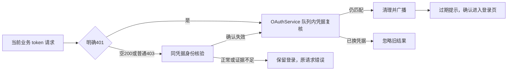

# ZCode 登录凭据失效与重新登录

## 项目定位缓存局部恢复

`project-key-location:v1:*` 是可重新查询的组织、项目和 Key ID 缓存，不是登录事实。
读取该缓存时明确发生解密错误，项目 Token owner 在当前解析中尝试一次局部重建：
先校验请求代次，再通过 Host 私有缓存恢复端口，在凭据文件共享锁内重读目标记录。
若记录已修复则复用新值；若已删除则按缓存未命中处理；只有仍无法解密时才删除该条。
普通 IO、文件损坏或权限错误不执行删除，也不能被当作缓存未命中。

```text
位置解密失败 → 校验当前代次 → 共享文件锁内复核 / 条件删除
                              → 已修复：复用；缺失或仍损坏：查询位置 → 签发 Token
位置查询或签发失败 → 既有错误分类
                    ├─ 网络 / 超时 / 服务异常 / 项目权限 → 保留有效登录，返回失败
                    └─ 确认当前登录失效 → 既有鉴权核验 / 登录恢复入口
```

恢复端口只修改目标缓存，不读取或清理 OAuth、Bot、手工 Key、其他账号或项目记录。
成功恢复不广播登录过期、不退出登录、不重启 App。失败后不在本次解析中递归重试。
单个客户端保留既有 pending 合并；跨窗口由共享文件锁保护“重读与删除”，禁止删除
已被其他写入修复的记录。成功和失败路径都必须在恢复副作用前及其存储提交前检查代次；位置保存与 404 删除也将
同一检查传入本地存储，并在共享锁内检查，防止等待锁期间失效后仍提交。

该端口属于 Host 的本地存储能力，不扩展 ICredentialService 的 Renderer/RPC 契约；
无恢复端口的消费者保持原有失败语义。短期 Token 不落盘，位置命名空间、加密算法和
登录凭据保持不变。桌面与手机 shared-host 使用同一 Token owner，不增加 UI 状态源。

可观测性：确认当前代次且具备恢复端口后，先记录 `project_token_location_unreadable`，
再调用恢复端口；端口返回且代次仍有效时，保留 `project_token_location_recovery`。
后者只表示锁内复核已返回，不表示位置查询或换证成功。恢复内 IO 失败仍保留前置事件；
后续查询失败保留两条事件及既有失败码。普通读取错误、无恢复端口及已失效的请求不记录
恢复开始事件。事件仅含 family、stage、固定 code，不包含账号、缓存 key、密文或原始异常。

验收：真实加密文件的并发恢复、修复先提交、等待锁期间代次失效；有效 OAuth 与坏位置
共存时自动重建；重建失败保留登录；旧请求 clear 后不得恢复。原有登录失效单测保持。
本次修复的是已确认的缓存恢复缺口，不宣称已确定原始用户异常的最初触发原因。

## 2026-10-12：业务凭据撤销恢复

BigModel/ZAI 当前 active provider 的业务 access_token 被明确拒绝时，复用 OAuthService 的条件退出、派生凭据清理和 Host 广播；Renderer 清除用户展示，显示现有“登录已过期”提示，确认后直接进入 Welcome 登录入口，不重启 App 或刷新 Web。

启动缓存恢复同时检查共享 JWT 和当前业务 access_token 的 JWT exp；任一明确过期都在原会话队列内复核并返回 reauthentication-required。业务 token 无 exp/不可解析时不据此退出，远端撤销由后续请求确认；不新增启动网络请求或定时到期检查。

业务请求范围是当前环境、当前平台的 `/api/biz/`、`/api/pay/` 及配置的 userinfo URL，且 Authorization 必须与当前业务 token 完全匹配（兼容裸 token 与 Bearer）。普通模型 Key/PAT、其它平台/环境和旧 token 均不属于业务认证失效。

失效证据：HTTP 401 或 HTTP 200/403 的完整 JSON 数值 code=401。业务请求的空正文 HTTP 200、普通 HTTP 403 先用同一请求凭据只读核验当前平台 customerInfo；只有核验返回明确 401，或 BigModel customerInfo 的已验证注销语义（HTTP 200、零字节正文）才进入条件退出。ZAI 空正文、HTML、损坏 JSON、网络/超时、5xx 不证明凭据失效。customerInfo 本身返回普通 403 时不重复探测。

身份核验沿用现有网络 transport、独立请求 ID 和有界超时，不走递归观察链。相同身份的并发核验只保留一个在途 Promise，结束即删除，不缓存登录有效性；不记录 token、Cookie、原始账号响应或派生 Key。原业务响应仍交给调用方，副本读取不抢正文。确认后仍由 OAuthService 在会话变更队列内核对原请求凭据并清理，旧响应/核验不能清除已换 token 或切换平台的新登录。

启动本地 token 检查通过 OAuthCredentialRepo 的统一解密错误分类和损坏会话清理执行，并进入 OAuthService 会话变更队列。确认损坏时返回 signed-out，清理已注册 OAuth 凭据与派生认证状态，保留独立 Bot/PAT 等凭据；普通 IO/RPC 异常继续抛出。队列 admission 时复核恢复 generation，旧恢复不得清理后提交的新登录。BigModel 旧资料迁移仅在本地凭据检查成功后启动。

Host 后台凭据仓储可能在 Account Source 自己的刷新 resolver 内发现损坏；本地 OAuth 删除完成后，其回调提交派生账号刷新并观察错误，不等待该刷新完成，避免“刷新读取凭据 → 清理 → 等待下一轮刷新”的循环。OAuthService 的正常退出仍等待原派生清理回调，Account Source 继续拥有并串行执行其刷新轮次。

响应副本观察、身份请求及身份正文读取均受原请求 signal/timeout 控制。取消时按既有 ApiError 契约立即收口，释放计时器与观察订阅，不提交迟到的失效通知。共享核验各调用方独立取消；仅最后一个订阅者离开时取消 transport，避免一个请求取消连带影响其他请求。桌面 continuous 与手机 shared-host/replayable 继续复用现有认证 owner，不改变消息恢复语义。

身份核验的 customerInfo 请求，BigModel/ZAI 均采用既有登录业务接口的裸 token 约定，与 createBigModelLoginAuthHeaders / createZaiLoginAuthHeaders 一致。原请求分类兼容 Bearer 不表示核验端点也接受 Bearer；不能将客户端添加错误前缀产生的 401 解释为凭据失效。回归覆盖两平台、原请求裸/Bearer 头，以及有效身份遇到空200/普通403时不清理、不广播。



状态 owner 仍为 Local Host OAuthService，核验不持有第二份会话状态。手机 shared-host 继续消费既有广播与当前登录入口；不新增 Host、RPC、定时轮询或自动换 token。不修改网站和 OAuth 签发端的会话生命周期。

Renderer 在显示提示和提示结束时读取 owner 的 active provider；如果新的登录已经提交，则忽略旧过期事件，不清除新头像或再次打开登录页。提示只保留本组件的在途标记用于去重，不维护第二份认证状态。

验收：BigModel/ZAI 业务接口/PAT 签发明确 401 均清理并提示；BigModel 网站注销产生的空响应经身份核验进入相同流程；正常身份的空业务响应/权限 403不登出；ZAI 不凭空响应判断失效；并发核验只执行一次，旧结果不清新会话；Electron 覆盖两平台明确失效与 BigModel 空200，确认后看到登录入口且不发 RelaunchApp。

## 兼容边界与历史原因

此前修复补充了三条身份/套餐接口的 HTTP 200 数值业务 401，但没有覆盖 PAT 签发入口和 BigModel 注销后的 customerInfo 空响应。因此仍会保留头像，套餐请求却持续失败。当前行为以上述撤销恢复规则为准。

响应副本读取限制为 64 KiB、每次最多等待 1 秒；超时、超限或解析失败会取消观察副本并交还原响应。SSE 不读取、不等待结束。环境隔离测试显式注入中性生产/测试地址，不依赖真实环境域名不同；裸 token 与 Bearer 均覆盖。

复用原弹窗、国际化和主题，不改变广播协议、credentials.json 格式或 desktop-continuous / web-remote-replayable 的消息语义。独立 CLI、WebView 内请求及绕过 NodeApiClient 的 Agent 官方 MCP transport 不增加拦截器。

## SG-01：迟到 401 的会话提交保护（2026-09-09）

原因：分类器读到旧 access token 后，同一平台可能完成新登录；仅复核 active provider 仍会放行旧响应。分类结果只是候选，不能直接作为清理当前登录的授权。

Host 将该请求的 URL/Authorization 交给 OAuthService 的本地 `logoutIfCurrentCredentialRequest`。该方法在既有 `sessionMutationQueue` 内重新分类，并在同一队列任务中清理凭据；只有实际清理成功才通知派生 provider 并广播过期提示；派生配置清理失败记录 warning，仍保留已退出会话的提示。每个候选均入队，避免旧候选等待期间丢弃新凭据的 401。原手动 logout、JWT 判定及接口白名单保持兼容，不增加 UI/RPC 方法。工厂返回具体 OAuthService 以供同模块 Host 装配调用，本地方法不加入 IOAuthService 的跨端契约。

```text
HTTP 401 -> 初步分类 -> 请求凭据进入 OAuthService 会话变更队列
                           |
              新登录/刷新先提交 -> 凭据不匹配 -> 忽略、无广播
              旧 401 先提交    -> 核对并清理 -> 广播
                           |
              后续新登录仍按原队列写入，不被旧清理覆盖
```

refreshToken 的网络交换保持在队列外，写回进入同一队列，并校验交换前的会话 generation、provider 和 access token；过期刷新不得在退出后复活凭据或覆盖新登录。不新增刷新能力，当前 BigModel/ZAI adapter 不提供 refreshToken 交换。

状态 owner 仍是当前 Host 的 OAuthService；该队列串行化本实例的登录、退出和刷新写回，不引入跨进程事务或变更 credentials.json 格式。跨 Host/CLI 的并发文件操作继续遵守原凭据存储边界。桌面 continuous / 手机 replayable 的 attachment 与广播边界不变；当前提示确认后进入登录入口。

### Todo103 整合约束：保留退出账号身份

条件退出与手动退出一样，在会话队列内、清理凭据之前读取原账号的 accountIdentity，
再把 provider + accountIdentity 交给现有派生清理回调。不能恢复为仅传平台的旧清理入口，
也不能在凭据清空后再猜身份。队列外派生清理仍遵循现有按账号身份清理的服务边界；
不因此重做账号状态同步或跨 Host 事务。需覆盖 BigModel/ZAI 两端身份传递、手动退出
错误语义、并发重复 401 和旧请求在新登录/刷新后返回不误清理的回归。

回归：分类器读旧 token 后同平台换新 token；候选入队前同平台重新登录；失效核对期间新的会话写入等待；刷新结果在退出后返回；正常当前 token 401 仍只触发原清理与提示。通过隔离服务层受控时序测试证明队列边界，Electron AUTH-06 复核正常 401 链路；旧 token 的竞态不广播由服务层受控测试覆盖。

## CR-01：隔离 URL 配置异常（2026-09-09）

原因：候选地址集中构造时，业务 base URL 的异常会阻断另一个有效 userinfo 地址；为了取 userinfo 而构造完整平台配置，也会引入无关授权/登录地址的异常。

仅在 access token 分类阶段安全解析请求地址，并分别构造、解析 customerInfo 与 userinfo 候选；非法地址（含相对地址、非 HTTP(S) 协议）仅跳过自身，不阻断有效候选。全部候选无效或请求地址非法时返回 false，HTTP 响应照常交还调用方。空白 override 仍复用原配置的默认地址规则。userinfo 地址解析由平台配置和分类器共用，不改变平台启动时原有配置校验，也不输出原始配置或凭据。

验收：BigModel/ZAI 无效 userinfo 不影响有效 customerInfo；无效业务 base 不影响有效 userinfo；无关配置异常不参与分类；空白 override、非法请求和全部候选无效均有回归，原 JWT 分支不依赖新增 URL 解析。
