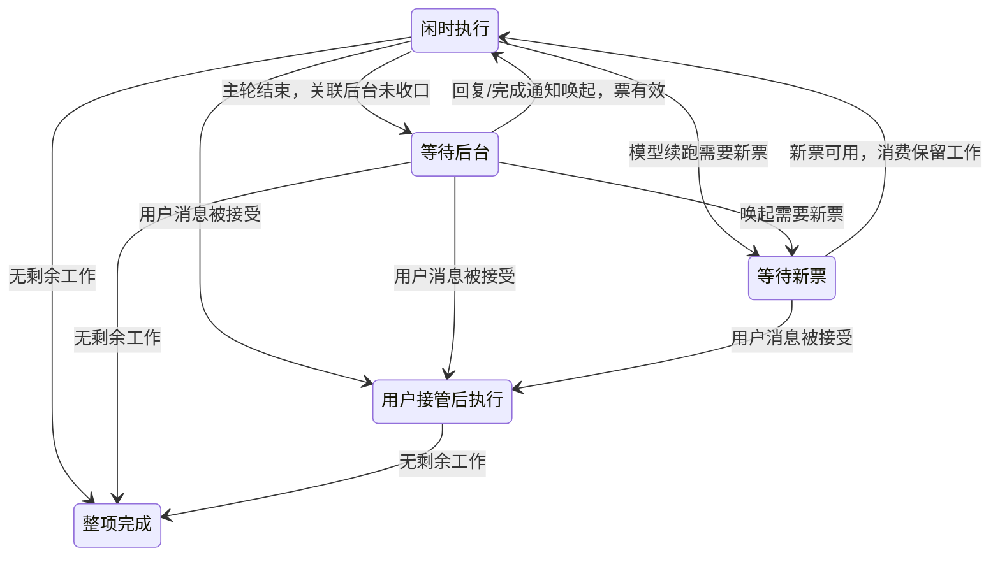

# 闲时后台执行与 Selection 职责拆分计划

状态：主体实现及 review 发现的迟到取消、换票确认丢失竞态已修复。本文保留目标设计、实施轨迹及验证边界。
当前实现基线见 [闲时任务 spec](./spec.md)；本文涉及的目标行为在实现前先回填对应规格，完成后以最终 spec 为准。

## 1. 目标与边界

闲时任务能够启动后台 subagent、调用 SendMessage、启动后台 Bash；主 agent 自然结束后，后台回复或完成通知能够继续驱动主 agent。票据与整项任务的生命周期分开管理，主执行循环复用普通 agent 机制。

| 已确认事项     | 目标行为                                                                           |
| -------------- | ---------------------------------------------------------------------------------- |
| 后台能力       | 支持已有显式后台启动及普通 agent 的转后台路径，不只解除工具可见性限制              |
| 消息           | SendMessage 支持运行中投递与终态 agent 恢复；RespondToCoordinator 沿用现有回复队列 |
| 主轮自然结束   | 存在关联后台工作、待处理回复/通知或等待新票的续跑时，整项任务不完成                |
| 用户接管       | 真实用户消息被权威入口接受时接管整项任务；发送失败、只改模型、审批响应不触发接管   |
| 已运行子 agent | 接管时当前子 agent 轮保留原模型跑完；后续唤起和恢复使用用户选择                    |
| 票据过期       | 本地 Bash 允许跑完并保存结果；模型续跑等待新票，不重跑已完成的工具                 |
| 聊天停止       | 沿用普通 agent 的停止范围和通知规则，不增加闲时专属差异                            |
| 任务卡取消     | 保持现有取消终态语义；关联后台迟到事件不得重新派发闲时执行                         |
| 重启           | 不恢复后台进程、待唤起通知或临时闲时执行状态；不新增恢复队列                       |
| 迁移           | 不需要配置迁移或数据库迁移；复用现有字段、记录与格式                               |

不扩大 Workflow、递归 OffPeakCreate/CronCreate、嵌套 subagent 或 child runtime 内后台 Bash 的既有能力边界。闲时自动项目记忆提取继续跳过，不修改会话 Memory 配置。既有闲时任务持久化调度与本次不恢复的后台工作分别处理，不借本次变更取消原有调度能力。

## 2. Selection 的职责与存储

| 概念                         | 唯一职责                                         | owner / 存储                                                                                                       |
| ---------------------------- | ------------------------------------------------ | ------------------------------------------------------------------------------------------------------------------ |
| Configured Default           | 新 CLI 会话的用户选型初始化偏好                  | Personal Provider 配置的 `config.defaultModelSelection`；默认 `~/.zcode/v2/provider_config.json`，允许现有路径覆盖 |
| `cliDefaultSelection`        | 当前 CLI/TUI 会话中，未显式选型的用户输入默认值  | bootstrap 会话层内存；复用每会话普通用户选择记录恢复                                                               |
| App Composer Selection       | 下一条 App 用户消息的选择                        | 现有 renderer 草稿与 localStorage；不新增 CLI 状态副本                                                             |
| `sessionModelSelection`      | 会话后续执行、后台唤起及 Goal 自动续轮使用的选择 | CLI Runtime；闲时选择只在本次运行生命周期内生效                                                                    |
| Submission Selection         | 某条已接纳输入固定的模型选择                     | 现有 canonical intent；排队期间不重新读取可变默认值                                                                |
| Active Model                 | 当前轮实际使用的模型实例                         | 当前执行轮；普通选择更新不修改其他已运行轮的模型                                                                   |
| `highspeedFallbackSelection` | 加速卡规定的回退场景所使用的普通模型选择         | 加速轮启动时固定的执行快照；专属于加速卡，不是闲时换票或通用降级配置                                               |

现有 SQLite `session_entry` 中的 `runtime/model_selection` 记录继续保存用户普通选择，保留原 id、type 和数据格式。通过明确的读写接口区分它与 Runtime 临时续跑选择，不把闲时选择写入该记录。App Recent、Configured Default 同样不能被闲时执行覆盖。

### 2.1 CLI 输入规则

1. 新会话按现有全局默认解析规则初始化 `cliDefaultSelection`；旧会话读取自己的用户选择，不被别的会话修改的全局默认覆盖。
2. `/model`、`/effort` 更新 CLI 输入默认选择及其会话记录，保留现有同步保存全局默认偏好的行为；尚未发送普通消息时不改变后台续跑选择。
3. CLI 用户消息缺少 Selection 时，在接纳入口补齐并固定到 Submission。App 继续显式提交 Composer Selection。
4. 缺失、不可用或不完整选择按现有校验报错，不借 Session 的闲时选择或 Registry 任意首项兜底。
5. 旧协议缺省输入的兼容读取必须明确来自用户输入偏好；Bot 等已有独立提交契约单独审查，不能机械改变其 `/model` 语义。

### 2.2 更新顺序与并发

真实用户消息经 CLI 串行 admission 接受后，更新会话续跑选择并触发接管；未接受的候选不得产生这些副作用。已经接受的输入随后开始执行时，只使用自己的 Submission 快照，不得把较早选择回写成最新 Session Selection。Guide 仍按原有 model-step 边界作用于当前轮。

```mermaid
sequenceDiagram
    participant Input as 用户输入默认/草稿
    participant Queue as CLI admission 与现有队列
    participant Session as Runtime Session Selection
    participant Life as 闲时生命周期
    participant Loop as 执行轮
    Life->>Session: 闲时开始，设置 I（不保存用户偏好）
    Input->>Input: 改选 B，尚未发送
    Note over Session: 仍为 I，后台唤起继续闲时执行
    Input->>Queue: 提交消息及 B
    Queue->>Queue: 校验并接纳，固定 Submission
    Queue->>Session: 按接纳顺序更新 B
    Queue->>Life: 用户接管，停止后续闲时派发
    Queue->>Loop: 按原有队列/Guide 规则执行本条快照
    Note over Loop: 已运行子 agent 当前轮不热切换
```

任务生命周期解除后不得遗留可被普通执行误用的无票闲时选择。恢复/清理依据已接纳的普通用户选择或未绑定状态，不读取未发送草稿；迟到的闲时结束回调不得覆盖接管后的 Session Selection。

## 3. 闲时生命周期与 owner

| 事实                             | owner                                    | 禁止的重复状态                               |
| -------------------------------- | ---------------------------------------- | -------------------------------------------- |
| 主轮、后台任务、命令与通知       | CLI RuntimeTaskRegistry、现有命令队列    | Host 再维护一份 accepted queue 或后台计数表  |
| 闲时工作归属、接管与本地生命周期 | CLI 侧独立生命周期协调，使用通用执行事实 | 在每个主循环步骤散布闲时专属分支             |
| 申请、换票、结算                 | 现有 OffPeakTaskService                  | 工具 handler 自行请求/续期票据               |
| 任务卡持久状态                   | 现有服务与 Repo，消费明确事件            | 根据首轮 terminal 或 UI loading 推断整项完成 |
| 主轮 Active Model                | 当前轮                                   | 用可变 Session Selection 反推正在执行的模型  |



自然完成要求本项任务无正在执行的主轮、无未结束的关联后台工作、无待消费的回复/通知，也无等待票据的续跑。只统计属于本项任务的工作；不得把会话里无关或历史任务混入。登记表终态、通知入队、队列 claim 和收口事件必须有明确顺序，防止后台终态到通知入队之间产生假空闲。不用轮询延迟或第二份待处理队列修补竞态。

等待后台可以是内部状态，卡片仍显示进行中；等待新票复用既有闲时排队展示。失败、取消与自然完成分别按其结果收口，不把“无剩余工作”等同于成功。

## 4. 后台执行与票据

- 复用现有 task-notification、subagent-message 命令与 active-loop drain。主轮正在执行时按原规则合流；新起主轮时使用 Session Selection。
- 后台 subagent 显式启动、前台转后台、SendMessage 终态恢复均传递正确的执行归属与请求依赖，不能只修第一条路径。
- 票据与鉴权通过独立生命周期及现有请求依赖/准入边界提供；通知、普通持久化输入不得固化凭据或旧票据。
- 票过期保留本地 Bash、结果 artifact 和现有待处理命令；模型执行等待有效票后继续。多个并发过期事件复用同一次换票过程。
- 用户接管后停止后续闲时派发；仍使用旧闲时执行上下文的子 agent 当前轮按已确认规则收尾。过期/失败等迟到事件必须校验归属版本，不能把已接管任务重新排队。
- 旧票不再有使用者后按现有服务契约结算。释放票据不意味着任务完成，主轮结束也不意味着可以立即释放。
- 停止沿用普通行为；取消、分支失效、runtime teardown 继续使用原有通知抑制与幂等边界。重启不补投递后台结果，已有账本只按原规则留痕收口。

Selection 只描述 provider/model/options。票据、是否可执行、任务状态不进入 Selection；Core 只接通用执行上下文、请求准入和工作事实通知，不引入另一套主执行循环。

## 5. 影响面与代码落点

### Review 修正：标题请求与流清理（2026-10-12）

- 标题入队时冻结模型选择与执行归属，必须早于 session store 等异步读取。继承闲时执行的标题独立持有模型轮租约，并使用同一票据 authority；主轮结束不能释放标题仍在使用的票据，3102 继续走已有换票通路。成功、失败及无需生成的早退均释放租约。
- 显式配置的标题模型保持独立调用；普通/外部标题调用不能仅因 Session 暂存闲时选择就继承闲时模型。用户接管后新标题按用户选择执行；已经启动的标题保留原请求归属。
- 流请求每次尝试有独立取消信号。退出尝试时先取消底层请求，再以 best-effort 方式关闭 iterator；关闭异常不得覆盖原请求错误，未完成的关闭不得阻塞换票、取消或整项收口。不增加清理超时和自动重放已交付内容。

```text
标题入队并保留租约 → 读取会话 → 生成标题（过期则换票） → 保存/早退/失败 → 释放租约
流尝试失败 → 取消该尝试 + 异步关闭 iterator → 保留原错误或等待新票重试
```

回归覆盖：默认标题鉴权、主轮先结束、标题换票、早退/错误释放、显式标题模型隔离；iterator.return 拒绝/不结束、原始错误和取消保留、已交付流不重放。桌面 OP10 保留默认标题路径并校验其闲时票据；不改变 continuous/replayable 消息交付边界。

| 优先级 | 模块/入口                                                      | 预期改动                                                             |
| ------ | -------------------------------------------------------------- | -------------------------------------------------------------------- |
| 必改   | CLI command-center、bootstrap session/input facade             | CLI 输入默认选择、切模型/档位、显式 Submission、旧请求缺省规则       |
| 必改   | Core turn-model、admission、恢复与持久化接口                   | 分离已接纳选择更新、单轮模型创建和用户偏好保存，处理 FIFO/Guide 竞态 |
| 必改   | 加速卡 selection fallback                                      | 启动时固定加速卡专属回退选择，不在失败时读取可变 Session             |
| 必改   | 工具可见性、Bash/SendMessage handler、subagent runner          | 同步解除对应限制；保持 Workflow、递归创建等其他约束                  |
| 必改   | subagent port、后台启动/转后台/消息恢复                        | 模型选择、执行归属与请求依赖一致传递                                 |
| 必改   | CLI background notifications、command queue、runtime residency | 复用通知通路；补工作生命周期事件，等待票据时不丢工作                 |
| 必改   | Host dispatch/track/finalize、OffPeakTaskService、任务适配器   | 用整项生命周期替代首轮 terminal 收口；换票、接管、结算与旧回调失效   |
| 必查   | App/协议 settings 与模型投影                                   | 输入选型显示用户选择；实际执行模型来自执行事实                       |
| 必查   | 标题、记忆、sampling、Compact                                  | 显式区分独立配置与所属执行；不能只继承闲时 model id 而丢失请求鉴权   |
| 必查   | Cron、Fork、会话冷恢复、Workflow 模型 pin                      | 防止临时闲时选择进入未来普通执行；保留各功能既有显式模型契约         |
| 不变量 | 普通后台、Goal、权限响应、child Bash cleanup                   | 不扩大停止、嵌套、权限、结果可见性等产品语义                         |

App/Agent 新增或修改的契约需要严格类型及运行时 schema。沿现有协议入口导出，Host 消费 CLI 事实，不让 Service 导入 Runtime 实现。所有 workspace 身份隔离继续使用 workspaceIdentity；真实路径仍使用 workspacePath。

桌面与手机接入同一个已有 owner：桌面保持 continuous，手机保持 replayable，命令 FIFO 由 CLI admission 决定。不得为手机新增 runtime，不把手机恢复逻辑扩散到桌面主链路。App 草稿保持每端已有隔离；不以全局默认替代其他会话的选择。

## 6. 规格与能力图回填

| 文件                                                                                                                          | 实施前/随实现更新                                                        |
| ----------------------------------------------------------------------------------------------------------------------------- | ------------------------------------------------------------------------ |
| [闲时 spec](./spec.md)、[技术设计](./tech-design.md)                                                                          | 开放后台能力、整项收口、换票、接管及当前实现/目标设计边界                |
| [Selection 状态设计](../working-memory/provider-refactor/design/interaction/selection-state.md)                               | cliDefaultSelection、接纳时更新、存储语义；删除过时的独立默认文件描述    |
| [执行选型设计](../working-memory/provider-refactor/design/execution/execution.md)                                             | Session 续跑选择、子 agent 当前轮、加速卡专属回退、独立辅助调用          |
| [后台覆盖矩阵](../testing/conversation-session-background-e2e-coverage-matrix.md)                                             | 加入闲时代表场景并链接手机专项验证；保留原桌面矩阵范围                   |
| [会话用例目录](../conversation-session-case-catalog.md)、[总覆盖矩阵](../testing/conversation-session-e2e-coverage-matrix.md) | 注册新场景；更新 OP10 的后台拒绝断言；计划用例不得标为已覆盖             |
| [能力图](../../.agents/skills/feature-boundary-planner/references/zcode-feature-graph.yaml)                                   | 标注待实现设计；落地时替换“闲时不写 Runtime Session、拒绝后台”的旧不变量 |

本次影响分析依据源码调用链和现有规格；当前无可用 codegraph，未将文本扫描冒充图查询。尚未确定的接口签名、事件名称、测试文件拆分属于实现细化，不改变已确认产品边界。

## 7. 验收场景

| 编号 | 场景与动作                               | 关键断言                                                      | 证据层                     |
| ---- | ---------------------------------------- | ------------------------------------------------------------- | -------------------------- |
| IL01 | 闲时显式后台 Agent，主轮先结束           | 后台继续；通知唤起仍走闲时；卡片不提前完成                    | Core + 桌面 E2E/请求记录   |
| IL02 | 闲时后台 Bash，覆盖显式与可转后台超时    | 命令只执行一次，artifact 保留；完成能唤起                     | adapter/Core + E2E         |
| IL03 | SendMessage 到运行中与已结束 agent       | 投递/恢复有效，执行选择与鉴权正确，回复可唤起                 | Core + 代表 E2E            |
| IL04 | 后台通知赶上主轮、或主轮结束后到达       | 合流/新起轮分别沿现有规则；无丢失、无重复                     | Core 时序测试              |
| IL05 | Bash 在票过期后完成，新票稍后到达        | Bash 不重跑，结果不丢，模型等待票后继续                       | 服务 + Core 集成           |
| IL06 | 多个后台同时遇到票过期                   | 单次换票、工作不重复，旧票事件不覆盖新票                      | 服务并发测试               |
| IL07 | 等后台/等新票时用户发 B                  | 接纳后 Session 为 B；当前子 agent 轮保留 I，后续唤起/恢复用 B | CLI + 桌面/手机 E2E        |
| IL08 | 接管后旧票过期或 ready 回调到达          | 不重新排队，不抢回选择，不重发原任务                          | 服务/协议测试              |
| IL09 | CLI /model、App 菜单改 B 但不发送        | 只改用户输入选择，后台仍按 I 续跑                             | CLI + UI 测试              |
| IL10 | 连续接纳 B、C，较早 B 随后开跑           | B 轮用 B，最新续跑选择保持 C                                  | admission/queue/Guide 测试 |
| IL11 | 会话 B 修改全局默认，会话 A 再发送       | A 保持自己的输入默认；新会话才使用新默认                      | CLI 多会话测试             |
| IL12 | 加速卡启动后用户选择变化，再触发规定回退 | 使用启动时固定的加速卡回退选择                                | Core 回归                  |
| IL13 | 聊天停止、后台单项停止、任务卡取消       | 各入口范围保持原契约，取消后无闲时复活                        | Core + 服务 + 代表 E2E     |
| IL14 | 重启/分支失效/teardown                   | 不恢复临时闲时选择或补唤起，用户选择可正常恢复                | 存储/协议测试              |
| IL15 | 后台终态、通知入队与收口交错             | 仅整项真正收口一次；不因中间假空闲完成                        | 确定性并发测试             |
| IL16 | 权限响应与辅助模型调用                   | 审批不触发用户接管；辅助调用选择与请求归属匹配                | Core/协议回归              |

不枚举所有模型供应商与后台数量的笛卡尔积；用普通/闲时/加速卡、单项/多项、接管前/后、票有效/过期代表关键差异。嵌套 Bash 仅保持 child cleanup 既有边界；跨重启后台恢复明确排除。

E2E 使用受控流和票据 fixture 制造时序，不以任意 sleep 证明同步。新候选按既有 manual-review 流程维护，未取得准入证据不得声称正式回放或容器套件覆盖。移动到正式用例沿用已有人工评审与提升流程。

## 8. 实施顺序与检查点

- [x] P0：从当前 staging 建立独立开发容器；检查源码基线、工具链、依赖；复现并分类已有测试失败。
- [x] P1：更新上述 spec、用例目录与矩阵；先写 CLI 默认/Session 分离、接纳顺序及加速卡回退测试，再实现 Selection 拆分。
- [x] P2：先写工作归属、后台收口、换票、接管与旧回调竞态测试，再实现独立生命周期及通用契约。
- [x] P3：先写后台 Agent/Bash/SendMessage 及恢复测试，再打通上下文传递并解除对应限制。
- [x] P4：接通 Host/服务整项收口；OP10 桌面三种变体与既有 continuous/replayable 协议边界回归完成。手机浏览器整机交互未验证，保留为验证限制。
- [x] P5：完成相关验证与 diff 自检，更新 spec 并本地提交；全量基线失败和未验证平台如下明确记录。用户请求后再推送/MR。

开发和执行检查使用独立开发容器。容器仅通过工具链检查不代表支持 Electron E2E；需分别确认图形依赖、回放资源与容器测试入口，缺失能力明确记录，不能用单测替代。

普通代码必要验证：根 `pnpm typecheck`、`pnpm lint`、`pnpm architecture:check --changed` 和受影响单测；CLI 另按其 AGENTS 执行独立 typecheck/lint/测试；App 交互执行对应 E2E。检查失败时区分基线与本次引入，不以跳过 hook 提交代码。

前期调查基线曾出现两个待定位失败：后台通知 snapshot batch 对 system-reminder 的断言，以及 execution-scoped foreground child 测试预期三次执行但实际为零。它们是已有失败线索，不代表本次设计已验证；应在新容器/当前基线重新取得证据。

文档阶段只做链接、格式、术语、约束一致性与开源检查，不把产品代码检查记为已通过。

### 实施记录

Selection 拆分已进入实现与回归：CLI 装配维护 `cliDefaultSelection`，输入接纳更新续跑选择，旧队列输入不会倒写；加速卡回退在启动时固定快照。模型实例仍在实际执行时创建，接纳仅保存选择意图，`ModelSelected` 继续表达实际执行切换。普通配置入口及 Session entry 复用，未新增迁移。

已执行根 typecheck/lint、CLI 完整 typecheck 和架构检查。CLI 默认/TUI、冷恢复、协议接纳和加速队列代表测试通过。Core 全量回归发现的本次模型重复创建问题已修正；六个历史失败在原基线隔离副本复现：I/O 边界名单、消息锚点 mock、compact 默认预算、trace cacheControl、unbound 默认测试及后台通知包装旧断言。CLI 全量测试入口另被缺少 CUA producer 仓库的环境条件阻断。CLI 原 lint 入口受根忽略规则影响，显式扫描与基线均为相同 58 个已有 max-lines 错误、31 个警告；未将它记为通过。后台通知包装断言随后按现行系统通知语义修正，所在文件 29 项通过。

生命周期实现采用独立组件，输入为现有执行层提供的工作快照；组件不保存第二份后台任务表或输入队列。仅维护票据版本、续票请求编号、闲时/用户归属、持票模型轮引用及任务终态。主轮自然结束时按快照决定等待后台或完成；用户接纳改变归属，旧续票回执通过执行身份和续票编号拒绝。票据只有在没有闲时模型轮继续使用时释放，释放本身不产生整项完成。聊天 Stop 仅报告原有主轮结果，任务卡取消才显式终止生命周期。

接入边界：`modelExecution.offPeak` 只携带执行 ID、初始票 ID 和票过期业务码；动态凭据仍由执行请求鉴权提供。
CLI 发出严格校验的 `v4/offPeak/lifecycle` 驻内存通知，由 Host 消费；它不属于聊天行、遥测或冷恢复事件。
Host 经 `v4/conversation/offPeakControl` 发送换票/取消，按 session、executionId 与 renewalId 校验；
控制请求只更新现存生命周期，不创建 Session、不重新提交 prompt，也不进入普通持久化输入。
真实用户消息继续通过现有 CommandInbox 接纳。桌面 continuous 与手机 replayable 的对话交付规则不变。
Host 只持有票据请求关联，完成条件始终由 CLI 决定。跨 App/CLI 重启不补发这些通知。

### 实施核对补充

- 续票交接按 `executionId + renewalId + ticketId` 确认，最近一次安装允许重复确认；终态的迟到派发只释放票，不重发 prompt。
- 工作流的限制覆盖现有动态入口 `CreateWorkflow`、`AmendWorkflow`、`ResumeWorkflowRun`、`EvalWorkflowSnippet`，这些运行器尚未接入闲时票据；查询与保存定义仍沿用既有权限。

OP10 运行夹具增加 `ZCODE_E2E_OFFPEAK_EXPIRE_WAKE=1` 变体：第一次后台唤起请求返回 3102，安装新票后重试相同模型请求；断言初始指令及 Bash 均仅执行一次，并消费保存的 Bash 结果。

OP10 的 `ZCODE_E2E_OFFPEAK_TAKEOVER=1` 变体在后台屏障放行前发送用户消息，验证既有子轮仍由闲时请求完成，而主 agent 后续后台唤起使用用户模型；默认变体只切工具栏未发送，仍用闲时模型。两种变体分别执行，不组合。

### 最终验证记录（2026-10-08）

- OP10 本地 Electron/Xvfb + 实际 Host/CLI + HTTP replay：普通后台唤起、3102 换票、等待后台时用户接管三种变体各 1/1 通过。四类前台、两类后台 Agent 的真实请求使用闲时模型；真实后台 Bash 只启动一次，输出保存在通知指定文件。仅切工具栏仍走闲时唤起；用户发送后后续唤起走普通 provider。
- 3102 变体核对新旧票不同、重试请求正文相同、初始任务和 Bash 未重跑。测试场景通过请求屏障控制时序。用例仍在 `manual-review/pending`，没有提升正式准入，也不声称正式容器集合已覆盖。
- 本次相关单测 270/270（根 138、CLI 132）、CLI/TUI 13/13 通过。另补终态控制器不得覆盖后来用户 Selection 持久化和普通后台唤起、会话准备期间取消、首轮 admission 前取消的确定性回归。
- 根与 CLI 类型检查、根 lint、架构检查、E2E 类型检查通过。并行类型检查曾以 137 退出，串行执行完成；不改项目配置绕过检查。
- 全量 Core 曾为 3895 passed / 21 failed（含 15 个缺少 Browser Use 资源、6 个历史失败）；本次修改过的后台通知旧断言现已修正。全量 Bootstrap 为 2923 passed / 34 failed；两个受影响的旧限制/加速队列断言已修正。余下包含旧 Provider fixture、PDF adapter、启动事件与超时等问题，不能称全量绿灯。与本次接纳相关的三个 cold-resume、一个 stale-revision、一个 unbound-default 失败已在 HEAD 的 Bootstrap 隔离源码复现；代表性正常恢复与新 CLI 默认测试通过。
- CLI Core/Bootstrap/CLI 源码显式 lint 与同范围基线均为 52 个 max-lines 错误、31 个警告，未新增诊断；未改全仓规则或跳过 hook。开源词汇检查未发现问题；影响面使用文本扫描，未执行 codegraph 影响面扫描。

验证边界：没有手机浏览器整机、macOS 或 Windows 实机验证；手机 shared-host 的工作归属继续由同一 CLI admission 接管，未新增 Host 输入队列，未改变 continuous/replayable 交付边界。已跑协议代表回归不替代手机 UI E2E。跨进程重启补唤起按需求排除。

最终重新构建后的桌面证据：默认 `desktop-e2e-20261008-162457-528`、换票 `desktop-e2e-20261008-162734-140`、接管 `desktop-e2e-20261008-162815-060`，均 1/1 通过。报告保留在开发容器 `packages/desktop/.e2e-artifacts/`。基线在开工时已同步并检查；收尾新鲜度检查通过。进行中的功能分支没有自动重放到开发期间新增的远端提交上。

### 合入 staging 与 MR 门禁复验（2026-10-08）

重新 fetch staging 后执行 merge，目标已包含在功能分支，无新增合并差异。推送门禁的关联集合首次为 13,854 passed / 3 failed；三项在独立 staging 源码副本中同样复现。两项 CUA 用例将 Linux 同步 native.captureApp 伪造为异步方法，动作提前错误结束；现改在真实 await 的截图接口设闸，并提供可解码 PNG。目录替换用例先删除再 mkdir，文件系统可能复用 inode；现保留旧目录再创建新目录，确定性构造目录身份替换。两文件 78 项通过，断言及平台覆盖范围未削减，产品实现未变。发布工作副本另外补齐 CLI 构建产物，以满足相关测试的包入口解析。


### Review 竞态修复与验证（2026-10-09）

- 迟到取消：终态闲时控制器直接返回；活动取消在更新登记表前捕获当前 foreground execution ID，并按该 ID 停止。避免同步完成回调或重复取消中断同会话后来启动的用户轮。
- 换票回执丢失：Host 在内存中保留同一次 execution/renewal/ticket 及请求凭据，复用既有同步周期确认。未知结果期间不回队取新票；同一交接的并发确认合并为一次 RPC。新续票先到时旧 ACK 不能倒写；明确拒绝才释放候选票并重新申请。用户接管/完成后，未安装的候选票仍需释放。
- 先增加失败回归再实现。根相关单测 50/50、CLI 相关单测 18/18；根与 CLI 类型检查、E2E 类型检查、根 lint、架构检查通过。CLI 全仓 lint 仍有历史 max-lines 错误，本次修改的 Core 文件显式 lint 为 0 错误、0 警告。
- OP10 故障变体 1/1 通过：`desktop-e2e-20261009-082511-005`。实际 Host/CLI stdio 边界将已安装票的首个确认替换为协议错误，保留完成通知直到相同交接重试确认；验证卡片最终完成、初始 prompt 与真实 Bash 只执行一次。用例仍为 manual-review/pending。
- 测试排障：初次缺少容器参数导致 renderer 资源加载失败；双窗口调度竞争与注入帧不符合严格协议均在测试 helper 修正后重跑。不把这些失败尝试算作通过。
- 没有新增生产计时器、协议字段、持久化队列或迁移；主执行循环与手机 replayable 边界未改。手机浏览器、macOS、Windows 实机仍未验证，重启恢复仍排除。


## Review 修复验证（2026-10-12）

- 先以新增测试复现：标题没有票据、iterator.return 拒绝覆盖原错误/不结束阻塞换票，修复前 6 项失败；修复后连同既有闲时、模型选择与标题持久化测试共 134/134 通过。
- 默认标题在入队时保留独立模型租约；覆盖主轮先结束、3102 换票、标题失败、异步读库早退、用户接管与显式独立标题模型。流关闭拒绝/不结束均不阻塞续跑，原业务错误与取消原因保持不变。
- 根和 CLI 完整 typecheck/lint 通过（既有 lint 告警保留）；架构 0 新违规，conversation 覆盖审计通过。
- Linux Electron + 真实 Host/CLI + HTTP replay：OP10 默认标题与主轮票据/模型一致，后台唤起和整项完成通过，run `desktop-e2e-20261012-105708-319`；换票回执丢失变体通过，run `desktop-e2e-20261012-105924-792`。两例仍为 manual-review/pending。
- 更新 Selection/执行设计与 feature graph，去掉待实现和后台拒绝等旧基线描述。未新增配置或数据库迁移；手机浏览器、macOS、Windows 和远程 workspace 整机未验证。
