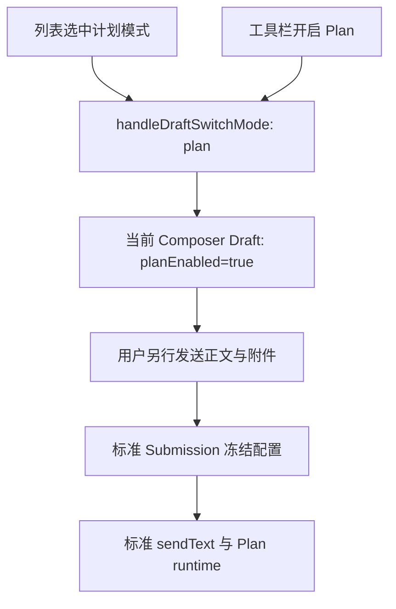

# Composer 计划模式快捷入口

## 目标与交互

`/plan` 是输入框列表中「计划模式」操作的搜索词。选中它等价于开启工具栏的标准 Plan 开关。
列表展示本地化名称「计划模式 / Plan mode」和描述「开启计划模式 / Enable Plan mode」，不展示命令参数语法。

| 操作 | 结果 |
| --- | --- |
| 输入 `/plan` | 展示计划模式操作，不改变当前模式。 |
| Tab、Enter 或点击选中 | 开启标准 Plan；仅删除当前 slash 搜索 token，关闭列表，保留输入焦点。 |
| 已开启 Plan 时再次选中 | 保持开启，不切换为关闭。 |
| 有其他正文、附件或结构化上下文 | 原样保留，不自动发送。 |
| Escape 关闭列表或没有选中 | 不改变模式。 |
| 关闭列表后发送原始 `/plan` 或 `/plan <text>` | 作为普通文本发送，保留原文与当前模式，不做隐藏解析。 |
| 退出 Plan | 使用现有工具栏开关或 Plan 标记的关闭按钮。 |

## 唯一状态与执行链路

列表选择只编辑当前 Composer Draft，保留权限模式；不发送 prompt，不创建 user row，不提前改变正在运行的 Agent。
连续选择幂等。新草稿、已有会话、桌面与手机使用同一个动作；只读界面不提供可执行入口。
发送、排队、失败恢复、Plan 工具限制和 ExitPlanMode 继续遵守标准 Plan 合同。

## 目录与跨端边界

计划模式由 App 的本地列表操作提供，不再由 CLI 广播 `/plan [task]`。
`plan` 仍是保留名，避免自定义命令接管这个入口；旧 Agent 广播的同名命令不应遮蔽本地操作。
技能和子智能体仍使用各自类型的列表条目，精确搜索 plan 时优先选中计划模式操作。
不增加 wire command、协议字段、配置副本或 Plan 专用发送分支。
desktop continuous 与手机 remote replayable 复用此 Composer 行为，传输与恢复边界不变。

## 验收

- 三种选择方式都只开启 Plan，不发送；正文、附件、上下文和焦点保留。
- 新草稿、已有会话、重复选择、Escape 和原始文本发送有回归证据。
- 标准发送携带 planEnabled；provider 收到正文与附件并进入标准 Plan runtime。
- CLI catalog 不再提供 Plan 命令，自定义同名命令不能接管入口。
