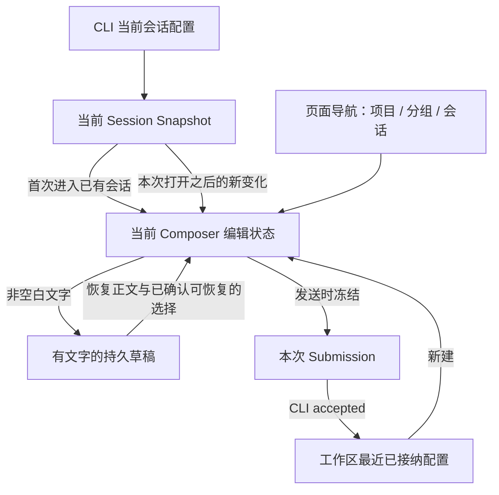

# Composer 状态简化与文字草稿边界

状态：已实现并完成范围内验证；用户已确认 R1 使用最新权限/Plan，并明确本轮不修改手机项目。2026-10-14 在文字草稿修复的 review 后补充；按以下已确认范围实施。原行为与验证记录见 [文字草稿 spec](../ui/composer-text-draft-persistence.md)。

## Feature Summary

| 项目        | 内容                                                                                                                                |
| ----------- | ----------------------------------------------------------------------------------------------------------------------------------- |
| 意图        | 保留“空白不持久化”，消除历史授权重放、无主配置交接；手机导航依赖留待后续                                                            |
| 能力        | Composer 配置、权限/Plan 同步、首发与分享导入、新建项目导航                                                                         |
| 层级 / 模式 | draft-default、persistence、recovery；implementation                                                                                      |
| 种子        | useDraftConfigControl、composerDraftStore、newTaskDraft、SessionPane、useRootPlatformEffects、WebRemoteControlMobileShell、web/main |
| 非目标      | 修改 CLI 执行权限定义、已接受队列、协议事件格式、预热 runtime、模型候选和跨工作区 Recent 策略                                       |

## 已证实的问题

临时 Hook 诊断在当前 MR 提交上运行，四项中两项正确性断言失败、两项诊断断言通过：

1. 当前 Session Snapshot 为 build、同时携带旧 permissionGrant，空白 Composer 初始化结果错误变成 yolo。
2. 当前 Snapshot 的 planEnabled=false、同时携带旧 planTransition=true，初始化错误变成 true。
3. New Task 已渲染后，发送前捕获的旧 promote 回调被 scopeKey 守卫拦截，新 Root 文字未被删除。不能把 review 的全部竞态推断都视为已确认。
4. 没有接收方挂载的 session seed 在原 Hook 卸载后仍存在，之后 Hook 打开该 Session 时优先采用 seed，覆盖 Snapshot。真实桌面触发链尚需进一步验证。

静态调用链另确认：readDraftFile 会在渲染期写 localStorage；手机项目冷恢复从文字草稿读取 projectId，空白时失去该来源。后者不等于已验证会建错项目，需验证 Host admission 与手机入口。

## 状态归属与目标结构

- CLI/投影拥有已生效的会话配置。历史授权 ID 是关联信息，不能在初始化时重新执行授权。
- 当前 Composer 拥有下一次提交的本地选择，菜单变更不直接改写运行中的任务。只允许本次 scope 的新授权/工具变化更新对应字段。
- 文字草稿只保存恢复输入所需的数据，不保存授权事件的已消费标记、订阅状态或临时初始化标志。
- Recent 仍只由 accepted Submission 更新，按 workspaceKey 隔离。
- 项目/分组是导航与创建目标，不能借空 Composer 记录持久化；手机页面恢复走已有导航入口。

## UI Surface Matrix

| 场景 / 入口           | 共享实现与编辑 owner          | 默认 / 恢复来源                     | 校验 / 提交                                      | 权威与持久化                      | 多端及隔离                      |
| --------------------- | ----------------------------- | ----------------------------------- | ------------------------------------------------ | --------------------------------- | ------------------------------- |
| 新建输入框            | useDraftConfigControl         | 文字草稿或 workspace Recent         | ModelSelectionView → 冻结 Submission             | Composer 本地；accepted 后 Recent | desktop/web 共用；identity 隔离 |
| 已有 Session          | 同一 Hook                     | 文字/模型来自草稿；权限/Plan 来自 Snapshot | 同上                                             | CLI 执行事实不由草稿重建          | 切换 Session 重建观察基线       |
| 在线授权 / Plan 工具  | Snapshot → 当前 Hook          | 本次 scope 已观察的投影与最新投影   | 只同步对应字段，保留正文/模型                    | 观察基线只在内存                  | 不新增 replay 队列              |
| 首发变为 Session      | SessionPane → 当前 pane owner | 已冻结提交配置与当前仍未发送文字    | source scope + draft generation + target session | 同一编辑 owner 迁移；无全局 seed  | 分屏 pane 隔离                  |
| 首次分享导入          | Root 导入完成 → 导航入口      | 接收方新建初始化规则                | imported/reused 区分、模型 readiness             | 一次导航初始化参数                | reused 不覆盖既有编辑           |
| 手机项目新建刷新      | web/main → Root / MobileShell | 项目导航目标，非草稿配置            | 重新验证 host / workspace / project              | 既有页面 history 上下文           | 不让手机改变桌面选中态          |
| 离线展示 / 读取旧记录 | composerDraftStore            | 只读有效文字                        | 离线不允许提交                                   | 清理在明确写入/迁移阶段           | render 无写入副作用             |

## Shared And Divergent Behavior

| 关注点      | 共用                             | 保持区别                                                       |
| ----------- | -------------------------------- | -------------------------------------------------------------- |
| 控件 / 候选 | 现有 toolbar、ModelSelectionView | 自动化和 Subagent 各自配置不接入 Composer                      |
| 默认        | 单一初始化入口                   | 新建读 Recent；已有会话读自身 Snapshot；导入显式说明首次初始化 |
| 选择 / 提交 | 当前编辑状态 → 冻结 Submission   | 当前输入框、已接纳消息和执行中任务互不改写                     |
| 恢复        | 有文字才保存                     | 桌面 direct continuous；手机 replayable gap/snapshot 恢复      |

## Feature Relationships

| 级别           | 起点 → 关系 → 落点                                     | 原因 / 证据                                                         |
| -------------- | ------------------------------------------------------ | ------------------------------------------------------------------- |
| must-inspect   | Composer → initializes-from → Snapshot / Recent / text | useDraftConfigControl 当前混合初始化与历史事件应用                  |
| must-inspect   | SessionPane → promotes → Composer scope                | handleDraftSessionCreated、promoteComposerDraft；需保持迟到回调防护 |
| must-inspect   | Root → initializes → imported Session                  | seedImportedSessionDraft 的无主 Map 交接                            |
| must-inspect   | mobile navigation → recovers → Root project intent     | web/main 的 initialTaskDraft 仅作为内存参数传递                     |
| should-inspect | disconnected surface → reads → text persistence        | RemoteConversationDisconnected 的 render 调用                       |
| invariant-only | Submission → CLI admission / queue                     | 不变更执行模式、FIFO、owner/lease                                   |
| evidence-only  | Hook / storage / bootstrap / E2E tests                 | 证明边界，不将测试可达性当产品依赖                                  |

## State Owners And Commit Sinks

| 状态                | 唯一 owner                      | 写入边界 / 生命周期                           |
| ------------------- | ------------------------------- | --------------------------------------------- |
| 当前会话配置        | CLI + 只读 Session Snapshot     | 已接受命令、真实授权、工具转换                |
| 当前输入配置 / 文字 | 当前 Composer scope             | 菜单、文字编辑、新的 live 配置变化            |
| 持久文字草稿        | composerDraftStore              | 非空保存、删空删除；不携带事件消费游标        |
| Recent              | accepted submission 回调        | 只记录本次被接纳的选择                        |
| 观察基线            | 当前 Composer scope 内存        | 第一份匹配 Snapshot 建立；切 scope / 卸载丢弃 |
| 导航创建目标        | workspace/pane/navigation owner | 项目选择、切会话、New Task、页面恢复          |
| 首发交接            | 当前 pane 的一次 scope 迁移     | 接收后结束；离开/换代失效；不使用 TTL         |

## 简化策略与删除清单

### 1. 初始化与在线更新分开

首次匹配的 Snapshot 是“现在是什么”，只用于初始化/建立观察基线。不能调用“应用历史授权”的逻辑。
后续 Snapshot 的授权/工具关联发生新变化时，使用最新 Snapshot 的当前值更新对应字段；不能从旧事件推导固定 yolo 或过期 planEnabled。
同值的新授权也可能有意义：用户当前输入框改选 build、运行态仍为 yolo 时，新一次显式授权必须按既有授权语义响应。因此不能只比较 mode 值，也不能不加区分地删除协议关联 ID。
观察基线只属于当前打开周期，不写 localStorage；重复投影、普通重渲染不覆盖用户改选。Snapshot 暂时缺席不重置基线；更换真实 scope 才重置。

删除 V4ComposerDraft 中 lastPermissionGrantId / lastPlanTransitionId 的持久化与 replace 特殊保留逻辑；合并或删除两份仅负责历史应用的 helper。CLI/runtime 内同名字段仍有真实授权恢复职责，不因 Renderer 简化而删除。

### 2. 首发沿用当前编辑 owner，取消全局 seed Map

首发是当前 pane 从新建地址绑定真实 sessionId。配置通过当前 owner 的明确迁移传递，不放全局 Map 等未来某个组件来拿。
发送时冻结的 Submission 是已发送消息的配置；发送后用户继续编辑的文字/配置仍属于当前编辑周期。两者不能混用，否则“冻结全部草稿再 promotion”会丢掉发送期间的新输入。
迁移前检查 workspaceKey、来源 draft generation、目标 sessionId。迟到 ACK 仍可完成已接受任务的组织工作，但不得切换用户的新页面、清掉新文字或覆盖其选择。
首次分享导入通过导航动作显式传递初始化原因/配置；只有该次激活可用，换页/取消/接收即结束。reused 保持历史 Session 规则。删除 sessionSeeds 及其 read/seed/clear API；不加定时清理兜底。

### 3. 存储读取纯化

read 只解析并过滤旧空记录，不写盘。空记录因被过滤不会再覆盖 Recent；物理删除放到显式写入或挂载后的迁移中。
旧有文字记录保持可读，未知历史标记不再参与行为。坏模型身份/选项的已有降级不能连带删除文字。读取失败保留现有一次性日志策略。

### 4. 手机项目导航独立恢复（本轮排除，后续候选）

复用现有 browser history 页面恢复入口保存“当前设备/工作区/项目/分组/目标会话”所需的最小导航信息，不保存空正文、模型和权限。
Root 重建只消费经过身份匹配和项目有效性检查的导航目标；切换设备、项目已删除、workspace identity 不匹配时不得套用旧意图。项目无法恢复时明确回到选择入口，不能静默按路径猜项目或建到未分类。
这是导航状态的恢复，不恢复空白草稿，也不引入新的 Host/relay 业务状态。实现前需验证现有 history 项与 bridge bootstrap 的完整接线。

## Must-Preserve Invariants

- 身份始终为 workspaceIdentity?.trim() || workspacePath；路径只用于执行/展示。
- 空白/纯空格不持久化，不新增隐藏的空白配置键。
- 用户当前编辑不被普通 Snapshot、模型目录刷新、重复事件覆盖。
- accepted 输入/执行配置只在 CLI；Renderer 不新增第二份队列。
- 桌面 continuous 与手机 replayable 继续消费同一权威状态，互不引入对方恢复语义。
- 不用计时器处理状态交接；不以删除并发检查作为“简化”。

## Codegraph Evidence

codegraph 未提供可用工具，未执行 codegraph。精确引用检索覆盖 store → Hook → SessionPane/Root、share import、mobile bootstrap、disconnected surface，深度 2；新发现的手机 history 入口按导航链额外核对。architecture 基线检查通过，project-sidebar 受控阅读包已生成。静态检索不证明 GUI 全链路可达，运行证据见首节。

## Graph Drift Candidates / Graph Delta

state.composer-text-draft 已更新为文字恢复、当前 Session 权限/Plan、scope 内观察基线、同 pane 首发迁移与导航显式初始化。手机导航不新增关系；不把 browser history 定义为任务权威。

## Unresolved Questions / Clarification Log

已确认：无文字不持久化；重新进入空白已有会话读当前 Snapshot；历史授权不得重放；本次要求结构简化。

R1 已确认：恢复正文及模型选择；权限/Plan 使用会话最新状态。这会舍弃此前未提交的权限/Plan 改选，也可能恢复为用户已在其他端批准的 yolo；不宣称只会收紧权限。

用户另明确“手机项目先不要动”：CS09 不在本轮实现与验收范围，相关静态分析仅作后续候选。

## Dimensions / Pruning

主维度：空白/有文字；新建/已有/首次导入；首份 Snapshot/同值重复/新事件/恢复快照；当前/已切走；desktop continuous/mobile replayable；同路径不同 identity。
模型候选、主题与语言沿用既有控件，只覆盖代表组合；不枚举 unrelated automation/Subagent/工具执行矩阵。预热首发故障作为独立阻塞记录，不借本轮扩大修改 Host/CLI。

## Accepted Cases / E2E Handoff

| ID   | 场景                                                    | 断言                                               | 证据计划                             |
| ---- | ------------------------------------------------------- | -------------------------------------------------- | ------------------------------------ |
| CS01 | 空白 Session 的当前 build + 历史完全访问授权，重进/刷新 | 仍为 build，草稿无持久记录                         | Hook 红测已复现；pending E2E         |
| CS02 | 当前 Plan 关闭 + 历史打开记录                           | 不重新打开                                         | Hook 红测已复现；浏览器交互          |
| CS03 | 当前挂载收到新授权/工具变化，之后用户改选、重复投影     | 新变化响应一次；重复不覆盖；其他字段不变           | Hook + 浏览器交互                    |
| CS04 | 首份 Snapshot 迟到/重连/StrictMode                      | 不把历史当新事件；无新旧 scope 串写                | Hook                                 |
| CS05 | 首发期间继续输入；accepted 后绑定 Session               | 保留未提交新输入；提交配置保持冻结                 | Hook + submission integration        |
| CS06 | 首发后新建/切走/卸载，再到达 ACK                        | 不清新草稿、无遗留 seed；沿用导航取消边界            | Hook；导航链静态核对              |
| CS07 | 首次导入、reused、目录迟到、切走                        | 一次初始化有 owner；reused 不覆盖；无泄漏          | 导入回归 + 浏览器交互                |
| CS08 | render 读取旧空/坏记录                                  | 不写 storage，文字保留；明确迁移后空记录清理       | storage + StrictMode                 |
| CS09 | 手机空白项目页刷新、后台重建、切设备                    | 恢复合法导航目标；无空配置持久化；身份不匹配不误用 | bootstrap + 手机 E2E，导航方案待落实 |
| CS10 | 有文字草稿与当前权限不一致                              | 恢复文字/模型，采用当前权限/Plan                                          | Hook + 浏览器交互                |

## Planning Handoff / 实施顺序

1. 按已确认 R1 更新文字草稿 spec、catalog、coverage 和 graph。
2. 先加 CS01–04 红测，分离初始化与在线观察，删除草稿事件标记。
3. 对 CS05–07 先补并发回归，合并首发/导入初始化入口，删除全局 seed Map。
4. 纯化 read 路径；本轮不修改手机项目与导航恢复。
5. 运行受影响单测、typecheck、lint、architecture、fixture 检查与 pending UI 流程。完整 A→B 首发用例当前有已记录的基线预热阻塞，必须继续标注，不能用 Hook 通过替代。
6. 每步在同一 MR 保留可评审提交，更新描述和验证范围；未获授权不代替用户回复或 resolve reviewer 评论。

回滚按提交进行；旧有文字草稿可读，清理掉的历史空记录不恢复。本轮实现与验证范围见文字草稿 spec；手机导航候选未实施。

## 最终裁决

R1 已确认采用最新权限和 Plan；恢复文字与模型选择。CS10 转 accepted。CS09 与手机项目/导航恢复移出本轮，相关分析保留为后续参考，不能扩大本次实现。

## 实施结果

已删除持久事件标记、两份历史事件 helper 与全局 sessionSeeds Map。首发由同 pane 持有，导入由导航传参；读取不写盘。新回归额外验证了首发绑定后、React 切换前的新输入直接写入已创建 Session，不重建 Root 草稿。验证通过及仍未覆盖的完整发送/手机实机边界见 [spec 验证记录](../ui/composer-text-draft-persistence.md)。
