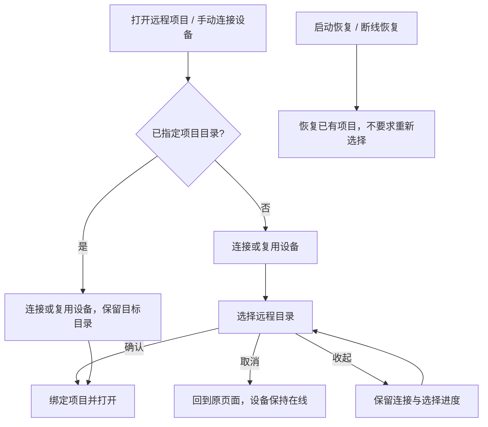
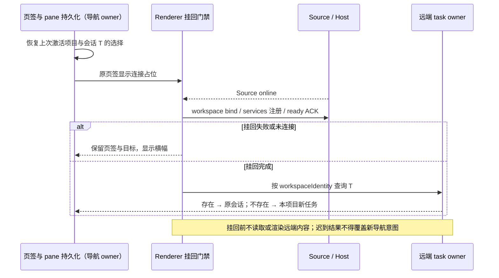

# 平铺项目导航与连接后选择远程工作区

2026-10-12 已确认下一轮目标：[项目创建与远程连接管理分离](../issues/remote-connection-ux/15-project-device-selection-and-connection-management.md)
（ready-for-agent，尚未实施）。实施该票时，项目加号入口、无目录手动连接的统一收尾和跨页草稿规则按目标规格执行；
本文的已有项目重连、启动恢复、身份隔离及历史数据边界继续有效。下文已实现标记与运行证据只对应原批次。

## 状态与范围

- 状态：已实现（2026-09-16）；A 原型已确认；本地验证通过，真实远端/手机联动验证范围见 §9。
- 来源：本轮 grill-me / grilling 讨论，Q1–Q7 已确认。
- 范围：侧栏「项目」tab、远程项目打开流程、远程无项目聊天 UI 停用。
- 覆盖 SSH / WSL / Docker / Direct Server；设备、线路、身份与连接管理模型继续沿用当前架构。
- 本规格是当前项目导航合同。旧规格的设备分组与 connect-and-chat UI 段落由本规格替代；设备、线路、Host 和数据兼容模型继续有效。
- 非目标：删除历史聊天数据、把远程聊天迁移成本地聊天、重写连接/认证/安装/升级协议、将项目列表扩展为设备文件系统或全部历史目录。

## 1. 已确认的产品决策

| 决策                 | 合同                                                                                                                                  |
| -------------------- | ------------------------------------------------------------------------------------------------------------------------------------- |
| Q1 项目展示          | 「项目」tab 删除设备层。本地和远程项目平铺在同一个「项目」分组。远程项目保留轻量设备识别信息，采用已确认的 A 紧凑设备标签与状态配色。 |
| Q2 打开项目          | 未指定项目的手动设备连接成功后选择远程目录；点击已有项目直接打开该项目；启动恢复与断线重连恢复原项目，不重新选目录。                  |
| Q3 停用远程无项目 UI | 所有新建与历史访问入口停用，历史数据保留，不再自动恢复；不迁移、不删除远端任务、索引、聊天文件或 backing workspace。                  |
| Q4 操作入口          | 设置页与远程连接弹窗继续管理设备；侧栏保留全局「打开远程项目」入口，采用「项目」分组标题加号菜单。已有项目从项目行打开/连接。         |
| Q5 排序              | 本地、远程项目共享全局顺序，允许跨设备拖动并记住顺序；连接状态变化不改变位置；离线项目行继续显示。                                    |
| Q6 取消与收起        | 取消目录选择回到原页面，释放本次未绑定项目的临时会话，设备保持在线，不新增项目或聊天，不影响其他项目；收起保留进度。                  |
| Q7 移除项目操作      | 远程项目输入框隐藏项目标签的 × 和「不在项目中工作」，保留切换项目能力；本地行为不变。                                                 |

```text
项目 tab
├─ 项目
│  ├─ 本地项目 A
│  ├─ 远程设备 1 的项目 B
│  └─ 远程设备 2 的项目 C（离线时保留）
└─ 任务
   └─ 本地无项目会话
```

本地解除项目绑定时，按完整 `workspaceKey = workspaceIdentity?.trim() || workspacePath`
匹配当前 tab；同路径远端 tab 排在前面也不能遮蔽本地项目或本地 conversation tab。
已有本地 conversation tab 直接复用；远端项目继续禁止解除绑定。

同名、同路径、不同设备的项目仍是不同条目。设备名仅用于展示，不能参与身份判等、排序 key 或持久化隔离。

## 2. 入口与连接顺序



- 无明确目录的手动入口统一进入目录选择；不创建或激活远程无项目聊天草稿。
- 已有项目、最近目录入口必须保留原项目意图；需要补凭据、安装或升级时，在向导内完成后继续原项目。
- 设置页设备卡的「最近项目」按 Source 身份和目录从本机已保存入口解析原项目，连接前固定入口 ID；在线点击和离线重连都复用已有项目恢复链路，不进入项目创建器、不新增项目。不能只传目录把打开意图降为创建意图；入口缺失或同目录有多个入口而无法唯一确定时报告无法确定原项目，保留当前页面，不猜选项目。连接完成仍按原入口及 Host 成员资格复验，移除后不复活。
- 原项目恢复在连接后从所属 Host 的项目树解析入口对应的有效项目，将其 projectId 显式传入草稿初始化并更新草稿范围；本地草稿缓存缺失或仍指向同目录其他项目时，不能替代原项目身份。旧入口复用目录 owner 的唯一匹配规则；项目缺失、已删除或目录不符时停止恢复。仅恢复已有会话的重连继续保留会话选择。
- 已保存项目不要求已存在 Renderer tab。桌面菜单由 Root 分派，未加载项目从本机成员目录解析；凭据齐全时只恢复设备。需要交互时携带精确 Profile 和原项目入口，处理完成直接绑定原目录，不进入新建项目编辑。交接及完成前验证成员仍存在；Profile 连接意图不同时携带 Source“连接后选目录”意图。
- 未加载 tab 的已保存项目，其操作线路沿用 Host 的默认 Profile 选择规则；其他线路的失败只参与设备展示，不得替换默认线路或阻止其连接。交接只使用操作线路的状态和错误。
- 原项目完成意图固定 entryId 与 host membershipId。目录绑定等异步步骤返回后，从成员目录复验原实例，再提交连接历史与导航；入口移除或成员换代使原意图取消，不回退新建目录选择，不释放其他项目复用的 attachment。
- 目录绑定成功之后才新增/激活项目。无效路径、无权限或绑定失败不得新增幽灵条目；沿用现有错误展示与目录修正能力。
- 全局新建、快捷键与历史激活路径不能通过旧 active workspace 绕过远程无项目 UI 停用。
- 打开本地项目、已有项目内的新任务、项目内任务恢复、分组管理本身保持既有语义。

### 2.1a 侧栏、详情与设备菜单（RDUX-12）

- 项目行单行展示一个五态图标、项目名、限宽设备名（在线、离线都保留设备名，见 RDUX-IDENTITY-01）。非在线时在设备名后加状态文字：展示模型为待处理（`pending`）时显示其短状态（需要更新、需要安装、需要确认新设备、需要补充密码），使用 warning 色；连接中（含自动恢复、设备在线但项目尚未就绪）显示其短状态“连接中/更新中”，失败显示“连接失败”；其他非在线显示“离线”；远端在线但项目未解析时显示“请选择项目”。不再显示额外错误图标、诊断图标、重复转圈和常驻重连按钮；连接进度与失败原因只在悬停详情中展示（见“连接进度详情”），行尾操作仅在悬停/键盘聚焦时出现，触屏保留可达入口。
- 项目行悬停 300ms 或键盘聚焦后打开只读身份详情，锚定整行右边界，避免遮挡行尾操作。点击沿用项目行原操作，不锁定详情；Escape、鼠标移出触发区与浮层、键盘移出时关闭。
- 详情标题使用同一项目显示名，状态右对齐，状态使用展示模型短状态（与项目行一致，不再显示泛化的“需要处理”）；连接中或失败时，标题下方先显示连接进度区或失败原因区（见“连接进度详情”），再列出项目、完整设备名、连接类型、地址与完整远端路径；在线和待处理不显示该区。详情没有连接、断开、编辑按钮；这些操作继续由项目菜单及设备设置入口提供。
- 待处理例外（2026-10-14，方案 C）：展示模型为 `pending` 且桌面端时，详情底部分隔线下追加一行入口「⚙ <展示模型操作名> ›」（如“更新远端”“更新桌面端”“安装并连接”“作为新设备使用”“补充密码”）。操作名与设置页设备卡读同一份连接管理器状态：项目 Host 投影随 `lastConnectionStatus` 一起带出 `upgradeTarget`，桌面端版本过旧（`upgradeTarget: controller`）时显示“更新桌面端”，不能回退成“更新远端”。点击关闭详情，打开“设置 › 远程设备”并定位该设备卡，由设置页完成实际处理；详情本身不执行更新、安装或身份确认。Web 端没有远程设备设置页，不显示该入口。说明文案暂不按场景区分。
- 远程项目菜单入口（2026-10-16）：桌面端远程项目（在线、离线、待处理均适用）的更多菜单与右键菜单提供「远程设备设置」，位于同步/连接操作之后、编辑项目之前。点击与待处理详情入口共用同一导航：打开“设置 › 远程设备”并定位该项目所属设备卡；菜单本身不执行连接、断开或更新。本地项目和 Web 端不显示。
- “项目 + → 打开远程项目”展开全部已保存设备，来源为设备管理快照，与已打开项目无关；在线复用连接进入选目录，离线先连接再选目录。末项“新建远程连接…”进入现有向导。
- 会话头部常驻状态图标与设备名；悬停项目名与完整路径与侧栏一致。输入框项目切换菜单采用紧凑同一行展示项目名、设备名和非在线状态；在线和离线均保留设备名，搜索同时匹配项目名、目录和设备名。任务行各视图共用设备标签的字号与颜色。

```text
项目行 hover/focus → 只读身份浮层 → 300ms 打开 → Escape/离开区域/键盘移出关闭
待处理详情入口 / 项目菜单「远程设备设置」 → setPendingSettingsSectionIntent(remoteDevices, sourceServerId) → 设置页定位设备卡
项目菜单连接 → 既有 Root 项目连接入口 → 原目录 attachment
菜单设备 → 既有唯一向导 → 连接或复用 → 选目录
管理设备 → 一次性设置导航意图 → SettingsPage → 对应设备卡聚焦
```

这些状态只属于 UI 导航与浮层；连接事实仍来自 Host 管理快照，项目身份仍使用 workspaceIdentity。桌面 continuous 与手机 replayable 保留各自既有恢复链路。

### 2.1b 新建空项目的状态订阅

远端项目树返回前，`bindRemoteProjectIdentities` 必须通过现有 resolver 完成全部项目 roots 与任务 cwd 的身份准备，并按路径去重。空项目也参与；不能仅凭已有 task 推导准备范围。准备失败向调用者报告，禁止发布未准备的树后提前订阅。该过程不打开 tab、不启动 Agent、不新增项目入口，目录和重复项目规则不变。

```text
所属 Host readTree → roots + task cwd 去重 → 既有身份 resolver 完成
                                         → 发布树 → Controller workspace/sessions-index 订阅
```

原因：提前创建的动态监听会固定到未映射的 emitter；稍后首次打开才注册映射，并不会自动重绑旧监听。修复在树发布边界完成准备，沿用 desktop-continuous / mobile replayable 各自的原订阅恢复与同一个远端 owner，不新增映射或重试机制。回归覆盖空项目首发权限实时显示、既有任务目录、共享 root 去重及准备失败不发布。

### 2.1 三屏选择与收起（RDUX-10）

“打开远程项目”固定从可搜索统一列表进入，来源与平台门禁见 [UX 规格](../architecture/remote-device-connection-ux-spec.md#三屏向导与统一选择2026-09-28rdux-10)。设备行连接后选目录；最近目录 chip（包括离线设备）连接后打开该目录。首屏内的新建表单不增加进度步骤。

项目区顶部为收起中的唯一向导预留显示位置：两行卡片显示设备、阶段比例及当前阶段；失败卡片保留原因并点击恢复，查看前不自动弹窗。卡片由向导会话直接渲染，侧栏仅提供 DOM 容器，不持有请求、日志或状态副本。关闭清空草稿、取消连接，输入历史继续保留。恢复卡片沿用原意图；新的显式入口使用独立意图标识，空闲或失败流程让位并撤销旧 epoch 与确认等待，重新消费最新 Profile/目标与目录；真正进行中或已有待绑定 session 的流程不被抢占。该入口状态仍由唯一向导 owner 持有。

### 2.2 断线体验与原地重连（RDUX-08）

- 侧栏重连按钮、离线项目行、详情卡和设置页共用连接意图：携带目录时恢复原项目；未携带目录时连接后选目录。选目录提供“稍后选择”，关闭向导、释放未绑定项目的临时 attachment，设备保持在线，不新增项目。
- 已有项目先走 Root 现有重连通路，凭据齐全时不弹向导，项目展示模型显示连接中。成功不抢占当前页面。需要补凭据、安装、升级或身份确认时，唯一向导直接进入连接步骤的对应等待点，保留目录意图。
- 手动原项目连接交接的 `source-server-upgrade-required` 沿用主规格 §6.3：向导读取 Host 最新快照，确认升级对象为远端后自动执行一次 `force:false` 更新，再继续原目录。运行任务守卫仍要求明确确认；本机过旧只提示更新本机。取消或切换意图使旧异步结果失效，收起/恢复不重复更新；更新失败或更新后仍不兼容保留显式重试入口，不自动循环。启动和断线后台恢复继续等待用户操作。
- 升级前读取 Host 快照失败时，普通连接和原项目交接均展示实际读取错误并提供“重试”，不保留没有更新目标的“更新远端”按钮，也不使用旧快照自动更新。显式重试沿用原线路和目录，重新连接并核验升级；取消后晚到的读取异常不得覆盖取消状态。
- 兼容性失败携带 Host 本次实际使用的 `profileId`，经 Main/平台连接结果和原项目失败交接保留到向导。向导按该 ID 和本次失败的规范化目标核验最新快照的线路与升级状态，以失败时的实际连接参数继续原意图；WSL 的默认发行版、默认用户由 Main 解析，不能再用未解析参数重建线路身份，也不能把省略用户当作任意用户匹配。缺少 ID 的旧调用保留精确目标匹配；指定 ID 已移除或没有可执行升级状态时提供重试，不选择其他线路、不留下空操作更新按钮。本机过旧仍只提示更新本机。
- 升级恢复固定本次失败的目标身份，不能用同 ID 的最新 Profile 覆盖后再匹配。原项目异步重连交接保留非敏感 `failedTarget`；打开向导后若 Profile 已改址，不读取新线路凭据。WSL 升级失败也携带 `resolvedWslTarget`；没有实际发行版/用户时停止自动更新并提供重试。最新线路改址、移除或退役时停止旧恢复，不更新或重连新目标，保留原目录意图。
- 向导自动更新、显式更新及运行任务确认后的强制更新均提交非敏感 `expectedTarget`。Host 在更新入口校验身份，从已读取的同一 Profile 解析并固定执行目标；快照核验后改址必须被拒绝，Host 已接纳后改址不得使执行目标漂移。仅改显示名不改变目标身份。沿用原 requestId/entryEpoch，不新增持久化修订或恢复 owner。
- WSL 首次安装等待也保留 Host 的 `profileId`，并携带只含实际发行版和用户的 `resolvedWslTarget`。向导以该实际目标显示安装预览、等待确认和继续原目录；预览快照失败只影响附加信息，不丢安装等待和目标。确认前修改系统默认发行版或用户，不得改变已等待的安装目标。取消、关闭或换入口后，迟到快照和旧确认不能恢复安装。
- WSL 表单在接受连接目标时同步发行版和用户，缺省字段清空；已保存线路连接失败后返回配置、安装等待返回配置、升级后返回配置均编辑当前目标，不借用上一条线路的输入。默认发行版/显式发行版与默认用户/显式用户的四种组合均保留相应意图；Host 已解析的安装/升级等待使用实际参数。
- 普通重连失败保留项目行及分类原因；再次点击进入向导连接步骤并展开失败日志，不自动再次拨号。明确点击重试才发起新请求。
- 会话 attachment 未就绪时保留页面横幅、内容占位和已有草稿，禁用发送，不创建离线队列、不在恢复后自动发送。只有现有会话 owner 仍持有的内容才可变淡只读展示，不新增内容缓存。
- 时间线、分组、置顶、归档各为离线项目保留一行连接占位，隐藏过期任务。搜索与发送竞态错误使用可读的远程连接分类文案。

```text
项目入口 → Root 重连 owner → Host 连接 / attachment admission
             ├─ 成功 → 原项目就绪；不改变当前页面
             ├─ 待处理 → 唯一向导接管原目录意图 → 用户处理 → attachment admission
             └─ 失败 → 项目行原因 → 用户查看 → 向导连接步骤与日志
服务失效 → 既有挂回门禁关闭 → 横幅 + 占位 + 草稿（禁止提交）
desktop-continuous / web-remote-replayable → 各自现有恢复边界 → 同一远端任务 owner
```

### 2.3 重连与重启后回到原处（RDUX-09）

- 恢复目标继续归属现有页签持久化：TabStore / `lastWorkspaceSession` / `lastActiveTabIndex` 保存项目与激活位置，Layout 的既有 `usePaneSessionPersistence` 保存该 workspaceKey 的最后会话 ID。两者只保存导航选择，不保存远端内容，也不新增恢复 owner。
- 主窗口冷启动恢复上次激活的项目（包括远程项目）与会话；`restoreTabs` 标记启动激活页签，只有该页签可消费冷启动会话选择。显式打开项目、新窗口和新任务继续遵循原导航意图。后台补齐 tabs 或 Source 恢复不抢焦点；同路径不同设备按 identity 隔离。
- Host 本地预热仍只选择本地 workspace。Renderer 激活远程页签不代表 Host 可按远程路径预热；二者不再强制选择同一项目。
- 依照 [Renderer 挂回门禁](./desktop-remote-session-renderer-reattach.md)，Source online 后仍须完成 workspace bind、services 注册与 ready ACK；首次挂回前只能显示连接占位，不订阅或渲染远端会话。恢复终态为未连接或失败时，停留在原页签显示既有横幅，不自动跳本地。
- 挂回成功后保持原会话选择，不调用新任务动作。仅对启动恢复与 attachment 挂回瞬间的既有选择，通过该 workspace 的权威 `getTaskMeta` 确认会话已不存在时才进入本项目新任务页并清除旧选择；正常新建任务 ACK 早于索引落盘，不参与这项缺失判定。RPC 失败不是会话删除。切换项目、会话、新建草稿或 services 换代后丢弃旧查询结果。
- 已经加载且仍由现有会话 owner 持有的断线内容，继续沿用 RDUX-08 的只读保留规则。这里不改变任何 Source 自动连接 eligibility、生命周期、重试或身份规则。
- 仅桌面 `desktop-continuous` 消费启动导航恢复；手机 `web-remote-replayable` 不读写桌面 pane 选择，仍由原 attachment / snapshot / gap 流程恢复。



验收复用页签持久化、pane 恢复与挂回测试边界；真实 SSH 冷启动用例 `SSH-P0-LIFE-01` 增加原激活项目/会话、挂回占位、手动重连保留选择与已删除会话回退断言。手机现有 replayable 单测与联动用例作为不变边界回归。

### 2.4 远程项目目录被外部删除

- Host 在首次打开、显式绑定和断线恢复的工作区 admission 中，通过当前远端 File Service 确认目录可读取、可遍历，再准备身份映射。复用已有 `readdir` RPC 读取 `workspacePath + "/."`；保留末尾 `/.`，使远端文件系统同时验证目标目录的遍历权限。目录自身的 `stat` 成功不能证明访问权限；不依赖远端 Server 升级，不使用控制端本地文件系统检查远端路径。
- 只检查目录访问，不要求写权限；只读但可读取、可遍历的目录仍可打开。检查只列举根目录，不递归扫描；身份和持久化继续使用原路径，探测路径不得变成新的 workspace identity。
- 目录不存在、路径不是目录或权限不足时，返回 `remote-workspace-directory-unavailable`，只使该项目恢复失败。设备保持在线，同设备其他项目继续恢复；即使由无效项目发起 SSH 重连，也不能把目录错误当作凭据失败阻止其他项目。
- 已打开项目仍保留在侧栏和持久化 open set，显示失败及目录不可用提示；不标记 connected，不自动删除任务历史，不重新创建用户删除的目录。用户恢复目录后可以重试。新选取的无效目录不得新增项目。
- 目录校验使用现有 Host scope 和取消信号；取消后的迟到结果不得继续绑定身份或记录打开历史。桌面 continuous 与手机 replayable 共用该 Host 边界，不新增连接或任务 owner。
- 这是打开/恢复时的校验，不新增在线目录监视器；绑定完成后再删除目录的文件操作仍按其原有 I/O 错误处理。

```text
Source Manager：设备上线
  -> Host 工作区 admission：远端 readdir(目录/.)
       -> 可读取且可遍历：身份映射 -> 原有 attachment/Controller -> 项目已连接
       -> 无效目录：项目失败 -> 保留历史条目；其他项目继续 admission
```

## 3. 停用覆盖面与历史数据

依据远程 workspace 身份及 `workspacePurpose=conversation` 判定远程无项目会话，不按“远程任务”或路径名过滤；远程项目中的正常任务继续可见、可用。

停用面至少包括：

1. 侧栏远程「任务 +」、设备卡「在此设备聊天」、设置页设备「新建任务」。
2. 手动连接成功默认打开 conversation 的分支。
3. 输入框远程项目标签 × /「不在项目中工作」。
4. 「分组」、置顶、搜索、时间线、归档及其他历史入口中的远程无项目会话。
5. 启动恢复、Renderer 重挂、设备上线恢复中的旧 conversation open entries。
6. 全局新建、快捷键与已持久化 active workspace 恢复中的旁路。
7. 手机远控中对应的历史入口；保留桌面本地无项目聊天与远程项目任务。

历史任务数据、原始会话内容及远端 backing 目录保留。过滤 UI open membership 与删除远端数据是不同操作，不得借本次变更执行远端数据清理。底层 conversation 能力是否被其他调用方依赖须在实施时核实；本规格不授权无关服务删除或存储迁移。

## 4. 状态所有权与多端边界

| 状态                        | 权威 owner / 边界                                                                          |
| --------------------------- | ------------------------------------------------------------------------------------------ |
| 设备、线路及 online/offline | 既有 Source Directory / Host connection manager；移除展示层不等于删除设备模型。            |
| 项目身份                    | `workspaceIdentity?.trim() \|\| workspacePath`；跨设备同路径不能合并，路径用于展示与执行。 |
| 项目列表与顺序              | 沿用现有 workspace/open-set 与排序持久化通路，不引入按设备的第二份 accepted 顺序。         |
| 目录选择草稿                | 唯一远程连接弹窗；取消、收起、确认分别沿用既有生命周期通路。                               |
| 任务与消息                  | 原有 CLI/runtime owner，不把状态迁入 sidebar、main 或 relay。                              |

```text
desktop-continuous   → 既有直接实时链路 ─────────────┐
                                                    ├→ 既有 Host / CLI 状态所有者
web-remote-replayable → shared-host attachment → 恢复边界 ┘
```

- 手机 `/remote` 继续附着桌面已有 Host，不创建独立 Agent、SSH/WSL/Docker session 或 local host。
- 远程路径全链路保留 `workspaceIdentity` 与 `remoteSessionId`；不改变 owner/lease 路由与 stale-run 防护。
- 手机端设备管理/新建连接能力不因布局原型而扩展，对应 UI 遵循现有 platform capability。
- 设备上线、离线及 attachment 恢复不重排项目；用户手动排序才更新排序事实。
- 浅色/深色、桌面/窄屏、中文/英文均需验证，不以 hover 作为唯一设备识别方式。

## 5. 展示规则

项目行、详情与设备菜单以 §2.1a 为准；颜色、图标和状态优先级只引用
[UX 五态表](../architecture/remote-device-connection-ux-spec.md#统一展示合同2026-09-27rdux-03)。
旧 A/B/C 原型讨论及绿/蓝/橙/红四态已退出，不作为当前视觉验收依据。

## 6. 验收用例

以下是已确认合同的验收清单。测试先于实现；已执行的单测与本地 Electron E2E、尚未验证的真实环境见 §9。

| ID     | 场景 / 操作                              | 断言                                                                           |
| ------ | ---------------------------------------- | ------------------------------------------------------------------------------ |
| RPN-01 | 本地与两个远程设备均有打开项目           | 单一「项目」分组，无设备层，远程项目身份独立。                                 |
| RPN-02 | 两设备的项目名称与路径相同               | 可识别所属设备，点击进入各自 workspace。                                       |
| RPN-03 | 跨设备拖动并重启                         | 顺序保留，设备上线/离线不重排。                                                |
| RPN-04 | 离线后点击原项目                         | 行继续存在，连接后打开原目录，不新建远程无项目草稿。                           |
| RPN-05 | 各远程类型手动连接，未指定目录           | 成功后选择目录；确认前不新增项目或远程聊天。                                   |
| RPN-06 | 原项目连接要求补凭据/安装/升级           | 连接完成继续原项目，错误可重试，无静默死路。                                   |
| RPN-07 | 连接成功后取消选目录                     | 原页面保留、设备在线、其他项目不受影响、项目/聊天数量不变。                    |
| RPN-08 | 目录步骤收起后恢复                       | 进度与选择保留，不取消连接。                                                   |
| RPN-09 | 启动与断线恢复                           | 恢复原项目，不弹目录选择；旧远程 conversation 不恢复。                         |
| RPN-10 | 历史远程无项目会话在分组/置顶/归档等索引 | 全部 UI 入口隐藏、数据保留；远程项目任务正常。                                 |
| RPN-11 | 远程输入框、全局新建与快捷键             | × /「不在项目中工作」不可见；不能进入远程无项目聊天。                          |
| RPN-12 | 本地项目与无项目会话                     | 原有新建、解除项目、历史访问不回归。                                           |
| RPN-13 | 桌面与手机访问同一远程项目               | shared-host 与身份隔离保持，continuous / replayable 不混用。                   |
| RPN-14 | 深浅主题、中英文、窄屏、键盘             | 设备可辨、状态不只靠颜色、菜单不裁切、焦点可见。                               |
| RPN-15 | 无效目录或绑定失败                       | 错误留在选择流程，不新增项目、不切换执行设备。                                 |
| RPN-16 | 三个远程项目中一个目录被外部删除后重连   | 设备在线、其余项目恢复；被删项目保留但显示失败，不重建目录；恢复目录后可重试。 |
| RPN-17 | 桌面端远程项目更多菜单/右键菜单          | 有「远程设备设置」，打开设置页并定位所属设备卡；本地项目与 Web 端无此项。      |

## 7. 手动连接与自动恢复

### 手动连接与自动恢复的互斥边界

Root 的当前连接意图保留已有目标 tabId（窗口内既有标识，不是新 workspace identity）。向导活动或收起期间，设备上线恢复只处理其他项目；该 tab 的目录绑定由向导完成。tabId 随 legacy → stable identity 重投影保持不变，因此不会因换 key 失去互斥。向导完成/取消后解除门禁，恢复仍按现有 open membership 判断；收起不清意图，也不在恢复弹窗时自动重试失败连接。

```text
Source online
  ├─ 当前向导持有的 tabId → 向导完成原目录绑定
  └─ 其他已打开项目       → 既有自动 attachment 恢复
向导完成/取消 → 解除临时门禁；收起 → 保持意图与错误
```

该边界不新增 accepted queue、Host owner 或连接缓存，只让 UI 既有两条入口服从同一显式用户意图。RPN-04、RPN-08 单测先证明了重复 admission 和收起后意外重试，再验证修复。

## 9. 验证记录与限制

### 设置页最近项目恢复（2026-10-16）

根因是设置入口只传 Profile 与目录，Root 未收到已保存入口 ID，因而跳过原项目恢复分支。修复复用侧栏目录 owner，在点击时按 Source 与目录固定唯一入口 ID；连接完成继续原有成员复验与导航，不新增状态缓存或重试。

同日评审补充修复：入口校验后仍未传递 projectId，草稿会沿用本地缓存，缺失时成为未归类，过期时指向其他项目。恢复现从所属 Host 解析有效项目，把项目 ID 交给 Root 草稿 owner，同时更新内存与持久化范围；显式项目草稿与恢复旧会话选择互斥。

- 回归先确认缓存缺失与错误缓存两项失败，再验证正确缓存、持久化范围及同 tab 后台重连交叉场景；最终以 `1d187f8f691a9e9e5cf27156ef2826d435d87ec9` 为起点选中的 43 个受影响测试文件 / 535 项通过，定向回归同时覆盖旧入口解析与成员失效。typecheck、Lint（0 errors）、架构和变更代码格式检查通过。
- 最终源码的 macOS Desktop + 全新 Linux SSH 容器 E2E run `desktop-e2e-20261016141425114-p13665-2cfa998be7b5adba` PASS：在线缺少草稿缓存、离线残留其他项目缓存时均恢复原项目并校正持久化范围，入口集合不变，无创建弹窗。深浅主题与三档宽度截图沿用 RDUX-13-03；未发送模型请求。
- 首轮 run `desktop-e2e-20261016140536472-p84812-8785189417c54ffb` 在首次打开项目时出现 renderer attachment 未就绪，随后超时，尚未进入新增缓存断言；该次失败原因未定，保留记录且不计为功能通过。重新构建的第二轮及上述最终轮通过。未实跑 Windows/Linux Desktop、WSL、Docker transport 或手机；设置设备管理入口仅桌面开放，候选 E2E 仍为 pending。

- 先修改 RDUX-13-01 E2E，在修复前的 macOS Desktop + 全新 Linux SSH 容器中确认创建弹窗断言失败（run `desktop-e2e-20261016134122289-p3441-1b5b8c7e11c117a8`）。
- 修复后完整 E2E run `desktop-e2e-20261016134749964-p14872-919a9a258f3e5144` PASS：通过本机 Docker 新建的独立 SSH 容器完成真实安装、连接、在线点击和断线后点击；原 workspace identity、项目 ID 与本机入口集合保持不变，无创建弹窗。深浅主题 × 1440/900/480px 截图保存在该 artifact。未发送模型请求。
- 首次修复后运行已通过最近项目断言，随后旧的历史连接折叠检查因仍有后台流程而失败；测试改为关闭失败流程后验证默认折叠，保留原断言。另一次复用构建运行在 Host 启动时失败，未进入业务场景；重新构建后的上述完整运行通过，不将启动失败计为功能通过。
- `pnpm typecheck`、Desktop E2E 类型检查、Lint（0 errors）、架构门禁、变更代码格式检查通过；以起点 `38c8129a54edc615c7c41950ea929e7a539427e7` 选择的 478 个受影响单测文件 / 5108 项通过。定向测试覆盖跨 Source 同路径隔离、无 tab、旧入口、入口/Host 缺失和歧义；已有恢复交接回归继续覆盖成员失效。
- 本轮未实跑 Windows/Linux Desktop、WSL、Docker transport 或手机端；设备管理页只在桌面开放，shared-host、continuous/replayable、Host 与 CLI 均未修改。候选 E2E 保持 pending，未人工转正或加入 CI。

### 连接意图隔离回归（2026-09-16）

已有项目进入向导时，外部偏好只初始化一次当前连接意图；后续补凭据、安装、升级和重试读取向导的 `pendingCompletionIntentRef`。设备页明确选择「新建连接」或另一条线路时，取消旧项目目录和 Root 持有的 `preferredWorkspaceTabId` 恢复互斥，未指定目录的连接成功后必须进入目录选择。

表单凭据只属于当前目标。自动回填另一设备（包括 Profile 凭据缺失后返回配置）必须清除上次的密码、私钥口令和 Server token；不能把缺凭据变成复用另一设备凭据。回填已有 SSH 目标时保留该目标的 `assetInstallMode`，只有新建线路使用默认下载方式。同一意图收起/恢复保留草稿，不重新消费外部偏好。

```text
已有项目偏好 → 向导当前意图 → 补凭据 / 安装 / 重试 → 原项目目录
                      └→ 明确新建 / 改选线路 → 清旧凭据与项目意图 → 选择新目录
Root 仅持有当前项目的恢复互斥；取消项目意图后立即释放。
```

回归对应 RPN-05/06/08：真实表单组件测试覆盖两种目标入口、密码/私钥口令/Server token 隔离、新建连接与改选线路、安装重试和下载方式；本地 Electron 用例覆盖项目入口、表单回填及新建切换。修复只在 UI 意图边界，不改变 Host、协议、任务数据或 desktop continuous / mobile replayable 链路。

修复验证：`sshDialogConnectionIntent.test.ts` 的 12 个真实表单场景通过（修复前 10 个失败、2 个通过），相关 32 个测试文件/221 个用例通过。Electron run `desktop-e2e-20260916065031134-p97183-32bff41d1e35e7a9` 通过，截图为 `rpn-connection-intent-isolation.png`；断言设备 A → B 清空密码、已有线路保持远端下载、新建恢复默认下载方式。该 E2E 不发送 prompt、不拨号；成功连接后的目录回调与安装重试由组件边界测试验证，真实远端安装/升级及手机 shared-host 仍未实测。

2026-09-16：

- 定向/相关单测：96 个文件、673 个用例通过。覆盖项目用途过滤、同路径隔离、展开与排序、恢复保留数据、手动/后台恢复互斥、连接后目录选择、原目录跨升级保留、凭据门禁、收起后不重试、移动端历史投影与连接地址脱敏。
- `pnpm typecheck`、`pnpm --filter @zcode/desktop typecheck:e2e` 通过；`pnpm lint` 0 错误，57 条存量警告，没有新增警告。
- `pnpm architecture:check --changed`：0 违规。Feature graph 节点唯一，新增悬空边为 0；全图存在 4 条相同的基线悬空边，本轮未处理无关图谱数据。
- 全局 `audit:conversation-session-coverage` 未通过：37 项既有问题（27 个旧 pending fixture 元数据、旧矩阵统计/引用和生成文档）。在审计输入与 HEAD 一致的原型 worktree 上对照运行，37 项完全相同，新增问题为 0；未改写无关基线数据。
- 新增本地 Electron E2E：`packages/desktop/test/e2e/conversation-session/manual-review/pending/conversation-session-rpn-project-navigation.test.ts`，已通过。
- E2E run：`desktop-e2e-20260916060143354-p74119-7eab82eb8a75775c`。隔离 HOME 中预置两个设备的同路径离线项目及一个历史远程 conversation；确认平铺、单一项目/任务分组、设备详情隔离、查看详情无连接副作用、Escape 不重开 tooltip、旧 conversation 不恢复、canonical 数据保留、项目名点击进入唯一连接向导。截图 `rpn-project-sidebar.png` 保存在该 run artifact 下。
- E2E 未发 prompt、未连接真实远端；复用未改动的已构建 CLI（`ZCODE_E2E_SKIP_AGENT_BUILD=1`），Desktop/UI 从当前工作树重新构建。
- SSH helper 的普通连接流程已要求进入目录步骤，不再把向导关闭当作新建远程无项目聊天成功。

新 E2E 仍位于 manual-review/pending，本轮未进行人工转正或 Docker 准入。旧设备组头/connect-and-chat 专用 pending 用例属于被替代的 UI 合同，不作为新功能验收；正式 E2E 未发现对这些撤销入口的直接引用。

尚未完整执行真实 SSH / WSL / Docker / Direct Server 的连接、安装、升级和断线恢复，以及手机真机 shared-host 联动。相关完成回调/恢复门禁通过组件与状态单测覆盖；不能把这些测试描述成真实远端或手机 E2E 通过。

回滚可整体撤销本次实现提交。没有删除远端会话、任务文件或 canonical conversation 映射，没有改变协议、owner/lease、continuous/replayable 或物理连接管理。

## 连接进度详情（2026-10-15）

回归背景：10-10 合并丢失 Host 对项目连接的 `onLog` 注入，Main 也从未登记 `project-connection:*` requestId，侧栏 (i) 诊断 Tooltip 一直为空；同时连接中的项目行状态文字落入“离线”分支。修复后侧栏不再走 requestId 文本日志，改读连接管理服务的结构化操作日志，原通道与诊断图标删除。

面向用户而非开发者：不展示原始日志行、时间戳或等级。采用已确认原型 D（浅色语义底区块 + 分段进度条）：

```text
┌ 项目名 ─────────────────────── 连接中 ┐
│ ┌──────────────────────────────────┐ │
│ │ ⟳ 安装 ZCode Server 43%            │ │  当前阶段 + 仅上传/下载时的百分比
│ │ ▬▬▬▬ ▬▬▬▬ ▬▬── ────               │ │  4 段：完成填满、当前按进度、未开始为空
│ │ 第 3/4 步 · 已用 32 秒 · 自动恢复 2/3 │ │
│ └──────────────────────────────────┘ │
│ 项目 / 设备 / 连接 / 连接地址 / 目录    │
└──────────────────────────────────────┘
```

- 阶段与连接向导（RDUX-11）共用同一阶段投影：连接设备 / 识别设备 / 安装 ZCode Server / 启动并检查兼容性；原始 phase 归并规则只有一份。跳过的阶段（如已安装时的安装阶段）随后续阶段一起显示为完成。尚无日志时显示第 1 步。
- 百分比只来自当前上传/下载日志的 `progress`；其他阶段的当前段整段呼吸。
- 已用时间从本次操作首条日志时间算起；新操作（含自动恢复的每次尝试）替换旧日志，计时随之重置。计时器只在详情打开期间每秒刷新，仅用于展示，不参与超时判定。
- Host 的最近日志保留的是“最近一次操作”，不一定是“进行中的操作”。最后一条为成功终态（`ready`）或失败（`error` 等级）时，该操作已结束：意外断线后首次重试前、两次重试之间都属于这种情况。此时按“尚无日志”展示（第 1 步、不显示耗时），只保留“自动恢复 n/m”；下一次尝试开始后 Host 替换日志，进度随之出现。
- 自动恢复 `n/m` 来自状态注册表中该设备的 `recoveryAttempt/Limit`；项目行仍只显示“连接中”。
- 失败（展示模型为 `failed`，或离线且带错误）时显示浅红底区块：按错误分类显示可读原因，无法分类时显示“连接失败”；附“复制错误详情”按钮，复制与原诊断入口相同的连接错误原文（Host 投影的 `lastConnectionError` 或旧 workspace 错误），原文不直接展示；“已复制”只对应被复制的那条原文，错误变化后恢复为“复制错误详情”。
- 数据只读：`host.id` → `sourceServerId`（与 Host 侧 `resolveProjectHostService` 相同解析）→ 状态注册表输入（`profileId`、恢复次数、错误码）→ `getRecentOperationLogs(profileId)`。详情关闭时不订阅日志；URL Server 直连（以及尚无 `sourceServerId` 的 Host）没有 Source 管理域，连接中不显示进度区，只保留标题右侧的“连接中”；失败区不受影响。
- 手机 Web 远控没有 hover，只获得项目行状态文字修正。

```text
Host 连接管线 → SourceServerOperationLogs（唯一日志 owner）
      │ onDidAppendOperationLog（仅作失效通知）
      ▼
详情打开 → useSourceServerOperationLogs([profileId]) → 阶段投影（与向导共用）→ 进度区
状态注册表（sourceServerId）→ 恢复次数 / 错误码 ─────────────────┘
```

验证（2026-10-15）：macOS Desktop + 独立 Linux SSH 容器 `retry-budget` E2E `hovercard-retry-20261015-r3` PASS。断网后项目行显示“连接中”且没有诊断图标；详情保持打开期间“自动恢复 1/3、2/3、3/3”实时递增，耗尽后同一浮层切换为失败区（可读原因 + 复制错误详情）；放通后静默恢复与手动接管仍各得新 session。此前 `displayedAttempts=[]` 的已知失败（remote-e2e-stability #20）在详情中可见。

## 远程身份悬停详情（2026-10-13）

聊天框项目菜单和侧栏远程项目行共用只读详情浮层。侧栏会话行（项目内、置顶区和最近更新）在 hover 或 focus 时不显示远程身份详情，仍保留原有会话操作。展示项目、完整设备名、连接类型、地址、目录与现有五态；同名项目按 Host + 项目 ID 区分，名称来自既有 Source 名称投影，地址和状态来自对应 Host，不能用当前活动设备代替。离线项目仍可查看，选择和导航权限不变。

采用已确认的「紧凑同一行」原型。浮层没有关闭叉和点击锁定；鼠标离开触发区域与浮层后自动关闭，键盘移出焦点或按 Escape 关闭。详情文字可以选择和复制，但选区不锁定浮层；选中文字后直接移出、返回触发区再移出或键盘移出，均须关闭。触发区与详情区之间移动保留原有关闭缓冲。移入浮层可以读取完整文字，不遮断原有项目展开、选择、拖拽和任务操作。触屏保留可见设备名，详情不改变原有选择语义。中英文、长名称/路径、深浅主题、桌面与手机共享视图均适用。

聊天框项目菜单中的详情使用菜单所属浮层层级，不能被菜单裁切或盖住。详情以菜单外边缘为横向锚点，外沿间距统一为 4px，有无滚动条、搜索过滤后及左右避让时均保持一致；空间不足时沿用既有左右避让，并按实际可用宽度收缩。详情与菜单不重叠，菜单选项仍可操作。菜单在鼠标离开项目项时将焦点收回容器，不代表离开详情，不能关闭已移入的详情；真正离开触发区与详情区、键盘切换或 Escape 仍按既有规则关闭。在线和离线项目均适用；验收须检查详情边缘的实际命中元素，不能只检查 DOM 存在或文字内容。

```text
既有 Host 目录 + Source 名称投影 → 项目身份 → 侧栏项目行/聊天项目菜单共用只读浮层
侧栏会话行 hover/focus → 原有会话操作，不挂载远程身份浮层
鼠标进入/键盘聚焦 → 展示 → 离开区域/移出焦点/Escape → 关闭
```

历史验证（包含旧任务详情合同）：远程侧栏与真实任务 E2E 3/3 PASS（`r3-server-ui-identity-20261013-r6`），手机 shared-host 与项目菜单 PASS（`r3-server-ui-identity-20261013-r5`）；中英文、深浅主题、在线/离线及宽窄布局已检查。运行环境与历史失败记录见 case catalog 的 2026-10-13 修复节。

2026-10-14 会话 hover 范围调整：移除会话行身份浮层，项目行与聊天项目菜单保留。组件回归先复现三种会话视图弹层，再验证 hover/focus 不再展示。macOS Desktop + 独立 Linux SSH 容器 E2E `task-hover-20261014-r2` 2/2 PASS，验证项目详情仍可打开、会话 hover 无详情。首轮测试因 DOM 选任务后鼠标未离开项目行而未产生新的进入事件，修正测试动作后通过；没有修改产品浮层时序。本轮未重跑 Windows/Linux Desktop 或手机 shared-host，候选仍为 pending。
