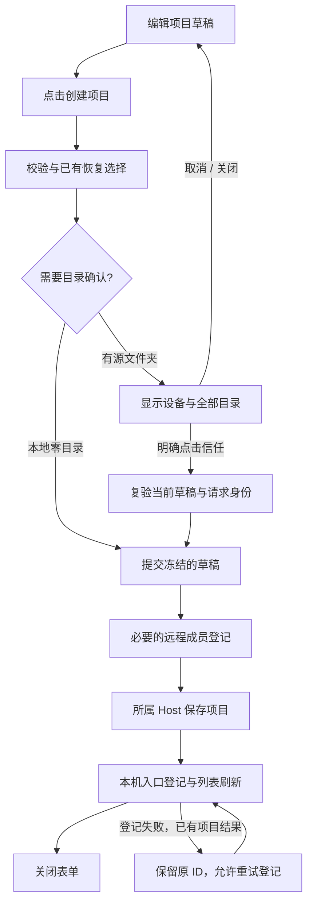

# 创建项目前确认信任文件夹

状态：已实现，2026-10-13。Q1–Q3 已逐项确认；用户授权按本方案开发。统一创建入口、恢复确认及交互细节纳入本次变更；验证范围见第 10 节。

## 1. Feature Summary

| 项目          | 内容                                                                                       |
| ------------- | ------------------------------------------------------------------------------------------ |
| 已确认需求    | 有源文件夹时，点击「创建项目」后须明确确认信任才创建；本地空项目直接创建                   |
| 能力 / 变更层 | 项目创建目录确认；presentation、validation、commit-effect；无新增持久化                    |
| 工作模式      | implemented；先补失败测试，再实现共享创建确认                                              |
| 源码基线      | `842da373332763dd39fec2bebb4f80c817b410af`                                                 |
| 主要入口      | `ProjectCreation` → `ProjectEditor.save` → `IProjectService.saveProject`                   |
| 实施范围      | 创建流程的目录访问确认，涵盖本地与远程，以及复用该流程的桌面、Web/手机入口                 |
| 暂不扩展      | Hook 自动授权、持久目录信任注册表、已有项目迁移、编辑项目新增目录、deep link、任务权限模式 |

当前项目约束见[虚拟项目规格](../superpowers/specs/2026-09-09-virtual-project-design.md)、[项目规则整合](../superpowers/specs/2026-10-10-session-manage-upstream-integration.md)、[本地目录选择](../ui/project-local-directory-picker.md)。安全边界见[工作区 Hook 信任](workspace-hook-trust-persistent-only.md)和[项目配置信任边界](../security/deep-link-project-trust-boundary.md)。

## 2. Clarification Log / Boundary Decisions

| ID  | 决策                             | 结论 / 建议                                                        | 状态与影响                                               |
| --- | -------------------------------- | ------------------------------------------------------------------ | -------------------------------------------------------- |
| Q1  | 「信任」是否同时授权自动执行配置 | 只确认本次项目目录访问；Hook 仍按现有规则单独信任                  | 用户已确认；不修改 Agent admission 或 Hook Trust         |
| Q2  | 同一目录再次创建项目是否重复确认 | 每次创建都确认，不新增永久信任记录                                 | 用户已确认；不新增信任存储、迁移或撤销入口               |
| Q3  | 本地零目录项目是否弹窗           | 直接创建，首次使用时沿用现有默认目录规则                           | 用户已确认；创建阶段不提前生成默认目录                   |
| Q4  | 复用创建流程的远程、Web/手机入口 | 统一确认所选 Host 的真实目录；远程保持唯一 root                    | 纳入本次开发；手机展示 Host 的目录，不表达为手机本机目录 |
| Q5  | 恢复、编辑、添加已有远程项目     | 经「创建项目」恢复也确认；编辑和仅添加已有远程项目入口暂不增加弹窗 | 纳入本次开发；后两者保持现有行为                         |

目录确认只作用于本次创建，不建立永久安全授权。现有服务调用方、CLI、deep link 不会因此获得新的全局目录准入机制。

## 3. 交互与状态顺序

1. 用户仍先填写名称、设备和源文件夹；目录选择只修改表单草稿。
2. 点击「创建项目」后先执行现有表单校验和恢复项目选择。恢复选择仍保留原来的「恢复或继续新建」语义。
3. 本地零目录项目直接保存，首次使用时沿用现有默认目录规则。有源文件夹时，对本次目标冻结 `hostId + roots + primaryRoot + name + restoreProjectId`，再展示信任弹窗。确认框打开期间，底层表单不可操作。
4. 确认后提交这个快照。取消、关闭按钮、Escape 或遮罩关闭均回到原表单，保留名称、设备、目录和主目录，不保存项目。
5. 保存失败显示原有错误并保留草稿。远程保存已成功但本机入口登记失败时，沿用 `created` 结果重试登记，不再次创建或再次索取本次目录确认。

文案：

- 标题：单目录「信任此文件夹吗？」；多目录「信任这些文件夹吗？」。
- 内容：设备名称和完整目录列表；路径使用等宽字体，可选择复制、换行和滚动，不能只显示末级目录名。
- 说明：「ZCode 可在当前权限设置允许的范围内读取、编辑这些文件夹中的文件，并运行命令。请仅在你信任列出的所有文件夹时继续。」
- 主操作：「信任文件夹并创建」；恢复时用「信任文件夹并恢复」。次操作：「取消」。

弹窗采用现有 Dialog/Button 的主题与尺寸规则，遵守 [DESIGN.md](../../DESIGN.md)，不复刻图片中的大号胶囊按钮。窄屏允许路径区滚动，操作区保持可见；覆盖中英文和当前深浅主题。

焦点初始落在取消操作，Tab 可到达信任按钮。仅信任按钮上的 Enter/Space 或点击才确认；不使用全局 Enter 接受。取消后焦点回到原创建按钮。切换标签页隐藏父表单时，子弹窗同步隐藏并作废旧确认；不能在隐藏的表单中继续提交。

## 4. UI Surface Matrix

| 场景 / 入口                      | 共享实现与草稿                                                   | 默认 / 校验                                                  | 提交与权威落点                              | 模式与隔离                                              |
| -------------------------------- | ---------------------------------------------------------------- | ------------------------------------------------------------ | ------------------------------------------- | ------------------------------------------------------- |
| 侧栏项目加号                     | `ProjectCreation` → `ProjectEditor` 持有 name/host/roots/primary | 沿用设备默认值、本地 0..n 与远程 1 root 规则；创建前增加确认 | `onBeforeSave` → `saveProject`；Host 项目库 | Desktop/Web/手机共享；不受当前其他 tab 的 cwd 影响      |
| 聊天项目菜单「在此设备创建项目」 | `ProjectComposerMenu` → 同一 `ProjectCreation`                   | 预选返回的远程设备；其余同上                                 | 同一保存链与远程入口登记                    | 不创建聊天，不修改输入框文本或附件                      |
| 远程项目选择器内新建             | `RemoteProjectPicker` → `ProjectEditor(project=null)`            | 使用明确 host 与 initialRoots                                | Host 保存后由原 add 回调登记入口            | 必须经过同一确认，不能只在 `ProjectCreation` 外层加弹窗 |
| 编辑项目                         | `ProjectEditor(project!=null)`                                   | 现有目录和编辑校验                                           | 原 `saveProject(id)`                        | 本轮不增加确认；共享组件需显式区分                      |
| 添加已有远程项目                 | `RemoteProjectList`，不是 save 分支                              | 原成员与入口身份校验                                         | `addEntry`，不创建远端项目                  | 本轮保持现状                                            |

## 5. Shared And Divergent Behavior

| 关注点                 | 共享与差异                                                          | 本次含义                                     |
| ---------------------- | ------------------------------------------------------------------- | -------------------------------------------- |
| UI / 候选源            | 共用编辑器；Desktop 本地用系统选择器，远端/Web/手机用 Host 目录服务 | 不改目录选择来源；确认列表来自同一个草稿快照 |
| 默认值                 | 本地支持空 roots；远程必须一个 root                                 | 本地零目录直接创建，远程仍须选择一个目录     |
| Validation             | 保存时已有 Host 目录存在性检查；信任确认是额外的用户动作            | 确认不代替服务校验或授予操作系统权限         |
| Commit effect          | 远程先保存权威项目，再登记本机入口                                  | 保留已创建 ID 和登记重试分支                 |
| Persistence / recovery | 项目权威留在所属 Host；UI 仅有临时确认态                            | 已确认不新增数据库、localStorage 或恢复协议  |

## 6. Feature Relationships / State Owners

| 级别           | 关系与证据                                                                  | 原因                                                 |
| -------------- | --------------------------------------------------------------------------- | ---------------------------------------------------- |
| must-inspect   | `ProjectEditor.save` 校验 → `ProjectCreation.onBeforeSave` → `saveProject`  | 确认必须早于远程成员登记与项目写入                   |
| must-inspect   | `ProjectCreation.saved` → `remoteService.addEntry`；`ProjectEditor.created` | 保留两阶段完成语义，登记重试不重复创建               |
| must-inspect   | 编辑器的 `epoch` / `alive` / `suspended` → 异步确认结果                     | 旧确认不能提交换设备后的草稿或已离开的界面           |
| should-inspect | 软删同 roots 项目 → 恢复确认                                                | 确定恢复目标后再确认，不能把两种确认混成一次默认接受 |
| invariant-only | Q2 → 无永久目录信任记录                                                     | 目录曾用于其他项目不免除本次创建确认                 |
| invariant-only | 工作区 Hook Trust、工具权限、deep-link 确认                                 | 本轮目录确认不写它们的授权状态                       |
| invariant-only | 手机 shared-host / continuous-replayable                                    | 不增加 Host/Agent，不改变消息投递边界                |
| evidence-only  | 项目创建、目录选择、手机项目 E2E                                            | 只按实际执行的 setup、action、assertion 记录覆盖     |

| 状态                       | 草稿 / 展示 owner                    | 权威 owner / 提交落点                                      |
| -------------------------- | ------------------------------------ | ---------------------------------------------------------- |
| 名称、设备、roots、primary | `ProjectEditor`                      | `saveProject` → 所属 Host 的 ProjectRepository             |
| 待确认的本次目标           | `ProjectEditor` 的局部快照与请求代次 | 不持久化；只能触发绑定快照的一次提交                       |
| 已创建结果、待登记状态     | 现有 `created`                       | 远端项目已保存；本机远程入口仍由 RemoteProjectService 管理 |
| Hook Trust                 | 既有 Hook UI 投影                    | Agent 的精确声明 Trust authority，保持现状                 |

## 7. 必须保持的不变量

- 对有源文件夹的创建，用户确认之前，不调用本次创建的 `onBeforeSave`、`saveProject` 或 `addEntry`，不打开 workspace、不启动 Agent。为选择远程目录已由用户触发的连接仍沿用既有流程。
- 展示的目录、提交的目录和设备一致；不按设备显示名判等，不用本地路径判断远端目录。
- 单次操作在途时禁止再次创建。复用现有请求代次和显式状态，异步返回后复验，不用延时推测同步完成。
- 目录在确认期间被删除或失去权限时，由原 Host 校验返回失败，保留草稿；不得为此创建替代目录。
- 取消不留下项目；远程入口登记失败与项目保存失败必须区分。该方案不新增自动网络重试，也不承诺解决既有 RPC 结果未知问题。
- 本地多目录、远程单目录、会话 cwd 不变、项目组织态 owner、Hook 精确授权及手机权限边界保持原合同。

## 8. Codegraph Evidence / Graph Delta

codegraph 返回当前 checkout 无索引；本次使用 `rg` 与源码核对，未建立索引，也未声称完成图工具的 depth-2 impact 查询。手工追踪覆盖入口、共享编辑器、Host 保存及远程登记两层关键关系。

| Seed                | 已核对的直接调用 / 关键路径                                  |
| ------------------- | ------------------------------------------------------------ |
| `ProjectEditor`     | `ProjectCreation`、侧栏编辑入口、`RemoteProjectPicker`       |
| `ProjectCreation`   | 侧栏新建、`ProjectComposerMenu`                              |
| `saveProject`       | service schema/目录校验 → repository；远程通过 `hostId` 路由 |
| `ConfirmDialogHost` | 普通确认包含 window Enter 捕获；不能直接当成显式信任控件     |

Graph drift：原图缺少项目创建目录确认能力；本轮已补入 capability、创建弹窗 surface、确认组件 code seed，以及不改写 Hook Trust 的边界。

已确认 graph delta：目录确认只作用于本次创建；已有使用记录不免确认，本地零目录直接创建，Hook Trust 独立。新增节点的 code seeds 指向共享创建入口和已实现的确认组件。开发授权包含三个创建入口与恢复分支；编辑和添加已有项目保持原行为。

## 9. Case Planning

主域为项目 UI、workspace/remote 身份、组织态持久化；Hook 权限作为不变量。formal-proof 当前聚焦会话 turn 组合，本次不扩展其枚举器。

维度：创建/恢复/编辑、0/1/多目录、本地/远端、信任/取消/关闭、待确认/保存/登记重试、Desktop/Web/手机。
高风险组合：确认与设备/草稿换代、父表单隐藏、双击、保存成功与登记失败、同路径不同设备。

| Case ID | Setup → Action                            | Guard / Assertions                                      | 状态 / 证据                                           |
| ------- | ----------------------------------------- | ------------------------------------------------------- | ----------------------------------------------------- |
| PCFT01  | 本地两目录 → 点击创建 → 点击信任          | 显示全部目录；确认前无保存，确认后才保存目标项目        | Electron E2E 通过；真实 Host 保存前后对照             |
| PCFT02  | 确认框打开 → 取消、X、Escape、遮罩关闭    | 未创建；返回原名称、设备、roots、primary；焦点恢复      | Electron E2E 通过；四种关闭方式及草稿/焦点            |
| PCFT03  | 确认框打开 → 键盘导航；连续点击创建/信任  | Enter 不全局确认；一个提交在途；无重复创建              | 定向单测通过；桌面键盘交互见第 10 节                  |
| PCFT04  | 远端单目录，同路径另有本地目录 → 确认创建 | 显示远端设备；调用对应 Host，不能写本地项目             | 组件与创建 owner 单测通过；真实 SSH/WSL/Docker 未执行 |
| PCFT05  | 确认待处理 → 切 tab/卸载/请求换代         | 确认失效，旧结果不能保存或关闭新表单                    | 定向单测通过；覆盖确认中及远端预查询中隐藏/卸载       |
| PCFT06  | 确认后目录不可用或远端掉线 → 保存         | 错误可见、草稿保留、不生成替代目录、不自动重复提交      | 定向单测覆盖保存拒绝；真实断线/权限变化未执行         |
| PCFT07  | 远端项目已返回成功，本机登记失败 → 重试   | 复用原项目 ID，仅重试登记，不再创建                     | 定向单测通过；保存一次，登记失败后只重试登记          |
| PCFT08  | 本地零目录；同目录用于另一项目 → 创建     | 零目录不弹窗；已用于其他项目的目录仍须重新确认          | 定向单测通过；空项目免确认、已有目录仍确认            |
| PCFT09  | 创建命中软删项目 → 选择恢复 → 信任        | 复用原项目 ID；取消信任不恢复、不另建                   | 定向单测通过；恢复目标 ID 保持原值                    |
| PCFT10  | 目录包含未信任 Hook → 完成项目创建        | 目录确认不能写 Hook Trust 或触发该 Hook                 | 源码边界核对；未执行带恶意 Hook 的端到端场景          |
| PCFT11  | 桌面和手机创建入口 → 取消/确认            | 均由相同 Host 保存；无额外 Host/Agent；主题和长路径可用 | 手机 shared-host E2E 通过；触摸取消/确认、Host/tab 数 |

剪枝：不将主题/语言与所有错误状态做全组合；以本地多目录和远端长路径为代表。SSH/WSL/Docker 共用 UI 门禁的部分可复用用例，但真实连接证据分别报告。编辑项目和添加已有远程项目暂作为不变行为；按 Q1/Q2 排除永久目录信任、撤销和配置自动授权。

## 10. 实现与验证

- `ProjectFolderTrustDialog` 复用 Dialog/Button，独立于全局 Enter 确认框。确认框放在父 DialogContent 的 React 子树内，避免触摸取消的延迟外部点击关闭底层草稿。初始焦点在取消按钮；路径保留原值、支持换行与滚动，设备名显示目标 Host。中英文文案和深浅主题沿用现有系统。
- `ProjectEditor` 保存闭包固定本次草稿；同步在途标记阻止重复提交，确认完成后复验已有请求代次。隐藏或卸载会取消确认，使尚未返回的远程恢复查询失效。确认状态不持久化。
- 确认前不调用 `onBeforeSave`、`saveProject` 或入口登记；后续继续使用原 Host 保存与 `created` 登记重试。未修改 ProjectService、协议、数据库或 Hook Trust。
- 创建 E2E helper 显式点击信任按钮，不通过通用点击工具自动接受。原生目录用例使用无账号启动，避免无关假 OAuth 过期遮挡；窄屏调整通过 Electron BrowserWindow，并在验证列表前恢复侧栏。

已执行验证：

| 检查                                                    | 结果与边界                                                                                                                                                                               |
| ------------------------------------------------------- | ---------------------------------------------------------------------------------------------------------------------------------------------------------------------------------------- |
| 根类型检查、desktop `typecheck:e2e`、lint、架构 changed | 通过；lint 为 0 errors / 208 warnings，架构 0 violations                                                                                                                                 |
| 受影响单测                                              | 按起点提交选择执行，670 个文件 / 6521 条先通过；仅 SSH 创建 helper 的 2 条测试未适配新按钮，修正后对应测试通过。最终创建、目录、owner、触摸、生命周期及 fixture 定向 8 文件 / 101 条通过 |
| 桌面原生目录 E2E                                        | 确认前真实 Host 无项目写入；取消/X/Escape/遮罩保留草稿与焦点；确认后保存、刷新/重开保留目录和主目录；1200px 英文与 390px 中文、深浅主题及按钮命中检查                                    |
| 手机 shared-host E2E                                    | Chrome 390×844 触摸设备模拟，经本地 relay/账号夹具配对真实桌面 Host；取消后草稿保留，再确认才创建；主题/按钮命中、Host/tab 数、后续任务和重开断言通过。不是实体手机或真实外部 relay 验证 |
| fixture / 文档                                          | 手机 fixture check 通过，沿用既有 metadata/matcher warnings；规格 6 个相对引用有效，新增 feature graph 节点和 seeds 有效，无新增悬空边；竞品词检查 0 项                                  |

运行产物：桌面和手机 run ID 在覆盖矩阵中记录。用例仍位于 `manual-review/pending`，不自动转正或纳入容器 CI。跨平台 GUI、真实 SSH/WSL/Docker 与带 Hook 的 E2E 不在本次已执行证据中。
