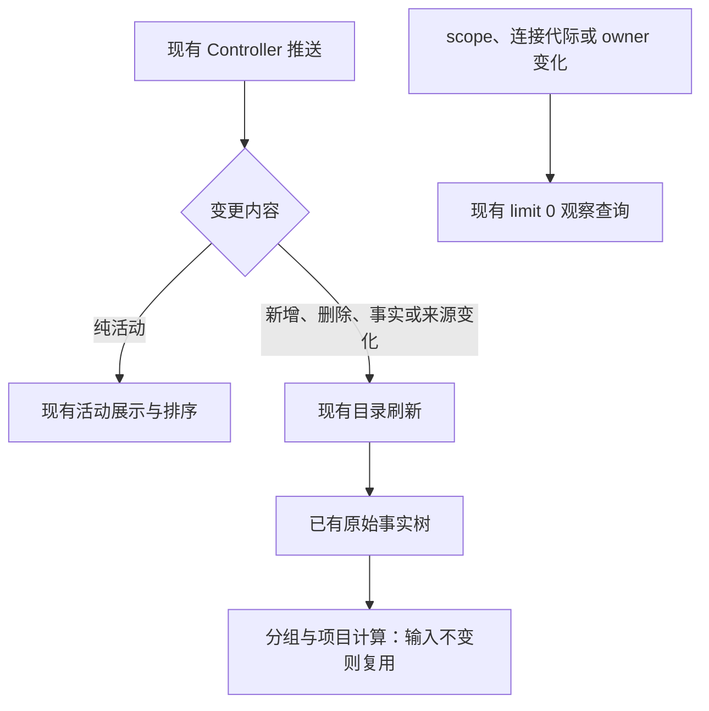

# 任务列表刷新语义（workspace_task_list_changed reason 分类学）

> 2026-07 定稿。背景：M5 把左侧列表数据源迁到 sessions-index 后，出现"输入框操作（切模型）/
> 任务收口 / 打开历史任务都会让左侧任务列表整刷、任务跳到列表顶部"的一串症状。根因是两个
> 消费语义从未被定义成契约：① `workspace_task_list_changed` 的 reason 分类学；② sessions-index
> `lastActivityAt` 的"活动"定义。本文是这两个语义的事实源。当前项目侧栏由
> `packages/ui/src/project-sidebar/useProjectTree.ts` 消费列表变化，自动未读由同目录
> `useProjectUnreadSignals.ts` 处理，回归见 `packages/ui/test/projectTreeBackgroundUnread.test.ts`。

## 1. reason → UI 刷新级别矩阵

发射面：`taskIndexSyncer.emitWorkspaceTaskListChanged(target, meta, reason)`——**reason 必填**（设计修正：
曾经的缺省值 `task_meta_changed` 让所有不表态的发射点静默落入最重的刷新语义，是整串缺陷的根）。

| reason                                           | 语义                                                     | 整表刷新¹        | membership 重拉² | meta 增量回写³      | 典型发射点                                        |
| ------------------------------------------------ | -------------------------------------------------------- | ---------------- | ---------------- | ------------------- | ------------------------------------------------- |
| `task_pinned` / `task_unpinned`                  | 置顶归属翻转                                             | ✅               | ✅               | —                   | setTaskPinned                                     |
| `task_archived` / `task_unarchived`              | 归档归属翻转                                             | ✅               | ✅               | —                   | archiveTask/unarchiveTask                         |
| `task_meta_changed`                              | 归属相关 meta（unread）或无更细分类的兜底                | ❌（带 meta）    | ✅               | preserve-membership | setTaskUnread、group 操作、批量归档、首发广播     |
| `task_status_changed`                            | 状态/快照收敛（收口、回源、打开/恢复任务、compact/goal） | ❌               | ❌               | preserve-membership | applyTerminalTransition、resync、resumeSession    |
| `task_model_changed`                             | 切模型（纯配置）                                         | ❌               | ❌               | preserve-membership | zcodeSessionService.setModel                      |
| `task_title_changed`                             | 标题（首条消息/自动标题/手动重命名）                     | ❌               | ❌               | preserve-membership | applyTitleChange、renameTask                      |
| `task_created`                                   | 新任务（tasks-index 正向行集合增加）                     | ✅（无 meta 时） | ✅               | insert-active       | adapter/create、首次 grouped 顺序提交             |
| `user_message_saved` / `assistant_message_saved` | 消息落盘                                                 | ❌（带 meta）    | ❌               | preserve-membership | 旧协议路径                                        |
| `task_deleted`                                   | 删除 tombstone                                           | ✅               | ✅               | —                   | deleteTask；立即移除缓存并换代 deleted membership |
| `stream_mirror_*`                                | 流恢复兜底                                               | ✅               | ❌               | —                   | 远控恢复路径                                      |

¹ `shouldRefreshTaskListForWorkspaceEvent`；² `shouldRefetchTaskListMembershipForWorkspaceEvent` →
`bumpTaskListMembershipVersion`（全局版本号，一次 bump 所有列表实例重拉 pin/archive/unread join 面，
且按事件内容去重防双订阅链路重复投递）；³ `getTaskMetaWorkspaceEventSyncMode`。

`task_status_changed` 还可携带可选的 `unreadSignal="background_terminal"`。v4 sessions-index 的
host syncer 不知道每个窗口正在查看哪个 task，所以 Host 只负责判定“这个终态是否值得
提醒”，renderer 再执行完整任务地址的查看判定。普通后台终态、Goal `verified` 和真实 error 携带
signal；Goal `active/paused/verifying/notSatisfied/failed` 不携带。打开/恢复历史任务、compact/goal
快照收敛等普通 status 广播也不携带，禁止仅根据 terminal status 猜测新完成。renderer 收到
signal 且任务未被桌面或有效 Web 前台查看时调用 `setTaskUnread(true)`；这次归属变更会再发出
`task_meta_changed`，由它触发 unread membership join 重拉。

项目侧栏接入 Controller 后，明确的后台终态信号仍必须送达窗口的唯一未读处理者。Host 从原 workspace event 转发窄的 live signal，不从 sessions-index snapshot、重连重放或历史读取推断新完成；信号携带完整任务地址。只向 desktop-continuous 的 local/base attachment 提供自动未读信号，远端 scope attachment 与手机共享同一持久 `unreadAt`，不产生第二个自动写者。普通没有 Controller 的 Web 路径由同一个项目树 owner 消费原事件。

窗口以完整 workspaceKey + taskId 识别任务，按桌面导航与下述有效 Web 查看事实判断是否需要置未读。同一终态去重；并发写入由持久 owner 原子分配不同 marker，每个回包只代表自身写入。持久写成功后刷新现有项目树，不另建已提交未读状态。若写入期间用户已查看任务，只用该次写入回包的精确 `unreadAt` 做已读 CAS；Controller 不得用后续刷新读到的另一版 marker 替代本次 mutation 的回包。服务换代或 owner 卸载后，旧回包不再发起写入。回归覆盖本地/远端身份隔离、活动任务、普通 status、重复终态、写入失败及迟到回包。

### 已连接 Web 的实际查看状态（2026-10-13）

自动未读判定认可桌面原有完整导航事实，或已连接 Web 前台实际显示同一完整任务地址。手机首页、设置/其它主视图、被 inert 层覆盖的聊天、后台页面、草稿与断线都不算查看。宽屏与窄屏共用查看上报入口，草稿提升为任务、任务切换、可见性变化和卸载立即更新；不能仅凭组件已挂载或缓存 activeTaskId 推断。浏览器前台按 Page Visibility 的可见状态判断。

最后导航位置 `mobileViewState` 保持原恢复用途；新增 `mobileTaskView` 是 Main 现有远控 runtime 中的瞬时查看事实，不持久化。Main 只接受当前配对代际、递增序号、bridge 和 workspace 身份均匹配的声明；断线或 bridge 失效立即清空，重连需重新声明，不沿用对话框的 mobileConnected 宽限。Main 向桌面发布查看事实时从当前 bridge 注入可信 remoteSessionId，Web 不得自行声明该路由。旧远端 identity 的精确读与 CAS 沿该 session 路由；查看与完成信号的显式 session 不一致时不能抑制未读。每次有效变化直接推送，桌面先订阅再读初始状态；迟到初始回包不能覆盖更新事件。不能依赖轮询、时钟比较或新增超时修补顺序。

Web 生命周期在 hidden/pagehide/freeze 时必须先通过仍可发送的当前连接撤销查看，再暂停 transport。不能依赖 React Reporter 的监听器顺序：暂停后发送已被禁止，而 relay 仍可能认为原 socket 已配对。suspended 及其进入 reconnecting 的原 socket 探测窗口保留 Main 颁发的 epoch 和递增 seq；真正建连或鉴权仍撤销旧资格，由新配对请求或 bootstrap 恢复当前 epoch。回到可见页面后，沿原恢复流程与当前 Reporter 重新声明；后台 online/resume 不能把缓存任务重报为正在查看，freeze/resume 也必须重读实际页面可见性。

bootstrap 的查看 epoch 只在现有 version guard 确认当前请求代际与版本可接受后同步写入；请求函数只读取响应。旧回包即使到达时已重新 paired，也不得占用空 epoch。新配对的重申请求丢失时，当前代 bootstrap 仍须补发；先到达的有效重申不能被 bootstrap 覆盖。同 socket 重新配对也适用，不另建 socket 代际作为查看资格来源。

```text
旧：hidden → transport 暂停 → Reporter(null) 无法发送 → Main 仍认为正在查看 T
新：hidden → 发送 null → transport 暂停 → Main 撤销查看 → 完成时写未读
    visible/resume → 读取当前实际显示 → 原连接恢复/重新配对 → 声明 T → 精确 CAS
```

只有 desktop 目录 owner 消费 Web 查看事件并自动收敛未读，Web 只上报，不能因共享 hook 成为第二个自动写者。完成信号与新有效查看事件在同一 writer 内按完整 workspaceKey + taskId 串行处理，其他任务可并发。若查看发生于未读写入途中，只清此次写入回包的 marker；若写入已经完成，新的查看事件通过 Controller 的精确 getTaskMeta(address) 读取所属 Source 当前 marker 后 CAS。读取与 CAS 在该任务串行链中占同一个位置，禁止慢读取越过后续完成、误清新 marker。链只管理在途操作，不是新的业务 accepted queue 或持久状态。

Controller 精确读取沿现有 source/attachment 校验路由到所属 TaskService，异步 IO 前后都验证 owner 未换代；不通过列表缓存或吞错后的投影读取 marker。卸载、身份变化、读取或写入失败不制造本地假已读；错误沿既有日志和刷新路径保留。重复同一有效查看状态不执行已读命令，避免 render、轮询或重发擦掉手动未读。有效查看转为空后再次声明同任务属于新的查看，应清除断线/离开期间产生的未读。

宽窄断点变化只切换布局，不代表离开任务。查看上报与手机 Home/chat 导航由布局分支之外的同一 owner 持有；连续显示同一任务时不得因子组件卸载产生 `T → null → T`，必须保留手动未读。真正切到 Home、遮盖聊天、后台或卸载仍立即撤销查看；不使用延时合并事件。

```text
Web 前台实际显示 T → Main 校验当前连接/bridge/序号 → 桌面唯一 writer
U1 完成 → mark-unread(11) → 查看 T → owner 读取 + CAS(11) → 离开
                                                     → U2 完成 → mark-unread(12)
```

回归 MRO03 覆盖宽窄屏、前台/Home/后台、草稿晋升、断线重连、同路径不同 Source；时序回归覆盖在途写、已完成写后查看、慢读期间离开再完成、旧 marker 不清新 marker、旧 owner 回包和重复查看不清手动未读。保留原 desktop-continuous 与 mobile replayable、Host 显式完成信号、单库 CAS 和排序时间语义。

桌面查看分支必须同时匹配活动 tab、workspace 的 `activeTaskId` 和当前导航条目的完整
`workspaceKey + taskId`。在途写入的“已查看”记录只消费导航 owner 的完整地址提交事件：
`setActiveTaskId` 完成原子更新后发布；设置页返回已有任务时由返回动作发布。事件不保存第二份
导航状态。跨工作区点击 B/T2 时，先激活 B 会短暂暴露 B 缓存的 T1；草稿还可能保留 B/T1 的历史，
因此任何原始 tab/session store 通知都不能单独证明 T1 被查看。空导航、自动化或插件市场也不能
作为查看任务的证据。保留真正打开后又切走的记录和精确 marker CAS，不通过延时合并 store 通知。

```text
A → 点击 B/T2 → 激活 B（缓存 T1，历史可能仍是 B/T1）→ 不发布查看事件
             → 原子提交 B/T2 → 完整地址事件 → 只确认 T2
T1 未读回包 → 无 T1 查看事实 → 保留该次 marker
```

Host 收到明确完成信号后立即转发，不等待列表 IO，确保窗口的查看记录覆盖列表读取期间。未读 mutation 负责等待已在途读取收口；若精确任务地址仍无投影行，再刷新一次并验证 source 未换代，然后执行原写入。已知任务的旧读取失败不应吞掉完成信号；缺行且刷新失败则拒绝写入。前台完成后切走，以及后台完成后在读取期间查看再切走，均不能重新制造未读。

首次打开远程项目时，已读请求先验证当前 attachment 的完整 sessionId、workspaceIdentity 与 cwd，再按稳定 Source 身份定位侧栏早已存在的任务行；有 sourceServerId 的投影不要求反向补上后来才创建的 logical sessionId。没有稳定 Source ID 的旧路径仍按 sessionId 精确匹配。身份验证后的异步读取结束时再次检查 attachment，拒绝已经换代的旧请求。

```text
后台终态 → Host 显式 live signal → 窗口 base owner 的 active-task guard
                                  → 既有 mark-unread 等待任务行就绪 → 持久 unreadAt → 项目树
                                  → 期间已查看：对本次 marker 做 mark-read CAS
```

`task_deleted` 的整表刷新仍是隐藏项 `total/hasMore` 的兜底；对已命中可见缓存的任务可以先做增量移除。
无论是否命中可见缓存，它都必须 bump membership version，因为 sessions-index 仍可能在后续 live frame 或
冷启动 seed 中返回同一个 CLI session，只有 tasks-index 的 deleted id 负向集合能阻止其重新进入普通列表。

`task_created` 也必须 bump membership version。tasks-index 现在是 Project/Timeline/Pinned/Archived/Grouped
持久行的左表；即使事件携带 `taskMeta`、sessions-index 已经发布 activity，也不能再沿用旧的“只增量回写
meta”策略。事件发生在 task row 与初始 grouped 顺序提交之后，换代读取才能完成
`optimistic -> persisted row` 的收敛，并让其它窗口/手机创建的任务进入当前列表。

**新增发射点的判定规则**：变更是否影响 pin/archive/unread 归属？否 → 绝不用 `task_meta_changed`，
选精确 reason 或新增 reason 并更新本矩阵与守护测试。高频路径（每次消息/收口/打开都会走的）落错
分类的代价 = 全部列表实例 × membership RPC × 整列表重渲染。

## 2. lastActivityAt："什么算任务活动"

sessions-index 的 `lastActivityAt` = CLI `record.updatedAt`（v4-bridge `getSessionIndexMeta`），UI 侧栏按它
降序排序。**只有用户可感的会话活动才允许 bump**：

- ✅ 计入活动：消息收发、turn 生命周期、工具执行、后台任务，以及新产生的 permission/userInput 阻塞请求等用户可感 SessionEvent。
- ❌ 不计入（`isNonActivitySessionEvent`，server-operations.ts）：
  - `ModelSelected` / `SessionModeChanged`：纯配置变更（切模型/切模式）；
  - `FollowupModeChanged`：追加消息的 queue/guide 配置同步；打开历史会话后的自动同步、重复同步及手动切换都不刷新活动时间；
  - `SessionResumed`：打开/恢复会话是读取不是活动（冷恢复路径刚回填 store 真实时间，不得被冲掉）。
- ❌ refresh/snapshot/resume/replay 同一 pending interaction 不产生新的活动；只有新的阻塞请求事件可以 bump 一次。
- ❌ 配置类 mutation（`CONFIG_ONLY_MUTATION_REASONS`：model/thought_level/mode changed）与
  `updateRuntimeModelConfig` 不 bump `record.updatedAt`。
- ❌ tasks-index membership/meta mutation（unread、pin/archive、group、rename）不得把其 SQLite `updatedAt`
  合并回 sessions-index `lastActivityAt`。Updated 排序只认后者；grouped 视图只认显式 `sort_order`。

违反后果：配置操作/打开任务把任务顶到列表最前并触发整列重排。

## 3. sessions-index 冷恢复降级防御（seed↔live 切换窗口）

冷启动时列表种子来自 store（`getStoredSessionSummaries`）；打开任务后 live 投影覆盖种子。hydration
完成前 live 投影是半成品，以下字段不得用降级值覆盖非空基线（`SessionsIndexProjection.upsertFromConversation`）：

- `title` 空 → 保基线；`createdAt` 更新 → 保更早值；`lastAssistantPreview` 空 → 保基线；
- `phase === "draft"` 而基线非 draft → 保基线 phase/sessionEnded/goalStatus（会话一旦有内容不可能退回 draft）。

防御完备时，"打开一个没有变化的历史任务"产生零 delta（守护测试：sessions-index-projection.test.ts
「冷恢复 draft 窗口快照与基线等价时不产 delta」）。

## 4. renderer 差量管道（防"一帧变化放大成全列表刷新"）

当前形态是"内存全量重算 + 引用等价短路 + IO 按版本缓存"（千级会话量下重算 ~ms；
真正的实体化差量 store 是后续重构方向，见 §6）：

- `useWorkspaceSessionsIndexItems`：聚合层逐条字段比对，等价复用旧对象；整表等价复用旧数组——
  下游依赖数组身份的 effect（grouped refresh、workspace 缓存失效、republish）自然短路。
- `useWorkspaceTaskLists`：sessions-index 变化只标脏 diff 出的有变化 workspace scope，不再全量 invalidate。
- **刷新展示语义**：已有 query cache 的 workspace 采用 stale-while-revalidate——只把命中 scope 标记为
  `stale` 并保留当前任务行，后台重算完成后原位替换；只有 query cache 完全缺失的首次 hydration 才进入
  blocking loading。禁止用“清空已有列表 → loading → 回填”表达普通 sessions-index / membership 刷新，
  否则一次任务选择或恢复仍会被用户感知成整个侧边栏重新加载。
- `useGroupedTaskView`：`stabilizeGroupedView` 节点级复用，整树等价时 setState 拿同引用直接 bail。
- `taskQueryCacheStore.setQueryResult(s)`：结果与现缓存等价时跳过 setState；`mergeIncomingTaskListItem`
  内容等价保留旧引用。
- **IO 差量**：membership（pin/archive/unread）与 grouped structure 均不随 sessions-index 内容帧变化，
  按 `membershipVersion + 签名` 缓存（`fetchTaskListMembershipSetsForEndpointsCached`、grouped
  `remoteDataCacheRef`），内容帧（title/status/lastActivity）只做内存 join，零 RPC；
  分组 mutation 路径显式失效缓存。

### 4.1 workspace scope 订阅隔离

`useWorkspaceSessionsIndexItems` 消费的是多个 workspace 的集合，但订阅所有权必须落到单个
`endpoint + workspaceKey`。scope 集合变化只能按 key 做增量 reconcile，禁止把数组签名变化直接解释成
“释放全部旧订阅，再重新订阅全部新 scope”。否则删除一个 workspace 会清空其余 workspace 已经持有的
snapshot、水位和任务行，把局部导航操作放大成跨 workspace 状态重建。

```text
before = [A, B, C]             after = [B, C]
             │                         │
             └── reconcile by key ─────┤
                                       ├─ release A
                                       ├─ retain B store/subscription/watermark
                                       └─ retain C store/subscription/watermark
```

| scope 变化                            | 允许的副作用                | 禁止的副作用                       | 分类                 |
| ------------------------------------- | --------------------------- | ---------------------------------- | -------------------- |
| 删除 A                                | unsubscribe/release A       | 重建或清空 B/C                     | accepted             |
| 新增 D                                | acquire D；D 独立 hydration | 清空已有 A/B/C 行等待 D            | accepted             |
| 仅重排 scopes                         | 无                          | 任意 subscribe/unsubscribe         | pruned：集合身份不变 |
| B 的 endpoint/service generation 换代 | 只替换 B                    | 重建相同 endpoint 的其它 workspace | accepted             |
| hook 真正卸载                         | release 全部当前 entry      | 保留泄漏引用                       | accepted             |

关键不变量：从 `[A, B, C]` 变为 `[B, C]` 后，B/C 的 `SessionsIndexStore` 实例、subscription、
watermark 与 session 集合必须保持原值；renderer 不得发布 B/C 的空中间态。桌面仍使用
`desktop-continuous`，手机远控 scope 仍使用所属 endpoint 的 `web-remote-replayable`；本次改动只隔离
订阅生命周期，不改变两种 delivery 语义。identity key 继续使用
`workspaceIdentity?.trim() || workspacePath`，`workspacePath` 只用于传输参数和展示/执行。

### 4.2 grouped 视图的空白帧禁令（2026-08）

`Grouped` 是唯一把「权威列表」放在组件实例 `useState` 里、并且带首屏门禁的侧栏视图；
timeline/pinned/archived 都从模块级 `taskQueryCacheStore` 渲染。因此同一条内容帧下，
只有 grouped 会把「刷新中」表达成整块空白——用户感知为「左侧分组列表整块闪一下」。
四条不变量：

- **门禁只拦首屏**：`isGroupedTaskViewInitialized` 必须是一次性闩锁。禁止直接读当前
  Controller 列表的 `loading`——运行中任务每个流式节点（发 prompt、首个 tool、输出完成）
  都会让它重查一轮，门禁会随之回关并卸载整棵 grouped 子树。
- **画过一次就不得回空白**：`shouldHideGroupedTaskContent` 必须接受 `hasPaintedOnce`。
  已经渲染过非空列表之后，任何 loading / 未初始化 / 瞬时空态帧都继续渲染上一份列表。
- **权威视图跨挂载存活**：最后一份权威视图按 scope 签名缓存在模块级
  （`useGroupedTaskView` 的 `groupedViewCacheBySignature`），祖先重挂载 / HMR 后立即接着画，
  RPC 只负责收敛；初始化闩锁一并从缓存种下，否则重挂载第一帧仍会关门。
- **scope memo 必须用值签名**：`scopes` / `sessionsIndexScopes` 禁止 memo 在 tabs 数组身份上。
  父级重建同值数组会换掉 `refresh` 的身份，而「`refresh` 变化即刷新」的 effect 又会 setState
  触发下一次渲染——形成自激刷新环，每帧发 RPC 并给门禁/空态制造闪动窗口。口径与
  `useGlobalTaskList` 的 `workspaceSignature` 保持一致。

```txt
Controller activity 帧（phase/lastActivityAt 变化）
   │
   ├─ timeline/pinned/archived ─> 模块级 query cache ─> stale-while-revalidate，无空白
   └─ grouped ─> 实例 state + 首屏门禁 ─> 闩锁/hasPaintedOnce/模块缓存 缺一即整块空白
```

验证提示：这类修复依赖「挂载时种初始状态 + 组件内闩锁」，vite HMR 会保留已挂载组件的旧状态，
必须**完整重启应用**复测，热替换下的观察结果不作为结论。

## 5. 历史根因链（2026-07 修复对账）

同一症状（左侧列表闪/整刷/任务跳顶）由四层独立缺陷叠加，修复分别位于：

1. reason 缺省值蹭用 → reason 必填 + 高频路径精确分类（本文 §1）；
2. 配置/恢复被计成活动 → §2 非活动事件集合；
3. 冷恢复 draft 降级 → §3 phase 防御；
4. 聚合层/查询缓存引用不稳定 → §4 稳定化。

### 5.1 grouped 整块闪（2026-08 修复对账）

症状与上面同源但只出现在 `Group` 视图：切到 Group 跑一个多 tool 任务，
**发出 prompt、首个 tool 展示、最终输出完成**这三个时刻各闪一次；切到 Project/Timeline 不闪。

已用测试复现并确认的三条独立缺陷（`packages/ui/test/groupedTaskViewStreamingStability.test.ts`）：

1. **门禁跟随瞬时 loading**：`initialized` 直接由 Controller 列表的 `loading` 推导，
   每个流式节点重查一轮就关门 → 整棵 grouped 子树卸载重挂载。
2. **自激刷新环**：`scopes` memo 在数组身份上，父级重建数组即触发 render→refresh→setState→render
   （护栏用例在改前会跑到 200+ 次渲染）。
3. **重挂载退回空态**：权威视图只存在于组件实例 state，重挂载后回到「空视图 + 门禁关门」，
   要等两个 RPC 才恢复；这也是「只有 grouped 闪」的结构性原因。

同期还排除了两条曾被怀疑的路径：顶层/组内虚拟化（实测 `nodeCount 67 < 80` 阈值，未启用）、
侧栏宽度被右侧内容挤压（侧栏面板是 `flex-none` + CSS 变量宽度）。

反面教材（不要再引入）：曾用「live Controller 仍报告该 task」当作「行不该消失」的证据来抵消
瞬时丢行。该判据的口径是 `kind:"active"` = `!archived`，**包含 pinned task**，而 grouped 的口径是
「非 pinned 非 archived」，结果置顶任务会被守卫复活并赖在分组里。约束见
`docs/ui/task-grouped-view.md` 的「可见性真相源与删除收敛」。

## 6. 侧栏性能：局部优化

> 2026-10-15：修正现有消费者的刷新依赖和重复计算；保留 Controller、
> 服务接口、持久化及列表数据结构。完整读模型、订阅租约和按行订阅重构不纳入本轮。
> 只改宿主，插件代码与有效 UI guest 不自动冻结、回收的策略保持不变。

### 6.1 已有证据与目标

一次开发态取证中，插件从打开通知到编辑器就绪用时 57.482 秒；同窗口出现 431 次
`window-controller.listTaskList`，Host 处理合计约 473 毫秒。RPC 服务耗时不能解释全部等待。
原始长帧和后续调用栈指向 Renderer 同步渲染压力，包含分组排序与序列化；完整 tracing
本身开销显著，不能用其耗时比例回填原始运行，也不能提前承诺优化后的启动秒数。

当前侧栏用 `limit: 0` 查询建立 Source 活动观察，该查询不提供项目树的行。
修正前，同一 Controller revision 同时触发观察查询、目录重读和活动合成；Provider 将合成后的树
交给分组逻辑，导致任务活动也重复计算分组签名。现在纯活动只触发展示路径。

### 6.2 三处改动

| 改动                       | 实现边界                                                                                                                                                               | 预期收益                                                   |
| -------------------------- | ---------------------------------------------------------------------------------------------------------------------------------------------------------------------- | ---------------------------------------------------------- |
| 收窄刷新条件               | 在现有 registry 区分纯活动与事实变化；目录只因事实、恢复和现有明确刷新入口重读。观察查询按有效 scope 集合、连接代际及 owner 生命周期建立或恢复，不随普通 activity 重发 | 减少无效 listTaskList、readTree 和后续整树计算             |
| 分组与项目计算使用稳定事实 | 复用 useProjectTree 已有的原始事实树，不另建 store；分组签名仅在事实输入变化时计算，排序键只序列化一次；项目排序依赖项目集合与原排序偏好                               | 去掉每次活动上的分组全量排序、重复 JSON 分配与无关项目排序 |
| RPC 控制消息先判标记       | 在现有协议判断中先检查控制标记，只有候选控制消息才枚举字段，并保留严格校验                                                                                             | 大块二进制消息不再为类型判断逐字节枚举                     |

主要涉及 `windowControllerTaskListRegistry`、`useProjectTree`、`ProjectDirectoryProvider`、
`useTaskGroups` 和 RPC 消息判断，以及相应测试。不扩展 Controller 协议，不迁移目录 owner，
不重做搜索/分页缓存或 Host 全量投影；这些路径仍按现有契约运行。



### 6.3 防止缩小范围时漏更新

- 不能只删 effect 的 revision 依赖。有 Controller 时，当前 hook 不再直接监听 workspace
  事实事件；必须先保留明确的事实刷新通知，再让纯活动走展示路径。
- 使用 registry 已保存的前后行作局部判断。Host 会把活动的 updatedAt、status、
  pendingInteraction 合入 meta，不能仅因 meta 引用或这些字段变化就重读目录。
  同时携带标题、未读、membership 等事实变化的帧仍需刷新；新增、删除、snapshot、
  Source 换代以及无法证明为纯活动的变更保留刷新。既有活动时间排序继续更新。
- scope 使用稳定身份和规范顺序比较；观察注册不能依赖任务活动来维持。
  首次注册失败、重连、owner 重建与显式刷新仍可重新建立观察；沿用代际保护，
  迟到回包不能覆盖新来源。不增加轮询、延时合并或新的自动重试 timer。
- 分组只换输入来源与计算时机，仍由既有 taskGroupService 登记；保持系统任务标记、
  明确删除、首发提升、未读 CAS 和远端身份规则。仅给活动合成树套 useMemo 不足以解决问题。
- 有限查询窗口仍可能在活动改变排序时重新查询。本轮零重查目标针对侧栏观察和目录读取，
  不宣称所有搜索、菜单和分页路径均已改为增量消费。

### 6.4 验证与范围

- 活动 hook 反例在修改前出现 1,000 次活动触发 1,000 次目录读取；修改后目录读取、
  观察查询、分组签名计算均增加 0 次，最终活动正确。覆盖标题、未读、pin/archive、
  系统标记、新增/删除、注册失败重试、离线重连、恢复快照与 owner 重挂载。
- RPC 回归用真实 3 MiB Uint8Array，确认普通二进制不枚举字段，合法/非法控制消息仍正确处理。
- TSL40 完整桌面 controlled stream：ACTIVITY_02 到 ACTIVITY_29 期间，listTaskList
  计数保持 2、readTree 保持 6；Stop 后运行标记消失，右键改名同步。用例处于
  manual-review/pending，自动运行通过不等于人工转正。
- 手机 shared-host 的既有 VP13 E2E 通过，覆盖共享项目目录、分组操作和草稿交接。
- 完整开发窗口使用未修改的 PhotoCraft 0.2.2：两个未展示的测试会话分别经真实 open_editor
  结果创建 guest，均达到 automationReady；后台建文档、加图层、文档隔离、拒绝自动回收和
  删除一个实例不影响另一个均通过。检查隐藏容器 inert 与透明度，并清理测试会话。
- 独立 Electron 宿主回归另外覆盖最小化启动 WASM、后台编辑、切页隐藏与返回同一 guest、
  保留未保存状态及删除释放；它补充生命周期证据，不替代完整窗口验证。
- 这些结果证明消除了指定的无效工作。原 57.482 秒场景尚无同数据、同负载的修改前后
  冷/热启动对照，不据此声称总启动缩短到某个秒数，也未证明整个应用内存降低。

这轮仍保留全树 activity 合成和现有 Context 通知，不承诺只有一个任务行重渲染。
若实测启动与交互已达到要求，就结束；若仍有明显长任务，再按剩余热点单独设计下一步。
不因为局部优化未消除所有 O(N) 工作，就预先加入实体化 store、租约协议或桥接迁移。
插件保留边界继续以 [MCP 页面保留与后台执行](./plugin-ui-background-execution.md) 为准。

## 7. 被动观察与 runtime 生命周期

`workspace_task_list_changed` 监听和 sessions-index scope acquire 都是观察行为，不是 workspace 使用意图。
它们必须满足：

- `onDynamicWorkspaceEvent` 只返回 workspace emitter，不建立上游订阅；
- task-list sessions-index 与 Host task-index syncer 只以 `existing-only` 方式 subscribe/resync；
- runtime 缺失时进入 dormant，不记录生产级错误、不启动退避 timer、不触发 Agent；
- runtime available 后只为匹配 workspaceKey 的 observer 建立一代订阅；Host task-index 的 dormant state
  第一次激活时必须先幂等安装 workspace frame listener、再发送 subscribe，确保同一次 stdio read 内在
  ACK promise resolve 后、await continuation/subscription ownership 生效前到达的 initial frame 不丢失；
  runtime 换代只重订阅，不重复安装 listener；
- unavailable 后清理 ownership、pending frame 与 retry，并隐藏失去 live 证明的 running activity；
- renderer reload 可以复用 Host 中已经存在的 runtime，但不得为其它 restored workspace 补启动。

App 冷启动预热是 Main 明确发出的启动意图，不属于上述被动观察。单窗口恢复多个本地 workspace 时，Main
只选择上次激活的 workspace 作为唯一 target（上限 1），并在首次 `InitLocal` 中交给 Host 走既有完整
`initializeWorkspace` 预热路径；`recentProjects` 中的其它 workspace 不再预热，保持 dormant，直到用户显式
打开/发送/后台任务入口才启动。没有可恢复 session、显式 open-workspace/deep-link 冷启动等单 workspace
入口同样只预热自己的 target；预热失败不扫描其它 workspace 补位。该名单只在 Host 首次创建时计算，
renderer reload 复用原 Host，不重新扩大名单。

> 2026-09-30 由最多 3 个收敛为 1 个：会话 CLI 没有 idle 回收，启动即拉起 3 个 Agent 进程会让每个
> 窗口常驻 3 份 CLI 内存，而切换到最近项目的冷启动收益不足以抵消这部分常驻成本。

```text
startup restore ─> explicit warmup target (active only, max 1) ─> Agent runtime available
                                                        │
sidebar mount/reconcile ─> passive observers ─> tasks-index rows
                                      │                 │
runtime available(workspaceKey) ──────┴─────────────────┴─> install listener -> attach sessions-index
runtime unavailable(workspaceKey) ─────────────────────────> dormant; no retry spawn
```

生产日志只保留 runtime available/unavailable 与真实订阅生命周期；observer reconcile、dormant 命中和逐帧
细节使用 `debug`，避免 workspace 数量乘以列表消费者形成新的日志风暴。
