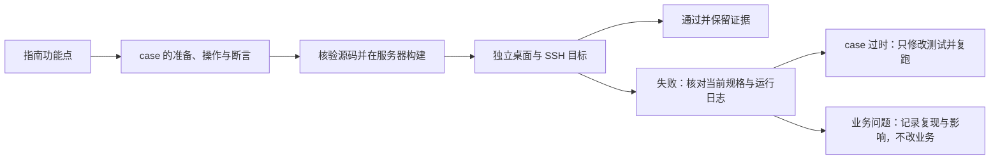

# 桌面 SSH 测试指南回归

Status: done

本轮依据《ZCode 远程连接新版测试指南》第 41 版（2026-10-09），业务基线为
`a13999a28927f629d0c64080a5096cf8b4f23bae`。仅验证桌面 SSH；手机、WSL、Docker
产品连接方式不在本轮范围。Linux 上的独立 Docker 容器只用于模拟真实 SSH 服务器。

复用服务器队列，每条使用独立 HOME、显示会话和 SSH 目标。先核验完整源码清单，再在服务器
构建 Desktop、Server、Agent。模型回放用于功能与故障时序；真实模型另跑 live-zapi / live-team。
PASS 必须同时有用户操作、对应断言和运行证据，不能用旧版本结果或经过某个页面代替覆盖。

## 验收结果

本轮完成“桌面 SSH 功能点均有 case，且通过或有记录”的检查，**不是全绿**。
100 个调度场景均已执行：95 PASS；3 个业务失败、1 个规格/入口行为差异、1 个账号模型前置阻塞。
原始 runner 对后五项均记录 FAIL；没有修改原结果、跳过失败或放宽业务断言。

后续修复（2026-10-10）：目录权限问题 [05](../issues/remote-e2e-stability/05-directory-permission-reattach.md)
已修复，完整 `directory-denied` E2E 单独复跑通过，包含权限恢复后重试及原历史续聊。
地址编辑后项目重连问题 [06](../issues/remote-e2e-stability/06-edited-route-ignored-by-project-reconnect.md)
也已修复，`connection-management` 编辑变体单独复跑通过：新端口实际收到连接、留空密码可认证、
两个原项目恢复，且不新增旧线路 Profile。
原项目必须更新问题 [07](../issues/remote-e2e-stability/07-existing-project-upgrade-intent.md)
已修复；四个版本策略变体独立复跑均通过，手动连接自动更新并恢复 A/B，后台等待、可选更新与
“稍后”、本机过旧的行为保持。完整证据与本机首轮夹具准备超时的说明见问题记录。
问题 [08](../issues/remote-e2e-stability/08-reinstall-history-visible-in-new-device.md) 的语义于
2026-10-10 经用户确认：正式卸载保留数据时，重装必须沿用原设备、连接和项目，原历史可见且
可续聊；只有独立数据环境替换才确认新身份。原 case 的“新设备不显示旧历史”不能用于保留数据
重装。两变体独立复跑均已通过：原设备历史实际续聊，独立环境的确认/取消/归档与隔离保持。
修复及运行证据记录在问题 08，原批次的统计和 ledger 保持不变。
后续修复（2026-10-11）：多线路迁移的任务身份预检只比较 canonical 快照，漏掉 source 之间的冲突，
重复打开会新建失败 ledger 并备份两库。新增 `history-conflict-sources`：修复前批次
`r3-server-20261011024625012-2857c7` 失败，打开阶段已有 2 条失败 ledger 和 2 份迁移备份；修复后批次
`r3-server-20261011025925916-fb3363` 中该项与 `history-conflict`、`history-merge` 均通过，重试前后
只有同一条 ledger，远端没有迁移备份。
以下统计和 ledger 保留原业务基线的结果，后续修复证据见各问题记录。

以下队列 key 的具体 spec/环境变体由 `harness/remote/run-all-remote.sh` 单点声明。
同一 spec 的目录故障、资源类型、版本策略、更新确认和管理路径按变体分开执行。

| 指南功能点                                             | 对应 case / 实际证据                                                                                          | 结论                                                                                                                                 |
| ------------------------------------------------------ | ------------------------------------------------------------------------------------------------------------- | ------------------------------------------------------------------------------------------------------------------------------------ |
| 设备搜索、SSH 配置发现、新建连接、最近目录             | projectentry、kinddoubleclick、three-screen                                                                   | PASS                                                                                                                                 |
| 错密码就地补充、缺密码、已在线连接复用                 | p0-conn、wizardcredentials                                                                                    | PASS                                                                                                                                 |
| 首装版本/账号/路径/大小、真实阶段/日志、就地重试       | install-progress、log-contract、installfaults、downloadproxy、three-screen                                    | PASS                                                                                                                                 |
| 收起、恢复、取消、关闭清空表单                         | cancelretry、three-screen                                                                                     | PASS                                                                                                                                 |
| 改设备名、选目录、稍后选择保持在线且无项目             | devicecards、disconnectux、three-screen                                                                       | PASS                                                                                                                                 |
| 首次目录页可关闭说明，后续与重启不重复                 | boundary                                                                                                      | PASS                                                                                                                                 |
| 退出/断网后继续执行、重连不重复                        | app-exit-running、transportloss、coldreconnect、renderer、ackloss                                             | PASS；实体系统休眠另列环境记录                                                                                                       |
| 多项目共享设备，等待确认不自动同意                     | p0-main、sharedwait、transportloss、taskcontrol                                                               | PASS                                                                                                                                 |
| 1/3、2/3、3/3、耗尽失败、静默恢复与手动接管            | retry-budget、transportloss                                                                                   | PASS                                                                                                                                 |
| 主动断开、启动开关、7 天守卫、远端重启                 | recov、coldreconnect、daemondet、serverfault                                                                  | PASS                                                                                                                                 |
| 草稿禁发送/保留、只读内容、原会话及已删会话            | disconnectux、coldreconnect、rdux13、rdux14、mixed                                                            | PASS                                                                                                                                 |
| 设备/连接名、地址/凭据下次生效、空值保留               | settings-safeguards、connection-management                                                                    | 名称与空凭据合同已测；侧栏地址重连失败，记录 [06](../issues/remote-e2e-stability/06-edited-route-ignored-by-project-reconnect.md)    |
| 同设备多连接、当前/默认、设默认、移除线路              | sourcelines、connection-lifecycle                                                                             | PASS                                                                                                                                 |
| 在线/离线定位、移除设备确认/默认取消、远端数据保留     | settings-safeguards、connection-lifecycle                                                                     | PASS                                                                                                                                 |
| 未完成记录折叠/删除/清理不影响已连通设备               | devicecards、offlineicons                                                                                     | PASS                                                                                                                                 |
| 必须/可选更新、后台等待、本机太旧与稍后                | version-manual-required、version-automatic-required、version-optional、version-controller-required            | 后台/本机过旧/可选提示与稍后 PASS；原项目自动更新差异记录 [07](../issues/remote-e2e-stability/07-existing-project-upgrade-intent.md) |
| 运行中任务清单、取消/重试、强制确认、版本/项目恢复     | serverupdate、serverupdate-force、install-progress、installfaults                                             | PASS                                                                                                                                 |
| 重装确认、取消、归档旧连接、旧历史不混入新设备         | uninstall（真实旧任务 + 可见新设备任务列表）                                                                  | 确认/取消/归档/数据保留 PASS；历史混入失败，记录 [08](../issues/remote-e2e-stability/08-reinstall-history-visible-in-new-device.md)  |
| 同地址不同账号与同路径历史隔离                         | account-isolation                                                                                             | PASS                                                                                                                                 |
| 平铺、五态、同名同路径、详情与各处设备标识             | projectnavigation、presentation、sidebar-menus、entryattr、pluginidentity、uipairwise                         | PASS                                                                                                                                 |
| 拖动顺序持久化且上下线不重排                           | project-order                                                                                                 | PASS                                                                                                                                 |
| 远端分享账号、不顶替、未登录拒绝、产物可打开           | share-authority（合成账号真实 SSH）+ share（真实云端）                                                        | PASS；手机入口不在桌面范围                                                                                                           |
| 目录删除/变文件/无权限、其他项目恢复与修复重试         | directory-missing、directory-file、directory-denied                                                           | 删除/文件 PASS；权限收回失败，记录 [05](../issues/remote-e2e-stability/05-directory-permission-reattach.md)                          |
| 单线路旧版升级、历史续聊、实际回退继续使用             | history-single                                                                                                | PASS                                                                                                                                 |
| 多线路合并、backup、冲突、重试/放弃与旧版回退限制      | history-merge、history-conflict（实际旧程序、SQLite、GUI）                                                    | PASS；两条旧线路实际读取后原任务数据仍保留，不承诺所有旧视图完整                                                                     |
| 文件浏览/编辑、终端、Git、首发/续聊、搜索/时间线       | p0-dev、p0-main、terminal、filelocal、taskactions                                                             | PASS                                                                                                                                 |
| 置顶/归档、离线操作拒绝、不使用本机数据                | taskactions、projectnavigation、botremote、modelcand                                                          | PASS                                                                                                                                 |
| 发送立即断线唯一执行、正文清理与后续草稿保留           | ackloss（ACK 扣留期间实际编辑新草稿）                                                                         | PASS                                                                                                                                 |
| 排队、停止/恢复、权限、子智能体、压缩                  | queuesel、taskcontrol、subagent、compactgoal、taskfaults                                                      | PASS                                                                                                                                 |
| 附件拖入/粘贴/发送、预览/下载、取消/断线后恢复         | attachments、mediapreview、attachment-cancel、attachment-disconnect                                           | PASS                                                                                                                                 |
| 模型/默认自动同步、离线补齐、无模型引导                | provisioning、modelcand、modelswitch、provready、connectivity、live-zapi、live-team                           | 回放与真实 API Key PASS；真实 Team 请求前置阻塞，记录 [09](../issues/remote-e2e-stability/09-live-team-model-precondition.md)        |
| Skills/MCP/插件/Hook/命令/子智能体的管理/实际保存/范围 | resource-skill/mcp/command/hook、settingsscopes、settings-safeguards、pluginidentity、pluginsync、remotehooks | PASS；每类有真实目标保存或执行/删除断言                                                                                              |
| 本机设置与项目所在机器设置边界                         | desktopauthority、settingslocalboundary、settingsscopes                                                       | PASS                                                                                                                                 |
| 机器人身份路由、离线拒绝、不误用本机/其他项目          | botidentity、botremote、botruntime                                                                            | PASS（合成渠道与真实 Host/MessagePort 链）；真实渠道与 SSH 端到端另列环境记录                                                        |
| 中文/英文、深/浅主题、窄窗口与键盘安全                 | uipairwise、accessibility、devicecards、settings-safeguards                                                   | PASS                                                                                                                                 |

## 构建与执行证据

业务代码为 `a13999a28927f629d0c64080a5096cf8b4f23bae`，与任务恢复时的最新分支一致。
完整源码 manifest 复算验真后，在服务器执行 `pnpm prepare:remote-assets`（Server / Agent）与
Desktop `build:no-runtime-assets`，分别构建 test / production。最终构建指纹前缀分别为
`60c92e7db6b5` / `8002e5ec70bb`。每条 case 使用独立 HOME、显示会话和 SSH 目标。

| 批次                                                                        | 范围/用途                                                        |
| --------------------------------------------------------------------------- | ---------------------------------------------------------------- |
| `r3-server-20261009170002590-cabde7`                                        | 主批次 80 项，55 PASS，定位旧 case 与新缺口                      |
| `r3-server-20261009183107835-42af65`                                        | 38 项修正复跑，21 PASS                                           |
| `r3-server-20261009221305938-a3e800`                                        | 恢复中断任务后 22 项，取得完整退出运行与权限故障的运行身份证据   |
| `r3-server-20261009223735233-3b63ee`                                        | 两份最新构建，19 项验证发送后草稿、真实强制更新、分享账号路由等  |
| `r3-server-20261009234650716-227ddc`                                        | 13 项，完成键盘/视觉、更新重试、旧版回退、附件断线、版本策略复验 |
| `r3-server-20261010000352793-dc135c` / `r3-server-20261010001224807-40c41f` | 设备默认/移除最终通过；真实旧任务揭示重装后的历史混入            |
| `r3-server-20261010001822450-9f7e7e`                                        | 多线路合并后实际回退旧程序并读取两条线路，核对原任务数据保留     |

另有早期首装/边界代表通过证据。构建指纹曾因 catalog/矩阵更新失效，
`r3-server-20261009223615174-965622` 在启动 Electron 前将 19 项标为 BLOCKED_ENV；
随后重新构建并执行，未把该批次算作通过证据。

最终逐项 ledger、各批 summary、构建凭证和脱敏诊断保存在
`packages/desktop/.e2e-artifacts/desktop-ssh-guide-regression-20261010/`；完整运行日志与视频按
上述 batchId / case key 保存在服务器原 artifact 中。ledger 保留每项最后实际执行的批次、
源码指纹、spec、环境和原始状态，不累计早期失败次数制造最终通过率。

## Case 修正与补齐

新增 11 类 SSH 候选 spec 及 case-local fixtures，覆盖账号隔离、完整退出、附件中途故障、
连接管理、目录故障、排序、资源设置、重试预算、分享账号、旧版升级/回退、版本策略。
沿用指南和既有接受规格；全部保留 `manual-review/pending`，未做人工转正或 CI 准入。

旧 case 的主要修正：三屏向导和可关闭说明替代旧弹框；使用当前上游回放入口；匿名回放
不播种会触发真实控制面请求的假登录；菜单/设备按稳定身份定位；显式等待表单动画、历史
正文与旧 attachment 释放；失败页实际点击重试；取消更新后按“重试→受保护自动更新”
继续；CLI 控制命令不加过时子命令，解析最后 JSON 结果行；真实 Team 按 OAuth 换证合同
验收。连续视觉采样使用 Electron 原生窗口 API 并断言实际尺寸。

历史断言使用旧程序自然产生的真实任务，重装后的新设备检查实际可见任务列表；
不以“文件哨兵存在”或内部 key 包含安装 UUID 代替用户历史隔离。合成冲突、版本元数据与
分享账号 API 均在 artifact 明确分类，不冒充真实旧业务版本、账号或云端发布。

## 验证与环境边界

- `pnpm --filter @zcode/desktop typecheck:e2e`、根 `pnpm typecheck`、`pnpm lint` 通过。
  Lint 的 81 条既有警告保留，无新错误。
- `pnpm architecture:check --changed` 通过，0 新违规；受影响根单测 20 文件 / 110 用例和
  14 条 Node 审计测试通过，未跑未经授权的全量单测。
- 28 条回放/无模型修改 spec 的 fixture 检查通过；真实 Team 按真实请求前置单列，
  不填写虚假的 `none` 或回放合同。队列审计 104 项无合同缺项，桌面 SSH 范围为其中 100 项。
- 开源术语扫描、diff 空白检查通过。修改仅在 E2E、编排和文档，未改业务实现。
- 实体客户端系统休眠未验证：同机 Linux Desktop/SSH 容器不能代表独立电脑休眠；
  `app-exit-running` 与 `transportloss` 的通过不替代此维度。
- 真实机器人渠道到 SSH 的完整投递/续聊未验证：现有机器人 case 是合成绑定与真实服务/RPC
  路由证据，不扩写为真实渠道验收。
- 当前 Desktop 的最低兼容版本等于自身版本，没有“更旧且兼容”的 Server 发行版供远端
  可选 archive 更新。`version-optional` 使用兼容的较新 Server 验证双向可选提示与稍后，
  不宣称远端可选 archive 更新分支已经运行。

业务/规格记录保持失败 case，真实账号请求阻塞与环境缺口单列。经用户明确授权，
提交本轮测试、编排与记录改动；未推送或创建 MR。
