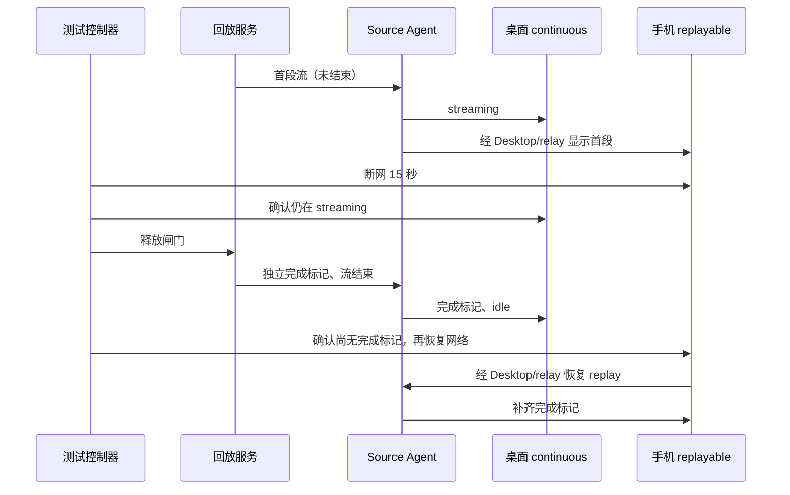

# R3 远程 e2e 服务器 harness（同机模拟）

编排代码在 `harness/remote/`；本文是它的事实说明。目标：**全部远程连接 e2e case 都能在一台
Linux 服务器上跑**，远端用同机 Docker 容器模拟，不追求跨机验证。

当前命令、构建环境、源码验真、调度和清理规则统一见 [harness README](../../harness/remote/README.md)。
本文保留拓扑、真实/模拟边界、case 档位和历史归因；不同日期的结果不能拼成当前全量 PASS。
10 月 SSH 范围结果见[指南回归](desktop-ssh-guide-regression.md)。

完整验收的 50 次/2 小时目标见[测试方案](r3-remote-automation-plan.md)；本 harness 的 10 轮/10 分钟只证明相应较短档位。

## 2026-10-11 全量复验结果

Status: done

本轮目标已完成：同一业务基线的 **90 份远程 spec、109 个任务全部执行**；按每个任务最新有效证据汇总，
**80 PASS、29 FAIL**，无未执行、未分诊或环境阻塞项。29 个失败当时均记录为业务行为，未修改业务代码。后续根因复核已撤回其中的旧恢复合同误判，见下节。
测试修复已复验；被业务失败阻塞的后续断言列在各问题记录中。
已撤回错误的本地归属 PASS 和走查收集器吞异常产生的 PASS。
这不是单一批次全绿，也不是人工转正或 CI 准入。

最终测试补丁 10 的完整源码清单 SHA-256 为
`423980d542925b4f4b31a8fe00f02d23372d5b8c7a443974c41d0a34aa289c9c`，test / production 均验真，
继续复用既定业务构建。单线路和多线路自然旧历史、实际旧程序回退、真实 Team/ZAPI/Docker、
手机两场景、10 轮重连和 10 分钟双端稳定性均已有通过证据。手机是 Chromium 触屏 viewport，
原生 Windows/macOS 专项不由本次 Linux 服务器运行替代。

补丁 09 批次 `r3-server-20261011150809016-2aeaba`：3 PASS、4 FAIL；
补丁 10 批次 `r3-server-20261011153818711-6d284c`：无障碍 PASS（153.6 秒），走查 FAIL（264.0 秒）。
走查的 45 组取证保留完整视频，唯一失败为收起进度卡；真实容器停起后端端口从 33089 变为 33091，
通过稳定代理恢复原应用线路；拖拽和恢复段落均完成。P0 四回合历史隔离及遥测完成后，仍因 B 行运行标志缺失失败。

### 2026-10-12 根因复核

问题 11 已按凭据所有权修复；问题 15 的“新版冷启动必须恢复旧列表全部 tabs”与虚拟项目 F5
冲突，已撤回该业务定性。新版只恢复 `lastActiveWorkspace`，其他项目入口保留并按需打开。
`project-order` 原失败实际发生在手动连接后等待未激活 tab，不是冷启动 B 恢复失败。
复核批次 `r3-server-20261012012923737-60d156` 的五项冷启动验收全部通过；25 当时保留业务 FAIL，随后已修复。
本轮定向结果以[问题 11](../issues/remote-e2e-stability/11-ssh-credential-missing-after-restart.md)、
[问题 15](../issues/remote-e2e-stability/15-cold-start-open-workspace-siblings.md)的新证据为准，
下表保留原批次任务映射，不再表示当前有 29 个已确认业务缺陷。
问题 25 在启动 owner 补齐 app-owned cwd 后，批次 `r3-server-20261012013853643-f32109` 的原设置变更场景与远程冷启动均 PASS；Worker 重启前后 exit=0 且正常发出存储完成帧，详见[问题 25](../issues/remote-e2e-stability/25-data-directory-restart-startup-failure.md)。

问题 07 已修复项目菜单/未加载 tab 的向导交接、凭据错误码缺失及新恢复周期误读旧终态错误。
基线 `07c35ed00085b9bb105d07633488951ff02032c2` 加最终补丁，源码清单 SHA-256 为
`3da756d09a6a91969782149c7f1d177124e49e5def287fcfde14ed11d56cd85d`。
批次 `r3-server-20261012042036306-3218d0` 与 `r3-server-20261012042909750-5eed5a`
使用同一源码及构建，问题 07 的七项和相邻恢复/冷启动两项全部 PASS。
后台更新的旧双 tab 断言按 F5 改为活动项目自动恢复、其他项目按需打开；手动升级仍验证 A/B 恢复。
详情与验证限制见[问题 07](../issues/remote-e2e-stability/07-existing-project-upgrade-intent.md)。
这九项定向结果不代表重跑了 109 项全量，也不是用例转正或 CI 准入。

### 原批次失败映射

| 任务                                                                                                                                                                 | 本地问题记录                                                                                                                      |
| -------------------------------------------------------------------------------------------------------------------------------------------------------------------- | --------------------------------------------------------------------------------------------------------------------------------- |
| `serverupdate`, `serverupdate-force`, `uninstall`, `version-manual-required`, `version-snapshot-failure-required`, `version-automatic-required`, `projectnavigation` | [原项目连接中的认证、升级与重装交接缺失](../issues/remote-e2e-stability/07-existing-project-upgrade-intent.md)                    |
| `boundary`, `recov`, `project-order`                                                                                                                                 | [SSH 已保存连接在冷重启后缺少凭据](../issues/remote-e2e-stability/11-ssh-credential-missing-after-restart.md)                     |
| `sourcelines`                                                                                                                                                        | [远程项目从符号链接创建任务后未收敛到 realpath identity](../issues/remote-e2e-stability/12-project-symlink-workspace-identity.md) |
| `renderer`                                                                                                                                                           | [Renderer 重载后已就绪的远程任务无法切换](../issues/remote-e2e-stability/14-renderer-reload-task-navigation.md)                   |
| `mixed`, `coldreconnect`, `rdux14`                                                                                                                                   | [冷启动未补齐已打开的另一远程工作区](../issues/remote-e2e-stability/15-cold-start-open-workspace-siblings.md)                     |
| `settings-safeguards`                                                                                                                                                | [设置页“在侧边栏中显示”未定位项目焦点](../issues/remote-e2e-stability/16-settings-show-project-focus.md)                          |
| `directory-missing`, `directory-file`, `directory-denied`                                                                                                            | [远程主目录失效后原任务历史无法打开](../issues/remote-e2e-stability/17-unavailable-root-history-navigation.md)                    |
| `history-conflict`, `history-conflict-sources`                                                                                                                       | [单个工作区历史冲突阻塞整个远程项目选择页](../issues/remote-e2e-stability/19-history-conflict-blocks-project-picker.md)           |
| `retry-budget`                                                                                                                                                       | [自动重连执行三次，但项目页不显示重试进度](../issues/remote-e2e-stability/20-retry-progress-not-visible.md)                       |
| `version-optional`                                                                                                                                                   | [兼容版本连接成功后，设备卡缺少可延后的更新提示](../issues/remote-e2e-stability/21-optional-update-notice-missing.md)             |
| `uipairwise`                                                                                                                                                         | [从项目菜单打开编辑器后焦点仍在页面 body](../issues/remote-e2e-stability/22-project-editor-focus-missing.md)                      |
| `version-controller-required`                                                                                                                                        | [版本门禁详情没有说明应升级桌面端](../issues/remote-e2e-stability/23-desktop-upgrade-guidance-missing.md)                         |
| `p0-main`                                                                                                                                                            | [远程会话正在生成，侧栏任务行没有运行标志](../issues/remote-e2e-stability/24-remote-task-running-indicator-missing.md)            |
| `desktopauthority`                                                                                                                                                   | [桌面设置和数据目录变更后冷启动失败](../issues/remote-e2e-stability/25-data-directory-restart-startup-failure.md)                 |
| `uiwalkthrough`, `three-screen`                                                                                                                                      | [收起连接向导后主界面没有进度卡](../issues/remote-e2e-stability/26-minimized-connection-progress-missing.md)                      |

另有不单独决定任务终态的[启动重连说明仍写 7 天](../issues/remote-e2e-stability/13-startup-reconnect-description.md)。
[旧历史打不开疑点](../issues/remote-e2e-stability/18-upgraded-project-history-open.md) 已按真实点击和完整回退证据排除，归为测试修复。
各问题记录写明已到达步骤、运行证据及被阻塞的后续断言；失败没有被删除或改成跳过。

### 耗时与测试可靠性

- 正式卸载去掉固定 3 + 30 秒等待，按两次真实确认提示输入；卸载命令实测 1527ms，保留数据和身份断言。
- 历史冲突在项目页已有明确错误时立即失败：两个变体由 880.0 / 865.2 秒降为 328.2 / 304.8 秒；原业务冲突仍为 FAIL。
- 运行态采用显式回放闸门，拖拽采用激活事件屏障，刷新和重启不等待无关默认草稿；未缩短 10 分钟稳定性观察窗口。

原始批次、录像、日志、fixture 和源码清单保留在服务器各 batch/case artifact 中；本机
`packages/desktop/.e2e-artifacts/r3-full-20261011/` 保存批次终态及 `latest-results.json`。
业务问题需要后续修改产品后再验证；本轮只提交测试、夹具和文档。

### 执行沿革与验证细节

起点业务 commit 为 `d31e735905cf744e75a0a93548a80acabe871ae5`，工作区原先无未提交修改。
首轮批次为 `r3-server-20261011100322804-2c6d71`，在新的 test / production 部署中构建并运行，
保留原部署与 `7a6e2eb3f1946aba9155155178e86cd947cee655` 旧版升级夹具。
首轮原始计划共 108 项，包含待补执行的离线项目策略项；后续测试修复与复跑结果须单列。
清单复核发现版本策略的 `snapshot-failure-required` 已有接受规格和 case 分支却未入队，
补入后计划为 109 项；离线项目策略改为实际执行项，不再以专用 fixture 阻塞代替运行。

全量首跑和早期取消记录：

| 批次                                 | 范围与结果                                                                      | 后续动作                                                                                |
| ------------------------------------ | ------------------------------------------------------------------------------- | --------------------------------------------------------------------------------------- |
| `r3-server-20261011100322804-2c6d71` | 原始 108 项：6 FAIL、101 NOT_RUN、1 BLOCKED_ENV                                 | 首批共同失败后正常取消；运行时确认项目区未 hover、按钮父容器 opacity 为 0，修正测试手势 |
| `r3-server-20261011101534847-c8a52a` | 定向 3 项：projectpolicy PASS；boundary、version-snapshot-failure-required FAIL | Linux 离线项目完整验证通过；升级入口回归记录于问题 07，边界说明继续分诊                 |
| `r3-server-20261011101924000-585080` | 修正队列 109 项：3 FAIL、106 NOT_RUN                                            | 录像确认新版项目选择弹窗已打开，旧准备循环误判关闭并点击遮挡侧栏；取消后删除重复判断    |
| `r3-server-20261011102357092-0ef726` | ackloss 原始 PASS，148.6 秒（后续归属审计不通过）                               | 原报告通过，但后续发现全局新建会跳到本地；不能作为有效远程覆盖，须在归属修复后重验      |

全量恢复批次为 `r3-server-20261011102656782-52518d`，独立进程服务
`r3-full-20261011-03` 已在发现公共任务归属错误后正常取消。该批 ackloss 原始状态为 PASS，
但现有 helper 在选好远程模型后又全局新建任务；运行时确认 recov、renderer 的 active identity
为空、cwd 为本地未分类目录，soakrecon 错用本地模型后发生 replay 协议重试。该批涉及此准备链
的结果均须在删除多余全局新建、补发送前 identity/path 断言后重跑，不能沿用原 PASS 证明远程覆盖；
边界说明的当前入口差异见[问题 10](../issues/remote-e2e-stability/10-connection-wizard-test-entry.md)。

后续有效远程归属复验：

| 批次                                 | 范围与结果                                     | 证据边界                                                                       |
| ------------------------------------ | ---------------------------------------------- | ------------------------------------------------------------------------------ |
| `r3-server-20261011103719304-29be6d` | ackloss PASS，148.7 秒                         | 发送前确认实际远程 identity/path；替代早前无效的本地执行结果                   |
| `r3-server-20261011104332183-3a0c00` | boundary FAIL，90.1 秒；ackloss PASS，146.5 秒 | 首次/第二项目说明通过；冷重启凭据丢失记录为问题 11。单个耗时样本不证明稳定加速 |
| `r3-server-20261011105317614-4a6780` | 109 项全部执行：37 PASS、70 FAIL、2 ERROR      | 业务版本不变，测试补丁 05；运行期间本地后续修复没有写进正在执行的部署          |

测试补丁 06 的定向批次 `r3-server-20261011123601821-eca14c`：5 PASS、5 FAIL。
通过 entryattr、cancelretry、botidentity、mobileperm、live-team；Team 使用用户重新登录后的材料。
失败中的 provisioning-failure 已到达真实同步失败，需展开折叠详情核对技术代码；sidebar-menus
完成在线/离线、中英/主题矩阵及重连，末尾把正常 hover 提示误当残留弹层；history-single
生成了同目录“(2)”新项目，旧任务仍属于原项目，改为按迁移后的 projectId 重新加入原项目。
Renderer 任务切换继续分诊，见[问题 14](../issues/remote-e2e-stability/14-renderer-reload-task-navigation.md)。

补丁 07 的定向队列覆盖首轮 FAIL/ERROR 中尚未通过的 67 项，已全部结束：29 PASS、38 FAIL。
已通过结果保留各自的源码清单与批次；原始累计 71 个 PASS 中，走查项随后撤回，有效数为 70。
这是同一业务基线上的全量首跑与逐项复验，不宣称一个源码批次已全部通过。

补丁 08 批次 `r3-server-20261011143037600-31012b` 的 23 项复验已全部结束：原始结果 7 PASS、16 FAIL。
审计发现 uiwalkthrough 会吞掉段落失败：两批均有后台进度、容器恢复和拖拽段落失败，原始 PASS 撤回有效统计。
排除该项后，此阶段累计 76 个任务取得有效 PASS；走查继续收集全部段落证据，但任何段落异常必须使最终 verdict 失败。
逐帧采样也必须达到目标状态；时间用完而条件未满足不能仅返回 false 后被调用方忽略。
实测 Docker 动态 SSH 映射在容器重启后从 33087 变为 33088，旧端口不可达而新端口正常。
走查通过全程持有的 TCP 代理保持应用侧线路稳定，重启后按 Docker 的实际映射更新后端；保留真实停容器、掉线与重新握手。
手机两个场景和显式插件同步已通过；随后对 7 项测试修复或补充验证执行补丁 09，业务失败保留。

补丁 07 批次 `r3-server-20261011125749338-152f05` 的 `soakdual` 已通过，整体 686.3 秒，
保留完整 10 分钟观察窗口并完成 65 轮（轮次累计 603370ms、21 次手机断网恢复）。
输入丢失、桌面缺失、手机回显缺失与断网恢复失败均为 0，
Host / Agent 最大数量各为 1。RSS 首尾采样 1220 / 1211 MB；这只是本次样本，不外推为长期无泄漏证明。

本地后续测试修复的检查：root 与 E2E 类型检查通过，architecture 无违规；受影响单测
35 文件、142 项及 Node 脚本 14 项通过；lint 为 0 errors、207 个既有 warnings。
51 份变更 conversation spec 中，48 份回放 fixture 合同通过；`live-team`、`live-zapi`、
`dockertrn` 使用真实账号请求，原基线未配置回放 fixture/manifest，通用 fixture 检查器对这三项报缺失。
保留该检查限制，以实际 live 队列为执行证据，不为通过检查伪造回放响应，也不据此转正。

测试修复与证据边界：

- 全局新任务属于本地未分类；远程发送使用项目草稿，按 Source identity + path 等待。
  相同路径的 Source B 不能借用 Source A 已激活的状态提前通过。
- 连接向导专项从设置页进入；关闭后在同一设置页重试。新版项目入口和独立三屏向导分别验证。
  旧版升级历史固定使用旧 UI 操作，不套用新版目录摘要和项目编辑器。
  回退到旧程序后由旧版新建草稿入口重新连接原目录，不借新版项目行选择器作为前置。
  最近目录快捷入口也会打开带预选 root 的项目编辑器；先核对目录并完成保存，才能继续设置操作。
  项目选择页的明确错误应立即终止等待并带出原始原因，不能把被错误禁用的“新项目”按钮当作仍在加载。
  桌面版本门禁沿当前“需要处理 → 详细信息”入口读取可见升级原因，并验证远端归档未降级，不只扫描未展开的主页。
  从设置页收起连接向导后返回主界面，再核对合同要求的项目区进度卡；设置页自身不是卡片的展示位置。
- 主动断开等待目标项目的实际 offline 投影，不等待退役的 settings history failed 字段。
  Renderer reload 以每个原 attachment 的有效 Main ready ACK 为恢复证据，导航缓存不代替 attachment owner。
  无障碍和桌面设置场景的刷新/冷重启只等待可操作主界面，不额外要求恢复与该断言无关的默认项目草稿。
  retry-budget 保留三次可见进度要求；该展示断言放在场景末尾，使进度缺失不会阻止后续静默恢复和手动接管取证。
- [当前项目规格](../superpowers/specs/2026-10-10-session-manage-upstream-integration.md) 下，设备详情/编辑在设置页，
  侧栏验证项目菜单、设备名称、键盘、主题和视口。移除本机入口后重新加入原远端项目，
  不把同目录新建项目当成原项目恢复，也不要求 membership 移除关闭整个 Source attachment。
- 目录失效验证采用[主目录可用性合同](../project-primary-root-availability.md)：
  Source/B/C 保持在线，A 的新建/文件入口禁用、历史可读；目录恢复后 focus 刷新再续聊。
- provisioning-failure 原用例在安装确认停留约 10 分钟；改为实际确认首装后观察注入故障。
  故障收尾仅在凭据文件锁内恢复注入键，保留连接期间新保存的 SSH 凭据。
- 正式卸载通过真实两次确认提示逐次输入 DELETE，移除旧 shell 管道的固定 3 + 30 秒等待；
  保留卸载 CLI 与数据哨兵核对，并记录实际卸载耗时。定向批次 `r3-server-20261011123601821-eca14c`
  的正式卸载阶段实测 1527ms；整体用例仍在重新安装入口失败，不把优化后的执行算作 PASS。
- SSH P0 的首发/续发使用现有 controlled replay：首段输出后停在闸门，侧栏 active/running 断言完成后释放结束帧。
  固定 1200ms 响应曾先于侧栏观测完成，不能以加长固定等待或删除运行态断言处理；失败诊断记录最终布尔状态。
  已确认的运行图标缺失延至末尾汇总失败，继续核对四回合历史和遥测；行归属、active 或 error 不符仍立即失败。
- Bot 合成身份夹具区分旧上下文（无 hostId）与新版项目授权键。真实 Bot service 探针修复前拒绝授权，
  修复后两次投递都进入同一 Source，一次连接、本机零投递；已在真实队列通过。
- 手机首页已显示共享项目/任务，旧配对文案不再存在。就绪链为“配对 URL → 指定项目/任务可见 →
  Desktop 手机连接状态 → 业务操作”；不拿空侧栏判成功，长稳观察窗口不缩短。
  同文件后续场景复用已登录远程页面时，先显式回到默认本地项目完成准备；每次覆盖浏览器句柄前关闭旧实例。
- 显式插件同步先核对“已同步”及远端物化，再关闭结果弹窗，从原项目创建验证会话；不穿过模态遮罩点击侧栏。
- 图片预览按主 pane 限定已发送缩略图，通过真实指针打开；重连后的退场 DOM 不作为交互目标，失败时保留独立诊断快照。
- 项目拖拽先跨越激活阈值并观察 aria-pressed，再发送实际位移；一次合并后的鼠标事件可能只激活 sensor，不能当作已发生拖动。无障碍与走查共用同一手势。
- Provider 设置刷新回到原工作区，不等待未切换过的本地默认目录；空参数 tab 探针读取实际激活项目，
  不能把未匹配到任何路径误当作“没有 remote session”。相关单测与本轮真实 E2E 已完成验证。

测试补丁的完整源码清单与补丁摘要独立保存；业务 commit 始终为上述起点。前两次取消不计为
完整执行，也不把 NOT_RUN 合并成通过。失败录像、日志和逐阶段耗时保留在各原始批次中。

本轮覆盖所选业务基线的完整远程队列，包含桌面 SSH、手机、Docker、真实账号和旧版历史变体。
以实际源码清单、构建环境、batchId 和逐项结果归因，不合并不同业务版本的通过次数。
专用 fixture 项保留在分母；补齐独立环境后实际执行，不以静态审计或环境探针代替 E2E。

- 测试代码问题：先保存失败日志、界面和状态证据，核对接受规格；只修改 case、fixture 或编排，
  保留原断言和覆盖范围，复跑受影响项后记录修复结果。
- 业务代码问题：保存复现、预期与实际、运行版本和影响，写入本地问题台账；本轮不修改业务实现。
- 耗时优化：先记录准备、交互、回放和清理耗时，再消除无业务意义的等待或重复准备，
  使用同一业务基线做前后对比；不缩短长稳观察窗口、吞掉失败或靠自动重试提高通过率。
- 完成条件：完整清单每项都有实际结果；测试问题已修复并复验，业务问题有证据和记录，
  耗时问题已评估并完成可保持语义的优化，适用代码检查通过。环境阻塞不能记作 PASS。

```text
固定业务基线 → 验真 test / production → 完整队列与逐项耗时
                                        ├─ 测试问题 → 修复 → 同基线复验
                                        ├─ 业务问题 → 本地 Issue 与原始证据
                                        └─ 慢用例 → 测量 → 保持覆盖的优化 → 对比
```

## 拓扑

### 隔离并行与可信结果（2026-09-16）

优化以现行业务断言为约束：不缩短 soak 的 10 分钟/10 轮，不把故障流改为正常响应，不把
生产握手、安装、Provisioning 或远端执行改成测试替身。纯准备动作可以播种本机 fixture；
安装测试仍使用全新目标。与项目平铺合同冲突的旧用例必须迁移或明确报告合同阻塞，不能
以超时归为产品失败，也不能过滤后声称全量通过。

```text
固定源码/构建 → 调度器（唯一资源与结果 owner）
                 ├─ 槽 1：独立 HOME/display/runId/container → case 串行
                 ├─ 槽 2：独立 HOME/display/runId/container
                 └─ 槽 3：独立 HOME/display/runId/container
                         ↓
                  逐 case 结果 → 全量汇总（等待全部结束）
```

资源准入、手机独占、live 互斥、批次锁、证据与失败退出规则见 README。
必须保留独立 HOME/display/目标、真实安装与握手、全部计划分母以及 FAIL/BLOCKED/ERROR/TIMEOUT 的区分；不得自动重试掩盖失败。

验收：调度单测证明并发上限、live 互斥、纯桌面 soak 与普通用例重叠、手机项全程独占、失败继续且结果完整；
进程级验证证明超时回收和显示服务清理；选择普通 SSH、双目标/故障及 soak 代表做小批验证。
抽样只验证编排机制；case 稳定性仍以完整清单和最终断言的实际独立执行证据为准。业务失败和环境阻塞不算通过。

三槽默认值依据 2026-09-24 的同源码六项对照（全部通过，墙钟 493.35 秒 → 422.54 秒）及修复手机独占后的完整 70 项执行：批次 `r3-server-20260924160231661-54c15b` 用时 4029.12 秒，平均 CPU 71.21%，最低可用内存 3617.2 MiB。该完整轮为 64 PASS、4 已记录业务 FAIL、2 VPN BLOCKED_ENV；三项手机页面均无资源加载错误，且执行区间无重叠。全量源码与早期两槽轮不同，不能把墙钟差额全归因于并发；同源码对照仅支持所测六项约 14.4% 的墙钟改善。

2026-09-24 后续候选记录：其后补强的 Provisioning PRV-12 写入失败恢复场景已独立验证三次；PRV-13 的真实未返回 RPC 场景则三次暴露了[设备管理页被远端统计阻塞](../issues/remote-e2e-stability/04-management-blocked-by-remote-counts.md)。该项整体仍为 FAIL，不能沿用完整轮旧版本的 PASS。该历史候选保留 70 项分母：63 项已有至少三次有效通过证据，5 项存在业务失败或后续断言未到达，2 项 VPN 阻塞；原生编辑器正向分支也尚未在 macOS/Windows 验证。

```
┌──────────────── e2e 服务器（Ubuntu 24.04 / x86_64）────────────────┐
│ xvfb-wm-run: Xvfb 动态 display + openbox + dbus-session                    │
│   └─ wdio → Electron Desktop（每 case 独立 HOME/profile）  │
│         │ 产品 SSH 弹窗：127.0.0.1:<映射端口>，dev / 每轮随机密码  │
│         ▼                                                          │
│   docker: zcode-r3-server-a  [dev + tunnel 用户]                  │
│                          c / d / e / f / dt（其余档位）            │
│                                                                    │
│   replay provider ──SSH forwardIn(tunnel 用户)──► 容器内 127.0.0.1 │
│   docker exec ─────────────────────────────────► 故障注入 / 探针   │
│   mock-cdn/releases/<版本> ─── 本地下载或上传安装 zcode-server     │
└────────────────────────────────────────────────────────────────────┘
```

关键点：SSH 协议、远端 sshd、远端 server/Agent 进程、远端文件系统都是真的；被模拟的只有
"另一台机器"这件事。容器端口只绑 `127.0.0.1`，因此 Desktop 必须与容器同机。

## 真实 / 模拟边界

| 环节              | 实现                                                                                                                                                                    |
| ----------------- | ----------------------------------------------------------------------------------------------------------------------------------------------------------------------- |
| 连接              | 产品 SSH 弹窗真实填 host/port/user/password，仅密码认证                                                                                                                 |
| 远端主机          | 同机 Docker 容器（`zcode-remote-ssh:test`），每 case 重建                                                                                                               |
| 远端 server/Agent | 真装真跑，测试读远端 PID/startTicks/日志对账                                                                                                                            |
| server 产物       | 本机构建的 `mock-cdn/releases/<版本>`，走"本地下载/上传"安装，不用真 CDN                                                                                                |
| 模型请求          | 默认 replay：`createSSHReplayTunnel` 经 SSH 反向端口转发把本机 replay server 暴露成容器内 `127.0.0.1:<port>`；`tunnel` 用户单独承载，避免被"杀 dev 的 sshd"故障连带     |
| 真实模型          | 仅 `live-zapi`、`live-bigmodel-team`、`docker-transport` 三个 case                                                                                                      |
| 故障注入          | `docker exec` 杀容器内 sshd / 只读探针；本机 loopback TCP 代理挂起首连；本机 HTTP 代理验证下载路径；伪造 release 源                                                     |
| 手机端            | 本机 chromium（`R3_MOBILE_CHROME`）390×844 viewport；默认托管同批源码的 v4 Web 构建，使用标准 test 外部 relay（`wss://zcode.z.ai/ws`）；显式页面 URL 覆盖仍有效 |

## Case 与档位映射

队列 `harness/remote/run-all-remote.sh` 声明完整清单，交由 `run-queue.mjs` 调度。精确列表用 `node harness/remote/run-queue.mjs --list` 查询；受限安装的三个变体分别计执行项。`projectpolicy` 使用 runner 的独立 HOME 自行播种离线入口，以无目标档位执行；不以在线 SSH 项目替代离线断言。其余用例按以下能力分组：

`SSH-P0-CONN-08`（`conversation-session-ssh-provisioning-failure.test.ts`）作为命名例外纳入远程清单，
使用队列 key `provisioning-failure` 和普通单 SSH 目标执行。该用例验证损坏凭据的安全诊断与恢复重试，
不发送模型请求，不需要 live 账号；仍保留 pending 状态，入队不代表人工转正或运行通过。

`R3A-DEV-06-hooks-local-scope` 与横幅重连 spec 分别使用队列 key `hooks-local-scope` 和
`banner-reconnect`，以普通单 SSH 目标、`replay` 组执行。前者验证本机与远端 Hooks scope
落盘隔离；后者在用例内创建 TCP 代理并注入断连，整份 spec 顺序执行，不过滤其中的握手前断开场景。
两者均保留 pending 状态；清单检查还需核对实际生成的执行计划，防止只登记 spec 却漏排队列。

| 组                           | 档位                                       | 说明                                                                                                                                                         |
| ---------------------------- | ------------------------------------------ | ------------------------------------------------------------------------------------------------------------------------------------------------------------ |
| 1 结构与恢复                 | `a`（entry-attribution 用 `a`+`c`）        | boundary / ack-loss / mixed / recovery / renderer / shared-waiters / source-lines / stale-gen / transport-loss                                               |
| 2 UI / 设备 / 设置           | `a`，offline-icons 与 remote-dialog 零连接 | device-row / task-actions / ui-pairwise / settings-scopes / desktop-settings-authority / offline-icons / remote-dialog / settings-ui-polish(MP-UI-05-remote) |
| 3 Provider / 模型            | `a`                                        | project-entry / provisioning-gui / model-candidates / connectivity / model-switch / queue-selection / provisioning-ready                                     |
| 4 任务 / 会话                | `a`                                        | compact-goal / subagent / task-control / task-faults / task-lifecycle / settings-overlay                                                                     |
| 5 远端开发                   | `a`                                        | attachments / media-preview / file-local-actions / remote-hooks / terminal                                                                                   |
| 6 安装 / 升级 / 连接生命周期 | `a`（install-faults 用 `a`+`c`）           | daemon-detached / install-faults / server-update / uninstall / cancel-retry / cold-reconnect / server-fault / download-proxy                                 |
| 7 既有 P0                    | `a`，development-p0 需带 git 的容器        | ssh-remote-p0 / connection-p0 / development-p0                                                                                                               |
| 8 RDUX 与 scope              | `a`                                        | rdux-13 / rdux-14 / project-conversation-scope / share-ssh-artifact                                                                                          |
| 9 远程 workspace 插件        | identity 用 `a`+`c`，sync 用 `a`           | WPL-010 / WPL-011                                                                                                                                            |
| 10 Bot 远程 workspace        | 无容器                                     | BOT-E2E-RW-01（synthetic fixture 契约）                                                                                                                      |
| 11 移动端                    | `a` + chromium + relay                     | mobile / mobile-permission                                                                                                                                   |
| 12 soak                      | `a`                                        | soak-reconnect(10 轮) / soak-dual(10 分钟)                                                                                                                   |
| 13 受限环境安装              | `d` / `e` / `f` / `g`                      | noexec-tmp / no-tar / no-forwarding / old-glibc（注入返回 `glibc 2.17` 的 getconf）                                                                          |
| 14 live                      | `a`，docker transport 用 `dt`              | live-zapi / live-bigmodel-team / docker-transport                                                                                                            |

覆盖门禁：`packages/desktop/scripts/r3-remote-spec-inventory.mjs` 是远程 spec 清单单点，
`packages/desktop/test/r3RemoteSpecInventory.test.ts` 校验队列排满清单。现有档位造不出 fixture 的用例必须显式报告阻塞，不得从计划分母消失。RDUX-16 已在 case 内真实首装，再通过本 run 的 staged archive 构造同版本异 SHA 更新；不再要求人工预装。更新与安装故障解除本 run 的硬链接后再写，公共构建包保持只读。

### 项目导航迁移与用例价值

9 月 16 日项目平铺合同替代了设备组头/connect-and-chat。保留文件名便于追溯，断言改为现行行为：

| 用例                                     | 当前验收行为                                                                     |
| ---------------------------------------- | -------------------------------------------------------------------------------- |
| RDUX-13、device-row                      | 项目重连保留目录、重复点击仅一个向导；设置页连接后显式选目录；同 Source A/B 恢复 |
| 原 CWP13/CWP15 project/conversation      | RPN-03/07：A/B 项目 session 独立、不能退出到远程无项目聊天                       |
| entry-attribution                        | 两个 Source 同路径项目的新建归属；第二项目不重复首次 Provisioning                |
| settings-scopes                          | User 落本机，远端项目 A/B 按 identity 分别落盘                                   |
| mixed-entries、provisioning-gui          | 本地与远端 A/B 恢复；断线期间配置变化重连后同步，项目 session 独立               |
| recovery-guards、cold-reconnect、RDUX-14 | 离线项目保留；启动/显式断开守卫、历史与换代断言保留；使用设置页/项目行           |
| offline-icons、ui-pairwise               | 设置页连接按钮键盘可达；英文深色窄窗口/中文浅色桌面下项目详情和重连可用          |

`--audit` 仅防止已知退役入口回流，不代表运行通过；真实产品路径仍由 E2E 证明。
case 内步骤保持顺序，desktop continuous 与 mobile replayable 的恢复断言不合并。

`model-switch`、`queue-selection` 的 slow fixture 在关键操作完成后显式释放，不空等 45 秒。
队列用例按 admission 合同检查唯一请求的 `model` 为 A，不再同时等待 A/B 两条互斥请求直到
其中一条耗尽 90 秒。recorded/fault stream 禁止使用释放机制，回放证据记录实际释放时间。
Provider 准备只播种本机 Personal Config 并通过真实刷新按钮更新 Registry；远端仍经产品
Provisioning。验证 Provider 保存/删除的用例继续使用真实设置 UI。

## 飞连 VPN 环境准入

### 测试前自动准备与人工认证等待

`vpn.mjs` 统一负责部署和队列的 VPN 前置检查。已就绪直接继续；未就绪时只调用一次固定权限
helper，幂等启动服务并恢复 Docker 路由保护。客户端已运行时不按存活时间重启：2026-10-11
实机已自动到达一次性口令窗口，旧的五分钟重启规则会打断未完成的认证。

准备默认最多等待 600 秒，可用 `R3_VPN_WAIT_SECONDS` 设置 1–3600 秒。等待上限只控制本次准备，
不是认证有效期；超时、取消均保留飞连现场。每次实际检查通过才放行，不以等待结束或进程存在
代替隧道、路由和 HTTPS 验证。取消须立即结束等待，不关闭共享 VPN。

开始准备和恢复成功时输出进度；等待 30 秒仍未就绪时只提示一次当前阻塞层：服务、VPN 连接、
Docker 路由或内网端点。只有连接层提示查看飞连窗口并完成其要求的登录/MFA；没有客户端
认证状态证据时，不把所有断线定性为 MFA。人工完成认证后，同一次准备自动继续，超时仍按
既有规则将依赖项记为 `BLOCKED_ENV`，不自动重跑已失败的测试。

```text
前置检查 → 已就绪 → 执行测试
    └─ 未就绪 → 幂等启动一次 → 持续检查真实就绪状态
                              ├─ 就绪 → 自动继续
                              ├─ 30 秒未就绪 → 一次诊断提示，保留认证窗口
                              └─ 等待上限 / 取消 → 阻塞 / NOT_RUN，保留共享连接
```

客户端“启动自动连接 VPN”仍是一次性前置。无法确认认证状态时不盲点连接开关、不自动提交
一次性口令；客户端本身卡死或用户关闭自动连接时，需要先诊断客户端，不以循环重启掩盖问题。

实机验证（2026-10-11）：在已有一次性口令窗口上部署新 helper，连续调用两次，再执行 35 秒
准备检查，客户端 PID 全程不变；等待期间只提示一次连接层诊断，超时返回非零并保留认证现场。
本轮未提交口令，未验证认证后的真实内网恢复；就绪后接续、最后一次等待的状态复核与取消由
聚焦回归测试覆盖。旧测试部署需同步新版 `vpn.mjs` 才使用新的等待预算和诊断提示。

VPN 是宿主共享基础设施，由 systemd 管理 `corplink.service`、`feilian-client.service` 和
`feilian-local-routing.service`。首次登录及企业 MFA 由授权用户完成，在飞连设置中启用
“启动自动连接 VPN”。测试不保存认证材料、不切换账号，不在每条 case 开关 VPN，结束后不关闭 VPN。

```text
宿主开机 → systemd 启动飞连 → 官方自动连接（必要时人工 MFA）
测试批次 → VPN 前置检查 → 必要时一次服务启动/恢复 → utun + Docker 路由 + HTTPS 探测
                                            ├─ 就绪 → 构建 → 每条依赖项只读复核 → case
                                            └─ 未就绪 → 依赖项 BLOCKED_ENV；其余 replay 可继续
```

`live-zapi`、`dockertrn` 显式声明 `R3_REQUIRE_VPN=1`；`--list`、`--audit` 与纯 replay
定向运行不启动 VPN。部署准备也执行 VPN 准入。检查要求服务 active、飞连 `utun` 有全局 IPv4、
Docker 子网仍走本机 bridge，以及 GitLab HTTPS 返回有效非 5xx 响应；401/403 只证明网络可达，
不冒充仓库认证成功。额外内网服务可由 `R3_VPN_PROBE_URLS` 配置无凭据、无查询参数的 HTTPS 地址。
批次保存脱敏 `vpn-preflight.json`；case 开始前复核失败报告环境阻塞，不启动 Electron。

恢复通过一次性安装的 root-owned 固定 helper 执行，仅授权 e2e 用户调用该无参数命令。
不授予任意 systemctl/shell 权限。helper 使用宿主锁；幂等启动缺失实例，始终保留已运行
客户端的认证现场，不按启动时间重启。超过就绪预算则明确失败，等待用户验证。
验收覆盖：健康状态不改服务、未连接触发恢复、MFA/网络/路由失败不能假通过、不相关 replay
不依赖 VPN，以及实机连接后的 GitLab 可达性。暂不运行全量 E2E。

实机验证记录（2026-09-17）：飞连 3.2.16 的“启动自动连接 VPN”已启用，重启
`feilian-client.service` 后触发官方连接流程。MFA 未完成时，检查返回
`servicesActive=true`、`dockerRouteSafe=true`、`tunnelReady=false`、`ready=false`，
正确阻塞；授权用户完成一次性认证后，`utun` 建立，GitLab 路由切到隧道，Docker
仍走 `docker0 / table 10144`。以 e2e 用户运行准备与检查均返回 `ready=true`，GitLab
登录页及 ZAPI 首页均 HTTP 200；准备约 0.23 秒，重复调用固定 helper 约 0.05 秒，客户端
PID 不变，健康连接没有被重启。带额外参数的 sudo 调用被拒绝。

GitLab 的 `git ls-remote` 已从连接超时变为缺少用户名/凭据，说明网络恢复，不代表已获得
仓库读取权限；CI checkout 仍需配置对应访问凭据。飞连界面提示本次连接 16 小时后自动断开。
启动自动连接不能绕过到期/MFA 策略；无人值守运行需企业管理员确认允许的自动接入策略，
否则前置检查会保留环境阻塞结果。测试脚本不保存认证材料，也不自动关闭共享 VPN。

## 环境注入合同

runner 从 `resources-<suffix>.json` 注入：

```
ZCODE_E2E_SSH_HOST / PORT / USERNAME / PASSWORD     每轮随机密码，docker exec chpasswd 写入
ZCODE_E2E_SSH_WORKSPACE_PATHS                        两个目录，A/B workspace 隔离用
ZCODE_E2E_SSH_WORKSPACE_PATH                         单 workspace 形态（WPL-011）
ZCODE_E2E_SSH_CONTAINER                              容器控制面（docker exec 故障注入）
ZCODE_E2E_SSH_{A,B}_{HOST,PORT,USERNAME,PASSWORD}    双 Source（R3_RESOURCES_B 存在时）
ZCODE_E2E_SSH_SHARED_WORKSPACE_PATH                  双 Source 共用的同一 POSIX 路径
DEEPSEEK_E2E_HTTP_MODE=replay + 按 spec 名匹配的 fixture
LANG/LC_ALL/LANGUAGE=zh_CN                           钉住中文界面（见下）
ZCODE_DEV_REMOTE_ASSET_USE_CDN / _CDN_BASE_URL / _CACHE_DIR
                                                     仅 local-download-proxy；Electron env 由
                                                     chromedriver 在 worker 前创建，case 内部
                                                     export 太晚，只能由编排注入
ZCODE_E2E_MOCHA_GREP                                 只跑 spec 内某个用例（settings-ui-polish
                                                     只有 MP-UI-05-remote 是远程用例）
```

## live-team 真实账号验证边界（2026-09-15 修复）

`conversation-session-r3-live-bigmodel-team.test.ts` 导入生产 BigModel 登录材料，必须独立运行，
并由 WDIO 在 launcher / worker / Electron 启动前统一选择生产 ZCode 控制面；
同时显式设置 `ZCODE_ENV=production` 和 `BIGMODEL_API_BASE_URL=https://bigmodel.cn`，
因为 Team 组织/项目校验的域名独立于 ZCode 控制面。SSH 的环境白名单透传 `ZCODE_ENV`，
不会透传 BigModel 地址覆盖；只覆盖本机地址时，远端仍会请求 `bigmodel.cn`。
真实账号用例还必须使用 `R3_BUILD_ENV=production` 构建：Desktop 的 `buildHostProcessEnv`
会重新注入编译期环境，且内置 Provider 配置也随构建档位变化，单改运行时变量不能替代生产构建。
可在独立部署目录运行 `R3_BUILD_ENV=production R3_LIVE_HOME=<导入后的HOME> node harness/remote/run-queue.mjs live-team share`，
保留普通回放部署的 test 构建。两种环境分别进入构建指纹和汇总报告，不能跨环境复用构建凭证。
全量可从 test 主目录设置 `R3_PRODUCTION_SERVER_BASE` 指向同源码的 production 部署，
由一份队列统一执行全部 70 项。两类构建在调度前准备，共用并发上限，并分别持有目录锁。
副本的 commit 或完整源码清单不同会阻塞其任务，不能把不同版本结果合并成完整覆盖。
显式的 E2E store bridge 开关继续保留。
真实账号的 SSH share 用例使用相同覆盖，普通 replay 与签名 capture 不额外覆盖 BigModel 域名。
`beforeSession` 的 mock 清理必须保留这项选择。不能把生产 JWT 发到默认测试域，
也不能依赖 URL 尾斜杠避开环境清理。普通 E2E 继续使用既有环境；现有签名 capture
preset 保持原行为。live-team 与其他 spec 混跑时，配置阶段明确拒绝，防止生产环境扩散。

```text
原路径：生产 JWT + 默认测试域 -> HTTP 401 -> 清理 BigModel OAuth / 过期弹窗 -> 用例失败
修复后：独立 live-team -> WDIO 统一选择并恢复生产控制面 -> SSH Provisioning -> 真实 Team 请求
```

远端凭据探针不要求全局 `node`，枚举 JSON 键名时必须保留键名内部的冒号；
模型选择和远端请求断言使用当前规范 ID `GLM-5.3-Flash`。测试仍需证明 BigModel OAuth
和 Team key 已同步、真实响应包含 `TEAM1`、replay 请求计数不变，以及远端请求的
provider/model/endpoint 正确。业务 401 退出、登录弹窗、SSH 协议和桌面/手机流语义不变。
请求超时也要在目标容器清理前保存远端模型网络阶段；只收集模型身份、地址和状态等白名单字段，
不保存凭据、请求头和 prompt 到用例 facts。

验证范围：聚焦的 endpoint 选择回归检查与服务器单个 live-team E2E；不重跑全量队列。

## 归因清单（2026-09-15，逐个复跑取证）

一句话结论：**这一轮 FAIL 里没有产品缺陷**。全部落在三类，按出现频次排列。

### 1. 测试代码与产品重构脱节

| 现象                                                                     | 真因                                                                                                                                                | 产品侧事实                                                                                                           |
| ------------------------------------------------------------------------ | --------------------------------------------------------------------------------------------------------------------------------------------------- | -------------------------------------------------------------------------------------------------------------------- |
| "没有找到远端文件树入口 / 没有显示更多菜单入口"（p0-dev、tasklifecycle） | workspace 行内 action 自 `da065a17cb` 改为 hover/focus 才挂载，纯 DOM 查询看不到                                                                    | 其余四个用同一入口的 case（含两个非远程）当时都补了 hover                                                            |
| WPL-011 "remote task header 没有更多菜单"                                | `d7b1d8a2a5` 把 header 上下文移进 `ControlHintTooltip`，`TID_WORKSPACE_PATH` 只剩 `aria-label`（显示名 + host，**不含绝对路径**），DOM `title` 消失 | 已补 `data-workspace-abs-path` 锚点并用 ui 单测锁住                                                                  |
| WPL-011 "没有'同步 Plugin'入口"                                          | 菜单项文案是 `remote.syncPlugins`＝"同步插件"                                                                                                       | 菜单确实是开着的（`moreState:"open"`）                                                                               |
| cancelretry "没有可用的返回按钮"                                         | 按钮文案是 `remote.backToConnection`＝"返回配置"                                                                                                    | 现场按钮排：收起／关闭／重试／返回配置／反馈／连接日志                                                               |
| SSH-P0-LIFE-02 daemon 探测空列表                                         | daemon 早已是 `server-cli.js serve --supervisor` + `server-core.js`，旧正则找 `zcode-server.cjs`                                                    | 故障注入还要连 core 一起停，否则 core 继续服务、UI 不会断开                                                          |
| serverfault "没有进入 disconnected 保留态"                               | 产品会**自愈**：拉起新 server、换新 `remoteSessionId`                                                                                               | 现场 `sessionsBeforeFault.A=9effdcc2…` → 读到 `9dcde31a…`，远端 `status.json` 是新 pid + `state:"ready"`             |
| devicerow "设置页返回按钮没有出现"                                       | 设置页里的"连接"派发 `connect-device` + `effect:"open-conversation"`，成功后产品自己离开设置页                                                      | 前一步 online 判定在设置页缺失时回退到 `document.body`（侧栏组头也带 `data-remote-connection-status`），所以照样通过 |

### 2. 测试自身 bug

| 现象                                           | 真因                                                                                                                                                                                                         |
| ---------------------------------------------- | ------------------------------------------------------------------------------------------------------------------------------------------------------------------------------------------------------------ |
| p0-dev / share "父目录没有显示目标目录"        | `pathInput.setValue()` 对受控 React input 的 clear 无效，`addValue` 追加到产品异步预填的远端 home 后面 → `/home/dev/home/dev/...`；预填是异步的，所以时好时坏、像环境抖动。改用 native value setter 覆盖写入 |
| 诊断里的现场事实全是空的（`()`、`visible=[]`） | `timeoutMsg` 是模板字符串，在 `waitUntil` **调用时**就求值，拿到的是探测前的初始值。**全仓 20+ 处同样写法**，现场事实必须在超时之后拼接                                                                      |
| devicerow 四轮各卡在不同位置                   | "各点一次然后等"在慢机上每步都可能落空；合并成按需重点的自愈循环后通过                                                                                                                                       |
| mediapreview 重连后 45s 打不开 gallery         | 远端 tab 重连后不会自动成为 primary pane，主区停在欢迎页；离线读取那步早就靠手动 `activateTab`，重连后同样需要                                                                                               |
| share 分享按钮 5s 不可点击                     | `$().waitForClickable()` 默认 5s；容器里 Chromium 把元素排到超大坐标会误判，应走 `clickTestIdByDom`                                                                                                          |

### 3. 编排缺口

| 现象                                                                          | 真因                                                                                                                                                                                                                                                                                                                                                                                                                                                                                                 |
| ----------------------------------------------------------------------------- | ---------------------------------------------------------------------------------------------------------------------------------------------------------------------------------------------------------------------------------------------------------------------------------------------------------------------------------------------------------------------------------------------------------------------------------------------------------------------------------------------------- |
| 8 个 case 找不到 `aria-label="更多"`、offline-icons 期望"重连"收到"Reconnect" | e2e 用户 `LANG=en_US.UTF-8`，Electron 起英文界面。runner 钉住 zh-CN                                                                                                                                                                                                                                                                                                                                                                                                                                  |
| downloadproxy 第一行断言 `received undefined`                                 | 三个 CDN/缓存 env **仓库里从来没有入口注入过**，这个 case 在任何机器上都跑不起来                                                                                                                                                                                                                                                                                                                                                                                                                     |
| share 等不到 `share-ssh-ready`                                                | 缺 replay 反向隧道：容器里的 `127.0.0.1` 是容器自己。该 case 沿用默认 replay provider，用 `mirrorLocalPort` 让远端监听同一端口号即可（已修，回复能拿到了）                                                                                                                                                                                                                                                                                                                                           |
| share 分享入口 `conversation-share-trigger` 始终 missing                      | 入口条件含 `user &&`，而 `user` 是 OAuth 产物（credentials 的 `oauth:<provider>:user_info`），API Key 登录不产生。已排除 `remoteTarget.kind`（实测 `"ssh"`）、header 缺失、草稿态。**仍未跑通**：补 OAuth 凭据要先让应用进到可操作状态，而该 case 沿用的老 conversation helper（`prepareConversationE2E` → `ensureDeepSeekProviderForE2E`）内部走 WebDriver clickable，正是容器里会误判的路径（`chat-model-select-trigger still not clickable`）。要跑通得先把它迁到 `prepareV4ConversationE2E` 体系 |
| settings-ui-polish FAIL                                                       | 远程用例 MP-UI-05-remote 本身通过，被同 spec 的本机用例 MP-UI-06 拖累；已用 `ZCODE_E2E_MOCHA_GREP` 只跑远程用例                                                                                                                                                                                                                                                                                                                                                                                      |
| 一整轮 8 个 case 各在 1 秒内 FAIL(1)                                          | 复跑脚本传的 runId 前缀不满足 runner 校验，而队列把 runner 输出丢进 `/dev/null` —— 编排失败与业务失败无法区分。现在写 `run-logs/<runId>.launcher.log`                                                                                                                                                                                                                                                                                                                                                |
| live-zapi / dockertrn                                                         | `zapi.z.ai` 从宿主与容器均不可达，等飞连（用户手动配）                                                                                                                                                                                                                                                                                                                                                                                                                                       |
| live-team                                                                     | 同上，注入 live 凭据后应用停在 `root-startup-loading`（`bodyText:""`、`localStorageKeys:[]`），启动阶段的账号请求打不通                                                                                                                                                                                                                                                                                                                                                                              |

### 结果（commit `7573244112` 全量）

**PASS 60 / FAIL 3**（上一轮同队列 PASS 49 / FAIL 15）。剩下 3 个：`share`（见上，需迁到 v4
helper 体系）、`live-zapi`、`live-team`（都等出网）。`dockertrn` 本轮转 PASS。

### 方法论（这一轮反复踩到）

1. **"超时"本身不能定性**，必须知道"再等下去会不会出现"。把一次性快照改成等待，很多"缺陷"就消失了。
2. 多条件判定的超时消息**必须输出现场事实**，否则必然误判 —— 但注意 `timeoutMsg` 提前求值这个坑，事实要在 catch 里拼。
3. 同一 case 每轮卡在**不同位置** ⇒ 时序敏感，不是固定缺陷；稳定卡在同一处才值得怀疑产品。
4. 修复要能自愈：菜单只点一次、hover 只做一次，都会在慢机上稳定失败。

## 复跑纪律

### 本轮优化验证（2026-09-16—17）

- 独立目录：`/home/e2e/z-code-perf-validation-20260916`，原 `/home/e2e/z-code` 未改动。
- 基线 commit 为 `f2707534a169e9fd004aace4ed1ac140945b1293`；工作区补丁逐文件校验，
  每批另存完整 `sourceRevision`。以下是代表样本，不是全量或 A/B 性能结论。
- 首个有效代表批次 `r3-server-20260916141026678-b89a82`：密码连接 PASS（134.1s）、
  模型切换 PASS（154.4s）、Bot 离线边界 PASS（36.7s）。
- 失联批次 `r3-server-20260916150349801-6fa9e1` 的证据已在恢复后取回：设备按钮 helper
  重复匹配设置页祖先 section，导致定位超时；Host 探针打开资源管理器留在前台，原始失败
  帧录到了探针窗口。soak 未进入十分钟循环，不能算作稳定性验证。queuesel 报告 TIMEOUT，
  install-progress 无终态，保留原台账与恢复说明，不将未收口项算通过。未取得 OOM 证据，
  不把 SSH 失联定性为内存问题。
- 修复后批次 `r3-server-20260916210607724-9bf65d`：device-row PASS（101.6s）、
  queuesel PASS（147.8s），两槽实际重叠。queue 证据确认运行中切到 B、排队请求仍使用 A、
  下一新请求使用 B。install-progress 失败在首装后仍调用空草稿菜单；现已改为设置页设备重连，
  保留真实更新阶段断言。
- 批次 `r3-server-20260916211525213-932f31`：soak-dual PASS（702.9s，含准备/清理），
  保留完整十分钟循环，100 轮、输入丢失/两端消息缺失/断网恢复失败均为 0，Host/Agent 最大数
  均为 1；安装更新进度 PASS（153.2s）。当轮可用内存约 6.6 GiB，按预约预算独占 soak，
  随后普通项双槽；已复用匹配的业务构建。
- 同批 offline-icons / project-navigation 暴露旧冷重启流程未重建 CDP bridge 的问题。
  远程用例统一复用已有安全重启：旧进程退出屏障、保留 Profile、新 bridge probe；窗口切换
  校验真实 handle/target 交集，并等待主界面就绪，不以裸 targetId 或固定 sleep 代替。
- 最终定向批次 `r3-server-20260916213247432-cd08ff`：offline-icons PASS（63.7s）、
  project-navigation PASS（69.2s）、queuesel PASS（145.1s）。队列中可用模型切换入口操作
  失败不再被吞掉；明确禁用才允许 drain 后切换。
- 主机探针改为只读 Main 的 `app.getAppMetrics()`，不再抢业务窗口焦点；设置卡从精确标题
  取最近 section。普通准备回合检查真实请求、回复与最终 idle，不要求探针捕获瞬时 streaming；
  业务 running 窗口仍通过 controlled-stream 验证。
- 本地 typecheck、typecheck:e2e、lint（61 条既有 warning、0 error）、架构（0 违规）通过；
  23 个聚焦单测文件，118 项通过、1 项平台跳过。受影响的 12 份 fixture 合同检查通过。
  没有执行全量；不得据代表样本宣称所有 case 稳定或转正。

1. 开发机 `sync-server-tree.mjs <commit> --base <旧 commit>` 推代码；服务器访问不了
   `git.example.invalid`（443 连接 135s 超时），所以不能 clone，同步后必须看到校验输出
   `mismatched: 0`（逐文件复算 git blob sha，symlink 按目标路径算）。
2. 服务器 `deploy-server.sh` 检查依赖与部署凭证（缺 ffmpeg / `.deployed-commit` 直接拒绝）。
3. `run-queue.mjs` 逐文件验证完整部署清单，再按构建指纹统一构建或复用，完成后才并行。构建指纹排除桌面测试、远程 harness、测试文档和远程 inventory 脚本，其余源码/配置及 commit、Node/平台、构建标志均参与；仅测试变更不会重编四个平台的发行产物。默认复用匹配凭证，`R3_REUSE_BUILD=0` 强制重建，`=1` 要求有效凭证；不能仅凭文件存在或版本号复用。
4. 全量 `run-all-remote.sh`；定向 `node harness/remote/run-queue.mjs <caseKey...>`。`recheck-run.sh <标签> <caseKey...>` 也走同一调度器，新批次保留首轮结果，不自动重试。
5. 结论必须带 commit：不同 commit 的 PASS/FAIL 不可合并统计。新调度器每批保存独立 summary；**不要用 `cp -al` 做快照**——硬链接同 inode 会被覆盖写一起改掉（实测导致
   两轮结果无法对比），要用 `cp -a`。
6. 编排层失败必须留痕：队列与复跑脚本都把 runner 的 stdout/stderr 写到
   `batches/<batchId>/<case>.launcher.log`，runner 的缺失终态/异常退出会记 ERROR。

## 手机恢复与权限用例的证据约束（2026-09-24）

`mobile` 的完成标记由 fixture 显式闸门控制，保留手机离线 15 秒的观察窗口。
桌面必须在手机仍离线时完成回合，手机只能在恢复 replay 后看到最终标记：



跨端 FIFO 也使用闸门：手机回合 running 时，桌面输入必须进入同一队列；释放手机回合后，
桌面输入才进入模型请求。两端以用户消息行核对次数与顺序，不能按整页正文里的词频统计。
两回合各有独立回复，分别要求一次模型请求；侧栏标题、助手引用和旧回复不能构成成功证据。

`mobileperm` 与桌面 `transportloss` 从远端正式 Agent 日志读取对应 Write 的
`tool.call.started` / `tool.call.completed`，按任务和 Write 限定，允许前为零次，允许后开始与完成各一次。
若重放产生了另一个调用 ID，也必须计入次数，不能只过滤预期 ID 而漏掉重复执行。
文件内容仍需核对，但覆盖相同一行不能证明工具只执行了一次。

消息取证、执行事件解析和实际 HTTP fixture 使用聚焦回归检查验证。
当前基线的手机用例已通过：补丁 08 批次 `r3-server-20261011143037600-31012b` 的 `mobile`
两个场景均成功，覆盖真实 relay、独立 replay、桌面 continuous、FIFO、原地重连及无模型草稿。
[较早的手机首页引导问题](../issues/remote-e2e-stability/01-mobile-home-onboarding.md) 保留旧基线记录，
不再作为当前这轮的阻塞项。此处手机证据为 Chromium 触屏 viewport，不能扩展为实体手机验证。

## 原生编辑器与远端媒体导出

`filelocal` 的 Linux 结果只覆盖远端文件读取、复制和本机操作禁用。Main 在 Linux 不枚举编辑器，
因此即使该分支 PASS，仍缺少 Remote-SSH URI 正向证据。macOS 用例要求实际安装 VS Code，
在本轮 artifact 目录创建可执行 `code` 录制夹具，并只修改测试 Electron Main 的 PATH；结束后恢复。
夹具保留参数个数和各参数 SHA-256，完整匹配期望的 `--file-uri` 与 authority/path，避免明文记录
错误参数里可能夹带的凭据。找不到 VS Code 或未调用 CLI 都明确失败，不能静默跳过。
Windows 需由原生测试环境提供 `R3_CODE_STUB_DIR/code.exe`；它向同目录 `code-calls.jsonl`
逐次追加 `{argumentCount, argumentHashes}`，参数用 UTF-8 SHA-256，不能覆盖或去重调用。

DEV-10 的下载与取消由 `mediapreview` 补充：远端图片先经真实上传/读取并核对源端字节，重连后
通过 gallery 下载和 native Save As 到受控本机路径；取消时已有文件保持不变。
OS 选择路径可以使用 fixture，Source 读取、Main 写入和图片内容校验必须走真实实现。
