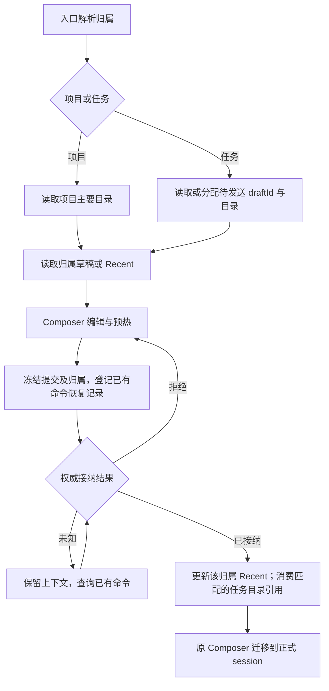

# 项目与未归类任务的草稿、默认配置及目录生命周期

状态：2026-10-16 用户确认；实现及本轮必要回归完成；未发布安装包。

## 术语与边界

- Project（项目）是组织 session 的逻辑容器，用目标主机身份与项目 ID 标识。
- root（项目目录）是真实文件夹；primary root（主要目录）是项目新建 session 时选用的目录。
- workspace（工作区）承载运行与数据隔离；workspaceKey = workspaceIdentity?.trim() || workspacePath。
- workspacePath 是实际路径；session 执行目录（cwd）在 session 创建后固定。移动项目归属不改变它。
- “任务”入口创建未归类任务。它拥有独立的新建草稿和默认配置，不是一个伪造的 Project。
- 客户端本地存储隔离桌面与手机；远控连接的目标主机也必须隔离。重连不能用临时 bridge ID 生成新的归属。

## 统一状态与唯一写者

| 状态                     | 归属/唯一写者                            | 持久化与用途                                                                   |
| ------------------------ | ---------------------------------------- | ------------------------------------------------------------------------------ |
| 新建草稿                 | Composer owner，按项目或未归类任务作用域 | 有非空白文字才保存 text、editorState、mention、完整 ModelSelection、mode、Plan |
| 当前输入框               | useDraftConfigControl                    | 用户编辑优先；普通 render、View 或 Snapshot 回包不能重置当前编辑               |
| 新建默认配置（Recent）   | 接纳真实用户 Submission 的统一路径       | 模型 Provider/model/options 与权限一起保存；每项目一份，未归类任务一份         |
| 未归类任务待发送目录引用 | 新建导航生命周期 owner                   | 保存 draftId 与准备结果；空文字也可保留目录引用，不伪造文字草稿                |
| 正式 session 的后续草稿  | 原 session Composer                      | 工作区身份 + session ID，不改为按项目存储                                      |
| session 事实与执行目录   | CLI；Host 只持有组织态及事实镜像         | 不由草稿存储、目录扫描或 UI snapshot 制造 session 事实                         |

项目 P、Q 即使主要目录相同，也分别保存新建草稿和 Recent。项目改名不影响归属；项目换主要目录仍保留它的文字草稿与 Recent。
分组只表达组织意图，不产生另一套默认配置范围。

## 用户行为

### 普通项目

新建读取该项目的草稿；有文字恢复完整选择，没有文字读取该项目 Recent，Plan 默认关闭。
项目主要目录用于准备预热 session。首次输入被接纳后，成为正式 session；后续新建继续使用项目当时的主要目录。
没有 root 的项目沿用 prepareSession 初始化主要目录的现有流程。
旧 session 执行目录不随项目主要目录修改或 session 移动而改变。

### 未归类任务

第一次新建生成 draftId，准备真实目录并保存引用。切走再新建复用同一目录与草稿。
首次输入被接纳后消费该引用，下一次新建生成新 draftId 和新目录。
重复点击和并发准备复用同一个准备结果；不能只挡住导航而仍创建多个目录。
不得全局改变无参 prepareSession 的语义，Bots、自动化及其他调用方仍有自己的目录准备语义。

### 默认配置

仅真实用户发送被接纳时更新 Recent；模型回复完成不是边界。改菜单、预热、权限确认、读取历史、打开设置、失败发送不更新 Recent。
已有 session 的真实发送也更新其发送时所属项目或未归类任务范围；从权威组织态读取归属，不从 cwd 猜项目。
辅助对话不在主任务索引中，续发使用侧栏记录的所属主会话查询 Recent 项目归属，命令仍发送给辅助 child；普通会话和 fork 仍查询自身任务。
发送前冻结归属与完整配置；迟到回执只更新该归属，不因当前导航变化改写其他项目。
跨 Pane 按发起顺序保留最近已接纳提交，旧回执不能覆盖较新的已接纳配置。
其他发送更新 Recent 时不覆盖正在编辑的草稿。
ModelSelection 按当前 schema 保存 providerId/modelId/options；当前 options 为 reasoningLevel。followup 等 app 设置不并入 Recent。
Plan 仍是草稿/运行态，不作为全新任务继承的开关。无有效模型时使用现有 ModelSelection View 校验规则，不把菜单第一项另存为默认值。

### 原有文字草稿规则

非空白正文才构成持久文字草稿。只改选项不保存；删空删除文字记录，目录引用不因此消失。
返回有文字的新建草稿恢复其完整选择；重新进入空白新建页取所属范围 Recent。
正式 session 重开时恢复正文与草稿模型，权限/Plan 取该 session 最新 Snapshot。挂载期间的显式选择沿用现有观察规则。
首发期间的新输入属于同一编辑周期，迁移到正式 session 后保留，不被新建草稿清理覆盖。
附件沿用现有准备与上传流程；本次不增加附件跨重启持久化。

## 生命周期与时序

- 消费目录引用以首个输入的 accepted 或可核实的 duplicate 为准，不以 prewarm create ACK、Host 预留行、列表投影或导航成功为准。
- 使用已有 pendingCommandRegistry 持久命令上下文保存归属与草稿身份；不增加第二份 accepted 队列。
- 本地首发副作用需可重入：重复回执、恢复查询不能重复消费，也不能覆盖更新的 Recent。
- 消费用 draftId 匹配；旧 ACK 不能清掉下一份草稿引用。先完成可恢复的本地交接，再删除命令恢复证据。
- 结果未知不等于失败；断线、超时、记录过期、列表暂时缺席均不能证明目录可再次用于新任务。复用现有查询机制，不以定时猜测同步。
- 导航切换可以使 UI 绑定失效，但不能撤销已经接纳的发送或跳过持久化交接。
- 切回草稿时，上一代预热创建仍在退出并不代表本次发送失效。等待既有创建收口，再校验点击时的目标代际；不另建并行 session，也不通过超时猜测。
- 首发未挂载时接纳，将等待期间的新正文交接给正式 session；恢复对账使用提交前的原始正文，避免附加上下文的协议文本使已发送正文复活。
- 草稿隔离须贯穿存储 key、Hook scope、内存组织意图、预热 owner、附件及回调，不只修改 localStorage。
- 桌面 continuous、手机 replayable 仍使用已有传输与命令恢复边界；手机切换 workspace 时归属须通过 bridge/navigation 显式交付。

## 目录变化、导入及兼容

项目换主要目录后，文字与 Recent 留在项目；预热需在目标目录重新准备，文件引用与附件按现有校验重检，不把旧运行实例换 cwd。
目录缺失/不可用时保留草稿并报告现有目录错误，不静默复活目录或选其他 root。
移动正式 session 只改组织归属，不搬项目新建草稿和 Recent；后续发送按提交时的归属记录默认配置。
首次分享导入、模板预填、显式项目切换沿用已有明确交接动作；普通导航不自动将一个项目正文搬到另一项目，也不覆盖目标已有草稿。
旧文字记录保留。仅草稿保存的 projectId 与目标匹配时允许认领；未归类旧草稿必须有明确当前上下文，不能扫描最新目录猜测。
旧 Recent 没有项目归属；不批量复制到所有同目录项目，不合并历史记录。新范围无记录时走正常默认解析。
迁移读操作不写盘；明确保存/清除后记录旧数据已认领，防止项目换目录或正文删空后重新读出旧草稿。保留旧版可读取数据，不批量删除历史目录。
导航另外记住每个工作区最后打开的新建作用域，仅用于刷新恢复入口；正文与 Recent 仍以项目/任务作用域为唯一数据源。

## 功能影响简报

变更层级：draft-default、persistence、commit-effect、recovery。模式：implementation-handoff。

| UI 场景                | 共享路径与 owner                           | 默认来源/校验                         | 提交与落点                                                  | 边界及等级                           |
| ---------------------- | ------------------------------------------ | ------------------------------------- | ----------------------------------------------------------- | ------------------------------------ |
| 任务分区加号           | useRootWorkspaceActions → Composer         | tasks scope Recent / View             | prepareSession → 用户 Submission → CLI；客户端草稿与 Recent | 桌面/手机 must-inspect               |
| 项目行/快捷键新建      | 同一导航与 Composer；明确 projectId/hostId | project scope Recent / 主要目录可用性 | 项目 prepareSession；同一发送链                             | 同目录项目 must-inspect              |
| 已有 session           | SessionPane/useDraftConfigControl          | 当前 Snapshot + session 文字草稿      | CLI admission；所属范围 Recent                              | 归属移动、迟到 ACK must-inspect      |
| 手机新建/恢复          | Web openProjectDraft、共享 Root            | 目标主机 + 项目/任务作用域            | project-workspace-navigation、原 replayable 恢复            | conditional                          |
| 分享/模板/分组         | 显式导航交接、原创建意图                   | 同一初始化规则，用户编辑优先          | 原首发与组织归属路径                                        | should-inspect                       |
| 自动化/Bots/Subagent   | 各自 record/CLI owner                      | 原配置来源                            | 原命令/存储                                                 | invariant-only，不消费 Composer 草稿 |
| Provider 设置/模型候选 | 原 ModelSelection View                     | 原可用性校验                          | 原 provider 服务                                            | invariant-only                       |

共享：草稿读写、Recent、模型校验、提交冻结、接纳回调。差异：归属标识与目录准备策略。
权威边界保持：Host 管组织，CLI 管 session，客户端管草稿；执行路径不使用 project ID 或 workspaceIdentity 替代。

当前精确源码种子：composerDraftStore/useDraftConfigControl/newTaskDraft/composerRecent、useRootWorkspaceActions、SessionPane/pendingCommandRegistry、project.prepareSession、project-workspace-navigation、Web openProjectDraft。
直接路径已通过源码检索核对；codegraph 工具不可用，未宣称图扫描。范围为上述主链及一跳导入、分组、附件，未扫描全部静态可达功能。
Graph drift：现有文本草稿节点只表达 workspace Recent；历史 new-task-model-resolution-chain 仍含旧 last-selected 规则。随实现更新索引及当前规则入口，不据旧文档恢复旧代码。

## 裁决、维度与剪枝

用户已确认：未发送复用目录；每端独立；只在发送成功记忆；模型与权限统一；项目草稿与 Recent 按项目隔离。
主要维度：项目/任务、非空/空草稿、同/异目录、首发/后续、accepted/rejected/unknown/late、桌面/手机、主机身份、目录变更/归属移动。
剪枝：不增加多桌面窗口产品规则、跨端草稿同步、附件跨重启保存、自动化默认继承；不改变正式 session cwd、运行队列与权限规则。
多主机同路径、双项目同目录、迟到 ACK、刷新恢复必须保留代表用例；主题语言按代表界面检查，不做全组合。

## 验收用例与 E2E 交接

| ID   | 前置 → 操作                                      | 必须断言                                             | 证据                              |
| ---- | ------------------------------------------------ | ---------------------------------------------------- | --------------------------------- |
| PD01 | 任务输入文字及模型权限 → 切 session → 点任务加号 | 目录、正文、选择恢复；未额外 mkdir                   | UT + Desktop/手机 E2E、文件与日志 |
| PD02 | 任务发送接纳 → 再新建                            | 新目录、空正文、继承完整 Recent                      | E2E + CLI ACK/目录                |
| PD03 | 双项目同目录各写不同正文选择 → 来回新建          | 草稿及内存/预热归属隔离，不能覆写 projectId          | UT + E2E                          |
| PD04 | P/Q/任务分别成功发送不同配置 → 新建              | 三个 Recent 隔离；同一项目后续发送更新               | UT + E2E                          |
| PD05 | 只改选项/正文删空 → 切走回来                     | 不生成文字草稿；按 Recent 初始化；任务目录引用仍在   | UT + E2E                          |
| PD06 | 首发拒绝、未知、重连 duplicate                   | 不丢输入、不误释放目录；最终交接恰好一次             | UT + 故障 E2E                     |
| PD07 | 连点新建、准备晚回、发送后快速切项目             | 准备不重复；旧回调不写新 scope；接纳仍完成原归属交接 | UT + E2E                          |
| PD08 | 首发过程中键入下一条 → ACK/投影晚到              | 下一条保留在正式 session，不复活新建 Root            | UT + E2E                          |
| PD09 | 项目改名/换主要目录/移动 session                 | 项目草稿与 Recent 保留；旧 session cwd 不变          | UT + E2E                          |
| PD10 | 刷新、重启、同路径不同主机、桌面与手机分别编辑   | 身份稳定且各端独立；未知发送可查询恢复               | UT + Desktop/手机 E2E             |
| PD11 | 合法旧 projectId 草稿、歧义旧记录、存储失败      | 仅可证明归属时认领；保留旧数据；写失败不清源         | UT                                |
| PD12 | 文件/截图附件、分享导入、模板、分组、不可用模型  | 原流程可用；不误更新 Recent、不串归属                | 受影响 UT + 代表 E2E              |

所有 PD 用例产品语义 accepted。自动化按下面的分层证据核验；不把一个代表交互通过扩大为全部组合通过。
E2E 使用 manual-review/pending；真实侧栏按钮，受控 Provider fast-text 与故障/延迟夹具；不通过 sleep 推断成功。
主断言同时检查 UI、工作区身份、目录、CLI admission 与客户端持久化。覆盖桌面及手机 shared-host/replayable。
优先复用 composer-recent-mode、virtual-project-mobile 的 helpers 与 case-local fixtures；不自动转正或加入 CI。
本轮运行时定位并修复预热代际等待问题；以任务切回后的真实发送验证，不仅依赖 Hook 单测。

## 实施顺序与完成条件

1. 落盘设计、catalog、coverage、功能图；记录基线与运行时复现。
2. 先写 scope/存储/Recent/目录幂等/恢复的回归，以及桌面手机交互用例，确认旧实现失败。
3. 在现有 owner 中统一归属解析，替换 workspace 新建 key 与默认配置来源，避免另造状态副本。
4. 完成任务目录复用、首发交接与命令恢复；接通项目、快捷键、分享、手机导航及附件。
5. 运行受影响单测、typecheck、lint、architecture、E2E 类型与目标交互验证；检查 diff。
6. 必要验证通过后本地提交。未验证项明确记录；不自动 push/MR，不宣称未完成验证已通过。

## 本轮验证记录（2026-10-16）

基线 `dd10b6e7bf36f7073f6edfc1b9305ddb25d34c4f`。独立 Linux 容器运行 Electron desktop-continuous 与手机浏览器 replayable，共用真实 Host/Agent，模型输出使用 synthetic case-local replay。

| 验证                  | 结果与实际覆盖                                                                                                           |
| --------------------- | ------------------------------------------------------------------------------------------------------------------------ |
| Composer 生命周期整组 | `desktop-e2e-20261016-095920-188`，5/5；PD01–05、PD07、PD09 的项目改名/换主要目录、PD10 刷新；包含首发在途切走与回执交接 |
| 首发单飞与下一条输入  | `desktop-e2e-20261016-093955-345`，1/1；PD08 等待首发期间的新输入保留；未重复创建 session                                |
| 文字与附件草稿切换    | `desktop-e2e-20261016-100030-743`，1/1；completed/running/新建草稿切换保留正文与内存附件引用                             |
| 手机完整项目流程      | `desktop-e2e-20261016-100100-797`，1/1；PD01/02/10 切回、刷新、目录复用及接纳后换目录；兼顾既有项目、分组、文件导航      |
| 受影响单测            | 官方 affected 最终选择 1,444 个文件，与实际分批清单完全一致；16,503 项通过、28 项跳过；未运行全量套件                    |
| 类型、Lint、架构      | 根 typecheck、桌面 E2E typecheck 通过；Lint 0 error、210 个存量 warning；架构 0 violation                                |
| 回放契约与格式        | 回放契约 5/5；变更文件格式、diff 空白及新规格链接检查通过                                                                |

PD06 的 rejected/unknown/duplicate、刷新重建账本、TTL 与旧 ACK，PD07 的目录准备并发，PD09 的 session 归属解析，PD10 的同路径不同主机及客户端隔离，PD11 的认领与存储失败由单测覆盖；不把在途延迟 E2E 表述为所有断网组合的真机验证。PD12 使用受影响回归与代表 UI 切换，未增加附件跨重启持久化，也未重新验证所有文件选择、截图和导入组合。

测试助手现在等待本次 draftFocusVersion 前进，避免同项目已有草稿 DOM 提前满足新建等待条件。旧权限用例适配当前可用模式及“正式会话重开取 Snapshot”的既有规则；回放补齐 Write 工具结果及切模型后的压缩响应。保留初次失败记录，不将 fixture 缺失或旧用例前提错误归为产品故障。

环境限制：最初大批测试与浏览器并发触发 8 GB 容器 OOM，改为按官方选择分批、两个 fork worker；两项打包测试在安装缺少的 zip 后通过，一处 Root mock 补齐客户端 namespace 后通过。Electron file URL 在该环境出现模块加载失败，最终使用支持的 localhost renderer URL；刷新曾出现空页面，最终桌面整组刷新与手机刷新均通过。本轮没有 MacBook Air 安装包、Windows GUI、实体手机或跨端文字同步验证。

功能图本次六个源码种子存在且节点无重复；全图仍有四条基线悬空引用与一个旧源码种子缺失，未扩大本次范围修复，不能宣称全图完整性通过。用例保持 manual-review/pending，未自动转正或加入 CI。

开源词检查的八处命中全部来自原虚拟项目历史设计，逐条与基线相同；本次只在该文档添加当前规格入口。新规格无命中，不将存量发现报告为全量检查通过。

## MR 集成验证

准备 MR 时迁移到 staging 的 `f05db3e645`，排除起点中未合入的 Provider 提交。保留主干的预热订阅身份校验及主输入框定位。新建项目的草稿交接、分组草稿关闭使用同一客户端/项目作用域；同目录的新项目也显式接收附件交接，由目标 draftFocusVersion 消费一次。编辑器注册与交接消费识别带项目身份的 Root scope。

三项单测先复现旧目录 key 读写及同目录附件跳过问题，再修复；分组关闭用例补充正文及刷新断言。直接调用方核对包含 ProjectCreation、TaskGroupedView、Root actions 和 ConversationComposer，功能图补齐交接与分组清理种子。前节证据对应原开发基线，集成后的复验结果另行记录。

| 集成验证           | 结果                                                                                                                                                                                                                                    |
| ------------------ | --------------------------------------------------------------------------------------------------------------------------------------------------------------------------------------------------------------------------------------- |
| 桌面 Composer      | `desktop-e2e-20261016-103617-676`，5/5，完整运行项目/任务草稿与 Recent 用例                                                                                                                                                             |
| 分组关闭及刷新     | `desktop-e2e-20261016-104001-042`，GRP02/03/11 1/1；中英及深浅主题代表组合                                                                                                                                                              |
| 手机与项目创建交接 | `desktop-e2e-20261016-104236-866`，VP13 1/1；同时执行 PCD01/02 桌面两入口 × 深浅主题，PCD03 手机正文与 ready 附件保持                                                                                                                   |
| 单测               | affected 选中 1,417 文件；首轮 15,832 通过、3 失败、28 跳过。含修复前同目录附件失败，修复后草稿存储/交接 26/26；另两项网络退避在系统 Node 24.19 下失败，使用仓库指定 Node 24.14.0 后两文件 22/22 通过。最终推送门禁结果以 MR 验证栏为准 |
| 类型与门禁         | 根及 E2E 类型检查、Lint（0 error）、架构（0 violation）、数据库 schema 与架构脚本测试通过                                                                                                                                               |

初次手机运行在主干新增的分组长按菜单等待超时；运行时触摸事件采样验证菜单可正常打开。CDP 坐标输入前补充 Playwright 可交互检查，保留真实 touch 长按，最终完整流程通过。最初集成构建因 rebase 后依赖未刷新缺少字体包，重新按当前 lockfile 安装后完成。失败记录保留，不以成功复跑掩盖环境与用例准备问题。截图已核对桌面权限继承、项目交接及手机正文/附件；本轮平台限制与前节相同。
