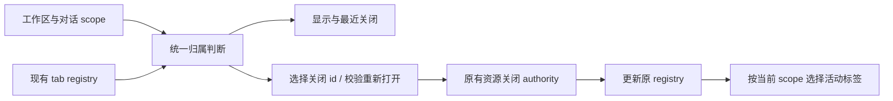

# Side Pane Tabs

## 目标

右侧 side pane 从单槽位切换升级为多 tab 模型，允许 Browser、Diff 和 Code Viewer 同时保留，并在 pane 内切换。

## 关键设计

- side pane 状态改为 `tabs + activeTabId`，而不是单个 `type`
- Diff 使用 singleton tab，重复点击只激活或关闭当前 tab
- Browser 支持多实例 tab；主入口的 Browser fallback 会优先切换到已有 Browser，而 新标签页里的 Browser 会新建独立 tab
- Code Viewer 按稳定 `sourceKey` 复用 tab，避免同一文件重复堆叠
- 各 workspace 的 tab registry 分开缓存在内存，切换时恢复对应 registry，不跨工作区搬迁 tab。

## 归属与操作契约

显示、关闭当前/其他/全部、最近关闭和重新打开，共用 `workspaceKey + ownerTaskId` scope：

- 先匹配工作区（`workspaceIdentity?.trim() || workspacePath`）；旧的未标记工作区 tab 沿用所在 registry。
- 新 tab 提交时独立补齐缺失的工作区和 owner；已有 owner 不得覆盖，但不能因已有 owner 而漏掉工作区。
- Git、Developer Tools、Treemapping 是工作区公共 tab；其他 tab 归属打开时的对话/草稿。
- browser-use 使用 `sessionId`；Subagent/Bash 使用 `rootSessionId`；侧边聊天、Plan、Workflow、插件面板使用 `parentSessionId`；其余使用冻结的 `ownerTaskId`。未标记 owner 与 null 保持草稿语义。
- 关闭菜单只选择当前可见 tab。关闭后只激活当前 scope 的剩余 tab；展开时没有可见 tab 则创建当前 scope 的新标签页，保持展开；主动收起不变。隐藏 tab 保留。
- 最近关闭只显示当前 scope 可恢复的 tab；重新打开也校验同一 scope，保持原归属。工作区公共 tab 可在该工作区的不同对话恢复。
- Browser 仍先由 main 确认关闭，再删除 UI 壳。异步关闭仅处理点击时选中的 tab id；等待期间新开的 tab 不在关闭范围。完成时更新原工作区，当前对话的激活/折叠态按完成时的 scope 解析，不能被旧操作覆盖。
- 不增加 tab 状态源、权限队列、超时、持久化格式或跨进程协议；桌面/手机共用 UI 归属逻辑，Browser main authority 和 continuous/replayable 消息边界不变。

## UI 行为

- tab strip 的「+」直接创建并激活一个「新标签页」（New tab），不再弹出应用菜单。每次点击生成独立 id，允许同时保留多个新标签页。
- 新标签页是统一 registry 中的 `new-tab` 类型，归属创建时的工作区与对话；聚焦、拖拽排序、关闭、关闭其他/全部沿用现有 tab 操作（新标签页不进入最近关闭），不维护第二套局部 tab 状态。
- 新标签页复用标准 tab trigger，使用空白文件图标与关闭按钮，宽度沿用其他标签（最小 60px、最大 156px）；标题不拉伸填满剩余区域。
- 内容复用空态的新标签页入口与推荐应用插件；选择工具或应用沿用既有打开动作，并在原位置替换当前新标签页；已打开的单例只激活既有标签并移除当前新标签页。查看所有插件仍保留来源新标签页供返回。插件宿主支持边界与去重规则保持不变。
- 推荐插件安装、恢复或启用期间，仅当前插件的入口在加载文案旁显示旋转图标，并标记 `aria-busy`；其他插件保留自己的安装、启用或打开文案。同一插件的多个 surface 共享进度。推荐列表继续禁用至当前操作结束，成功或失败后清除图标与忙碌状态并恢复可操作；成功后仍需用户另点打开。空态与新标签页、桌面与手机布局遵循同一规则；系统要求减少动画时保留静态加载图标和文案。

- 右侧面板顶部使用项目现有 `Tabs` 组件渲染 tab strip
- 切换 tab 时保留已打开 pane 的实例，避免 Browser webview 被销毁
- Browser tab 会跟随 webview 的 `page-title-updated` / `page-favicon-updated` 事件显示网页 title 和 favicon；事件未返回时回退到默认 Browser 标题和 Globe 图标
- Header 上原来的 Browser / Diff 独立按钮已移除，统一收口到最右侧 side pane 按钮
- side pane 按钮始终可点击；展开时若当前 scope 没有可见标签，创建并激活一个 new-tab；不自动创建 Browser / Review / Terminal 等工具 tab
- 面板开关与动画显隐更新只影响右侧和会话布局；左侧项目数据、导航 props 没有变化时，项目树跳过重渲染。桌面传递稳定的远控回调，手机导航仍按原有同 workspace / 跨 workspace 规则完成跳转。项目目录、未读、任务状态、主题与语言变化继续正常更新，不用忽略 props 的比较器冻结侧栏。
- 新建草稿及其后续配置、面板收起更新遵循同一渲染边界：新建操作不因 Root 重新装配远端导航回调而失去引用稳定性，调用时使用最近已提交的实现；远端导航依赖稳定的服务对象，不以每次取值都会新建的 RPC 方法作为渲染依赖；目录重复读取得到等价的项目、空任务列表、连接状态和入口时复用原有引用。侧栏只订阅影响显示的当前任务状态，分组继承在点击时读取当前任务。项目数据、身份或导航目标真正变化时仍正常更新，不增加延时、导航队列或业务状态副本。SPT03 覆盖桌面与手机布局的新建及后续操作，并以渲染次数、导航结果和数据更新验证边界。
- Cmd/Ctrl+N 沿菜单 → platform → Root → App → WorkspaceShell 的真实链路进入草稿。同一工作区的等值 `addTab` 保留 tab 与列表引用；任务选择回调在操作时读取当前会话，不因切入草稿而重渲染全部项目。真实连接元数据、身份和分类变化仍发布更新。Host `prepareSession` 的项目读取与目录检查后的删除复检只加载项目/roots，不读取无关任务；保留原有目录、并发删除和远端单目录校验。SPT04 在已有多项目 Dev App 上以真实按键和菜单事件验证这条链路，记录项目行渲染次数、草稿首帧和 trace；不可用 noop 替代 App/WorkspaceShell/tab store。毫秒数据用于同条件对比，回归门限使用行为与渲染次数。
- 运行任务的活动时间变化只更新相关项目与任务行。项目行装配按项目隔离：无关项目的任务元素引用、菜单数据与回调语义未变时跳过内容渲染；任务数组按元素身份与顺序比较，其余属性全部参加比较。运行/完成、未读、标题、归属、置顶、远端连接、语言及操作回调的真实变化继续传播。沿用现有目录投影与任务 owner，不过滤活动字段、不增加延时或业务缓存。SPT06 在桌面/手机、深浅主题的多项目夹具中驱动活动更新，并检查运行结束和项目操作仍生效。
- 侧栏任务与消息区的 loading 沿用原图标、尺寸、颜色和状态语义；旋转作用于现有 HTML 容器，让 Chromium 合成动画。静止等待期间不得因 SVG 旋转逐帧重算样式。SPT06 同时验证图标继续旋转、完成后移除，以及空闲动画期间的样式重算次数。
- 工具栏完整布局已放得下时，尺寸通知只读取现有几何，不克隆测量节点。发生溢出或已有压缩状态时，继续使用不可见副本测量，保持原折叠顺序、恢复顺序、焦点与打开中的选择器。测量结果仍只是 DOM 布局投影，不新增业务状态或延时同步。
- New Task 草稿态与已有 Task 复用同一个 `WorkspaceHeader` 骨架，通过 `variant="draft"` 隐藏 task 专属上下文和菜单，并保留 Help / Terminal / Side Pane 与平台 caption 操作区。进入新草稿时 side pane 继续默认收起，用户点击按钮后按草稿 owner 恢复已有 tab；没有可见 tab 时创建真实的 `New tab`（新标签页）标签，并显示统一标签栏。手机 Web 远控继续复用现有 side pane overlay，不新增独立 runtime 或恢复链路。完整约束见 `docs/ui/workspace-header-variants.md`。
- 用户主动展开 side pane 且当前任务没有可见 tab 时创建 `New tab` 标签；判定使用按 active task 过滤后的可见 tab 集，而不是 workspace registry 的全部 tab。即使 registry 仍保留其他 task 的 session-scoped 隐藏 tab，也必须创建当前 scope 的新标签页并显示 tab strip 和 `+`。不再渲染独立空态。空态页顶部对齐、可滚动，左对齐标题「新标签页」，不显示副标题。内置应用在上、UI 插件在下，两区之间用居中的短分割线隔开。两区条目都是横向行：48px `surface` 图标块 + 名称与单行说明 + 尾部 `secondary` 胶囊「打开」；整行可点击，`hover:bg-hover`，不显示边框。容器宽度达到 36rem 时改为双列，窄面板单列。UI 插件区标题右侧为「查看所有插件」入口，打开完整插件市场。尚未创建会话（activeTaskId 为空）时隐藏整个应用插件区、分隔线及查看所有插件入口。已有会话从新标签页通过该入口进入时，市场浏览页标题左侧显示返回箭头；返回关闭市场 tab 并激活来源新标签页，来源 tab 已关闭时创建新的新标签页。其他入口不显示此返回箭头。返回入口仅对来源任务可见，切换到其他任务不显示返回箭头。该入口上下文仅在当前面板生命周期内保留，不跨重载恢复。内置应用说明沿用原型文案：辅助对话「在侧边面板中继续对话。」、审查「查看代码变更与差异。」、终端「运行命令和查看输出。」、浏览器「浏览网页和预览应用。」、开发者工具「检查和调试应用。」
- 关闭最后一个可见 tab（含新标签页）或执行关闭全部后收起面板，不补建标签；仅在用户再次展开空面板时创建新标签页。新标签页不进入最近关闭列表；Cmd/Ctrl+W 关闭末标签后，下一次按键沿用关窗 fallback。已收起面板的后台关闭不能展开面板
- 当 Browser / Diff / Code Viewer 被重新激活时，会自动清掉收起态，避免右侧已有内容却继续隐藏
- 对话级 tab 按归属 scope 隐藏而不销毁；切到无 tab 的对话时收起，但普通 Browser 与 browser-use
  `<webview>` 都仍在后台挂载保活。切回有 tab 的对话时重新选择该对话的 preferred/current/latest tab，
  并主动展开，不能继承中间对话的收起态
- Code Viewer 对代码文件继续使用语法高亮预览；对 `.md/.markdown` 文件和 markdown 文本 source 改为正文渲染，支持在 side pane 里直接检查标题、列表、工作区文件链接和外链跳转
- Code Viewer 顶部显示紧凑路径面包屑：优先按当前 workspace 展示 `workspace -> 目录 -> 文件`，末尾文件节点带文件类型图标；超长路径通过横向滚动查看
- Code Viewer 右上角改为 `更多 + 打开` 两个按钮；关闭仍统一走 tab 自身的关闭入口，`更多` 菜单只承载文件类型相关视图切换，当前已支持 markdown 预览/源码、SVG 预览/代码，以及普通代码文件的自动换行开关
- tab strip 支持横向拖拽排序，排序只改变 `tabs` 数组顺序，不改变当前 `activeTabId`
- 每一个 tab 默认宽度为 156px（`w-39`）；当 tab strip 的可用宽度不足以维持默认宽度时，所有 tab 等宽收缩，最小宽度为 60px（`min-w-15`）。只有在所有 tab 都缩到 60px 后仍无法容纳时，tab strip 才允许横向滚动。标题使用 tab 内图标、徽标之外的剩余空间，关闭按钮绝对定位不占位；icon 与文字组成 item-content，超长内容使用 mask 淡出而非省略号；关闭按钮显示时渐隐区域左移，内容不位移或重新排版
- tab 总览不参与 tab 宽度等分。新增按钮在未溢出时紧跟最后一个 tab；所有 tab 已缩到 60px 后仍无法容纳、tab strip 开始横向滚动时，新增按钮移到滚动区域外并固定在右侧
- 每个 tab 的关闭按钮绝对定位、不占标题空间，仅在选中、hover 或 focus-within 时显示；隐藏时不响应鼠标点击，键盘聚焦可使其显示。触屏先选中再关闭；关闭操作继续阻止 tab 激活或拖拽
- 标签页支持鼠标中键关闭：中键按在 tab 的任意非交互区域时直接关闭该 tab，不先激活它；浏览器默认的中键自动滚动行为也必须被阻止。该交互复用所有 Side Pane tab 类型（包括侧边聊天、Browser、Terminal 等）；移动 Web 触屏没有中键，不依赖此交互
- 每个 tab 复用项目封装的 Tooltip 展示未截断完整标题。指针进入后等待 1500ms 才显示；离开或移到另一个 tab 时立即取消当前提示，新 tab 必须重新等待完整 1500ms，不沿用 Tooltip group 的快速切换窗口。拖拽 tab 时强制关闭提示，触屏端不依赖该 hover 交互
- 拖拽使用小距离阈值，普通点击仍然只负责切换 tab；关闭图标区域不触发拖拽
- tab strip 支持右键菜单，当前提供关闭当前 tab 和关闭其他 tab；关闭其他 tab 会保留并激活被右键操作的 tab
- tab strip 的加号旁提供标签总览入口，可按标题、路径/URL 和类型多词搜索已打开标签、查看打开时间、切换到目标标签，并支持关闭其他标签或关闭全部标签
- 标签总览底部展示最近关闭的标签页；点击最近关闭项会重新打开并激活对应 tab
- 标签总览搜索会同时过滤已打开标签和最近关闭标签；搜索结果按标题命中优先，再按路径/URL 和类型命中排序
- side pane 的 tabs、折叠态、Git source 选择和 Browser 当前 URL 按 `workspaceIdentity?.trim() || workspacePath` 缓存在内存中，跨 workspace 切换后恢复；刷新或重启应用后不保留
- 多 Browser tab 的 URL 按 `browser tab id -> URL` 记录，避免多个 webview 共用同一份恢复地址
- 桌面端 `Cmd/Ctrl+W` 走“关闭当前上下文”语义：右侧 side pane 展开且存在 active tab 时优先关闭该 tab；否则回退到关闭当前窗口。该快捷键由 main 进程转发给 renderer 判断，避免 Electron 原生 `close` role 绕过 side pane 状态直接关闭窗口。
- 桌面端面板右上角提供「进入完整视图」（`⇧⌘F` / `Ctrl+Shift+F`），面板占满窗口、对话变为第一个 tab 并提供浮动输入窗口，完整合同见 `docs/ui/side-pane-full-view.md`。

### 新标签页展示

启动页标题统一为“新标签页”（New tab）。页面左右最小留白为 28px，双列间距为 32px；分区标题与条目 logo 方块左边缘对齐。应用插件通过 PluginStoreAvatar 复用市场的真实图标来源和尺寸规则，图片缺失或加载失败时显示拼图占位；内置工具保留各自图标。推荐顺序、安装与打开行为不变。

推荐应用列表首次加载时展示 8 个骨架条目：48px 圆角图标、标题与说明两行占位、24px 高的胶囊操作占位。行内间距和内边距与实际条目保持一致；沿用 36rem 单双列断点与 32px 列间距，并遵守系统减少动画偏好。
