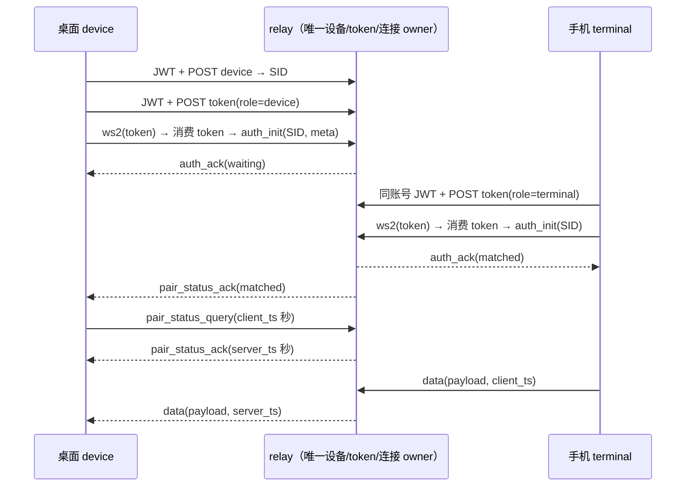
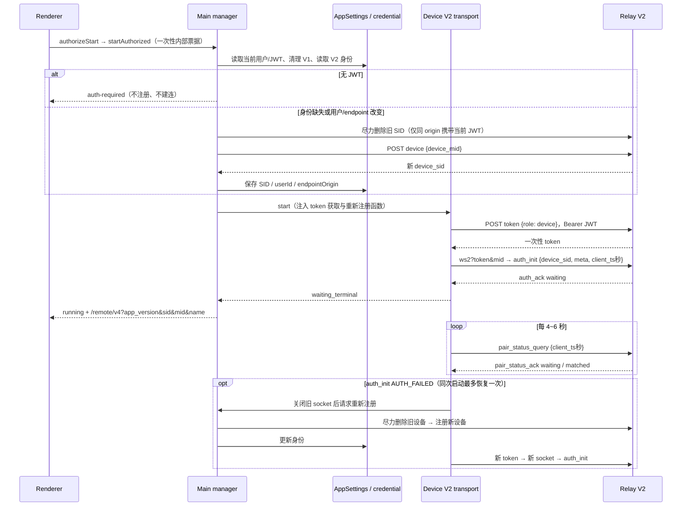
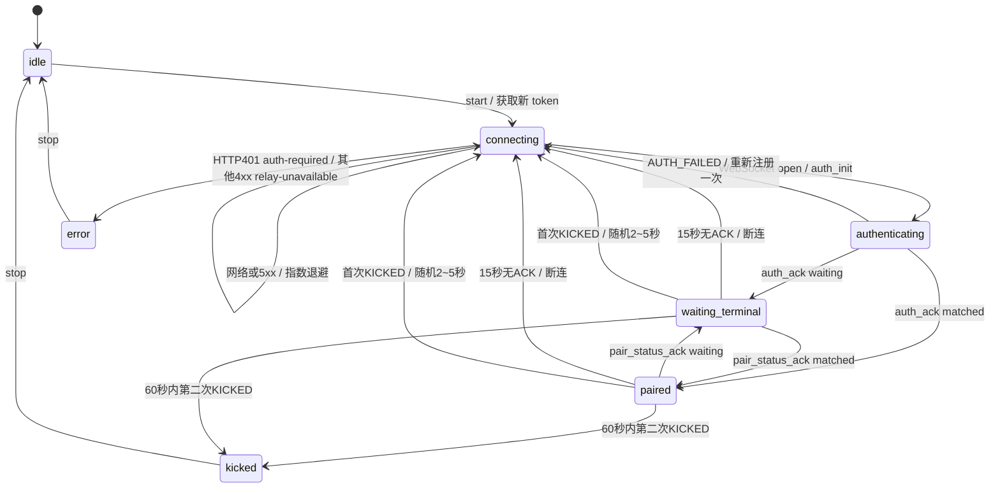
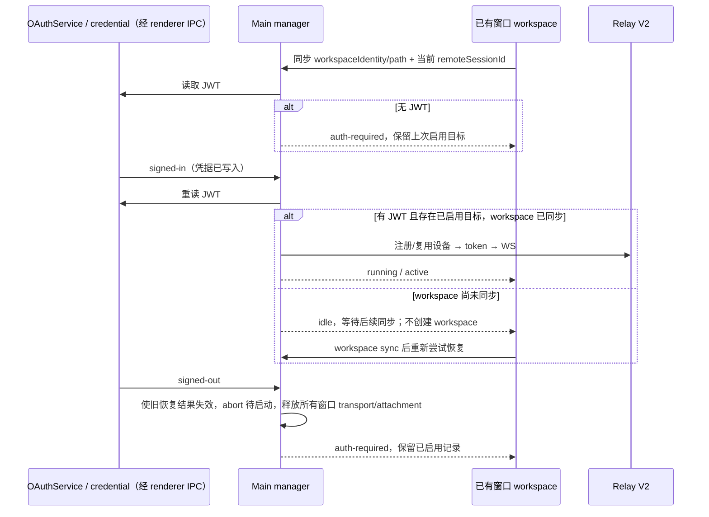
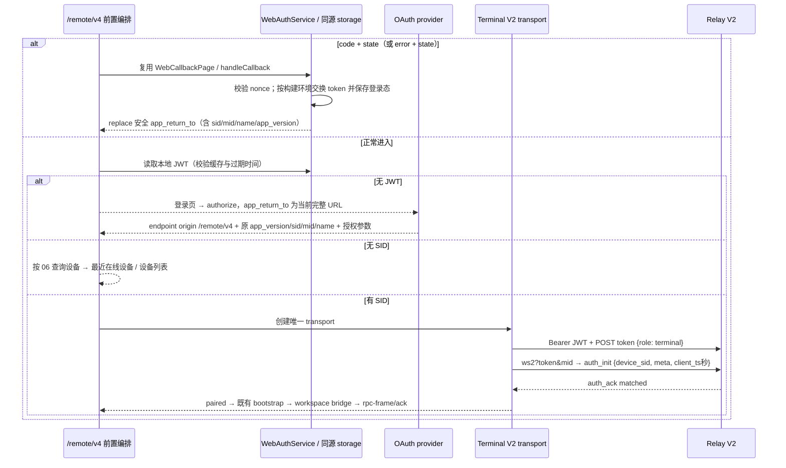
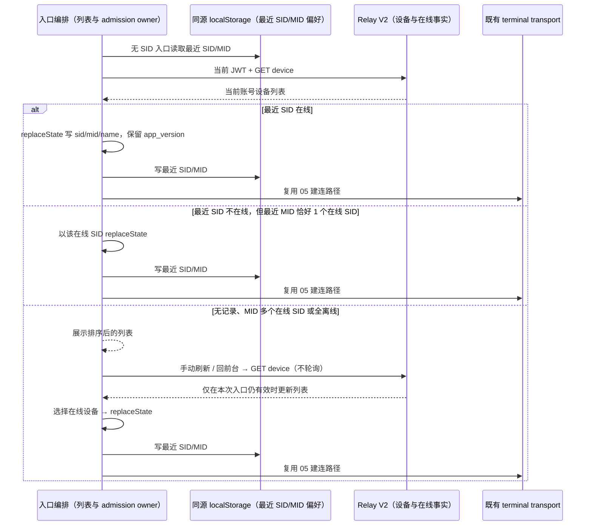

# Relay V2 共享契约与配对

本页定义 [Relay V2](../issues/web-remote-control-relay-v2/01-relay-v2-login-pairing.md) 的最终共享契约、连接行为与验收边界。桌面 device、手机 terminal 与 shared 均只使用 V2。

契约依据：zcode-server `origin/staging` 提交 `5a947caea3a022b12b5d051ef25c807952feefa7` 的 `docs/remote-relay.md`、`internal/domain/relay_v2/proto.go`、`service.go` 和 `internal/interfaces/web/{dto,controller}/remote_v2.go`。HTTP 请求及 WebSocket 消息采用严格字段校验，禁止把 V1 字段意外发到 V2；HTTP 响应采用下述兼容性校验。服务端 Go JSON 解码本身可能忽略多余字段。

## HTTP 契约

所有接口使用 `Authorization: Bearer <jwt>`，用户来自登录上下文。成功信封为 `{code: 0, msg: string, data: T}`；失败信封为 `{code: 非零整数, msg: string, data?: null}`，HTTP 非 2xx 也可能没有 JSON 正文。

HTTP 响应允许服务端增加字段：注册、列表、删除和 token 的成功/失败信封，以及设备记录、设备 `meta` 和 token 数据对象中的未知字段，在解析时忽略并从返回值中移除。`logid` 等客户端不使用的元数据不单独列入 schema，也不限制其类型；无需随服务端新增字段发布客户端。已声明字段的必填性、类型与值约束继续校验，`code !== 0` 仍按失败处理。新增字段兼容不意味着缺失设备 SID、非法 token 或错误业务状态可以被接受。

验收：响应增加顶层追踪字段、设备属性、`meta` 属性或 token 属性时，桌面注册/token 与手机列表/token 继续成功且只返回已声明字段；已有业务字段缺失或类型错误时仍失败。HTTP 请求与 WebSocket 的字段校验不受此策略影响。

| 方法与路径                          | 请求                                          | 成功 data                               |
| ----------------------------------- | --------------------------------------------- | --------------------------------------- |
| POST `/api/v1/remote/device`        | `{device_mid: string}`，非空白、最多 128 字符 | 设备记录                                |
| GET `/api/v1/remote/device`         | 无 body、无查询参数                           | 当前用户的设备记录数组                  |
| POST `/api/v1/remote/device/delete` | `{device_sid: string}`，非空白、最多 128 字符 | `null` 或省略 data                      |
| POST `/api/v1/remote/token`         | `{role: "device" \| "terminal"}`              | `{token: string, expires_in: 正整数秒}` |

设备记录为 `{device_sid, device_mid, online: boolean, created_at: Unix秒, meta}`。`meta` 是 `{name?: string, platform?: string, version?: string}`；离线为 `{}`。注册不接收 `meta`，同 MID 每次注册都产生新 SID。只能删除自己的离线设备，删除后的 SID 无法再认证。删除不存在的 SID 幂等成功；删除异账号设备返回 HTTP 200、`code: 1006`、`msg: "no permission"`；删除在线设备返回 HTTP 400、`code: 3005`、`msg: "wrong status"`。调用方必须同时检查 HTTP 状态和业务 `code`。请求参数非法返回 HTTP 400、`code: 3001`、`msg: "parameter error"`。

Token 是 16 随机字节的 22 字符 Base64URL 无填充编码，绑定用户与角色，不绑定 SID；签发带 `Cache-Control: no-store`，有效期 60 秒。在 WS Upgrade 前原子消费，失败不恢复，重连必须重新申请。过期不影响已建立的连接。JWT/token 不进入二维码或业务消息。

## WebSocket 契约

入口 `/api/v1/remote/ws2?token=...`，可携带网关路由提示 `mid`。缺失、无效、过期或重复 token 在升级前返回 401。只接受 JSON 文本，单消息最大 1 MiB。

| 方向           | 消息                | 字段                                                                                  |
| -------------- | ------------------- | ------------------------------------------------------------------------------------- |
| 客户端 → relay | `auth_init`         | `device_sid`（非空白、最多 128 UTF-8 字节）、可选 `meta`、可选 `client_ts`；无 `role` |
| 客户端 → relay | `pair_status_query` | 可选 `client_ts`；无 `device_sid`                                                     |
| 客户端 → relay | `data`              | 必须有 `payload`（任意 JSON）、可选 `client_ts`                                       |
| relay → 客户端 | `auth_ack`          | `device_sid`、`terminal_sid`、`pair_status`、可选 `server_ts`                         |
| relay → 客户端 | `pair_status_ack`   | `terminal_sid`、`pair_status`、可选 `server_ts`                                       |
| relay → 客户端 | `data`              | `payload`、可选 `server_ts`；无 `client_ts`                                           |
| relay → 客户端 | `error`             | `code`、可选 `message`、可选 `server_ts`                                              |

`terminal_sid` 允许空字符串或缺省：device 的 auth ACK 为空，terminal 的 auth ACK 是分配的 SID；查询 ACK 是对端 terminal SID，推送 ACK 为空。`pair_status` 仅 `waiting | matched`。错误码仅 `AUTH_FAILED | WRONG_PARAM | KICKED | INTERNAL | DEVICE_OFFLINE`。

时间戳为非负整数 Unix 秒（不超过公元 9999 年末，拒绝毫秒值），不参与授权。V2 心跳基准 5,000ms、jitter ±1,000ms、ACK deadline 15,000ms；心跳 delay helper 默认即为 V2 常量，不再保留 V1 默认值。



状态归属：假 relay 单独拥有设备、未消费 token、连接与 `(SID, role)` 当前 owner。先验证归属，再替换同角色旧 owner、发送 `KICKED` 并关闭旧连接；旧连接异步 close 不得移除新 owner。未认证不能发 data/query，重复认证或非法字段关闭连接。设备断开时通知 terminal `waiting`、`DEVICE_OFFLINE` 并关闭；terminal 断开仅通知 device `waiting`。数据只发给同 SID 的另一角色，不读取 payload 内用户/设备信息。

Relay 不保有 task、workspace、stream 或已提交输入；桌面 `desktop-continuous` 与手机 `web-remote-replayable` 的 owner、snapshot/gap 恢复边界不变。

## 二维码最终契约

`buildWebRemoteControlExternalQrUrl` 仅接受 V2 的 `sid`、`mid`、`name`、`app_version` 路由提示，均可选；输出清除 base URL 中残留的 `hash`/`t`。

`parseWebRemoteControlExternalQrParams(params)` 仅返回 V2 参数，空白参数按缺省处理，无参数允许进入设备列表。带 `hash` 或 `t` 的旧链接返回 null，不存在 V1 overload 或解析回退。共享 V1 消息类型、proof 向量和心跳常量删除；心跳 helper 默认使用 V2 的 5 秒 ±1 秒。

## 共用假 relay

位置：`packages/shared/test/fixtures/fake-relay-v2.ts`，独立测试子路径 `@zcode/shared/testing/fake-relay-v2`。只在 Node 测试进程导入，不从生产 shared 根入口导出，不向浏览器 bundle 引入 Node HTTP 或 `ws`。真实 loopback HTTP/WS 可服务 Node `ws` 与浏览器 WebSocket API 兼容客户端。

`createFakeRelayV2({users: {测试JWT: 用户ID}, now?, onHttp?, onMessage?})` 返回 `httpUrl`、`wsUrl`、`httpCalls`、`messages`、`sendError(target, code)`、`disconnect(target)` 和异步 `close()`。`now` 返回毫秒；target 可按 `connectionId`、`deviceSid`、`role` 筛选。`onHttp(call)` 返回 `{status, body?}` 或 `{networkError: true}`；`onMessage(record)` 返回 `{pairStatus}`、`{error}`、`{disconnect: true}` 或 `{drop: true}`（忽略该条请求，不改变连接状态、不发 ACK），返回空值走正常行为。测试必须在清理阶段 `await relay.close()`。

测试控制面支持按请求注入 HTTP 401/5xx/网络断开，按连接角色与 SID 编排 auth/pair ACK 状态（含丢弃 ACK 供 watchdog 测试）、注入任意协议错误、主动关闭。每次 HTTP 调用和每条 WS 消息均在内存留存供断言（含非法消息），测试凭据不写日志。

能力边界：提供注册/列表/离线删除、用户隔离、一次性 token/过期、鉴权/配对/替换、数据透传、错误注入与清理。使用测试 JWT→用户映射，不验证真实 JWT/OAuth，不模拟 Redis、多实例 owner TTL、IP 封禁、TLS、网关 mid 路由、自动 Ping/认证超时或客户端重连策略；这些仍需后续 transport 测试和线上联调。ACK 状态覆盖只改变应答，不伪造对端连接或业务状态。

## 验收接缝

- shared 公共解析函数：合法 wire/HTTP 样例、非法字段/类型/时间单位、V2 二维码与旧凭据参数拒绝、V2 心跳参数。
- 假 relay 的真实 HTTP/WS：注册/列表/删除、跨用户拒绝、一次性 token 与有效期、同角色替换后的旧 close、双向透明路由、心跳 ACK、全部错误码/断连/HTTP 故障与调用记录。
- Node `ws` 与全局标准 WebSocket 各走一次配对传输；不替代桌面/手机生产 transport 或真机 E2E。

## 桌面 device 生命周期（03）

Main manager 是设备身份与窗口 runtime 的唯一 owner；AppSettings 的 `webRemoteControlRelayV2Device` 只保存 `{deviceSid, userId, endpointOrigin}`。首次启动清除 V1 `webRemoteControlExternalRelayDevice` 和 `web-remote-control:external-relay:pass_hash` credential；V2 不写 credential。JWT 从 main 现有 credential 读取入口按当前账号只读加载，不经过 services 进程的网络层，不触发登出。



注册接口只接受 `device_mid`；主机名通过 `auth_init.meta.name` 上报（以 02 核实的服务端契约为准）。跨 endpoint 时不向旧域发送新域 JWT，因此旧记录的删除跳过；同域换账号的无权限删除失败不阻塞注册。

注册成功但本地身份保存失败时，manager 尽力删除刚注册的新 SID，记录真实保存错误，并以不可重试的 `relay-unavailable` 结束本次启动、保留 `error` 状态。补偿删除失败只记录警告，仍结束启动，不进入网络退避重注册；本地旧身份和启用意图不被失败写入覆盖。网络/5xx 继续退避，`AUTH_FAILED` 同次启动最多恢复一次的约定不变。

```text
修复前：relay 注册新 SID → 本地保存失败 → transport 按网络退避 → 再注册新 SID
修复后：relay 注册新 SID → 本地保存失败 → 尽力删除新 SID → 不可重试 error
```

该边界位于 main 的 device 注册、建连之前，只持有设备身份，不改变 shared-host attachment、桌面 `desktop-continuous` 或手机 `web-remote-replayable` 的 stream/snapshot/queue 语义。



Transport 独占 socket、重试次数与计时器；共享 helper 负责心跳调度、waiting/matched 映射与有界重试。首次获取 SID 与 AUTH_FAILED 后的强制重注册统一通过 manager 的身份解析回调执行，串行注册与身份持久化仍由 manager 独占；首次注册也纳入 transport 的退避、取消和30秒首次等待期限。每轮 heartbeat 重新抽样 5秒±1秒，15秒 ACK watchdog 独立计时；握手也有 15秒 deadline。断连和 HTTP 网络/5xx 从1秒开始指数退避，jitter ±20%，最大30秒，`auth_ack` 清零。首次 KICKED 随机2~5秒后重连；60秒内第二次置 kicked，manager 对外保留 `error/session-conflict`。超过窗口允许下一次有界恢复。任何重连先关闭旧连接再申请新 token；generation 与 AbortSignal 丢弃 stop/重启后的过期异步结果。

HTTP401 置 `auth-required` 并停止自动重连；其他4xx、无效响应或重复 AUTH_FAILED 置 `error/relay-unavailable`。保留上次启用意图，既不全局登出也不清除启用记录；登录通知按下节恢复。二维码在 auth_ack 后可用，重注册后更新 SID；JWT/token 不进入状态或日志。30秒首次调用等待超时后报告失败并保留可恢复 runtime，后台退避继续，用户 stop 才撤销启用意图。

Renderer 可达依赖面仅 `authorizeStart/startAuthorized/stop/getStatus`；刷新二维码的按钮、确认弹窗、平台方法和 IPC 删除，不新增 UI 文案。桌面 continuous 与手机 replayable 的业务 owner、workspaceIdentity 隔离、snapshot/gap 与 acknowledged replay 保持不变。

## 桌面登录门禁与恢复（04）

`auth-required` 表示远控等待应用登录：不显示二维码或复制链接，不注册设备、不申请 token、不连接 relay，也不创建 host、远程 session 或 Agent runtime。弹窗登录按钮关闭远控弹窗并复用现有 `requestLoginEntry`。它不是全局 OAuth 登出命令；HTTP 401 仅停止远控。

| 内容     | zh-CN                                                  | en-US                                                                                   |
| -------- | ------------------------------------------------------ | --------------------------------------------------------------------------------------- |
| 标题     | 需要先登录                                             | Sign in required                                                                        |
| 说明     | 登录后即可使用手机远程控制。手机和电脑需登录同一账号。 | Sign in to control this computer from your phone. Use the same account on both devices. |
| 登录按钮 | 登录                                                   | Sign in                                                                                 |

以上为本票实现及视觉验收文案。主进程 manager 是远控运行态与恢复 admission 的唯一 owner；OAuth credential 仍是登录事实来源。OAuthService 在会话串行队列中完成登录凭据写入或登出清理后，通过 `onDidChangeSession` 发布 `signed-in | signed-out`，早于派生 provider 清理、设置刷新和 UI 用户投影更新。取消或回滚的登录、未成功清理的登出不发布完成事件；同账号重新认证也发布。renderer 订阅该事件，经既有单向 IPC 发送严格 `{state: "signed-in" | "signed-out"}`，不携带 JWT、用户或 workspace；本地会话恢复完成时仍同步一次初始状态。main 校验 payload 和发送窗口，登录通知只触发重新读取 credential，不能授权设备注册。

```text
修复前：凭据清除 → provider/设置更新失败 → UI 用户未清空 → 漏发登出 → 旧远控仍连接
修复后：OAuthService 凭据清除 → 会话事件 → renderer IPC → Main 撤销连接/attachment
                            └→ provider/设置后处理（失败仍报告，不撤销会话事件）
同账号登录：凭据写入 → 会话事件 → Main 重读凭据并恢复；不等待 UI 成功计数变化
```

回归覆盖：已配对后登出，即使派生 provider 清理或 UI 设置更新失败，Main 仍转为 `auth-required`、关闭旧 WS 并释放 attachment，保留上次启用记录；同账号重新认证后即使设置刷新失败仍能恢复。事件订阅在 Root 卸载时释放，普通 Web/手机平台不订阅桌面会话通知；continuous/replayable 的业务恢复边界不变。多窗口恢复异常不在本节验收范围内。



每个窗口的启动/连接生命周期绑定 `{userId, endpointOrigin}`。登录通知重读凭据后，若身份变化，main 先撤销所有不匹配的待启动操作与连接/attachment，再按已启用目标恢复。身份读取期间到达的新通知会使旧读取作废；不能让旧账号的迟到结果覆盖新连接。同账号重复通知不重连。

```text
修复前：A 连接 → 登录 B → 只检查 JWT 存在 → A 连接仍可访问
修复后：A 连接/待启动 → 登录 B → main 撤销旧代 → B 注册/连接
首次注册：runtime/首次等待期限 → 身份解析 → 网络失败 → transport 退避 → 重试
```

同一进程只认领一次上次启用目标；重复登录通知不能重复建连。登出、手动停止或窗口销毁后的旧异步恢复结果不得重新启动。手动停止清除启用记录，后续登录不复活它。窗口已同步的候选必须始终保留，即使尚未建立 runtime；`SyncWebRemoteControlWorkspaces` 始终发布本地和远端完整快照（包括空列表删除），远控恢复不再消费仅含本地路径的 `SyncWindowTabs`；远程目标用 workspaceIdentity 匹配，并使用本进程同步的 remoteSessionId。无 JWT 时保持等待，不把失败标记为已恢复。

桌面 `desktop-continuous` 和手机 `web-remote-replayable` 的 owner、snapshot/gap、host attachment 边界不变。验收使用 manager 公开接口 + 可变假登录源 + 真实 loopback relay、IPC schema、弹窗渲染；桌面 E2E 覆盖无登录打开弹窗、零远控 HTTP/WS 及 Zai Light/Dark × zh-CN/en-US 截图。

## 手机首次进入与恢复（05）

前置编排只拥有入口流程，凭据 owner 是 `BrowserOAuthCredentialRepo` / `WebAuthService`；transport 独占 socket、generation、AbortController、心跳与重试。无 SID 按 06 查询当前账号设备并选择落点；选定目标前不申请 token、不创建业务 runtime。



回调模式先于普通入口；生产回调地址由 endpoint origin 推导，本地调试仍经允许的私网 `return_to=/remote/v4` 转发，只有显式启用开发转发的构建接受它。`app_return_to` 只允许同源 `/remote/v4`、保留的 `/remote/__test__`（均可有尾斜杠）和已有分享路径；远控 query 仅放行 `app_version`、`sid`、`mid`、`name`，其他参数与 fragment 不进入 OAuth 安全回跳。测试入口复用 `/remote/v4` 回调后返回原测试链接，不新增 OAuth 或私网 callback 路径；验收见 [测试入口登录回跳](./web-remote-login.md#独立测试入口的登录回跳)。

发起授权时，回调地址与私网 return_to 同样保留上述白名单参数，保证网关在加载 JS 前能按 app_version 选取资源。凭据仓储在同源 localStorage 按 nonce 保存本次登录记录（含完整回调地址），回调取出匹配记录后按该地址交换 token。具体边界与回归见 [回调保留扫码参数](./web-remote-login.md#回调保留扫码参数) 与 [回调落到同一浏览器的其他标签页](./web-remote-login.md#回调落到同一浏览器的其他标签页)。

有 SID 直接认证，不先查询设备列表。V1 hash/t 链接显示 invalid-mobile-connection，不计算 HMAC。每次重连重新读 JWT、申请并消费一次性 terminal token；transport 使用共享 V2 心跳（5秒±1秒/15秒 watchdog）、pair_status 映射和 KICKED 窗口。手机网络/5xx 保留 500ms×2ⁿ、最大10秒退避；桌面保留既有1秒起步/最大30秒/jitter。首次 KICKED 随机2~5秒后恢复，60秒内第二次终止为 session-conflict，回前台不能绕过该终态。

HTTP401 或重连前 JWT 缺失：关闭连接、清除本地会话、回登录页，当前完整 URL 作为再次登录返回地址。auth_init 后 AUTH_FAILED：device-not-owned；切换账号同样清除会话并保留返回地址。WRONG_PARAM：invalid-mobile-connection。DEVICE_OFFLINE 保留15秒宽限恢复；INTERNAL 维持现有可恢复等待/重连。waiting 是合法配对态，继续心跳；业务 data 仅在已认证 paired 时可接收。dispose/挂起/重建使迟到 token、旧 socket 消息失效。

前后台恢复继续先探测同一 socket，必要时重新申请 token；重配对后按原顺序校验桌面版本、恢复 bootstrap/mobile-view-state、bridge、ACK 未确认帧与 snapshot/gap。桌面 `desktop-continuous`、手机 `web-remote-replayable` 的业务 owner、workspaceIdentity 和恢复顺序不变。

### 浏览器 HTTP 取消兼容

terminal token 与设备列表 HTTP adapter 不依赖 `AbortSignal.any()`、`AbortSignal.timeout()` 或 `throwIfAborted()`。缺少这些方法时，仍须完成真实请求和配对，不能在构造请求参数时抛错并持续重连。

两个 adapter 共用请求作用域的 `AbortController`，将调用方取消和既有 15 秒期限连接到同一请求信号。期限覆盖 fetch 和完整正文读取；收到响应头时不能提前释放。调用方已取消时不发请求；成功、HTTP/业务错误、网络失败、取消或超时后，均清理定时器和调用方监听。提前拒绝 HTTP 状态时也终止未读正文，避免取消期限后留下无期限请求。HTTP 401、业务错误与可重试网络错误沿用原分类，不吞错或返回部分正文。

```text
修复前：token / list → 缺少静态 API → fetch 未执行 → 重连 / 列表失败
修复后：入口 / transport 的取消信号 → 请求内 AbortController → fetch + 完整正文
                                               ├─ 15 秒期限
                                               └─ finally 清理计时器 / 监听
```

helper 只拥有一次 HTTP 请求的取消资源；导航由 Entry 持有，socket/generation/重试由 transport 持有。配对协议、账号隔离、桌面 continuous 和手机 replayable 的状态归属不变。

回归：两种静态 API 分别缺失及同时缺失时，token/list 成功；取消覆盖请求头和正文阶段，已取消输入零请求，正文期限与成功/异常清理均有 adapter 测试；真实 loopback relay 验证配对和 bootstrap 透传。ML08 pending 浏览器用例覆盖扫码直连、无码选设备到配对发送 bootstrap，矩阵为三种 API 缺失 × 两入口 × 手机/宽屏 × 深浅主题，交错使用中英文。此证据不替代真机浏览器、生产 relay 或用户现场事故验证。

2026-10-19 本地验证：修复前兼容回归 27 项失败，浏览器缺少 `any` 时 token/WS/bootstrap 均为零；候选的未读错误正文清理另以 2 项失败测试确认。最终受影响 UT 为 21 文件、223 项通过；ML08 的 24 组浏览器回归均只取一次 token、建立一次 WS 并配对发送 bootstrap，证据在 `.tmp/remote-abort-api-compat-e2e/`。正常环境、缺少 `any`、缺少 `timeout` 的真实 HTTP/WS 探针均配对成功。typecheck、桌面 E2E typecheck、lint、architecture 和改动文件格式检查通过；lint 告警位于未修改文件。真机与生产环境仍未验证，用例保持 pending。

### 手机文案与截图验收

以下表格保留 05 阶段文案；06 已以设备列表替代无 SID 扫码占位，并启用“选择其他设备”。当前设备列表及归属失败动作以 06 为准；失败页次级动作在主按钮下方使用 Button ghost。

| 页面/元素            | zh-CN                                                | en-US                                                                       |
| -------------------- | ---------------------------------------------------- | --------------------------------------------------------------------------- |
| 登录标题             | 登录后继续使用 Web 远程控制                          | Sign In To Continue                                                         |
| 登录说明             | 请选择与电脑端相同的登录平台，并使用同一账号。       | Choose the same sign-in provider and account as on your computer.           |
| Z.AI 登录按钮        | 连接 Z.ai 继续使用（全球）                           | Connect to Z.ai (Global)                                                    |
| BigModel 登录按钮    | 连接 BigModel 继续使用（中国）                       | Connect to BigModel (CN)                                                    |
| 无 sid 标题          | 请扫描桌面二维码                                     | Scan the desktop QR code                                                    |
| 无 sid 说明          | 在电脑端打开 Web 远程控制，再用手机扫描二维码连接。  | Open Web remote control on your computer, then scan its QR code to connect. |
| 归属失败标题         | 该设备不属于当前账号                                 | This device does not belong to this account                                 |
| 归属失败说明         | 请使用与电脑端相同的账号登录。                       | Sign in with the same account as the computer.                              |
| 归属失败主按钮       | 重新连接                                             | Try Again                                                                   |
| 归属失败次级按钮     | 切换账号                                             | Switch account                                                              |
| 预留设备动作（隐藏） | 选择其他设备                                         | Choose another device                                                       |
| 参数失败标题         | 手机连接已失效                                       | Mobile Connection Invalid                                                   |
| 参数失败说明         | 当前页面的二维码参数无效，请扫描桌面端的最新二维码。 | The QR parameters are invalid. Scan the latest desktop QR code.             |
| 参数失败按钮         | 重新连接                                             | Try Again                                                                   |

截图矩阵：登录门禁 / 无 SID / device-not-owned × 390px / 1024px × Zai Light / Zai Dark × zh-CN / en-US，共24张；pending 用例 `packages/web/test/e2e/manual-review/pending/remote-login-v2.mjs`，不自动转正。测试接缝沿用本票已定义的前置编排 + 注入 auth/fetch/location/storage/transport，以及真实 loopback 假 relay。

| 用例 | 行为与断言                                                                                                      | 自动化层级                                    |
| ---- | --------------------------------------------------------------------------------------------------------------- | --------------------------------------------- |
| ML01 | 无 JWT 显示双平台登录门禁，零 token/WS；24张矩阵中的8张                                                         | pending 浏览器                                |
| ML02 | 已登录无 SID 查询设备并显示列表，选定前零 token/WS；06 更新为混合/空列表16张                                    | pending 浏览器                                |
| ML03 | AUTH_FAILED 展示归属失败；切换账号清会话且保留 URL；8张                                                         | pending 浏览器                                |
| ML04 | 两平台 × 手机/宽屏保留回调的扫码参数，保存 nonce/provider/回调地址，按原地址换 token 并回跳、配对发送 bootstrap | pending 浏览器，受控 OAuth/relay              |
| ML05 | 已登录直接 terminal token/auth_init/配对发送 bootstrap                                                          | pending 浏览器                                |
| ML06 | token401 清凭据回登录并保留 URL，无 WS                                                                          | pending 浏览器                                |
| ML08 | 缺少 AbortSignal 静态 API 时，扫码直连和设备列表选择均完成 token/WS/auth/配对并发送 bootstrap                   | pending 浏览器，`remote-abort-api-compat.mjs` |

### 环境验收记录

根版本保持 `3.13.0`。OSS 测试流水线覆盖 `3.13.0/` 前需知会仍使用该版本 V1 桌面的同事；真机“扫码首次登录 → 回跳 → 连接”和“已登录直连”需单独记录。自动化本地证据不等于真实 OAuth、OSS 网关、真机及跨实例 relay 验收。

2026-09-19 本地自动化：ML01–ML06 共27项检查通过，24张矩阵截图与结果在 `.tmp/remote-login-v2-e2e/`（`index.html`、`matrix.jpg`、`results.json`）；新扫码卡圆角与归属失败徽标对比度调整后分别更新8张截图。RV01–RV03 六组浏览器配置通过；home-only 已有动态会话/工作区事件订阅缺失告警仍存在，未声称覆盖其任务操作。Web31文件296项通过，设备/手机 transport 定向48项通过；typecheck/lint/architecture通过。

全量单测仍被已有反馈 E2E `/private/tmp` 路径断言阻塞，源文件与任务开始快照一致；本票测试 fixture 的 location.href 缺失已修复并通过 Web 全集。尚无 OSS 覆盖与真实手机 OAuth 证据，不标记测试环境验收完成，不自动本地提交。Standards/Spec 双轴评审发现的等待定时器、挂起迟到事件与扫码卡圆角问题已修复并定向复核通过。

## 手机设备列表与最近设备（06）

本节对应 [06 issue](../issues/web-remote-control-relay-v2/06-mobile-device-list-and-last-device.md)，2026-09-19 用户已确认线框、文案与行为方案。本节取代 05 的无 SID 扫码占位和隐藏的“选择其他设备”动作；05 的有 SID 直连、OAuth 回跳与业务恢复契约继续适用。

### 落点、状态归属与刷新

`WebRemoteControlEntry` 是入口视图、设备列表请求和自动连接 admission 的唯一 owner；页面只渲染其投影并发送选择、刷新和切换账号命令。凭据继续由 `WebAuthService` 持有，设备在线事实来自当前账号的 `GET /api/v1/remote/device`，localStorage 最近 SID/MID 仅是偏好，不能证明归属或在线；同源 localStorage 记住的设备名和平台同样只是展示偏好，不参与身份、归属或在线判断。

1. 回调模式和登录门禁保持优先；有 SID 沿用 05 直接连接，不查询设备列表。
2. 已登录且无 SID 时，读取同源 localStorage 的 `zcode-web-remote-last-device-sid` 与 `zcode-web-remote-last-device-mid`，拉取当前账号的设备列表，按以下顺序决定落点：
   - 返回列表包含最近 SID 且 `online=true`：自动连接该 SID。
   - 最近 SID 不在线（离线或已被桌面重新注册删除），但最近 MID 在当前列表中恰好只有 1 个在线 SID：自动连接这个 SID。同一台电脑重新注册后 SID 会变化，MID 代表同一台机器，列表已限定为当前账号，因此可以直接接上。最近 MID 缺失（只记录过 SID 的旧偏好）时，取列表中最近 SID 记录的 MID。
   - 同 MID 有多个在线 SID、无记录、或上述都不满足：展示列表，不任选其他电脑或连接。
3. 最近设备自动连接只在本次无码入口首次成功获取列表时尝试一次。进入列表后，手动刷新和回前台刷新只更新列表，不突然跳入连接。失败页主动“选择其他设备”始终跳过最近设备自动连接，避免回到刚失败的设备。
4. 列表进入时请求一次，点击刷新请求一次，`visibilitychange` 变为 `visible` 时请求一次；隐藏时不请求，不轮询。请求中的刷新按钮禁用，重叠触发合并到当前请求；离开列表、切换账号或开始连接时取消请求并使旧结果失效。
5. 首次加载展示加载文案；刷新期间保留当前列表但暂时禁用选择。请求失败时显示列表内错误与刷新入口，不伪装成空列表，旧数据若存在则保留且不可连接，直到刷新成功。HTTP 401 清会话回登录，保留当前返回 URL；网络、5xx、非成功业务码或非法响应均显示加载失败，不启动轮询。
6. localStorage 读取失败按无最近记录处理，写入失败不阻断连接。换账号后必须重新拉当前账号列表验证最近 SID/MID，不复用旧列表或旧请求的结果。



进入连接时撤销列表刷新监听。配对后仍由既有 bootstrap/bridge 接管；桌面 `desktop-continuous`、手机 `web-remote-replayable` 的 owner、workspaceIdentity、ACK、snapshot/gap 顺序不变。

### 列表排布与文本线框

2026-09-23 改版（原型确认存档于 `prototype/mobile-remote-redesign` 分支）：独立全屏页，采用原生 App 分组列表风格，不再使用居中卡片。页面横向 16px 留白，顶部留出安全区；宽屏（≥768px）同样居中一列、最大宽度 `max-w-md`，不套外层卡片。分组容器为 `rounded-xl`，容器内平台图标块为 `rounded-lg`；行的可点击高度不低于 64px。入口提供视口高度的滚动容器，内容超高时纵向滚动，保证设备末行可达。默认主题为 `zai-dark`，遵循现有已保存主题；不新增主题或语言切换控件。

```text
┌──────────────────────────────────────┐
│ [Z] ZCode                            │
│ 选择电脑                        (⟳) │
│ (J) jyrong · Z.ai  切换              │
│                                      │
│ 在线 2                               │
│ ┌──────────────────────────────────┐ │
│ │ [] Alice’s MacBook Pro         › │ │
│ │ ●  macOS · ZCode 3.15.0          │ │
│ ├──────────────────────────────────┤ │
│ │ [⊞] Workstation     2 个连接   › │ │
│ │ ●   Windows                      │ │
│ └──────────────────────────────────┘ │
│ 离线 2                               │
│ ┌──────────────────────────────────┐ │
│ │ [L] Home PC                       │ │
│ │      Linux · 离线                 │ │
│ ├──────────────────────────────────┤ │
│ │ [▭] 未命名设备                    │ │
│ │      离线                         │ │
│ └──────────────────────────────────┘ │
│ 没看到你的电脑？在电脑端 ZCode 登录  │
│ 同一账号并开启远程控制，然后刷新。   │
└──────────────────────────────────────┘

“Home PC”是本手机此前见过在线、现在离线的设备，名字与平台来自本地记住的记录；“未命名设备”是从未在本手机上线过的离线记录，显示通用电脑图标。

空列表：保留页头、标题、账号行和刷新图标；列表区域替换为居中的电脑图标、
“暂无设备”、说明“在电脑端登录同一账号并开启 Web 远程控制，然后刷新列表。”
和一个带文字的“刷新”按钮。
```

- 页头左侧品牌为桌面端标题栏同款应用 logo 图标（`logo-zai.svg`，20px，自带底色，深浅主题共用）加“ZCode”文字，纯静态标识，不可点击；图标为装饰性图片，可读名称由文字承担。线框中的 `[Z]` 即该图标。
- 标题“选择电脑”右侧为刷新图标按钮（点击区域 40px，带可读名称“刷新”，请求中转圈并禁用）；不做下拉刷新，避免与移动浏览器及内置浏览器自带的下拉手势冲突。
- 标题下一行是当前账号：头像（`avatarUrl`，缺失时取显示名首字）、显示名、“·”、登录平台（`Z.ai` / `BigModel`），右侧文字按钮“切换”打开[手动切换账号确认弹窗](./web-remote-login.md#手动切换账号确认)。账号资料只从本机已保存的登录资料只读读取，不校验或清理凭据；读取不到时该行只显示文字按钮“切换账号”。
- 当前账号的注册记录按完整 `device_mid` 聚合为设备项，同 MID 始终只展示一项；SID 仍是连接与本地业务状态的隔离键，不合并不同 SID 的业务状态，不删除或改写服务端记录。
- 设备项分为“在线 {n}”与“离线 {n}”两组，分组标题为弱化小字加数量；没有成员的分组整体不显示。离线组整体弱化，不折叠，不提供删除。
- 每条记录的显示名取去除首尾空白的 `meta.name`，缺失时取本地记住的设备名（见下节），仍缺失为空名。在线记录在前、显示名非空在前，再按显示名以当前语言排序，同名/空名按完整 MID、SID 确定稳定顺序。入口编排按这个顺序聚合：设备名取首条记录的显示名；任意 SID 在线即归入在线组，全离线仅显示一项。每次成功刷新从当前响应重建在线事实与连接投影，不缓存历史连接；只有设备名和平台允许回退到本地记住的记录。
- 设备行左侧为 36px 平台图标块：`meta.platform` 为 `darwin` / `win32` / `linux` 时分别显示 macOS / Windows / Linux 品牌图标（Simple Icons，CC0），未知或缺失显示通用电脑图标；在线设备在图标右下角叠加成功色圆点。首行为设备名（单行截断，空名显示“未命名设备”），次行为说明：在线单连接为“{平台} · ZCode {version}”，在线多连接为“{平台}”，离线为“{平台} · 离线”，平台未知时省略平台段。
- 设备 ID 默认不显示；只有同一分组中出现同名设备项时，才在这些项的次行末尾追加 `device_mid` 前 8 位（“· ID a12b34c5”）用于区分，前 8 位不参与身份判断。不用 MID 片段冒充名字。
- 只有一个在线 SID 时，在线整行是可聚焦按钮，支持触摸、Enter/Space，点击连接该 SID，右侧显示进入箭头。全离线行原生禁用、弱化、无进入箭头。状态不只依靠颜色区分：离线行次行带“离线”文字，在线行带进入箭头。
- 多个 SID 在线时仍只有一个设备项，行右侧显示“{n} 个连接”和进入箭头；点击后从底部弹出选择层（见“多连接选择”），用户明确选择后才连接，不按注册时间猜测或丢弃连接目标。
- 列表末尾为弱化说明“没看到你的电脑？在电脑端 ZCode 登录同一账号并开启远程控制，然后刷新。”。
- 标题使用 `text-ui-xl font-semibold`，设备名使用 `text-ui-base font-medium`，次行、分组标题与说明使用 `text-ui-sm`；颜色使用已有语义 token。

### 多连接选择

底部弹层标题为设备名，说明为“这台电脑上有 {n} 个 ZCode 在线，选择要连接的一个”。每个在线连接一行：左侧平台图标，首行“ZCode {version}”（缺版本时为“ZCode”），次行“{相对时间}启动 · ID {SID 末 6 位}”，其中启动时间取该 SID 的 `created_at`；右侧进入箭头。底部为全宽“取消”按钮。弹层外壳遵守 DESIGN 的 `bg-popover`、`border-popover-border` 与 `rounded-t-2xl`；弹层遵循对话框的焦点与 Esc 关闭语义，选择后关闭弹层并走与单连接相同的 admission；刷新中或刷新失败时弹层内连接行同样禁用。完整 SID 不在界面展示，仍写入 URL 与最近记录。

### 本地记住的设备名与平台

服务端只在设备在线时通过 `auth_init.meta` 携带主机名和平台，离线记录的 `meta` 为空。为了让离线设备仍可辨认，手机端把见过的在线设备名和平台记在本机，作用范围是这台手机的同源 localStorage，不同步到服务端或其他手机。

- 存储键 `zcode-web-remote-device-names`，值为 JSON 数组 `[[device_mid, name, platform?], …]`，按最近更新顺序排列，最多 50 条；超出时淘汰最久未更新的条目。键是完整 `device_mid`，同一台电脑每次注册产生的新 SID 共用同一份记录。读取兼容只有 `[device_mid, name]` 两项的旧条目（平台视为未知）。
- 写入时机：每次设备列表刷新成功并通过账号校验后，把当前响应中有在线连接、且显示名或平台非空的设备项按 MID 写入，并移到最近位置；电脑改名后下次上线即覆盖旧名。选择设备、配对成功和扫码直连不额外写入。
- 读取时机：同一次刷新中先读取缓存，再用它补全离线记录的显示名与平台。显示名的优先级为当前响应的 `meta.name`、本地记住的名字、空名（显示“未命名设备”）；平台同理。连接过程页的平台图标也按当前连接的 MID 读取这份记录，读不到时显示通用电脑图标。
- 读取失败、内容不是合法 JSON 或条目形状不对，按没有记住任何记录处理；写入失败静默忽略。两者都不阻断列表展示与连接。
- 切换账号不清除该缓存：记录属于机器而非账号，且另一账号的列表里不会出现不属于它的 MID，缓存条目不会被展示。
- 缓存不参与最近设备自动连接、归属校验或 SID 隔离；有 SID 的扫码入口不读取它来决定连接目标。

```text
GET 设备记录成功 → 账号校验通过 → 读取本地设备名/平台缓存
                → 用缓存补全离线记录显示名与平台 → 按 MID 聚合、排序
                → 把有在线连接且有名字或平台的设备项写回缓存（LRU，≤50）
                → 页面展示投影
```

设备聚合的 owner 与事件顺序：

```text
当前账号 GET 设备记录 → WebRemoteControlEntry 校验账号/请求有效性
                     → 按完整 MID 派生设备项（保留所有在线 SID）
                     → 页面展示一个设备项 → 用户选择该项内的在线 SID
                     → Entry 再校验当前列表/账号 → 原 SID 建连路径
```

最近设备自动连接按“落点”一节的顺序：最近 SID 在线优先；否则仅当最近 MID 恰好 1 个在线 SID 时替换为该 SID，多个在线 SID 时仍由用户选择。有 SID 的扫码入口不受聚合影响。刷新中、刷新失败或账号变化后，所有连接按钮遵循原有 admission，迟到结果不能提供新连接依据。桌面 continuous、手机 replayable、workspaceIdentity 与按 SID 保存的业务状态不变。

### 连接过程页

选中设备（或自动连接）后到任务首页之间的连接过程页改为全屏：左上角保留 ZCode 品牌，页面中部为 64px 平台图标块、“正在连接 {设备名}”（无名称时为“正在连接电脑”）、带转圈的当前阶段文案，以及 4 段进度条（连接中转服务 → 设备鉴权 → 等待桌面端配对 → 同步工作区）。只改呈现，阶段来源仍是 terminal transport 状态，不改变阶段逻辑或恢复语义；重连中、后台等待等非线性状态不高亮进度段，并在阶段文案下补充原有说明。

### 双语文案

| 页面/元素    | zh-CN                                                                 | en-US                                                                                                        |
| ------------ | --------------------------------------------------------------------- | ------------------------------------------------------------------------------------------------------------ |
| 品牌         | ZCode                                                                 | ZCode                                                                                                        |
| 标题         | 选择电脑                                                              | Choose a computer                                                                                            |
| 刷新按钮名   | 刷新                                                                  | Refresh                                                                                                      |
| 账号行动作   | 切换                                                                  | Switch                                                                                                       |
| 账号保底动作 | 切换账号                                                              | Switch account                                                                                               |
| 在线分组     | 在线                                                                  | Online                                                                                                       |
| 离线分组     | 离线                                                                  | Offline                                                                                                      |
| 首次加载     | 正在加载设备…                                                         | Loading devices…                                                                                             |
| 离线说明     | 离线                                                                  | Offline                                                                                                      |
| 无名称       | 未命名设备                                                            | Unnamed device                                                                                               |
| 多连接       | {n} 个连接                                                            | {n} connections                                                                                              |
| 多连接说明   | 这台电脑上有 {n} 个 ZCode 在线，选择要连接的一个                      | {n} ZCode instances are online on this computer. Choose one.                                                 |
| 连接启动时间 | {相对时间}启动                                                        | started {relative time}                                                                                      |
| 取消         | 取消                                                                  | Cancel                                                                                                       |
| 找不到提示   | 没看到你的电脑？在电脑端 ZCode 登录同一账号并开启远程控制，然后刷新。 | Don't see your computer? Sign in to ZCode on it with the same account, turn on remote control, then refresh. |
| 空态标题     | 暂无设备                                                              | No devices yet                                                                                               |
| 空态说明     | 在电脑端登录同一账号并开启 Web 远程控制，然后刷新列表。               | Sign in with the same account on your computer, enable Web remote control, then refresh this list.           |
| 加载失败     | 无法加载设备，请检查网络后刷新。                                      | Could not load devices. Check your connection and refresh.                                                   |
| 连接过程标题 | 正在连接 {设备名} / 正在连接电脑                                      | Connecting to {device} / Connecting to your computer                                                         |
| 失败页选设备 | 选择其他设备                                                          | Choose another device                                                                                        |

### URL、最近设备与失败页动作

手动选择与最近设备自动连接共用一次 admission：从当前设备项的在线连接中取所选 SID 对应的 `device_sid`、`device_mid`、`meta.name`，用 `history.replaceState` 覆盖 `sid`、`mid`、`name` 并保留原 `app_version`；没有名字时移除旧 `name`，不把“未命名设备”写入 URL。随后写入最近 SID 与 MID，再调用既有连接路径。存储失败不阻断连接；不能重复接纳同一次点击。页面刷新按 05 的有 SID 路径恢复。

有 SID 的扫码/历史链接在 relay 配对成功后也更新最近 SID（URL 带 `mid` 时同时更新最近 MID），使“最近用过”包含扫码进入；归属失败的直连不覆盖最近记录。已有按 SID 保存的 client ID、工作区选择与 mobile-view-state 均保留原键和隔离方式。

失败页“选择其他设备”清除 URL 的 `sid`、`mid`、`name`（及非法旧链接遗留的 `hash`、`t`），保留 `app_version`，释放当前连接与业务资源，再进入明确跳过自动连接的列表流程。它不清除按 SID 保存的业务状态。`device-not-owned` 显示两个动作：“切换账号”为主按钮，与列表页共用[手动切换账号确认弹窗](./web-remote-login.md#手动切换账号确认)，确认登出后保留当前目标 URL 回登录；“选择其他设备”为下方 ghost 按钮，留在当前账号选设备。其余连接失败保留既有重试主按钮并增加选设备次级动作。

### 已连接页面的设备入口

宽屏远控侧栏与手机任务首页共用项目侧栏，均在侧栏导航下方显示“当前设备：{name}”及文字按钮“切换设备”（英文 `Current device: {name}` / `Switch device`）。名称使用本次连接参数的 `deviceName`，去除首尾空白；缺失时显示“未命名设备” / `Unnamed device`。手机聊天页沿用返回任务首页入口。

`WebRemoteControlWorkspaceSwitcherApi` 增加可选 `deviceNavigation`，由 Web bootstrap 注入展示名称、平台及选择设备命令；它是 UI 导航能力，不通过 workspace bridge/RPC 传递。普通桌面、普通 Web 或未注入该能力的调用方不显示设备入口。正常 bridge 和仅首页（home-only）两种连接均注入同一能力。

点击后复用 `WebRemoteControlEntry.chooseOtherDevice()`，不刷新整页，不重新登录，不新增设备列表或连接状态 owner。其 abort 先释放当前 bootstrap 的 transport、requester、bridge 注册、版本校验和生命周期监听，再展示列表；旧异步结果不得重新挂载原设备。保留现有 URL 清理与 SID 隔离规则，显式跳过最近设备自动连接；用户选择在线设备后才发起新连接。

```text
修复前：已连接首页 → 仅工作区/任务导航，无法主动进入设备列表
修复后：页头按钮 → Entry.chooseOtherDevice → abort 当前 bootstrap
                 → 清理连接/bridge → 无自动连接的设备列表 → 选择设备 → 新 bootstrap
业务边界：desktop continuous / mobile replayable → 原 task owner（均不变）
```

验收：新增 pending 浏览器用例 `packages/web/test/e2e/manual-review/pending/remote-device-switch.mjs`，覆盖扫码连接后的入口、最近设备仍在线时保持列表、选择另一设备并回写 URL/名称、旧连接释放和迟到响应、刷新按新 SID 恢复；手机/宽屏、深浅主题、中文/英文核对入口布局与长设备名。组件回归覆盖能力缺省和无设备名，入口编排复用取消/最近设备的现有测试。受控 relay/桌面响应不等于真实手机 OAuth 和线上部署验证。

2026-09-19 本地验证：Web 与相关 UI 共39文件417项单测通过；`pnpm exec tsx packages/web/test/e2e/manual-review/pending/remote-device-switch.mjs` 的12组配置通过（手机 bridge/home-only、宽屏 bridge × 深浅主题 × 中英文），并核对旧 remote session 注销、新 SID 注册和刷新恢复。截图和逐项结果在 `.tmp/remote-device-switch-e2e/`。typecheck、lint（61条既有 warning / 0 error）、architecture 和桌面 E2E typecheck 通过。

验证限制：宽屏 home-only 仍被既有 `onDynamicWorkspaceEvent` / `onDynamicLocalTtftFacts` 订阅缺口阻断，未列入通过矩阵；手机 home-only 保留并记录已有 `onDynamicSessionsIndexFrame` 异常。`createHomeOnlyWebRemoteControlServices` 与修复前 HEAD 完全一致，本次未扩展其服务契约。宽屏 home-only 未完成验收；真实手机、OAuth 和线上部署仍未验证。

2026-10-11 更新：home-only 空服务改按 RPC 事件命名契约返回空 Event，home-only `Root` 挂载后标记 ready（配对状态抖动不再重挂首页）。`remote-device-switch.mjs` 去掉已知异常豁免，扩为16组配置（手机/宽屏 × bridge/home-only × 深浅主题 × 中英文）全部通过，页面无异常。同日 home-only 首页改由项目侧栏展示 `listWorkspaces` 工作区列表与重连入口（见[虚拟项目 §6.0.3](../superpowers/specs/2026-09-09-virtual-project-design.md#603-手机项目新目录的-shared-host-admission)），pending 用例 `remote-home-only-workspaces.mjs` 8组配置（手机/宽屏 × 深浅主题 × 中英文）通过，覆盖重连失败提示、重连成功后行变为可打开、点击后建 bridge。真实手机、OAuth 和线上部署仍未验证。

### 验收计划与记录

2026-09-23 设备页改版（分组列表、账号行、平台图标、多连接底部弹层、同 MID 自动接续、全屏连接过程页）：单测覆盖设备名/平台缓存新旧格式、最近 SID/MID 落点（在线原 SID 优先、同 MID 唯一在线 SID 接续、多个在线或全离线展示列表）、账号只读资料、分组/重名 ID/多连接行与连接过程阶段。pending 浏览器用例已随新布局更新：`remote-login-v2.mjs` 75 项、`remote-device-groups.mjs` 24 组（含多连接弹层键盘选择与截图）、`remote-device-switch.mjs` 12 组通过；连接过程页按 390/1024 × 深浅主题 × 中英文截图人工核对。受控接口不等于真实手机、OAuth 或线上部署验收。

2026-09-22 设备聚合回归（MD08–MD10）：入口单测覆盖同 MID 的 1 在线 + 11 离线、全离线、多个在线 SID、前 8 位相同但完整 MID 不同、最近 SID 仍按原身份匹配、刷新后旧 SID 禁止选择、账号隔离及响应顺序变化。pending 浏览器用例 `packages/web/test/e2e/manual-review/pending/remote-device-groups.mjs` 覆盖单设备展示、项内多连接键盘选择与 URL 精确回写、刷新禁用/失败/恢复；390px/1024px × 深浅主题 × 中英文核对布局和长 ID。复用既有登录和切换设备浏览器回归，不自动转正；受控接口不等于真实手机或线上部署验收。

本地验证：修复前新增聚合回归有4项失败；修复后 `pnpm exec vitest run packages/web/test/webRemoteControlEntry.test.ts packages/web/test/webRemoteControlDeviceListPage.test.ts packages/web/test/webRemoteControlDeviceClient.test.ts` 共35项通过。现场捕获的12条记录回放到真实 Entry 后为1个设备项、1个在线连接。`node packages/web/test/e2e/manual-review/pending/remote-device-groups.mjs` 的24组通过，截图及结果在 `.tmp/remote-device-groups-e2e/`；同目录的 `remote-login-v2.mjs` 59项通过，`pnpm exec tsx packages/web/test/e2e/manual-review/pending/remote-device-switch.mjs` 12组通过。新增用例修正了“错误提示消失早于刷新完成”的测试等待时序；既有切换用例首次运行被职业引导阻断，调试复跑通过，仍记录上述 home-only 订阅告警，未修改引导或空服务行为。typecheck、桌面 E2E typecheck、lint（60条既有 warning / 0 error）、architecture、修改代码的格式检查通过；当时架构 gate 尚未覆盖 Web 模块，owner 边界由上述编排回归核对；当前受管范围见下文“模块边界与架构验收”。未删除线上注册、未部署、未执行真实手机/OAuth 验收。

测试接缝沿用父 issue 已指定的前置编排公开接口（注入 auth、假设备接口、location/history/storage 与连接回调），以及列表页渲染，不对私有状态写测试。覆盖最近在线/离线/不存在、跨账号列表、排序与同名、三种刷新触发、无轮询、刷新不会自动跳转、迟到响应丢弃、401/网络失败、URL 与最近 SID 写入、存储不可用、空列表和失败页两个动作。设备 HTTP 适配器复用共享 V2 解析器，以假 relay 验证当前账号隔离与信封错误。

沿用 `packages/web/test/e2e/manual-review/pending/remote-login-v2.mjs`，新增混合在线/离线与空列表 × 390px/1024px × Zai Light/Zai Dark × zh-CN/en-US 的16张截图；将 ML02 扫码占位验收更新为设备列表入口，保留登录与归属失败截图。交互验证覆盖手动刷新、回前台刷新、选设备后 URL、刷新直连以及从失败页换设备。

真机验收待在测试环境执行并记录：无码打开选设备连接、刷新恢复、另一账号访问有 SID 链接出现归属失败、切换同账号后连接。实现已完成，自动化与截图核对结果记录如下；仍无真实手机、OAuth 提供方与 OSS 测试网关的验收证据。

2026-09-19，06 本地实现验收记录：

| 验证                                | 结果与证据                                                                                                                                                                                                                                                                                                                 |
| ----------------------------------- | -------------------------------------------------------------------------------------------------------------------------------------------------------------------------------------------------------------------------------------------------------------------------------------------------------------------------- |
| 前置编排、设备接口、组件与 Web 回归 | Web 33 文件312项通过；涵盖最近设备分流、当前账号列表验证、三种刷新/合并与无轮询、迟到响应取消、存储不可用、URL 回写、失败页动作                                                                                                                                                                                            |
| ML01–ML06 / MD01–MD06 浏览器        | 41项通过：32张入口截图（其中设备列表16张）以及选设备/刷新恢复/最近设备分流/失败后换设备/切账号/矮屏滚动与键盘选择/原登录回跳路径                                                                                                                                                                                           |
| 截图                                | `.tmp/remote-login-v2-e2e/index.html` 为完整索引；`device-matrix.html` / `device-matrix.png` 为设备列表16张概览，原图保留390px和1024px完整视口；`results.json` 保存逐项结果                                                                                                                                                |
| 既有版本恢复 RV01–RV03              | 6组配置通过；既有 home-only 动态会话/工作区事件订阅告警仍存在，不声称覆盖其任务操作                                                                                                                                                                                                                                        |
| 代码与构建                          | `pnpm typecheck`、`pnpm lint`（60 warning / 0 error）、`pnpm architecture:check --changed`、`pnpm --filter @zcode/desktop typecheck:e2e`、当时的 v4 单目录构建通过（该命令已在 07 删除，现使用 OSS 版本目录构建）；当时 Web 模块未纳入 managed architecture；当前范围见“模块边界与架构验收”，检查通过不替代 owner/时序核对 |
| 双轴评审                            | Standards 与 Spec 的已报问题均关闭；为全局禁止滚动的根容器添加入口滚动层，为键盘提供焦点反馈，补齐离线背景/圆角；Web 入口增加自身 Tailwind 扫描，生产 CSS 与浏览器计算样式均验证状态类存在且生效                                                                                                                           |
| 全量单测                            | 1921文件/18002项通过，3文件/3项失败，2文件/12项跳过，另1个 Vitest teardown 异常；详见下述边界，不宣称全量通过                                                                                                                                                                                                              |
| 测试环境真机                        | 未执行：仍需真实手机无码选设备连接、刷新恢复、跨账号归属失败与切换账号；本地受控 OAuth/relay 不替代该项                                                                                                                                                                                                                    |

全量失败中，`packages/desktop/test/e2eRuntimePaths.test.ts` 指出已有 `feedback/manual-review/pending/feedback-upload-privacy.test.ts` 使用裸系统临时路径，定向重跑仍失败且本票未修改该文件。`packages/provider-node/test/zcode-builtin-process.test.ts` 全量运行等待子进程超时、`packages/desktop/test/webRemoteControlTransport.test.ts` 的 KICKED 恢复时序断言失败，分别定向重跑通过（1项/11项）；`packages/services/test/conversationShareComposition.test.ts` 报 Vitest worker teardown 异常，定向2项通过。不能用这些定向通过替代全量成功。本票依根规则保留改动、不自动提交，issue 在真机与剩余验证完成前保持 `in-progress`。

## 模块边界与架构验收（2026-10-11）

本分支的远控实现按方案 A 迁入专属 managed 模块。原来平铺在 legacy 根目录的新文件
不受模块约束，导致以目标分支为基准的 CI 报 `unmanaged-new-file`；仅比较 upstream
会漏掉已推送的新增文件。修复不增加 exceptions、不更新 baseline，也不扩张上游接纳范围。

| 模块                     | 根目录                                       | 职责与公开边界                                                                        |
| ------------------------ | -------------------------------------------- | ------------------------------------------------------------------------------------- |
| web-remote-relay         | `packages/shared/src/web-remote-relay`       | V2 wire schema、错误分类、退避与心跳；schema/纯计算与定时器适配分层                   |
| desktop-web-remote-relay | `packages/desktop/src/main/web-remote-relay` | Node HTTP、非敏感设备存储与 device transport；Main 经公开入口装配                     |
| web-remote-control       | `packages/web/src/web-remote-control`        | 手机 admission、设备展示、terminal transport；页面依赖只读契约，HTTP/存储通过端口注入 |
| web-remote-control-ui    | `packages/ui/src/web-remote-control`         | 桌面弹窗、设备导航和 OAuth 完成事件订阅；不保存第二份凭据事实                         |
| mobile-ui                | `packages/ui/src/components/mobile-ui`       | 共用品牌、设备图标与底部弹层；保留已有包子路径和主题/可访问性语义                     |

每个模块提供 manifest、contract、调用示例、契约测试与短契约说明。跨模块使用公开入口；
类型与实现分开，避免设备分组和存储相互依赖。transport 的 socket/generation、entry 的
AbortController 仍各有唯一 owner；只提取数据解析、类型和独立请求关联职责，不拆分状态机。

```text
OAuth owner 完成凭据写入 → UI 通知 → Main 重读凭据 → device transport
手机 entry（本次 AbortSignal） → terminal transport → relay → Main attachment → 既有 Host/CLI
桌面 continuous ────────────────────────────────────────────────────────────┤
手机 replayable（snapshot + gap）────────────────────────────────────────────┘
```

Main manager、Web bootstrap 与既有 app payload 契约继续承担原装配职责；迁移不改变 SID/MID、
workspaceIdentity、remoteSessionId、owner/lease、CommandInbox 或 continuous/replayable 语义。
停止、换账号和后续导航继续使旧请求失效；JWT 与一次性 token 不进入设置和日志。

验收覆盖整个分支端点差异：模块门禁使用固定 staging SHA；检查源码导入、包导出、构建/部署
脚本、spec、受影响单测和 E2E 源码路径。回归沿用 AUTH-08 两份 Electron 用例及手机登录、
设备分组/切换、home-only、版本恢复和分享 OAuth 用例；pending 用例不自动转正。

### 方案 A 的回归证据

- 五模块完成目录、契约、公开入口与依赖登记；同时更新包子路径、分享镜像 COPY、历史 tag
  路由能力识别、源码路径读取测试与 feature map。未增加门禁例外或刷新 baseline。
- JSONC 解析回归先复现两种别名都未建边，再修正为 TypeScript 解析器。真实别名恢复后，补齐
  `mobile-ui`、`web-remote-control-ui` 和既有 `workspace-config-catalog` 对 UI 适配入口的依赖。
- 固定 staging 基准 `6295a71ff38a242af5704061fea6b3947ce7241b` 的架构检查为 0 违规；
  37 项架构测试、12 项新模块契约测试、全仓类型检查、lint、Web/分享页构建与 CUA 版本检查通过。
- 整个分支的 affected 选择 2203 个测试文件：Vitest 首轮 2185 文件通过、5 文件失败、2 文件跳过；
  Node runner 103 项通过。失败涉及一项独立进程超时、测试的全局 `#src` 覆盖、已移除的 V1 刷新
  配对清单、迁移后的 mock/导出入口。修正测试边界后，七个相关文件共 61 项通过；未修改数据库迁移
  或会话行为，也未通过全量测试回退扩张选择范围。
- 桌面 AUTH-08 四个场景通过：登录门禁与远控 401 重新认证使用完整重建产物；随后复用该产物验证
  注册保存失败与登出写锁失败。夹具把账号业务请求隔离到 loopback；只持有设置写锁，保持设置读取
  和凭据写入可用，并要求观察真实 `setting.update FAIL` 后才释放锁。
- 手机入口 75 项、设备分组 24 组通过。底部弹层先复现 12px 圆角不符，再按 DESIGN 的弹窗表面
  和 16px 顶部圆角修复；390px/1024px、深浅主题与中英文沿用浏览器断言和截图核对。
- 手机设备切换 16 组、home-only 8 组、版本恢复 6 组、分享 OAuth 16 组通过。设备切换的 store
  探针依赖相同 Vite 模块实例；开发中热更新生成不同模块 URL 时，用全新服务器复验，未改变产品状态逻辑。

以上为本地受控验证。E2E 保持 pending；真实手机、线上 OAuth/relay、Windows/Linux 实机和完整
Docker 镜像构建不在本轮验证范围。分享镜像验证本地 COPY 源存在，并完成真实前端生产构建。

## 已知限制（07）

- 升级前保存的旧链接带旧 `app_version`，网关仍加载旧 V1 页面。该页面连接新 V2 桌面会停在等待页，不能自动纠正；用户需重新扫描当前二维码。新 V2 页面自身拒绝 `hash`/`t` 参数。
- 服务端不提供离线设备的在线 `meta` 内容，列表以 `device_mid` 片段显示离线设备，不能将其当作仍可连接的具名设备。
- `KICKED` 同时表示同角色被替换与 relay owner 丢失，客户端无法直接区分。首次延迟 2–5 秒重新取 token，60 秒内第二次停止并显示 `session-conflict`；因此两台手机接管可能出现一次反向抢回。服务端区分错误码后才能实现立即且稳定的停止策略。

## 外部依赖与发布顺序（07）

以下沿用父 spec 的依赖记录，尚未在本次任务重新取得生产验收证据；不能据此宣布生产可发布。

| 外部依赖                                                   | 归属         | 放行证据                                                                                                      |
| ---------------------------------------------------------- | ------------ | ------------------------------------------------------------------------------------------------------------- |
| 生产 zcode-server 部署 V2 HTTP/WS                          | 服务端维护方 | token 接口无 JWT 返回 401，合法账号完成设备注册与一次性 token 配对                                            |
| `/api/v1/remote/ws2` 精确路由，同 MID 双端落同一实例       | 网关维护方   | 无 token 返回 401，同 MID 稳定配对，滚动后恢复                                                                |
| `/remote/v4` 按 `app_version` 取 OSS index，资源按目录路由 | 网关维护方   | 两个版本加载各自资源，release-manifest 返回 JSON，不能是 SPA HTML                                             |
| ZAI/BigModel OAuth 回调白名单                              | OAuth 提供方 | `https://zcode.z.ai/remote/v4` 与 `https://zcode.z.ai/remote/v4` 已登记，测试环境真实登录后回跳原 URL |

发布顺序：生产服务端 V2 → 网关 WS 与 OSS 规则 → OAuth 白名单 → 手机页面新版本目录 → 同版本桌面 App。网关支持版本目录前不运行手动 latest job。当前根版本为 `3.13.0`，覆盖测试 OSS 的同版本目录前必须知会仍使用该版本 V1 桌面的同事。

## 测试环境真机验收矩阵（07）

记录日期：2026-09-19。目标入口为测试环境 `/remote/v4`；执行需要已部署对应版本页面、登录桌面、两台真实手机、两个账号，以及 relay 滚动操作方。当前会话未获得这些设备和账号接入信息，以下均为 **未执行**，本地假 relay 与浏览器测试不替代真机证据。

| 场景                   | 步骤与期望                                                                                        | 状态 / 证据 |
| ---------------------- | ------------------------------------------------------------------------------------------------- | ----------- |
| 扫码首次登录           | 手机清除测试登录态，扫当前桌面二维码 → OAuth → 原 sid/mid/name/app_version 恢复 → 配对并进入任务  | 未执行      |
| 已登录直连             | 同账号手机再次扫码 → 不显示登录页 → 配对并进入现有 workspace bridge                               | 未执行      |
| 无码选设备             | 打开无 sid 入口，最近设备不可用时展示列表 → 选择在线设备 → URL 回写 → 刷新恢复                    | 未执行      |
| 账号不匹配与切换账号   | 另一账号打开带 sid URL → 归属失败 → 切换桌面账号 → 恢复原 URL 并连接                              | 未执行      |
| 另一台手机接管         | 两机同账号连接同 SID，记录 KICKED 与首次有界重试；原机再次被替换后停止重连并提示                  | 未执行      |
| 桌面登出与重新登录     | 已连接时桌面登出 → 手机断开；桌面同账号登录 → enabled 记录保留、重新注册/配对恢复                 | 未执行      |
| Relay 滚动 KICKED 恢复 | 维护方滚动实例并触发 owner 丢失 → 首次 KICKED 延迟后新 token → 恢复配对与 replayable snapshot/gap | 未执行      |

执行时每行补充 App/页面版本、设备 OS/浏览器、账号匿名代号、时间、截图/脱敏日志与结果。不得记录 JWT、一次性 token 或凭据。未执行项保持开放，07 不标记完成。

## 本地验证记录（07）

2026-09-19，基于当前工作区（保留 02–06 前置未提交改动）执行：

| 验证                                 | 结果与边界                                                                                                                            |
| ------------------------------------ | ------------------------------------------------------------------------------------------------------------------------------------- |
| `pnpm typecheck`                     | 通过                                                                                                                                  |
| `pnpm lint`                          | 通过，60 warning / 0 error                                                                                                            |
| `pnpm architecture:check --changed`  | 通过，0 violation；相关 legacy 模块不等于运行时行为已验证                                                                             |
| 定向远控回归                         | 15 文件、250 项通过，涵盖共享契约/QR/心跳、假 relay、双端 transport、manager、入口和 rpc-frame gap 恢复                               |
| OSS / 构建工具 / 序列化器回归        | 7 文件、131 项通过；补齐测试镜像输入后追加 2 文件、25 项通过                                                                          |
| `pnpm build:web-remote-control:test` | 通过；存在既有 bundle 大小与动态导入告警                                                                                              |
| 测试镜像 smoke                       | 未通过：初次缺 patches 已修复；重试进入私有 CUA Git 依赖下载，因容器无仓库凭据报无法读取 Username，尚未执行 nginx 路由/二进制响应断言 |
| nginx 与本地产物                     | 独立容器验证通过：入口、重定向、静态资源、非法前缀 404 和 CMap 二进制响应；使用宿主 Vite 产物，不替代完整 Dockerfile 构建             |
| 测试发布脚本                         | Bash 语法及隔离 Docker stub smoke 通过：只 build/push 测试镜像，空 tag 在调用 Docker 前失败；未真实推送镜像                           |
| `pnpm verify:pre-push`               | 命令通过；其 affected 脚本比较已提交 HEAD，当前无对应已提交代码差异而跳过单测，因此不作为当前工作区单测通过的证据                     |
| 文档与引用                           | 修改文档的 38 个相对路径链接存在；已删除基础设施引用与生产 V1 消息/心跳导出，保留旧数据清理与拒绝旧消息的负例                         |
| 双轴评审                             | Standards 无发现；Spec 发现设备列表与刷新 IPC 的旧文案，已修正并复查通过。真机与镜像环境阻塞继续开放                                  |

`pnpm test:unit` 全量结果：1,923 文件通过、1 文件失败、2 文件跳过；17,988 项通过、1 项失败、12 项跳过，用时 418.96 秒。唯一失败是 `packages/desktop/test/e2eRuntimePaths.test.ts` 检出已有 `feedback/manual-review/pending/feedback-upload-privacy.test.ts` 使用裸系统临时路径；该违规文件本票未修改，定向重跑仍失败，与 06 既有记录一致。

代码收口与可执行本地验证已完成，完整 Docker 镜像仍受私有 CUA 依赖认证阻塞，七项测试环境真机矩阵均未执行。必要验证未完成且全量存在既有失败，按根 AGENTS.md 保留工作区改动、不自动提交，07 保持 `in-progress`。
