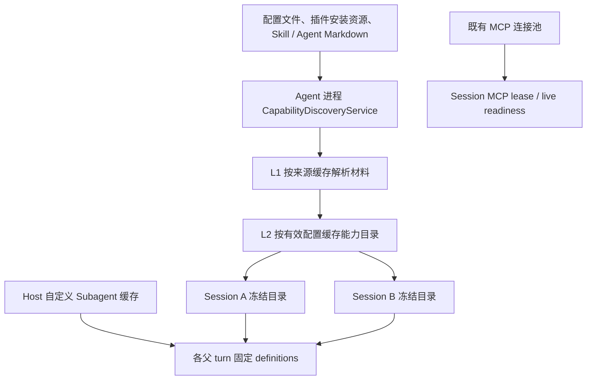
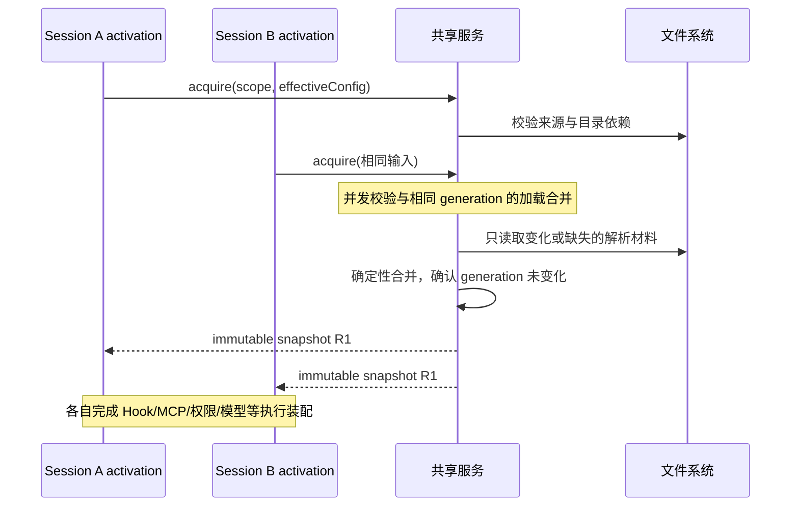

# Workspace 外置能力发现缓存

> 状态：设计草案，2026-10-09；未实现、未完成性能验收。本文给出推荐决策，不把候选测试记作已覆盖。
> 范围：同一 Agent 进程内，新建／冷恢复 session 对外置配置发现、读取和解析结果的复用。
> 改动层级：option-source、persistence（仅内存缓存）、recovery。运行时执行状态和消息交付协议保持原有归属。

## 1. 目标与现状

目标是同一 workspace 的 Session A 已加载能力后，Session B 不再重复读取未变化的 Skill、插件 manifest、插件 Agent Markdown 和配置正文，也不重复解析这些内容。仍允许必要的文件元数据校验，不承诺命中时零文件系统操作。

当前 `createZCodeApp()` 每次创建 App 都调用 `createConfig()`、`resolveStartupPlugins()`、`loadPluginAgentTemplates()`，并创建独立 `NodeSkillAdapter`。`ensureContextInitialized()` 把发现结果存入本 Runtime；这不能为另一个 Runtime 提供解析缓存。

已有能力应复用，不另建 owner：

| 现有事实                                 | 当前 owner                                    | 本设计处理                                    |
| ---------------------------------------- | --------------------------------------------- | --------------------------------------------- |
| 用户／项目 Subagent 解析快照             | Local Host `createSubagentRuntimeConfigCache` | 保留；本地初始化及新父 turn 继续读 Host 快照  |
| Skill／插件引用目录                      | `AgentRuntime`／session App                   | 保留冻结目录；新 Runtime 从共享材料构建新快照 |
| MCP live 连接和工具列表                  | 现有 MCP adapter／connection pool             | 保留默认 session 隔离与显式 workspace 隔离    |
| 插件安装文件、配置文件、Markdown         | 文件系统及现有配置写入口                      | 仍是权威源；缓存不是新持久化源                |
| Provider Registry、账号、凭据、Hook 信任 | 各自现有 owner                                | 获取执行事实时继续读取，不从能力缓存恢复      |

相关事实文档：[Skill 目录生命周期](ui/conversation-skill-catalog-lifecycle.md)、[Subagent 按父上下文刷新](subagent-runtime-refresh.md)、[Workspace 插件](plugins/workspace-level-plugin-architecture.md)、[冷恢复](v4-refactor/17-cold-resume-runtime-activation.md)。

## 2. 推荐边界

1. 第一阶段只有进程内缓存。Agent 重启后重新构建；磁盘 `plugins/cache` 继续只表达已安装资源，不作为解析缓存。
2. 缓存命中与未命中必须生成同等的能力、优先级、命名空间、诊断和禁用规则。优化重复工作，不扩大可执行能力。
3. 新建、冷恢复、fork 的 App 可复用共享解析材料；已初始化的 session 继续持有自己的不可变目录，不热更新。
4. 自定义 Subagent 保持现有“初始化／新父 turn 读取 Host，轮内固定”的独立规则，不能被统一冻结到 session 生命周期。插件 Agent 只缓存原始模板，模型覆盖每个父上下文按既有规则重新合并。
5. 本设计不改变 `SessionStart` 执行时机，也不缓存 Hook 输出、执行结果或“已运行”标志。浏览历史是否触发执行属于另一项生命周期决策。
6. 不改变 MCP 工具声明等待、live readiness、权限、sampling、elicitation 或 App ownership。规划中的 [MCP tool catalog cache](mcp-async-tool-catalog-cache.md) 是独立优化，不作为已实现依赖。

## 3. 单一 owner 与两级缓存

bootstrap 在 `app-server` 启动时创建一个 `CapabilityDiscoveryService`，通过依赖注入供各 App 使用；独立 CLI 在自己的进程创建同一实现。资源不得放到模块全局 singleton，以免测试、嵌入调用和不同配置源串用。

adapter 负责文件 I/O、解析缓存、watcher、generation 和并发调度；bootstrap 负责配置层合并、依赖装配及每次 activation 的最终投影；core 只消费严格类型的不可变结果，不导入 adapter 具体实现。名称是拟定契约，不表示已有 API。

插件 seed、离线配置迁移、安装事务等有副作用的准备工作仍由原 owner 完成；它们发布成功后的资源 revision 才能进入缓存。不得直接给整个 `createConfig()` 或 `createZCodeApp()` 加 memoization，把迁移、存储打开和 session 装配一起跳过。



| 层级             | 保存内容                                                                                     | 不保存的内容                                                                                  |
| ---------------- | -------------------------------------------------------------------------------------------- | --------------------------------------------------------------------------------------------- |
| L1 来源解析      | config AST／校验结果、manifest 与组件声明、Skill 元数据、插件 Agent 模板、来源诊断与依赖清单 | client、进程句柄、会话历史、模型对象、Hook 执行、凭据服务查询结果                             |
| L2 有效目录      | 按配置合并后的插件身份、Skill catalog、插件 Agent 模板索引、MCP／Hook 配置声明模板           | 插值后的会话专属路径、broker token、当前 OAuth header、信任批准、最终模型可用性、工具执行状态 |
| Session／父 turn | 本次 activation／父上下文最终接受的快照与现有运行态                                          | 其他 session 可写引用、共享 accepted input queue                                              |

L1 中来自配置文件的敏感字段仍按配置敏感数据处理：只在内存使用，不持久化、不写日志、不暴露调试 dump。环境变量与凭据引用尽量保留声明形式，在现有执行装配边界解析。

本地自定义 Subagent 不在 CLI 再建一份可更新解析缓存；CLI 只持有该轮 Host 返回的副本。独立 CLI／远程未接入 Host 端口时，其既有文件加载路径可接入 L1，但不得因此获得本地 Host 的逐父轮刷新语义。

## 4. Key 与来源身份

不能用 `sessionId` 建共享 key，也不能只用 cwd。定义：

```text
workspaceKey = workspaceIdentity?.trim() || workspacePath
scope = ownerInstanceEpoch + workspaceKey + remoteSessionId（远程逻辑 attachment 存在时）

L1 key = scope + sourceKind + logicalPath + canonicalPath
       + parserVersion + discoveryPolicy + sourceRevision

L2 key = scope + effectiveDiscoveryFingerprint + dependencyRevisionVector
```

`ownerInstanceEpoch` 是进程内隔离标识，重启重建。远端请求必须先验证 `workspaceIdentity`、`remoteSessionId` 和现有 Host 绑定，再选择目标 Agent owner；缺失远端身份时不得退化到本机同路径缓存。跨窗口或不同 Agent 进程不共享缓存。

`effectiveDiscoveryFingerprint` 必须覆盖：

- 用户／项目配置来源、storage root、按优先级排序的 capability roots；每个 root 的来源、scope、namespace 和 symlink 策略。
- 插件安装清单 revision、启用／禁用／suppressed 状态、版本／安装内容 revision、相关 options。
- Skill 禁用路径、功能开关、内置资源版本、影响发现的 CLI／session override。
- 影响路径解析的环境输入；若加载结果实际依赖账号或身份，则纳入该来源的 opaque revision。不能仅因当前实现碰巧不使用而遗漏后续依赖。

等价对象用确定性序列化；数组按产品规定的优先级保留顺序，不能为去重随意排序。hash 碰撞不得直接视为等价，entry 同时保存内部 canonical descriptor 校验。含敏感材料的 key 不输出日志。

L1 第一阶段按 scope 隔离，优先解决同 workspace 多 session；不跨 workspace 复用用户／插件 AST，以免在来源权限和命名空间尚未验证时扩大范围。Host 已有用户 Subagent 共享保持原样。

## 5. 获取、冻结与共享加载

推荐内部契约：

```ts
interface CapabilityDiscoveryService {
  acquire(
    input: DiscoveryInput,
    options: {
      freshness: "validate-sources" | "force-reload";
      signal?: AbortSignal;
    },
  ): Promise<Readonly<CapabilityDiscoverySnapshot>>;
  invalidate(input: DiscoveryInvalidation): void;
  dispose(): Promise<void>;
}
```

`DiscoveryInput` 只接受已验证的 scope、发现配置与来源 revision；不接收 UI 任意指定的全局缓存 key。snapshot 包含 `snapshotId`、依赖 revision、不可变材料和诊断，不包含 session 可变字段。



- 每个相同 key＋generation 只有一个共享 Promise。先登记 flight，再启动 I/O；等待并发许可后重新检查缓存及 revision。
- cache hit 仍先完成来源新鲜度校验；不会因为存在目录 entry 就跳过新增／删除文件检查。并发 activation 共用正在进行的校验，后续 activation 不以短 TTL 代替校验。
- 消费者取消只取消自己的等待，不中止其他等待者的加载。第一阶段即使所有等待者离开，也允许有界加载完成并供后续使用；owner dispose 必须取消全部 I/O，并禁止迟到发布。
- 共享结果只读。现有代码若会改写 `PluginLoadOutcome.skillRoots` 等字段，必须改为派生新对象或在 session 装配边界复制，不能把可变引用交给多个 App。wire 返回防御性副本。
- cache eviction 只删除服务持有的引用；已初始化的 session 快照不受影响。Runtime 被回收不清空同进程共享缓存。
- Skill 缓存只固定 catalog 元数据；显式 `Skill` tool 的正文读取、动态查找、截断和错误语义沿用现有规则，不顺带把正文永久冻结。

## 6. 来源校验与失效

L1 每份材料必须有显式依赖清单：已读文件、已扫描目录、候选但不存在的路径、symlink 及目标、配置祖先候选、插件安装记录和内置资源 revision。否则新增文件和目录重建无法使旧空结果失效。

### 6.1 新鲜度规则

第一阶段每次 activation 对可变来源进行异步元数据校验：目录成员清单及文件 `dev/ino/size/mtime/ctime` 等可用指纹；精度使用平台支持的最高值。保持当前发现深度和祖先边界，不能通过扩大递归扫描引入新能力。变化项才读取正文、校验和解析；无法可靠判定指纹时按变化处理。

初次读取前后校验文件指纹；扫描／构建前后校验依赖 revision。检测到变化则丢弃候选并重取。元数据无法识别的原地替换由文件事件强制 dirty／显式 force reload 补充；这不是对任意并发外部写入的文件系统事务保证。测试要覆盖同长度写入、原子替换和保留 mtime 的写入。

对受发布版本管理的不可变内置资产，可用安装完成后的资源 revision 代替逐文件校验；inline、本地开发路径、用户可编辑的市场安装目录不能仅凭版本号视为不可变。

watcher 是提前失效和减少无效构建的机制，不是唯一正确性来源。事件可合并，但收到第一个有效事件时立即增加 generation、标记 dirty，再进行异步刷新；debounce 仅用于合并 I/O，不决定快照是否过期。

### 6.2 失效矩阵

| 事件                                            | 失效范围                                                           | 已运行 Session                                                   |
| ----------------------------------------------- | ------------------------------------------------------------------ | ---------------------------------------------------------------- |
| Skill 新增／修改／删除、root 改变               | 受影响 L1；依赖它的 L2                                             | 保持冻结目录，新 Runtime 重取                                    |
| 插件安装／升级／卸载／suppressed／启停／options | 安装索引、相应模板及 L2；插件关联 Skill／Agent／MCP／Hook 一起失效 | 沿用现有插件生命周期，不借缓存强制刷新                           |
| user／project config 改变                       | 依赖该配置的 L2；发现 roots 改变时重建依赖                         | 原有运行期设置生效规则保持                                       |
| Host 自定义 Subagent 改变                       | 既有 Host watcher；CLI 不复制 owner                                | 下一个父上下文读取，当前轮／child 不变                           |
| trust revoke、账号／凭据切换                    | 既有 live 校验立即处理；涉及发现结果的 revision 同时失效           | 不允许旧缓存替代现有执行校验                                     |
| watcher 丢失／目录删除重建／远端连接换代        | 来源 unhealthy，撤销旧 entry 的可命中资格，重建监听和校验          | 不修改既有快照；错误按原运行逻辑处理                             |
| 显式刷新                                        | force reload，绕过对应范围的 L1/L2，不复用旧 flight                | Settings／workspace query 取当前值；session query 仍取本 session |
| Runtime eviction／普通 UI unsubscribe           | 不失效进程缓存                                                     | 释放该 Runtime 自身引用                                          |
| Agent shutdown                                  | 取消 flight、关闭 watcher、清空缓存                                | 由既有 runtime lifecycle 收尾                                    |

CLI 内现有插件／配置写入口在成功写入后同步 invalidate，再完成响应。Host 写配置不新增跨 Host ACK 屏障：新 activation 的来源校验和既有 watcher 负责发现变化。保持 Subagent 现有“各 Host 独立观察”的合同；不新建配置广播协议。

workspace 无 session 的目录查询和 Settings 显式刷新继续走当前权威读取路径；第一阶段不把这些入口改成直接返回 L2。后续若接入，也必须保留当前目录语义及 force reload。草稿 prewarm 的失效沿用现有管理入口，新快照不能原地替换已提升的正式 Runtime。

### 6.3 迟到结果与错误

```text
generation 7 开始读取
    → 文件变化：generation 8，旧 entry dirty
    → generation 7 完成：既不写缓存，也不返回给尚未完成 acquire 的新 Runtime
    → acquire 重取 generation 8
```

发布条件同时检查 owner epoch、entry token、完整 dependency revision vector；避免 LRU 删除重建造成 ABA。失效既影响缓存写回，也影响进行中的 waiter，不能只阻止旧结果入缓存却仍返回给 Session B。

持续修改导致无法取得稳定材料时，最多 3 次因来源变化重建；之后返回可识别的 `sources_changed_during_load`，通过已有初始化重试入口重试，不以 sleep 等待。普通 I/O 错误按当前 loader 的诊断／失败规则返回，失败 Promise 立即移除；不得长期缓存空目录或把旧成功结果静默作为当前值。

确定性解析错误可以随来源指纹缓存诊断；缺失的可选目录可以缓存空结果，但其父目录／候选路径必须纳入依赖。I/O 故障导致的降级结果不进入可复用 L2；下一次 activation 可恢复。

## 7. 并发与内存预算

建议初始内部常量，需用实际 fixture 调整，不直接作为用户设置：

| 项目                   | 初始建议        | 约束                                                              |
| ---------------------- | --------------- | ----------------------------------------------------------------- |
| 同时构建不同有效目录   | 4               | 同 key 合并；等待队列可取消                                       |
| root 扫描              | 8               | 整个 owner 共用 semaphore，不能每个 session 各开 8 个             |
| 文件读取／解析任务     | 32              | owner 全局上限，不是每 root 32；CPU 解析也分批让出事件循环        |
| 完成的 L2／L1 条目     | 64／512         | LRU；同时受字节预算约束                                           |
| 缓存保留数据           | 32 MiB 估算预算 | 不计 session 自身保留的快照，指标分别记录；单条超限可返回但不保留 |
| 排队的不同 acquire key | 64              | 超限返回结构化 busy，可在既有重试入口重试；不无限排队             |

只读小段文本和所需元数据，不缓存 Skill 完整正文、Hook stdout 或图片等资产。移除无引用的来源索引时同时释放 watcher、反向依赖和 revision bookkeeping；flight 中的来源不能被提前清理。预算达到上限时 eviction 不改变能力结果。

把当前同步文件发现改为 adapter 内异步 I/O 是实现前提；在 `Promise.all()` 外包同步 `readdirSync/readFileSync` 不能改善 CLI 事件循环阻塞。并发完成后按原 roots 优先级和稳定路径顺序合并，保持同名／同路径规则和诊断顺序。

## 8. MCP、Hook 与多端边界

- MCP 缓存只覆盖配置声明模板的发现和解析。runtime cwd、环境、broker 数据与 auth header 在原有装配边界生成，之后交给现有 pool 的完整配置 key；默认 `session` 隔离绝不自动改成 `workspace`。
- 已有 workspace MCP pool 条目可照常复用。cache hit 不等于 connected，不跳过 live tool schema、权限、sampling／elicitation 路由和 MCP App session 归属校验。
- Hook 只缓存声明；信任检查与执行仍由原 owner 负责。一个 session 执行过不意味着其他 session 可以跳过。
- 自定义 Subagent Host snapshot、插件模板、用户模型覆盖、当前 Provider Registry 分别保留来源。父轮先读取完整 Host snapshot，再合并被冻结的插件模板和当前覆盖；不把最终 profile 当成跨父轮永久缓存。
- 桌面固定 `desktop-continuous`；手机固定 `web-remote-replayable`。两者访问同一已有 Host／Agent，缓存不放到 renderer、relay 或 desktop main，不生成新 runtime，也不持有 projection、seq、queue 或 owner lease。
- `workspacePath` 用于文件执行；隔离使用 workspaceKey。remote 请求贯穿 `workspaceIdentity`／`remoteSessionId`；断线重连不重放配置副作用。Windows 路径、大小写和 symlink 解析复用现有路径工具。
- history-first 与本缓存独立：历史读取无需 acquire；runtime 初始化可以使用缓存，但命中不能直接把 execution readiness 标为完成。初始化失败仍保留历史。

## 9. Impact Brief

### Feature Summary 与 UI Surface Matrix

模式为 planning；只形成设计和候选验证。无新增 UI、schema 持久化或用户设置；不修改模型选择、队列和 Hook 事件合同。

| 用户场景／入口          | 共享实现                                 | 展示／草稿与默认来源                               | 校验与提交                            | 权威 owner／落点                      | 模式／隔离                                 |
| ----------------------- | ---------------------------------------- | -------------------------------------------------- | ------------------------------------- | ------------------------------------- | ------------------------------------------ |
| 打开历史 `SessionPane`  | activation → `createZCodeApp`            | 历史 projection；草稿仍在 renderer                 | 原 runtime readiness；原 send command | CLI Runtime、持久 transcript          | desktop continuous／mobile replayable 不变 |
| `/`、`$` Skill Picker   | `useSkills` → `getSkillReferenceCatalog` | 有 session 取冻结目录，无 session 取当前 workspace | 原查询与 canonical mention            | Runtime 或文件系统；不保存新 UI cache | 旧 scope 请求不得回填新 scope              |
| `@` 插件 Picker         | plugin reference catalog                 | 当前 session 冻结身份                              | 原引用校验与输入提交                  | session App catalog／transcript       | 不扩展插件启用状态                         |
| Skill／插件设置页       | Skills／Plugins service                  | 磁盘当前状态与页面草稿                             | 原安装／启停／刷新入口                | 文件和安装记录                        | 设置页刷新不热更新正式 session             |
| Subagent 设置／父轮启动 | Host runtime config、插件模板            | 表单 draft；父轮最新 Host snapshot                 | 原保存／模型可用性／launch            | Markdown、state、父轮 definitions     | 当前 child 模型不变                        |
| MCP 设置／工具执行      | MCP config、现有 connection pool         | live 状态；无 cache-connected 状态                 | 原 connect／auth／permission／call    | live adapter／原配置文件              | 保留 session isolation 和可信路由          |

### Shared And Divergent Behavior

共享的是 adapter 解析和确定性目录合并。各 UI 继续拥有原草稿，各域继续执行原校验与提交；用户／项目配置仍决定默认和覆盖。持久化不变；恢复只更换 Runtime 使用的材料来源。Skill／插件按 session 固定，Subagent 按父上下文固定，MCP 状态实时，不能统一成一种刷新规则。

### Feature Relationships、State Owners And Commit Sinks

| 等级           | 来源 → 语义边 → 目标                             | 原因／证据                                                                          |
| -------------- | ------------------------------------------------ | ----------------------------------------------------------------------------------- |
| must-inspect   | bootstrap → 装配 → discovery service             | `createZCodeApp`、`resolveStartupPlugins`、`NodeSkillAdapter`                       |
| must-inspect   | cache snapshot → 冻结材料 → Runtime catalog      | `ensureContextInitialized`、`getSkillReferenceCatalog`、`getPluginReferenceCatalog` |
| must-inspect   | Host Subagents → 提供定义 → 新父上下文           | `createSubagentRuntimeConfigCache`、`subagent-runtime-refresh.md`                   |
| should-inspect | 设置／安装写入口 → 使来源变化 → cache validation | `createSkillsService`、workspace plugin 配置与安装记录                              |
| conditional    | remote attachment → 选择 owner → scope           | 远程 identity 与当前 logical session 绑定                                           |
| invariant-only | cached MCP 声明 → 装配 → pool／live client       | `createMcpConnectionPool`，不共享未授权 live 状态                                   |
| invariant-only | cache → 不拥有 → CommandInbox／projection        | 三篇 remote 当前事实文档及 conversation protocol                                    |
| evidence-only  | 既有单测 → 验证基线 → 新测试                     | 下节列出的测试只证明已有语义，不证明缓存已实现                                      |

L1/L2 的 owner 是新 adapter 服务；权威输入来自文件／配置 owner；唯一缓存 mutation 是 acquire 发布、invalidate 和 dispose。session 安装快照后不再由缓存反向写入。Host Subagent cache 和 MCP pool 不迁移 owner。

### Codegraph Evidence

已使用 codegraph，以直接调用方和一跳 owner 为主要范围（分析目标深度 2）。工具未提供严格 depth 参数，因此不宣称进行了完整两层可达性枚举；静态同名关系只作导航，结论以本轮源码和事实文档为准。

| Seed                               | 直接调用方／关键链路                          | 既有测试证据                                                                    |
| ---------------------------------- | --------------------------------------------- | ------------------------------------------------------------------------------- |
| `resolveStartupPlugins`            | `createZCodeApp`、协议 MCP 列表               | bootstrap `plugins.test.ts`、`visualize-skill-gate.test.ts`                     |
| `createZCodeApp`                   | protocol entrypoint、独立／嵌入式调用         | bootstrap `mcp-project-config.test.ts`、`provider-registry-app-runtime.test.ts` |
| `getSkillReferenceCatalog`         | protocol server、UI `useSkills`               | bootstrap `skill-reference-catalog.test.ts`                                     |
| `getPluginReferenceCatalog`        | protocol server、MCP App notification         | bootstrap `plugin-reference-protocol.test.ts`                                   |
| `createSubagentRuntimeConfigCache` | `createSubagentsService` → service collection | services `subagentRuntimeConfig.test.ts`、watcher tests                         |
| `createMcpConnectionPool`          | MCP adapter factory → protocol entrypoint     | adapters `mcp-connection-pool.test.ts`、appConnections tests                    |

### Graph Drift Candidates 与 Graph Delta

- 新 cache owner 尚不存在；拟新增 `capability.workspace-capability-discovery-cache`、`state.capability-discovery-cache` 和 bootstrap injection service，再连到已有 `state.session-skill-catalog`、`state.plugin-reference-session-catalog`。
- 既有 `capability.subagents` 应补充按父上下文刷新及 Host cache 文档关系；属于待核对的 graph-drift-candidate。
- graph 中 tool catalog cache 节点可能描述规划，不能推断已有运行时接线。
- 本轮只记录 proposed delta；正式语义图、conversation catalog 和 coverage matrix 已有相邻工作，且本设计尚未批准实施，不将拟议节点或候选用例登记为现有行为。

## 10. 决策与验证交接

### Clarification Log、Boundary Decisions、Unresolved Questions

| 决策                                                    | 来源／状态           | 含义                             |
| ------------------------------------------------------- | -------------------- | -------------------------------- |
| 设计同 workspace 多 session 缓存                        | 用户明确要求         | 设计授权，不包含运行时代码实施   |
| session catalog 冻结、Subagent 按父轮更新、MCP 默认隔离 | 现有合同，accepted   | 缓存必须保持                     |
| 进程内两级缓存、metadata validation、全局并发上限       | 本文推荐，待设计评审 | 具体数值可随基准调整             |
| 磁盘持久化／跨进程共享／MCP tool advertisement cache    | 本期 pruned          | 独立协议与失效成本，不是本期目标 |

没有阻止产出本设计的待答问题。若要求“Agent 进程重启也不再发现”或“缓存命中完全不做文件系统操作”，必须另行修改第一期范围和新鲜度合同，不能在实现中静默放宽。

### Domain Scope、Concept Map 与 Dimensions

主域为能力发现、session 生命周期、配置权威／持久化、多端身份。关键概念是 source revision、有效配置、冻结快照、live 执行事实，分别对应来源、缓存、Runtime 和现有执行 owner。

| 维度     | 代表值                                                    | 高风险交叉                     |
| -------- | --------------------------------------------------------- | ------------------------------ |
| 生命周期 | 首次 miss、同进程 hit、Runtime eviction、进程 restart     | eviction × frozen snapshot     |
| 竞争     | 相同 key、不同 key、取消、失效中加载、dispose             | invalidation × late completion |
| 配置     | 等价／不同 override、启停、插件更新、信任变化             | config identity × reuse        |
| 文件     | 新增、修改、删除、rename、symlink、权限错误、watcher loss | source health × freshness      |
| 执行环境 | local、SSH／WSL／Docker、相同 path 不同 identity          | remote scope × cache key       |
| 客户端   | desktop continuous、mobile replayable、双端同时访问       | delivery × single owner        |

### Candidate Combinations 与 Accepted Cases

以下 C01–C13 是推荐实施用例，状态为 `undefined`（等待本设计评审，并非产品语义未知）；既有冻结／隔离不变量为 accepted，但其新增缓存证据均为 planned。未执行新的单测／E2E，不宣称 covered。

| ID  | Setup → Action                                                    | 必须断言的 guard／effect                                                   | 证据层／E2E 状态                              |
| --- | ----------------------------------------------------------------- | -------------------------------------------------------------------------- | --------------------------------------------- |
| C01 | 固定 workspace，A 完成 → 冷建 B                                   | 不变文件正文读取和解析次数为 0；允许 metadata 校验；结果与未缓存路径相同   | adapter + bootstrap，planned                  |
| C02 | 空缓存，同时创建 10 个 session                                    | 每个源／generation 最多一次解析；稳定排序；全局并发峰值不越界              | controlled Promise + I/O counters，planned    |
| C03 | A/B 共用 flight → 取消 A                                          | B 成功；A 不接收结果；dispose 后所有迟到结果不发布                         | adapter，planned                              |
| C04 | 暂停旧读取 → 修改文件／配置 → 释放                                | 旧 generation 不写回也不交给新 Runtime；不会 ABA 命中                      | adapter + bootstrap，planned                  |
| C05 | 热 A → 安装／禁用 Skill 或插件 → 新 B                             | A catalog 固定；B 最新；Settings 当前；draft prewarm 沿用既有失效          | Desktop UI + Agent snapshot／文件，planned    |
| C06 | 同 workspace 不同 roots／options／override；不同 identity 同 path | 不误命中；同名不同来源和 symlink 策略保留                                  | adapter/protocol，planned                     |
| C07 | Host 自定义 Agent 与插件模板 → 改模型覆盖 → 新父 turn             | 复用模板解析；新轮使用新覆盖；旧轮／child 不变                             | services + core + provider fixture，planned   |
| C08 | 首次文件 EACCES／不存在 → 修复／创建                              | 不缓存失败空结果；新增 root 被发现；下一 acquire 恢复                      | real temp filesystem，planned                 |
| C09 | watcher 丢失、root 原子替换、同长改写保留 mtime                   | 校验发现依赖变化或走强制重读，不沿用不可信 cache                           | macOS/Windows/Linux fixture，planned          |
| C10 | Runtime eviction、缓存 LRU、超大 entry、进程 restart              | eviction 不影响已接受快照；超大项可用不保留；进程重启 miss                 | adapter + process harness，planned            |
| C11 | 两 session 同 MCP 配置，分别 session/workspace isolation          | session 隔离不合并；workspace 可按既有规则复用；cache hit 不伪造 connected | MCP pool + auth/elicitation/App 回归，planned |
| C12 | 桌面／手机同时冷订阅，同 path 的不同 remote identity              | 同 owner 可共享材料；跨身份不共享；continuous/replayable 恢复边界不变      | protocol + remote fixture，planned            |
| C13 | 缓存加载慢／失败，与 history-first 同时运行                       | 历史仍可读；readiness 不提前；重试单飞；不制造新输入队列                   | gateway + Desktop E2E，planned                |

剪枝：主题／语言／所有模型不全排列，因无 UI 和模型选择变化，复用一次窄屏／双端入口代表；不枚举所有 MCP 工具，只选普通工具、auth、elicitation、sampling／App 路由的高风险代表。Hook 时间调整与磁盘缓存为独立功能；本期只断言 Hook 不因 hit/miss 少执行或重复执行。

### Matrix Backfill 与 E2E Handoff

设计确认并进入实现前，将 C05/C12/C13 回填 conversation case catalog 与 coverage matrix；C07 回填 Subagent refresh 验证矩阵；新 cache 核心用例写入 adapter/bootstrap 测试。复用现有 S08、MCP pool、Subagent watcher、cold resume 测试，不覆盖或替换相邻 history-first 用例编号。

E2E 先进入 manual-review/pending。fixture 使用临时目录、受控插件／Skill 文件、固定 provider replay；通过 latch／Promise 控制 load/invalidate 顺序，不用 sleep 猜事件完成。Docker 先跑 isolated 单例，验证后再加入 conversation/plugins preset。未连接真实手机／SSH／WSL／Docker 时明确保留待补项。

## 11. 度量、实施顺序与回退

每次 activation 聚合一次 `capability.discovery.completed`：hit/miss/shared-flight、validate/read/parse/merge 各阶段耗时、正文读取数、解析数、候选重建次数、entry 数／估算 bytes／并发峰值。字段不含文件内容、敏感 key 或凭据。高频 lookup 只用 debug；失效计数聚合，不逐文件写生产 info。

基准同时覆盖全新进程首个 session、同进程第二个 session、10 个并发 session、文件变更、Runtime eviction 后重建。记录 runtime-ready 与 history-first-frame 两种耗时，另记首轮 MCP wait 和 Hook 时间，不能把它们算作配置缓存收益。先以 C01/C02 的工作量断言验收，再比较同机多次 p50/p95 和事件循环延迟；不提前承诺具体毫秒数。

实施顺序：

1. 建立阶段计时及可控 loader 测试；把共享发现路径改成真正异步 I/O，保持顺序和能力合同。
2. 在现有 adapter 内引入 L1、来源校验、共享加载、generation、容量管理；先覆盖配置／插件／Skill／插件 Agent，保留原公共调用路径。
3. bootstrap 注入进程 owner，接入 L2 和 session 不可变装配；接通写入口 invalidation，完成新旧结果等价测试。
4. 跑 C01–C13 与相关回归，在实际构建启动的 dev／production CLI 上测量；首屏与初始化分别报告。

不做新的缓存开关 UI。开发验证可通过注入无缓存实现做等价对照；生产回退撤回 bootstrap 缓存装配，继续使用同一异步 loader。两条路径不得维护不同发现规则。

验证门禁：实现前跑架构检查并取相关模块 context；代码实现按 spec 先写测试。实现后执行 root typecheck/lint、CLI typecheck/lint、受影响 adapter/core/bootstrap/services 测试以及涉及交互的 E2E。本轮仅提交设计文档，检查结果在交付说明中记录，不把设计检查当成实现验收。
